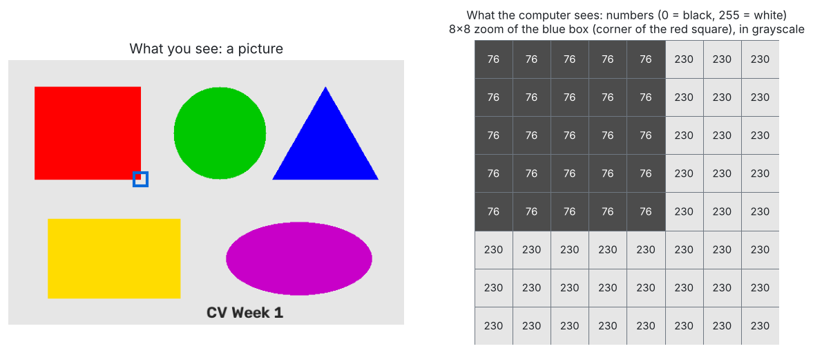
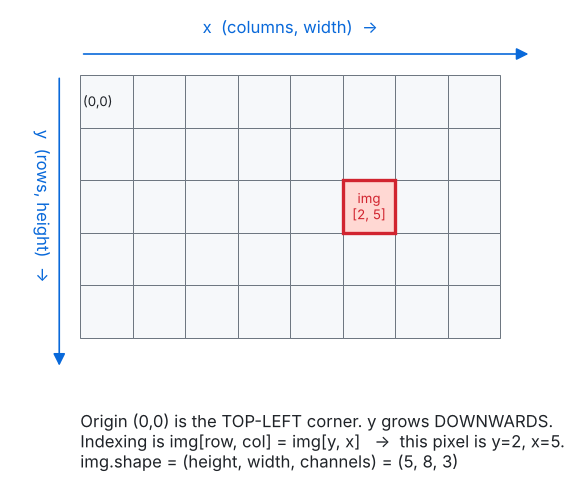
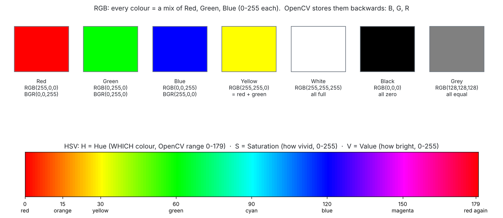
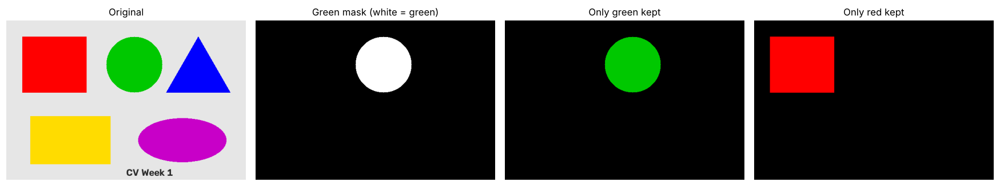

# Day 1 · Introduction to Computer Vision

**Lecture covers:** What is CV? · Images as data · Colour spaces · Transformations (overview) · Filtering (intro) · Applications · Mini-project: Image Viewer

**Code for today:** `code/day1_01` → `day1_04`

---

## 1. What is Computer Vision?

> **Computer Vision (CV)** is the part of AI that lets computers *see*: take in pictures or video and work out what's in them.

Your eyes just see a cat. A computer receives **millions of numbers** and has to work out from those numbers that there's a cat. CV is the set of tricks for doing that.

**Applications the lecture lists (learn these for the eval):**

| Area | Example |
|------|---------|
| Self-driving cars | Detect lanes, cars, pedestrians, traffic signs |
| Medical imaging | Find tumours in X-rays/MRI scans |
| Surveillance | Spot people or unusual activity on CCTV |
| Augmented Reality (AR) | Snapchat filters, Pokémon GO (stick graphics onto the real world) |
| Traffic monitoring | Count / detect cars |
| Retail | Face recognition, product tracking on shelves |
| Creative AI | Art generation |

---

## 2. Images as data



- A digital image is a **grid of tiny squares called pixels** (short for "picture elements").
- Each pixel holds **numbers that say how bright it is**.
  - **Grayscale image:** 1 number per pixel. `0 = black`, `255 = white`, in between = grey.
  - **Colour image:** 3 numbers per pixel, one each for **Red, Green, Blue**.
- Why 0–255? Each number is stored in **8 bits** (1 byte), and 8 bits can hold 2⁸ = 256 different values. The type is called **`uint8`** (unsigned 8-bit integer).
- **Resolution** = how many pixels the image has (width × height). More pixels means more detail. The lecture's photo was **5472 × 3648 ≈ 20 million pixels**.

### Shape: the most important 3 numbers

```python
img = cv2.imread('sample.jpg')
print(img.shape)        # (5472, 3648, 3)  in the lecture
#                          height  width  channels
```

| Position | Meaning | Other name |
|----------|---------|------------|
| `shape[0]` | **height**, the number of rows | `rows` |
| `shape[1]` | **width**, the number of columns | `cols` |
| `shape[2]` | **channels** (3 for colour; missing for grayscale) | |

> ⚠️ Shape is **(height, width)**, but OpenCV functions that ask for a *size* want **(width, height)**. E.g. `cv2.warpAffine(img, M, (cols, rows))`. This flip catches everyone at least once.

### Coordinates: the origin is the TOP-LEFT



- `(0, 0)` is the **top-left** corner (not the bottom-left like in school maths graphs).
- **x** goes right (columns). **y** goes **down** (rows).
- To read a pixel: **`img[y, x]`**, i.e. **row first**.

```python
print(img[50, 50])     # [172 169 161]  in the lecture → B=172, G=169, R=161 (a light grey)
```

Why grey? When all three numbers are roughly equal, the colour is grey. All 0 is black, all 255 is white.

### The BGR trap ⚠️ (very likely to be asked)

- OpenCV loads colour images in **B, G, R** order (Blue first). That's a historical choice.
- Matplotlib (and almost everything else) expects **R, G, B**.
- So you **must convert before showing with matplotlib**:

```python
img_rgb = cv2.cvtColor(img, cv2.COLOR_BGR2RGB)
plt.imshow(img_rgb)
```

- If you forget, **red and blue swap**. The lecture's *Mode: original* screenshot in the mini-project shows exactly that: the orange Pantone swatches came out **blue**, because the function passed the BGR image straight to `plt.imshow`.
- `cv2.imshow()` (OpenCV's own window) expects BGR, so it needs **no** conversion.

▶ Run `code/day1_01_load_and_inspect.py` and `code/day1_02_pixels_by_hand.py`.

---

## 3. Colour spaces

A **colour space** is just a *way of describing colour with numbers*. Same colour, different description.



### RGB (and OpenCV's BGR)
- Every colour = a mix of **Red + Green + Blue** light, each 0–255.
- Red + Green = Yellow. All full = White. All zero = Black.
- Problem: if a red ball goes into shadow, **all three** numbers change. That makes "find the red things" awkward.

### Grayscale
- One brightness number per pixel. 3× less data, and enough for edges and shapes.
- OpenCV's formula: **Gray = 0.299·R + 0.587·G + 0.114·B**. Green counts most because human eyes are most sensitive to green.
- `gray = cv2.cvtColor(img, cv2.COLOR_BGR2GRAY)` → shape becomes `(h, w)` with no channel number.

### HSV = Hue, Saturation, Value
Think of describing paint to a friend:

| Letter | Means | Plain words | OpenCV range |
|--------|-------|-------------|--------------|
| **H**ue | *Which* colour | "it's red / green / blue" (position on the colour wheel) | **0–179** (half of 0–360°, so it fits in a byte) |
| **S**aturation | How *pure / vivid* | 0 = washed-out grey, 255 = vivid | 0–255 |
| **V**alue | How *bright* | 0 = black, 255 = bright | 0–255 |

**Why HSV helps with colour detection:** the *colour* (Hue) is stored separately from the *brightness* (Value). A red ball in sunlight and in shadow keeps roughly the **same Hue**, so "find red" becomes "find Hue ≈ 0". That's why the lecture says converting between colour spaces "helps in tasks like colour detection".

```python
hsv  = cv2.cvtColor(img, cv2.COLOR_BGR2HSV)
mask = cv2.inRange(hsv, (40, 80, 50), (80, 255, 255))   # white where the pixel is green
only_green = cv2.bitwise_and(img, img, mask=mask)
```

- A **mask** is a black-and-white image: white (255) = "yes, keep this pixel", black (0) = "no".
- Red sits at **both ends** of the hue scale (0 and 179), so red needs two ranges joined with `|`.

**Lecture note:** the lecture converts to HSV and then *back* to RGB before showing it, so the "HSV Color Space" picture looks exactly like the original. To actually *see* HSV, show its H, S and V channels separately, as `day1_03_color_spaces.py` does.



▶ Run `code/day1_03_color_spaces.py`.

---

## 4. Transformations & filtering: Day 1 preview

Day 1 only *introduces* these. They're covered properly on Days 2 and 3.

- **Translation**: shifting the image. **Scaling**: resizing. **Rotation**: turning around a pivot. **Perspective**: changing the viewpoint, as if photographed from another angle.
- **Convolution** = sliding a small grid of numbers (a **kernel**) over the image. Filters made this way detect **edges, textures and patterns**, and this is the **foundation of CNNs** (Convolutional Neural Networks, the deep-learning models used for images).
- Day 1 already shows the sharpening kernel `[[0,-1,0],[-1,5,-1],[0,-1,0]]` and `cv2.Canny(img, 100, 200)` for edges.

---

## 5. Mini-project: Image Viewer

**Task:** load an image → convert to grayscale → apply edge detection → toggle between modes.

```python
def image_viewer(img_path, mode="original"):
    img = cv2.imread(img_path)
    if mode == "gray":
        img = cv2.cvtColor(img, cv2.COLOR_BGR2GRAY)
    elif mode == "edges":
        img = cv2.Canny(img, 100, 200)
    plt.imshow(img, cmap='gray' if mode != "original" else None)
    plt.title(f"Mode: {mode}")
    plt.axis('off')
    plt.show()
```

Read it line by line:
- `mode="original"` is a **default**: if you don't pass a mode, you get "original".
- Gray and edges results are **1-channel**, so they need `cmap='gray'`.
- **Bug:** in "original" mode it shows a **BGR** image with matplotlib, which swaps red and blue. Fix: `img = cv2.cvtColor(img, cv2.COLOR_BGR2RGB)` in an `else:` branch.

▶ Run `code/day1_04_mini_project_image_viewer.py`. It also has an interactive keyboard version for your own computer.

---

## ✅ Day 1: check yourself

1. What does `img.shape = (480, 640, 3)` mean? *(480 rows high, 640 columns wide, 3 colour channels)*
2. Which pixel is `img[10, 200]`? *(row 10 (y = 10), column 200 (x = 200))*
3. Why do colours look wrong in matplotlib after `cv2.imread`? *(OpenCV uses BGR, matplotlib expects RGB)*
4. Why is HSV better than RGB for detecting a coloured object? *(Hue holds the colour separately from the brightness, so shadows don't change it much)*
5. What range does Hue have in OpenCV? *(0–179)*

More questions: `practice/quiz.md`.
