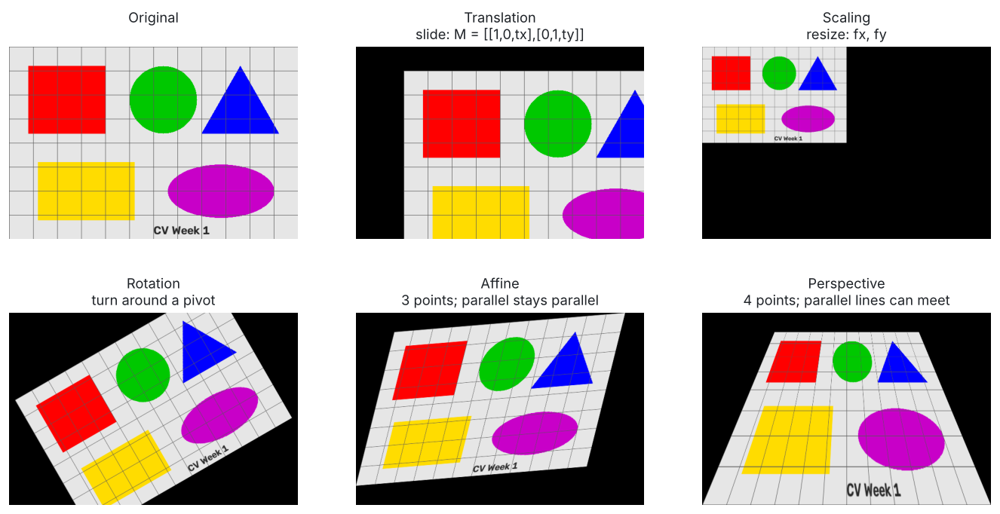
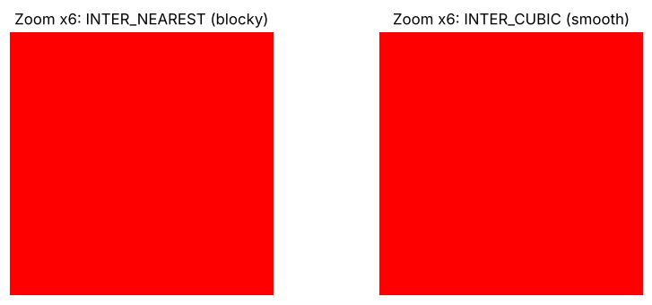
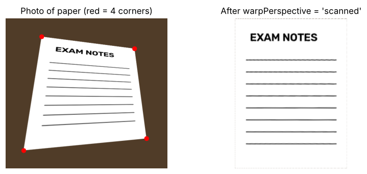
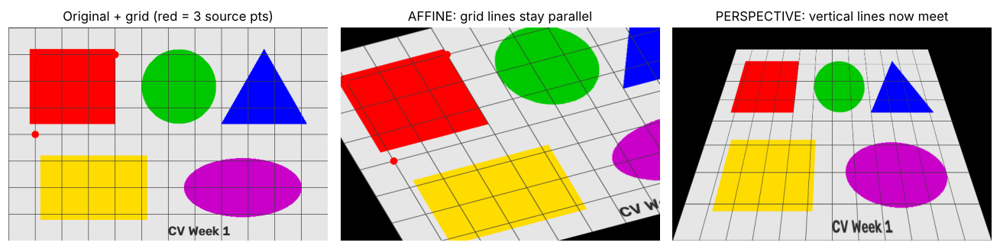
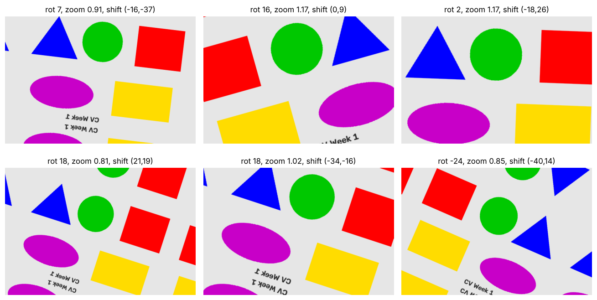

# Day 2 · Image Transformations

**Lecture covers:** Translation · Scaling (resizing) · Rotation · Affine transformations · Perspective transformations · Mini-project: Image Augmentation Tool

**Code for today:** `code/day2_01` → `day2_03`

---

## The big picture

A **transformation** moves pixels to **new positions**. The colours don't change, only *where* each pixel ends up.



Almost all of them follow the same 2-step recipe in OpenCV:

```python
M   = <make a small matrix that describes the movement>
out = cv2.warpAffine(img, M, (width, height))      # or cv2.warpPerspective for 4-point warps
```

Think of **M** as a recipe card that says, for every pixel, "you started at (x, y), now go to (x', y')". `warpAffine` follows the recipe for every pixel.

⚠️ The lecture's Day 2 snippets use `rows` and `cols` without defining them first. You need:

```python
rows, cols = img.shape[:2]     # rows = height, cols = width
```

---

## 1. Translation: sliding the picture

Shifting the image along x (right/left) and/or y (down/up).

```python
M = np.float32([[1, 0, 100],     # x' = 1·x + 0·y + 100   → move 100 px RIGHT
                [0, 1,  50]])    # y' = 0·x + 1·y +  50   → move  50 px DOWN
translated = cv2.warpAffine(img, M, (cols, rows))
```

- General form: `[[1, 0, tx], [0, 1, ty]]`. `tx` is the horizontal shift, `ty` the vertical shift.
- **Negative** values move left/up.
- The area that becomes empty is filled with **black**, and anything pushed past the edge is cut off. That's why the lecture's "Translated Image" has a black strip on the top and left.
- The `1`s keep the size the same; the `0`s mean "x doesn't affect y and vice versa".

---

## 2. Scaling: resizing

```python
scaled = cv2.resize(img, None, fx=0.5, fy=0.5, interpolation=cv2.INTER_LINEAR)
```

- `fx` = horizontal factor, `fy` = vertical factor. `0.5` = half, `2` = double.
- `None` = "I'm not giving an exact size, work it out from fx/fy". Or give the size directly: `cv2.resize(img, (300, 200))`. Remember that's **(width, height)**.
- Different fx and fy **stretch or squash** the image (the aspect ratio changes).

**Interpolation** = how to fill in pixels that didn't exist before (enlarging) or merge ones that get squeezed together (shrinking):

| Flag | How | Use it when |
|------|-----|-------------|
| `INTER_NEAREST` | Copy the nearest pixel | Fastest, blocky look |
| `INTER_LINEAR` | Average of the 4 nearest | Default, good all-rounder |
| `INTER_CUBIC` | Uses 16 nearby pixels | Smoother when **enlarging** (slower) |
| `INTER_AREA` | Averages areas | Best for **shrinking** |



---

## 3. Rotation: turning around a pivot

```python
M = cv2.getRotationMatrix2D((cols/2, rows/2), 45, 1)   # (centre, angle, scale)
rotated = cv2.warpAffine(img, M, (cols, rows))
```

| Argument | Meaning |
|----------|---------|
| `center` | The pivot point (x, y). `(cols/2, rows/2)` = the middle of the image |
| `angle` | Degrees. **Positive = anti-clockwise**, negative = clockwise |
| `scale` | `1` = same size. `0.6` = shrink while rotating, which keeps the corners inside |

- The output canvas stays the same size, so **the corners get cut off** and black triangles appear (see the lecture's "Rotated Image (45°)").
- The matrix OpenCV builds is `[[cos θ, sin θ, …], [−sin θ, cos θ, …]]`, scaled. For 45°, cos = sin ≈ 0.707.
- Shortcuts that don't crop: `cv2.rotate(img, cv2.ROTATE_90_CLOCKWISE)`. Mirror with `cv2.flip(img, 1)`.

---

## 4. Affine transformation: 3 points

> **Affine = keeps parallel lines parallel.** Straight lines stay straight, and lines that were parallel stay parallel. Squares can become slanted parallelograms, but never trapezoids.

Translation, scaling, rotation and **shear** (slanting, like italic text) are *all* affine. An affine transform is defined by **3 points before → 3 points after**:

```python
pts1 = np.float32([[50, 50], [200, 50], [50, 200]])    # 3 points in the original
pts2 = np.float32([[10, 100], [200, 50], [100, 250]])  # where those 3 should go
M = cv2.getAffineTransform(pts1, pts2)                 # → 2×3 matrix
affine = cv2.warpAffine(img, M, (cols, rows))
```

Why 3? The affine matrix has **6 unknown numbers** (2×3). Each point pair gives 2 equations (one for x, one for y), so 3 pairs give the 6 equations needed.

---

## 5. Perspective transformation: 4 points

> **Perspective maps any 4-sided shape to any other 4-sided shape.** Parallel lines can **meet**, like train tracks going into the distance. Straight lines still stay straight.

```python
pts1 = np.float32([[56,65],[368,52],[28,387],[389,390]])   # 4 corners in the photo
pts2 = np.float32([[0,0],[300,0],[0,300],[300,300]])       # where they should go
M = cv2.getPerspectiveTransform(pts1, pts2)                # → 3×3 matrix
perspective = cv2.warpPerspective(img, M, (300, 300))
```

- Needs **4 point pairs** (the 3×3 matrix has 8 free numbers, and 4 pairs × 2 = 8 equations).
- Points must be listed in the **same order** in both lists (here: top-left, top-right, bottom-left, bottom-right).
- Uses **`warpPerspective`**, not `warpAffine`.
- **Main use, document scanning:** a page photographed at an angle is a tilted 4-sided shape. Map its 4 corners to a neat rectangle and you get a flat "scan". (Apps like CamScanner and Adobe Scan do this.)



**Why the lecture's perspective output is a plain grey square:** its corner points (56,65)…(389,390) cover only a small patch in the top-left of a 5472×3648 photo, which is empty grey background. The code works, but the points weren't placed on an object. The 4 source points have to sit on the corners of the thing you want to flatten.

### Affine vs perspective (classic eval question)



| | Affine | Perspective |
|---|---|---|
| Points needed | **3** | **4** |
| Matrix size | **2×3** | **3×3** |
| Get matrix | `cv2.getAffineTransform` | `cv2.getPerspectiveTransform` |
| Apply | `cv2.warpAffine` | `cv2.warpPerspective` |
| Parallel lines | **stay parallel** | can **meet** |
| Rectangle can become | parallelogram | any 4-sided shape (e.g. trapezoid) |
| Includes | translate, scale, rotate, shear | all affine + "tilt / viewpoint change" |

▶ Run `code/day2_01_translate_scale_rotate.py` and `code/day2_02_affine_vs_perspective.py`.

---

## 6. Mini-project: Image Augmentation Tool

**What is data augmentation?** AI models learn from examples, and you rarely have enough photos. So you create **extra versions** of each one: shifted, rotated, zoomed, flipped. It's still the same cat, so the model learns that a cat is a cat **whatever its position, size or angle**. More variety means the model generalises better and overfits less.

The lecture's `transform_image(img_path, mode)` uses `if / elif` to pick one transform:

| mode | does |
|------|------|
| `"translate"` | shift 100 right, 50 down |
| `"scale"` | resize to 50% |
| `"rotate"` | 45° around the centre |
| `"perspective"` | 4-point warp to 300×300 |

`day2_03_mini_project_augmentation.py` also has a **random augmenter** (random angle, zoom, shift and flip), which is how real deep-learning pipelines do it.



---

## ✅ Day 2: check yourself

1. Write the translation matrix for "move 30 px left and 20 px down". *(`[[1,0,-30],[0,1,20]]`)*
2. What does the third argument of `getRotationMatrix2D` do? *(scale; 1 = same size)*
3. Is a positive angle clockwise or anti-clockwise? *(anti-clockwise)*
4. How many points do affine and perspective need? *(3 and 4)*
5. Which interpolation is best for shrinking? *(`INTER_AREA`)*
6. Why do corners disappear after rotation? *(the output canvas keeps the original size)*
