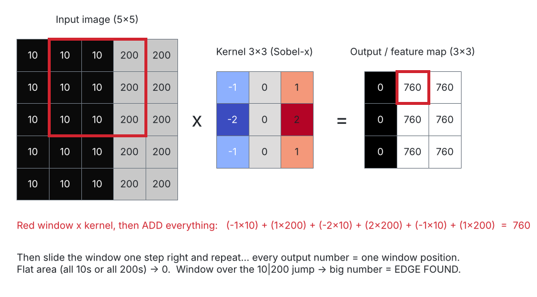
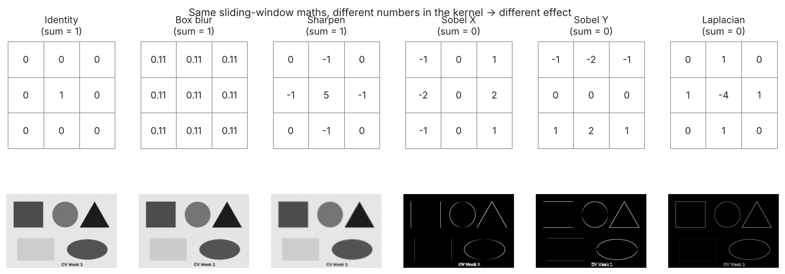
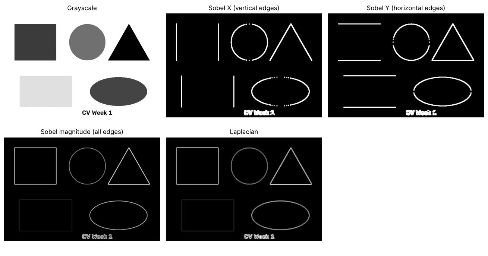
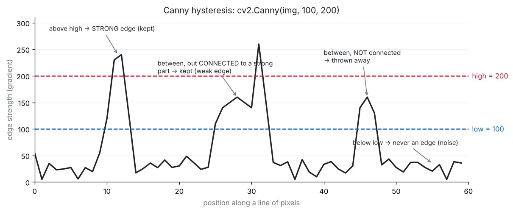
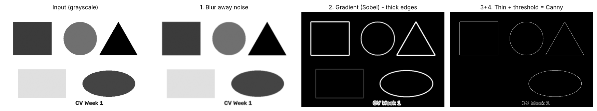
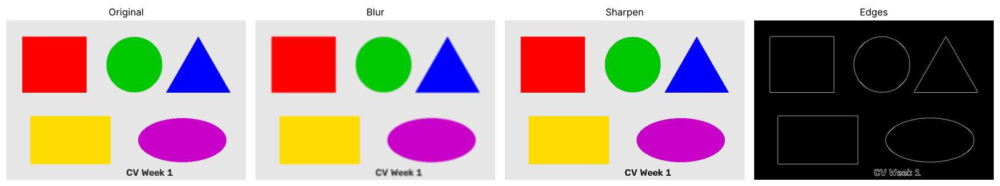
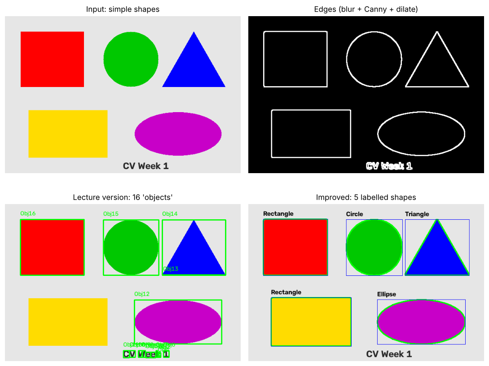

# Day 3 · Filtering & Convolutions

**Lecture covers:** Why filtering matters · Convolution basics · Common filters (blur, sharpen, edge detection) · Canny edge detection · Applications · Lab exercise · Mini-project: Edge-based object detector

**Code for today:** `code/day3_01` → `day3_05`. **Start with `day3_01_convolution_by_hand.py`**: it's the key to the whole day.

---

## 1. Why filtering matters

A **filter** changes each pixel based on **its neighbours**. Filters can:

- **Suppress** features: blur away noise or tiny details.
- **Enhance** features: sharpen, or highlight edges.
- They are the **foundation of CNNs**. A CNN is basically a stack of filters whose numbers the computer *learns by itself* instead of a human choosing them.

---

## 2. Convolution: the core idea

> **Kernel** = a small grid of numbers (usually 3×3 or 5×5).
> **Convolution** = slide the kernel over the image. At each spot, **multiply** each kernel number by the pixel under it, **add** them all up, and write that one number into the output.
> The output image is called a **feature map**: it highlights wherever the image matched the kernel's pattern.



Picture a magnifying glass with numbers written on it. You slide it across a photo one pixel at a time. At every spot you calculate one "score" for the patch underneath. Those scores form the new image.

**Worked example** (from the picture): window `[[10,10,200],[10,10,200],[10,10,200]]` × Sobel-x kernel `[[-1,0,1],[-2,0,2],[-1,0,1]]`:

```
(-1×10) + (0×10) + (1×200)
(-2×10) + (0×10) + (2×200)
(-1×10) + (0×10) + (1×200)   = -10+200 -20+400 -10+200 = 760   ← big number = EDGE
```

Over a flat area (all 10s): −10 + 10 − 20 + 20 − 10 + 10 = **0**, so no edge.

### The kernel-sum rule (easy marks)

| Kernel numbers add up to… | Effect | Examples |
|---|---|---|
| **1** | Overall brightness kept | Blur, sharpen, identity |
| **0** | Flat areas → 0 (black); only *changes* survive | Edge detectors (Sobel, Laplacian) |
| >1 / <1 | Image gets brighter / darker | |

### In OpenCV

```python
kernel = np.array([[0,-1,0],[-1,5,-1],[0,-1,0]])
sharp  = cv2.filter2D(img, -1, kernel)     # -1 = output has the same depth/type as the input
```

### Output size, padding, stride (CNN basics, often asked)

Without padding the kernel can't sit centred on border pixels, so the output **shrinks**: a 6×6 image with a 3×3 kernel gives 4×4. `cv2.filter2D` **pads** the border, so its output is the same size.

**Formula:** `output = (N − K + 2P) / S + 1`
N = input size, K = kernel size, P = padding, S = stride (how many pixels the kernel jumps each step).
Example: N = 6, K = 3, P = 0, S = 1 → (6 − 3 + 0)/1 + 1 = **4**.

**Fine print:** strictly speaking `filter2D` computes **correlation**. True convolution flips the kernel 180° first. For symmetric kernels (blur, sharpen) the results are identical. CNNs also use correlation and still call it "convolution".

▶ Run `code/day3_01_convolution_by_hand.py`. It does all of this with plain loops and proves it matches OpenCV.

---

## 3. Common filters



### Blur (smoothing): removes noise and fine detail

| Filter | Code | How it works |
|--------|------|--------------|
| **Average (box)** | `cv2.blur(img, (5,5))` | Every pixel = plain average of its 5×5 neighbourhood. Kernel is all 1/25 |
| **Gaussian** | `cv2.GaussianBlur(img, (5,5), 0)` | Weighted average: **closer neighbours count more** (bell-curve weights). Looks more natural. `0` = let OpenCV choose sigma (spread) from the kernel size |
| Median *(bonus)* | `cv2.medianBlur(img, 5)` | Takes the middle value. Best for "salt-and-pepper" dots |

- The kernel size must be **odd** (3, 5, 7…) so there is a centre pixel.
- **Bigger kernel = more blur.**
- Blurring is often done **before** edge detection so that noise isn't mistaken for edges.

### Sharpen

```python
kernel = np.array([[ 0, -1,  0],
                   [-1,  5, -1],
                   [ 0, -1,  0]])
```

"5 × me minus my 4 neighbours." In a flat area 5x − 4x = x, so nothing changes. At an edge the difference between neighbours gets **exaggerated**, so it looks crisper. The sum is 1, so brightness is kept.

### Edge detection: Sobel and Laplacian

An **edge** is a place where brightness **changes suddenly**: the outline of an object.

**Sobel** measures how fast brightness changes in one direction (the *gradient*, i.e. the slope):

```python
sobel_x = cv2.Sobel(gray, cv2.CV_64F, 1, 0, ksize=5)   # dx=1 → change left→right → VERTICAL edges
sobel_y = cv2.Sobel(gray, cv2.CV_64F, 0, 1, ksize=5)   # dy=1 → change top→bottom → HORIZONTAL edges
magnitude = np.sqrt(sobel_x**2 + sobel_y**2)           # all edges combined
```

- **Why `cv2.CV_64F`?** Dark→bright gives a positive value and bright→dark gives a **negative** one. `uint8` can't store negatives (they'd be cut to 0) and you'd lose half the edges. So compute in float, then `cv2.convertScaleAbs(...)` to take the absolute value and convert back to 0–255 for display.
- **The lecture's "Clipping input data to the valid range for imshow with RGB" warning:** it ran Sobel on the *colour* image and showed the float result (with negatives and values above 255) directly. That's why its Sobel picture looks rainbow-noisy. Fix: run Sobel on **grayscale** and use `convertScaleAbs`.

**Laplacian** looks at the *second* derivative (the change of the change) and finds edges in **all directions with one kernel** `[[0,1,0],[1,-4,1],[0,1,0]]`. It's very sensitive to noise, so blur first. `cv2.Laplacian(gray, cv2.CV_64F)`.



▶ Run `code/day3_02_common_filters.py`.

---

## 4. Canny edge detection

> "Combines gradient + thresholding. Produces clean edge maps."

The Canny algorithm has **4 steps**. Know them in order:

1. **Noise reduction**: Gaussian blur (5×5). *Fine print:* OpenCV's `cv2.Canny` function actually skips this step, which is why people usually call `cv2.GaussianBlur` themselves before Canny. For the exam, list all 4 steps.
2. **Gradient**: Sobel in x and y gives the edge strength and direction at every pixel.
3. **Non-maximum suppression**: thick edges are thinned to **1 pixel wide** by keeping only the strongest pixel across each edge.
4. **Hysteresis thresholding** with the two numbers (low = 100, high = 200):



| Edge strength | Decision |
|---|---|
| **> high** (200) | **Strong edge**: keep |
| **< low** (100) | Not an edge: discard |
| **between** | Keep **only if connected to a strong edge**, otherwise discard |

This "connected" rule is what makes Canny's lines clean and continuous instead of broken and noisy.

- Output: a **single-channel, black image with white 1-pixel lines** (values only 0 or 255).
- **Lower thresholds** give more edges (including noise and texture). **Higher thresholds** keep only strong outlines. Rule of thumb: high ≈ 2–3 × low.



**Why the lecture's Canny images look almost black:** the photo is huge (5472×3648) and soft-focused. The edges are only 1 pixel thin, so when such a big image is shrunk to fit on the page most of them disappear. Resize the image first or lower the thresholds.

▶ Run `code/day3_03_canny.py`.

---

## 5. Applications of filtering

| Area | Use |
|------|-----|
| Medical imaging | Find **tumour boundaries** (edges) |
| Document scanning | Find the page's edges and clean up/sharpen the text |
| Autonomous driving | **Lane detection** (edges of the lane markings) |

---

## 6. Lab exercise: compare filters side by side

```python
filters = {
    "blur":    cv2.blur(img, (5,5)),
    "sharpen": cv2.filter2D(img, -1, kernel),
    "edges":   cv2.Canny(img, 50, 150),
}
for name, output in filters.items():
    plt.figure()
    plt.imshow(output if name=="edges" else cv2.cvtColor(output, cv2.COLOR_BGR2RGB),
               cmap='gray' if name=="edges" else None)
    plt.title(name.capitalize())
```

Why the `if name == "edges"`? Canny returns a **1-channel** image, which can't be converted BGR→RGB and needs `cmap='gray'`. Blur and sharpen return 3-channel BGR images, which need converting.



---

## 7. Mini-project: Edge-based object detector

**Pipeline:** colour → grayscale → Canny edges → **find contours** → draw boxes and labels.

```python
gray  = cv2.cvtColor(img, cv2.COLOR_BGR2GRAY)
edges = cv2.Canny(gray, 50, 150)
contours, _ = cv2.findContours(edges, cv2.RETR_EXTERNAL, cv2.CHAIN_APPROX_SIMPLE)
for i, cnt in enumerate(contours):
    x, y, w, h = cv2.boundingRect(cnt)
    cv2.rectangle(img_contours, (x,y), (x+w,y+h), (0,255,0), 2)
    cv2.putText(img_contours, f"Obj{i+1}", (x,y-10), cv2.FONT_HERSHEY_SIMPLEX, 0.5, (0,255,0), 1)
```

| Piece | Plain meaning |
|-------|---------------|
| **Contour** | A list of points tracing the outline of one shape (like drawing around a coin with a pencil) |
| `findContours` returns | `(contours, hierarchy)`. Hierarchy says which outline is inside which. The lecture ignores it with `_` |
| `RETR_EXTERNAL` | Only the **outermost** outlines (ignore holes and inner shapes). `RETR_TREE` = all of them, with nesting |
| `CHAIN_APPROX_SIMPLE` | Store only the **corner points** of straight runs. A rectangle becomes 4 points instead of hundreds |
| `boundingRect(cnt)` | The smallest **upright box** around the contour: `x, y` = top-left corner, `w, h` = size |
| `rectangle(img, pt1, pt2, colour, thickness)` | Draws the box. `(0,255,0)` in BGR = **green** |
| `putText(img, text, position, font, scale, colour, thickness)` | Writes the label just above the box (`y-10`) |

**Why the lecture's result has green boxes all over the text and noise:** every tiny squiggle Canny finds becomes a "contour". Standard fixes (all in `day3_05_...py`):
1. **Blur first** (`GaussianBlur`) so there's less noise.
2. **Ignore small contours**: `if cv2.contourArea(cnt) < 500: continue`.
3. **Dilate** the edges to close tiny gaps so each shape is one closed outline.
4. *Bonus:* name each shape by counting corners with `cv2.approxPolyDP`: 3 = triangle, 4 = rectangle/square, many = circle.



Notice the yellow rectangle: with the lecture's thresholds (50, 150) Canny **misses it**. Yellow (grey value 205) on light grey (230) is only 25 brightness levels apart. **Edges are found on brightness, not colour**, so two different colours with similar brightness look the same to an edge detector.

▶ Run `code/day3_05_mini_project_object_detector.py`.

---

## ✅ Day 3: check yourself

1. In one sentence, what is convolution? *(Slide a small kernel over the image and, at each spot, multiply and add to get one output pixel.)*
2. Sharpen kernel sum? Sobel kernel sum? What does each mean? *(1 keeps brightness; 0 makes flat areas black)*
3. Why `cv2.CV_64F` in Sobel? *(edge values can be negative)*
4. The 4 steps of Canny? *(blur → gradient → non-max suppression → hysteresis)*
5. In `Canny(img, 100, 200)`, what happens to a pixel with strength 150? *(kept only if connected to a strong edge, i.e. one above 200)*
6. Output size for a 32×32 input, 5×5 kernel, no padding, stride 1? *((32−5)/1+1 = 28 → 28×28)*
7. What does `RETR_EXTERNAL` do? *(returns only the outermost contours)*
