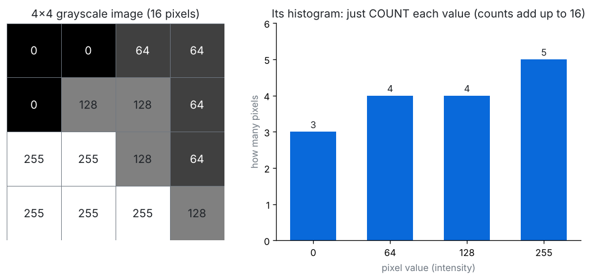
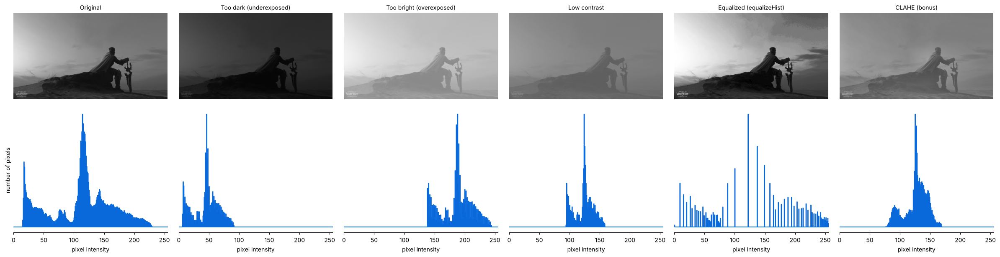
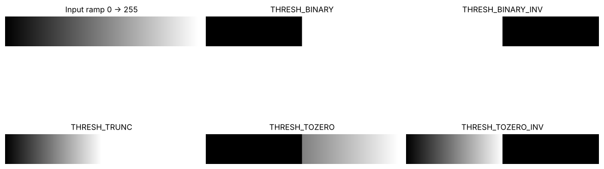
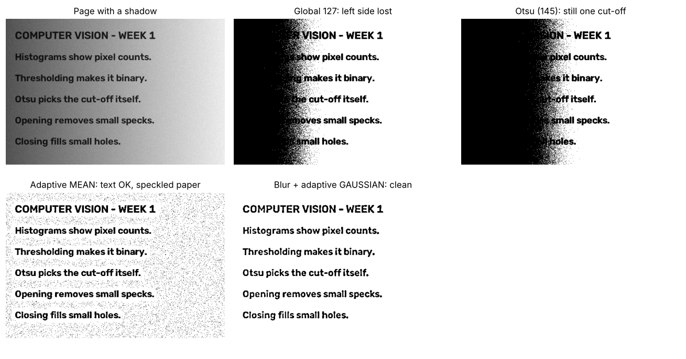
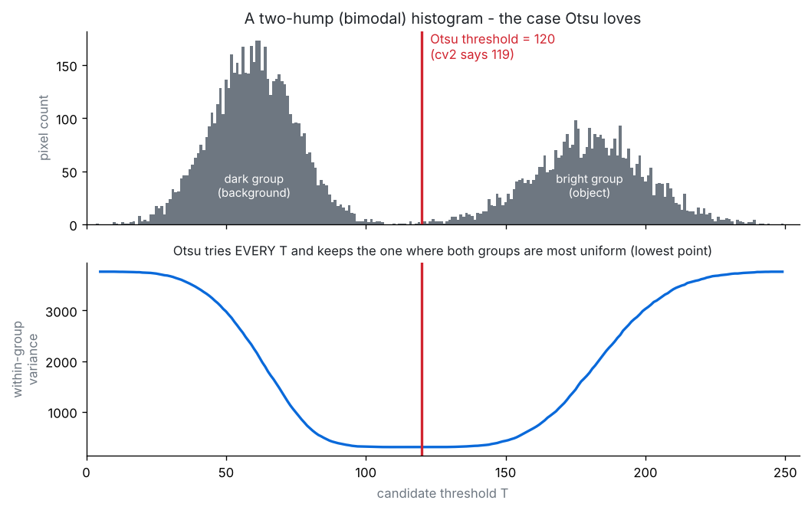
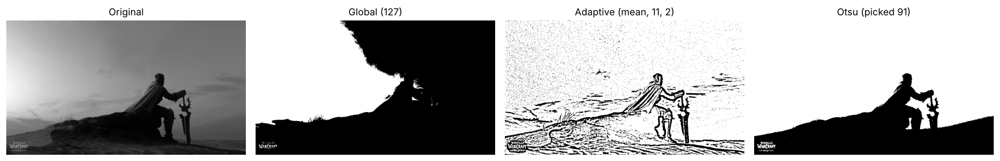
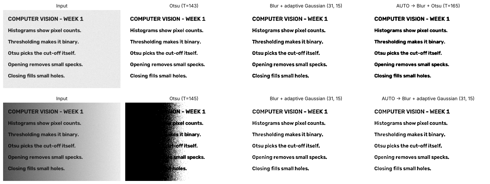

# Day 4 · Histograms & Thresholding

**Lecture covers:** Image histograms · Global thresholding · Adaptive thresholding · Otsu's method · Applications · Lab exercise · Mini-project: Document Binarizer

**Code for today:** `code/day4_01` → `day4_03`

---

## 0. Loading straight to grayscale

From Day 4 on, the lectures load images like this:

```python
img = cv2.imread('sample.jpg', 0)     # 0 = cv2.IMREAD_GRAYSCALE
```

The `0` means "give me one brightness number per pixel". The result has shape `(rows, cols)`, with no channel number. Histograms and thresholding both work on grayscale.

---

## 1. Image histograms

> A **histogram** is a bar chart that **counts pixels**. The x-axis is the brightness value (0–255) and the y-axis is how many pixels have that value.



It throws away *where* the pixels are and keeps only *how many* of each brightness there are. Think of tipping a jar of coloured sweets onto a table and sorting them into piles by colour.

```python
plt.hist(img.ravel(), 256, [0, 256])          # lecture: matplotlib counts for you
hist = cv2.calcHist([img], [0], None, [256], [0, 256])   # OpenCV: returns the counts
#                   images channel mask  bins   range
```

- `img.ravel()` flattens the 2-D grid into one long list of numbers.
- `256` = number of bars (**bins**); `[0, 256]` = the range covered (the end is excluded).
- `calcHist` arguments are all **lists**, so you can pass several images or channels. Channel `[0]` is the only channel of a grayscale image (for colour: 0 = B, 1 = G, 2 = R).
- The **mask** argument lets you count only part of the image (`None` = the whole thing).

### Reading a histogram (exam favourite)



| Histogram looks like… | Image is… |
|---|---|
| Hump on the **left** | **Dark / underexposed** |
| Hump on the **right** | **Bright / overexposed** |
| **Narrow** hump in the middle | **Low contrast** (flat, greyish) |
| Spread across 0–255 | Good contrast |
| **Two separate humps** (bimodal) | Object + background → **perfect for thresholding** |

**Histogram equalization** (`cv2.equalizeHist(img)`) stretches a squashed histogram across the full 0–255 range to boost contrast. The Key Concepts sheet calls histograms "the basis for enhancement techniques like histogram equalization". **CLAHE** is a smarter version that equalizes small tiles separately.

▶ Run `code/day4_01_histograms.py`.

---

## 2. Thresholding: making an image binary

> **Thresholding** turns a grayscale image into a **binary** (black-and-white) image by asking every pixel one question: *"are you brighter than T?"* Yes → 255 (white). No → 0 (black).

```python
ret, thresh = cv2.threshold(img, 127, 255, cv2.THRESH_BINARY)
#  ↑ the T used    src  T    value-if-yes   type
```

- **Returns 2 things:** the threshold actually used (`ret`) and the image. The lecture writes `_, thresh_global = ...` because `ret` is just 127 here, which it already knows. With Otsu, `ret` is the useful answer.
- **Why binary?** It separates **foreground from background**, which is the first step for contours (Day 6), morphology (Day 5), OCR and measuring objects.

### The 5 threshold types



| Type | Pixel > T | Pixel ≤ T |
|---|---|---|
| `THRESH_BINARY` | 255 | 0 |
| `THRESH_BINARY_INV` | 0 | 255 (inverted, so **dark objects become white**) |
| `THRESH_TRUNC` | T (capped) | unchanged |
| `THRESH_TOZERO` | unchanged | 0 |
| `THRESH_TOZERO_INV` | 0 | unchanged |

---

## 3. Global thresholding

**One** fixed cut-off for the **whole** image: `cv2.threshold(img, 127, 255, cv2.THRESH_BINARY)`.

- Simple and fast.
- **Fails when the lighting is uneven.** A shadow makes one side darker, and no single number works for both sides.

## 4. Adaptive thresholding

The threshold is **calculated separately for small regions**, so each neighbourhood gets its own cut-off. Use it for images with varying illumination.

```python
thresh = cv2.adaptiveThreshold(img, 255,
                               cv2.ADAPTIVE_THRESH_MEAN_C,   # how to compute T locally
                               cv2.THRESH_BINARY,
                               11,     # blockSize: neighbourhood size (ODD, > 1)
                               2)      # C: constant subtracted from the local mean
```

| Method | Local threshold T = |
|---|---|
| `ADAPTIVE_THRESH_MEAN_C` | plain **average** of the blockSize × blockSize neighbourhood − C |
| `ADAPTIVE_THRESH_GAUSSIAN_C` | **weighted** average (nearer pixels count more) − C |

Notice that `adaptiveThreshold` returns **only the image**, unlike `threshold`, which returns `(ret, image)`.



**Why the lecture's adaptive result looks like a pencil sketch:** `blockSize = 11` is tiny compared with a 5472×3648 photo. In big flat areas each 11×11 block is almost uniform, so tiny noise decides black or white. Blurring first, using a bigger `blockSize` or using a bigger `C` all fix it (see the last panel above).

## 5. Otsu's method

> **Otsu automatically calculates the optimal threshold value.** It tries every possible T and keeps the one that makes the two groups (below T and above T) as **uniform as possible inside themselves**, i.e. it **minimizes intra-class (within-group) variance**.

```python
T, thresh_otsu = cv2.threshold(img, 0, 255, cv2.THRESH_BINARY + cv2.THRESH_OTSU)
print(T)        # the threshold Otsu picked; the 0 you passed is ignored
```



- Works best with a **bimodal** (two-hump) histogram: object and background.
- It is still **one global** threshold, so it fails under uneven lighting just like a fixed 127.
- You can combine flags: `THRESH_BINARY_INV + THRESH_OTSU`.
- Blurring first (`GaussianBlur`) usually gives Otsu a cleaner result.

### Lab exercise: compare all three



On this photo Otsu picked T = 91. That separates the dark knight and rock from the bright sky better than the fixed 127.

| | Global | Adaptive | Otsu |
|---|---|---|---|
| Threshold | one, chosen by you | one **per neighbourhood** | one, chosen **automatically** |
| Uneven lighting | ❌ | ✅ | ❌ |
| Need to guess T? | yes | blockSize and C | no |
| Best for | controlled lighting | documents, shadows | bimodal histograms |

▶ Run `code/day4_02_thresholding.py`.

---

## 6. Applications

| Area | Use |
|---|---|
| Document scanning | **Binarization**: text vs paper |
| Medical imaging | **Tumour segmentation** (separate the region from the tissue) |
| Industrial inspection | **Defect detection** (scratches, spots) |
| Object detection | Separate foreground from background before contours |

## 7. Mini-project: Document Binarizer

**Task:** a scanned document goes in, and a clean binary version comes out using Otsu.

```python
doc = cv2.imread('sample.jpg', 0)
_, doc_bin = cv2.threshold(doc, 0, 255, cv2.THRESH_BINARY + cv2.THRESH_OTSU)
```

The lecture ran it on the Pantone *photo*, so the result was blotchy. On a real page, Otsu is excellent when the lighting is even. With a shadow you need adaptive thresholding. `day4_03` includes an **auto** mode that checks whether the lighting is uneven and picks the right method.



▶ Run `code/day4_03_mini_project_document_binarizer.py`.

---

## ✅ Day 4: check yourself

1. What does the y-axis of a histogram show? *(the number of pixels with each intensity)*
2. Histogram bunched on the left means? *(a dark / underexposed image)*
3. What does `cv2.threshold` return? *(a tuple: (threshold used, binary image))*
4. When does global thresholding fail, and what fixes it? *(uneven lighting; adaptive thresholding)*
5. What does Otsu minimise? *(intra-class (within-group) variance)*
6. In Otsu, why pass 0 as the threshold? *(it's ignored; Otsu computes T itself)*
7. Why must `blockSize` be odd? *(the neighbourhood needs a centre pixel)*
