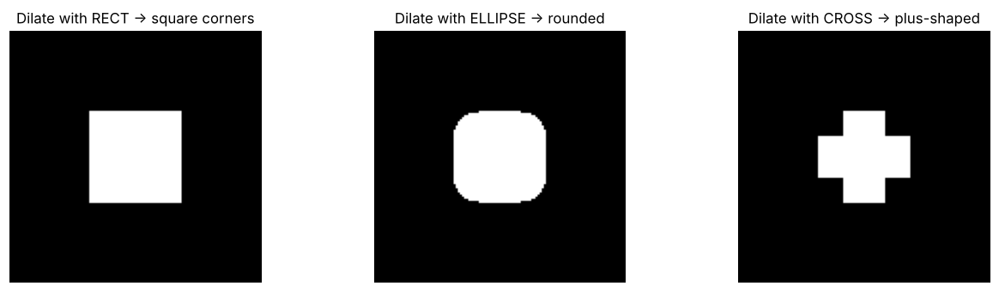
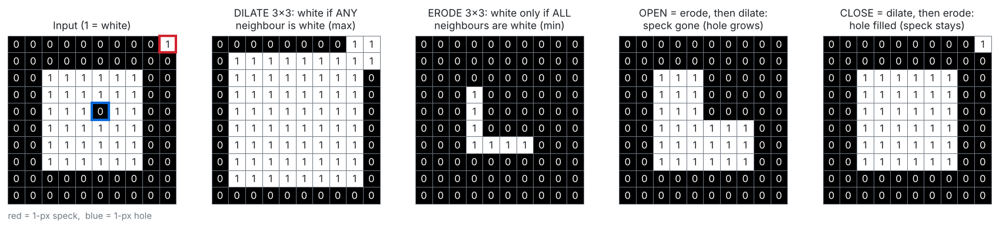
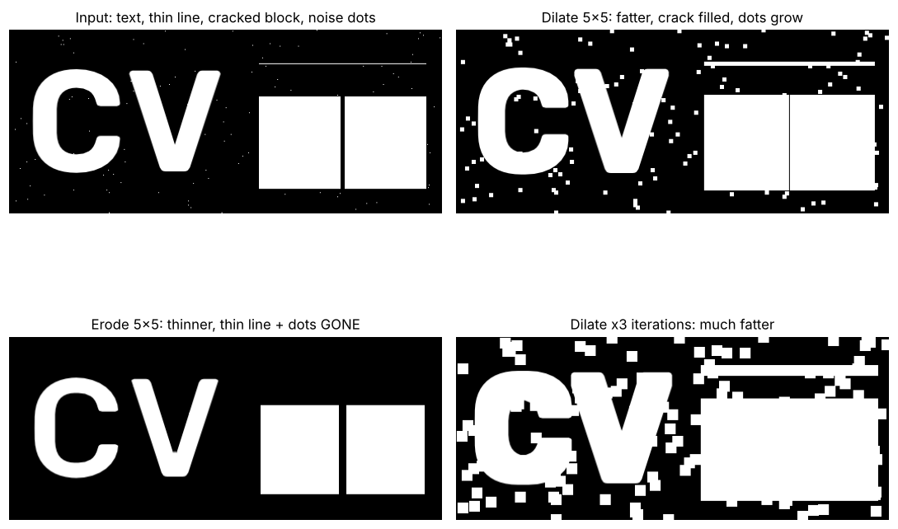
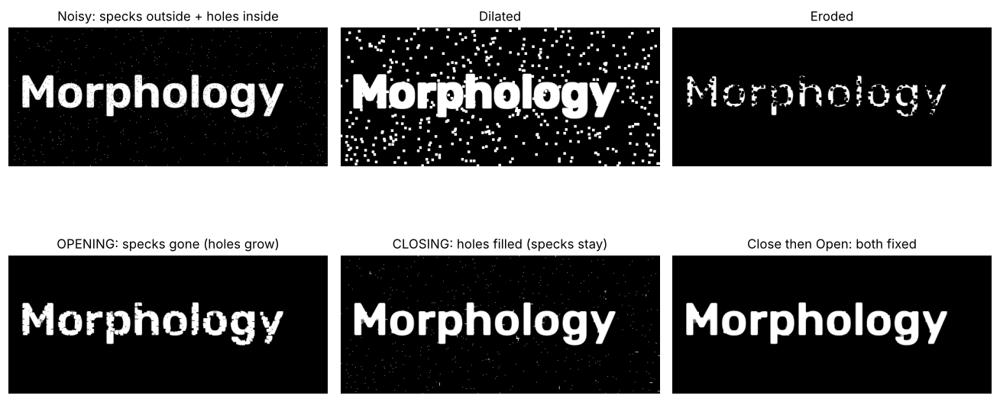
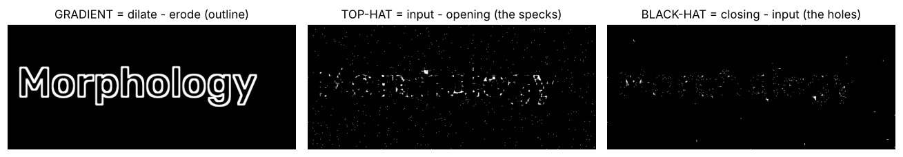
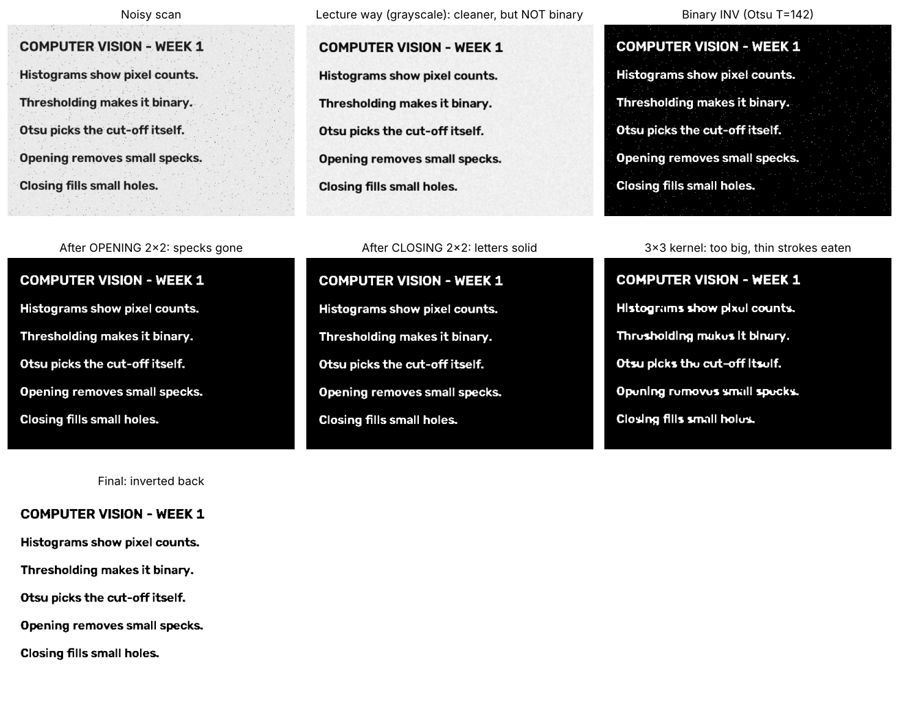

# Day 5 · Morphological Operations

**Lecture covers:** Dilation · Erosion · Opening & Closing · Structuring elements · Applications · Lab exercise · Mini-project: Noise removal in scanned documents

**Code for today:** `code/day5_01` → `day5_03`

---

## The big idea

**Morphology** = operations that change the **shape** of the white regions in an image. They're mainly used on **binary** images (after thresholding, Day 4), but they also work on grayscale.

The Key Concepts sheet's analogy is the best way to remember them. Think of editing a drawing with a **marker and an eraser**:

| Operation | Like… | Effect |
|---|---|---|
| **Dilation** | going over every stroke with a **thick marker** | white shapes get **fatter** |
| **Erosion** | **shaving** the edges of every stroke | white shapes get **thinner** |
| **Opening** | **erasing tiny specks** | small white noise removed |
| **Closing** | **filling tiny gaps** | small black holes filled |

> ⚠️ Morphology treats **WHITE (255) as the object**. If your objects are dark on light paper, invert first with `cv2.THRESH_BINARY_INV` or `cv2.bitwise_not(img)`. Otherwise "dilate" thickens the paper, not the text.

---

## 1. Structuring element (kernel)

A **small binary matrix used to probe the image**. It's the shape of the marker tip.

```python
kernel = np.ones((5, 5), np.uint8)            # lecture: 5x5 square of 1s

cv2.getStructuringElement(cv2.MORPH_RECT,    (5, 5))   # square
cv2.getStructuringElement(cv2.MORPH_ELLIPSE, (5, 5))   # roughly round
cv2.getStructuringElement(cv2.MORPH_CROSS,   (5, 5))   # plus sign
```

- **Shape**: rectangle, ellipse or cross. It decides the shape of the corners after dilation.
- **Size** decides how strong the effect is. A bigger kernel removes bigger specks but also damages more detail.
- **Rule of thumb:** the kernel should be *bigger than the noise* but *smaller than the thinnest part you want to keep*.



Unlike a convolution kernel (Day 3), there's no multiply-and-add here. The structuring element only says **which neighbours to look at**.

---

## 2. Dilation and erosion



| | Dilation | Erosion |
|---|---|---|
| Rule (binary) | pixel becomes white if **ANY** pixel under the kernel is white | pixel stays white only if **ALL** pixels under the kernel are white |
| Rule (grayscale) | **maximum** under the kernel | **minimum** under the kernel |
| White regions | **expand** | **shrink** |
| Use | **connect broken parts**, fill gaps in text characters | **remove small noise**, thin lines, separate touching objects |
| Code | `cv2.dilate(img, kernel, iterations=1)` | `cv2.erode(img, kernel, iterations=1)` |

`iterations=N` repeats the operation N times. That's like using a bigger kernel.



**Why the lecture's dilated and eroded photos barely change:** on a **grayscale photo**, dilation is just a local *max*, so the image gets slightly brighter and blockier. Erosion is a local *min*, so it gets slightly darker. Morphology shows its real power on **binary images with small details**.

▶ Run `code/day5_01_morphology_basics.py`.

---

## 3. Opening and closing

> **OPENING = Erosion, then Dilation.** It removes small white noise while preserving the shape of big objects.
> **CLOSING = Dilation, then Erosion.** It fills small holes inside objects.

```python
opened = cv2.morphologyEx(img, cv2.MORPH_OPEN,  kernel)
closed = cv2.morphologyEx(img, cv2.MORPH_CLOSE, kernel)
```

**Why the second step?** Erosion alone removes specks but also shrinks everything. Dilating afterwards grows the survivors back to about their original size, and the specks don't come back because they were completely erased. Closing is the same idea in reverse.

**Memory trick:** *Opening* = **E**rode first, like "**O**ut with the specks". *Closing* = **D**ilate first, to "**C**lose the holes".



**Order matters** when an image has both problems. Above, opening first would widen the pinholes inside the letters. So: **close first** (seal the holes), **then open** (delete the specks).

### Bonus operations (built on the same pieces)

| Operation | = | Shows |
|---|---|---|
| `MORPH_GRADIENT` | dilation − erosion | the **outline** of shapes |
| `MORPH_TOPHAT` | input − opening | the small bright bits opening removed |
| `MORPH_BLACKHAT` | closing − input | the small dark holes closing filled |



▶ Run `code/day5_02_opening_closing.py`.

---

## 4. Applications

| Area | Use |
|---|---|
| Document processing | Remove noise, fill gaps in letters, make text more readable |
| Medical imaging | Highlight structures like cells or tissues |
| Industrial inspection | Detect defects in materials |
| Object detection | **Clean up shapes before contour analysis** (Day 6) |

## 5. Mini-project: Noise removal in scanned documents

**Task:** a noisy scanned document goes in, and a **cleaned binary** version comes out using opening and closing.

The lecture applied opening and closing to the grayscale photo, so "Cleaned Document" looks almost unchanged. The full pipeline is:

```python
doc = cv2.imread('page.jpg', 0)
_, binary = cv2.threshold(doc, 0, 255, cv2.THRESH_BINARY_INV + cv2.THRESH_OTSU)  # text → WHITE
kernel = np.ones((2, 2), np.uint8)       # bigger than 1-px specks, smaller than 3-px strokes
clean = cv2.morphologyEx(binary, cv2.MORPH_OPEN, kernel)    # remove specks
clean = cv2.morphologyEx(clean,  cv2.MORPH_CLOSE, kernel)   # fill gaps in letters
final = cv2.bitwise_not(clean)           # back to black text on white
```



Notice the "3×3 kernel" panel: it's **too big** for this thin text and eats the strokes ("pixel" → "pixul").

**A subtle point:** on a *grayscale* page with dark specks, it's **closing** (not opening) that removes the specks, because closing removes small *dark* things and opening removes small *bright* things. Inverting so the text is white removes the confusion.

▶ Run `code/day5_03_mini_project_document_cleaning.py`.

---

## ✅ Day 5: check yourself

1. Dilation vs erosion in one line each? *(dilation: white grows (local max); erosion: white shrinks (local min))*
2. Opening = ? Closing = ? *(erode then dilate; dilate then erode)*
3. Which removes salt noise (white specks)? Which fills small holes? *(opening; closing)*
4. What is a structuring element? Name 3 shapes. *(a small binary matrix that probes the image; rect, ellipse, cross)*
5. What happens if the kernel is too big? *(it destroys real detail, e.g. thin strokes and small objects)*
6. Why invert before morphology on black-on-white text? *(morphology treats white as the object)*
7. What does `iterations=3` do? *(repeats the operation 3 times, a stronger effect)*
