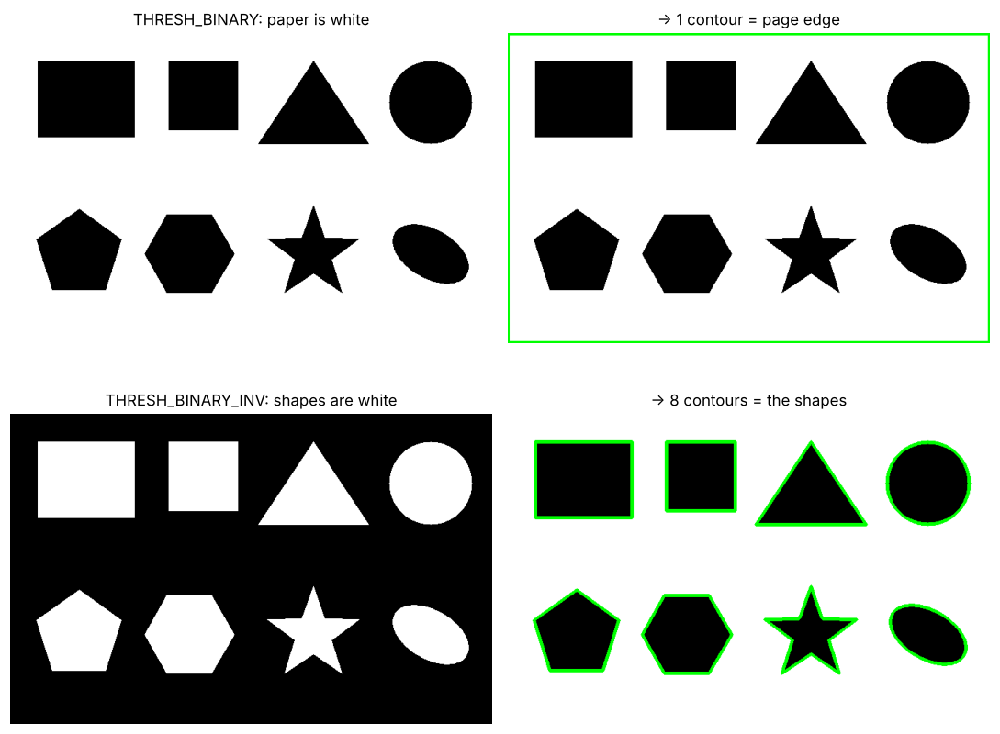
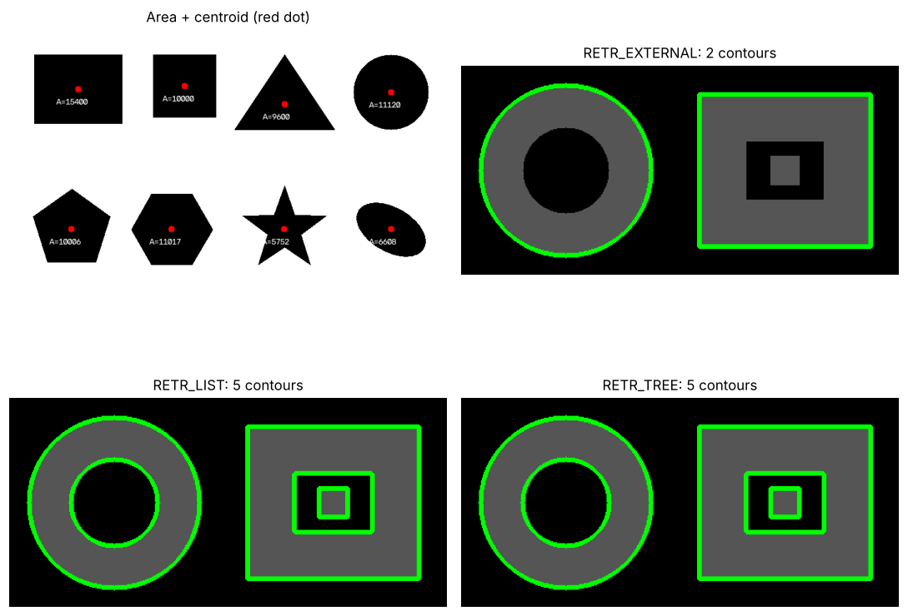
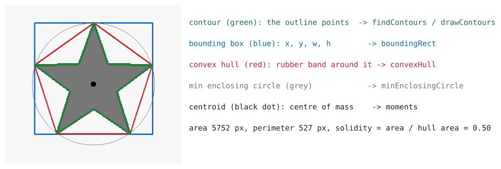
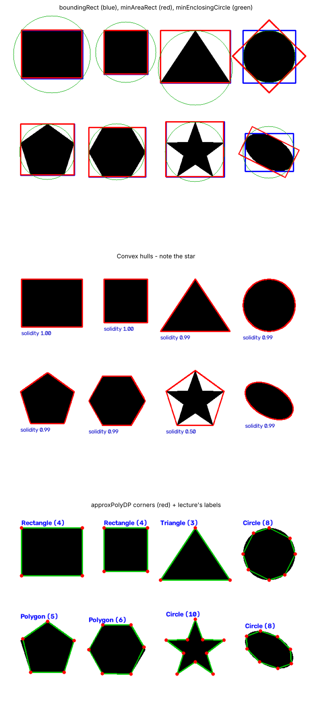
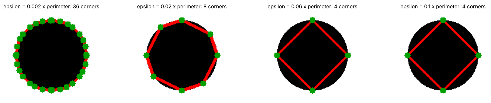
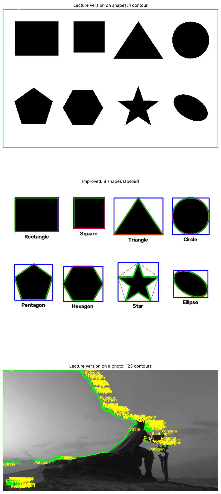

# Day 6 · Contours & Shape Analysis

**Lecture covers:** Contour detection · Bounding boxes · Convex hull · Shape classification · Applications · Lab exercise · Mini-project: Shape Detector

**Code for today:** `code/day6_01` → `day6_03`

---

## 1. Contours

> **Contours are curves joining continuous points along the boundary** of objects with the same intensity or colour. A contour is the outline of one blob, stored as a list of (x, y) points.

Picture a coin on paper: tracing round it with a pencil gives you its contour.

**Pipeline** (this is Days 4 + 5 + 6 working together):

```
grayscale → threshold (Day 4) → [clean up with morphology (Day 5)] → findContours → measure / draw
```

```python
_, thresh = cv2.threshold(img, 127, 255, cv2.THRESH_BINARY_INV)   # shapes → WHITE
contours, hierarchy = cv2.findContours(thresh, cv2.RETR_EXTERNAL, cv2.CHAIN_APPROX_SIMPLE)

img_contours = cv2.cvtColor(img, cv2.COLOR_GRAY2BGR)   # colour copy so we can draw in colour
cv2.drawContours(img_contours, contours, -1, (0, 255, 0), 2)
#                image          list     which  colour   thickness
```

| Argument | Meaning |
|---|---|
| `contours` | a Python **list**; each item is one outline (a NumPy array of points) |
| `hierarchy` | which contour is inside which (see below) |
| `drawContours(..., -1, ...)` | `-1` = draw **all**; `2` = draw only contour number 2 |
| thickness `-1` | **fill** the contour instead of outlining it |
| `COLOR_GRAY2BGR` | needed because you can't draw a *green* line on a 1-channel grey image |

### ⚠️ The #1 contour bug: white is the object

`findContours` finds **white** objects on a **black** background. The lecture used `THRESH_BINARY` on dark shapes on white paper, which makes the **paper** the object: you get one contour around the page edge. Use **`THRESH_BINARY_INV`** so the shapes are white.



### Retrieval modes and approximation

| Flag | Meaning |
|---|---|
| `RETR_EXTERNAL` | only the **outermost** outlines (ignores holes) |
| `RETR_LIST` | every outline, no parent/child info |
| `RETR_TREE` | every outline **plus** the full family tree (hierarchy) |
| `CHAIN_APPROX_NONE` | store **every** boundary point |
| `CHAIN_APPROX_SIMPLE` | straight runs are stored by their **end points** only (a rectangle → 4 points) |

`hierarchy[0][i] = [next, previous, first_child, parent]`, where `-1` means "none".

### Measuring contours: shape descriptors

| Measure | Code | Meaning |
|---|---|---|
| Area | `cv2.contourArea(cnt)` | pixels inside |
| Perimeter | `cv2.arcLength(cnt, True)` | outline length (`True` = closed) |
| Centroid | `M = cv2.moments(cnt)`; `cx = M['m10']/M['m00']`, `cy = M['m01']/M['m00']` | centre of mass |
| Aspect ratio | `w / h` from `boundingRect` | square ≈ 1 |
| Solidity | `area / hull area` | 1 = no dents; a star ≈ 0.5 |
| Circularity | `4π·area / perimeter²` | 1 = perfect circle |



▶ Run `code/day6_01_contours.py`.

---

## 2. Bounding boxes, convex hull and more



### Bounding box
> The **smallest (upright) rectangle that encloses a contour**. Used for **object localization**: "the object is here".

```python
x, y, w, h = cv2.boundingRect(cnt)                       # (x, y) = top-left corner
cv2.rectangle(img, (x, y), (x + w, y + h), (255, 0, 0), 2)   # (255,0,0) in BGR = BLUE
```

Variants: `cv2.minAreaRect(cnt)` = the tightest **rotated** rectangle (draw it with `cv2.boxPoints`). `cv2.minEnclosingCircle(cnt)` = the smallest circle around the shape.

### Convex hull
> The **smallest convex polygon enclosing a contour**. Picture a rubber band snapped around the shape. Used for **shape simplification**.

```python
hull = cv2.convexHull(cnt)
cv2.drawContours(img, [hull], 0, (0, 0, 255), 2)         # note the [ ]: drawContours wants a LIST
```

- **Convex** = no dents: every corner points outward. A square, circle or hexagon is convex. A **star is not**.
- The gaps between the shape and its hull are called **convexity defects**. They're used to count fingers in hand-gesture recognition, for example.
- `cv2.isContourConvex(cnt)` returns True or False.



---

## 3. Shape classification

> **Approximate contours to polygons, then count the vertices.**

```python
approx = cv2.approxPolyDP(cnt, 0.02 * cv2.arcLength(cnt, True), True)
n = len(approx)          # number of corners
# 3 → Triangle   4 → Rectangle   > 6 → Circle   otherwise → Polygon   (lecture's rule)
```

`approxPolyDP` (Douglas–Peucker algorithm) simplifies a wobbly outline into a polygon with fewer corners. **epsilon** is how far the simplified line may stray from the real outline. The lecture uses **2% of the perimeter**.



A bigger epsilon gives fewer corners: at 6%, even a circle becomes a 4-cornered "rectangle". The lecture's simple rule also mislabels shapes. The star has 10 corners, so it's called "Circle", and the pentagon and hexagon are just "Polygon". Better rules:

| Shape | Test |
|---|---|
| Square vs rectangle | 4 corners and aspect ratio `w/h` ≈ 1 |
| Pentagon / hexagon | 5 / 6 corners |
| Star | **solidity < 0.8** (big dents) |
| Circle vs ellipse | many corners and circularity > 0.85 (circle) or lower (ellipse) |

▶ Run `code/day6_02_boxes_hull_shapes.py`.

---

## 4. Applications

| Area | Use |
|---|---|
| Object detection and tracking | Find, box and follow objects |
| Industrial inspection | Check part shape and size, find missing pieces |
| Medical imaging | **Cell shape analysis** (area, roundness) |

## 5. Lab exercise and mini-project: Shape Detector

**Task:** an image with multiple geometric shapes goes in, and contours, bounding boxes, convex hulls and labels come out.

The lecture's `sample.png` is actually the same Pantone **photo**, not a shapes image. So its "Detected Shapes" output is covered in hundreds of tiny contours on noise and text. On a real shapes image the lecture's code finds **1 contour** (the page) because of the `THRESH_BINARY` bug. The fixed version:

1. Uses **BINARY_INV + Otsu** so the shapes are white.
2. **Ignores tiny contours** (`if cv2.contourArea(cnt) < 300: continue`).
3. Draws the contour, box, hull and label.
4. Uses the better rules from the table above.



▶ Run `code/day6_03_mini_project_shape_detector.py`.

---

## ✅ Day 6: check yourself

1. What is a contour? *(a curve joining continuous boundary points of a shape)*
2. Why `THRESH_BINARY_INV` for dark shapes on white paper? *(findContours treats white as the object)*
3. What does `boundingRect` return? *(x, y, w, h: top-left corner, width, height)*
4. What is a convex hull? Is a star convex? *(the smallest convex polygon around the shape; no)*
5. In `approxPolyDP(cnt, 0.02*peri, True)`, what does 0.02 control? *(epsilon, the allowed deviation; bigger means fewer corners)*
6. How do you compute the centroid? *(moments: cx = m10/m00, cy = m01/m00)*
7. `RETR_EXTERNAL` vs `RETR_TREE`? *(outer contours only vs all contours plus the hierarchy)*
