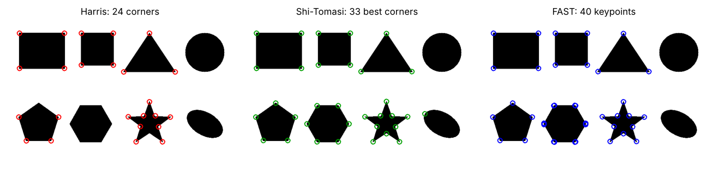
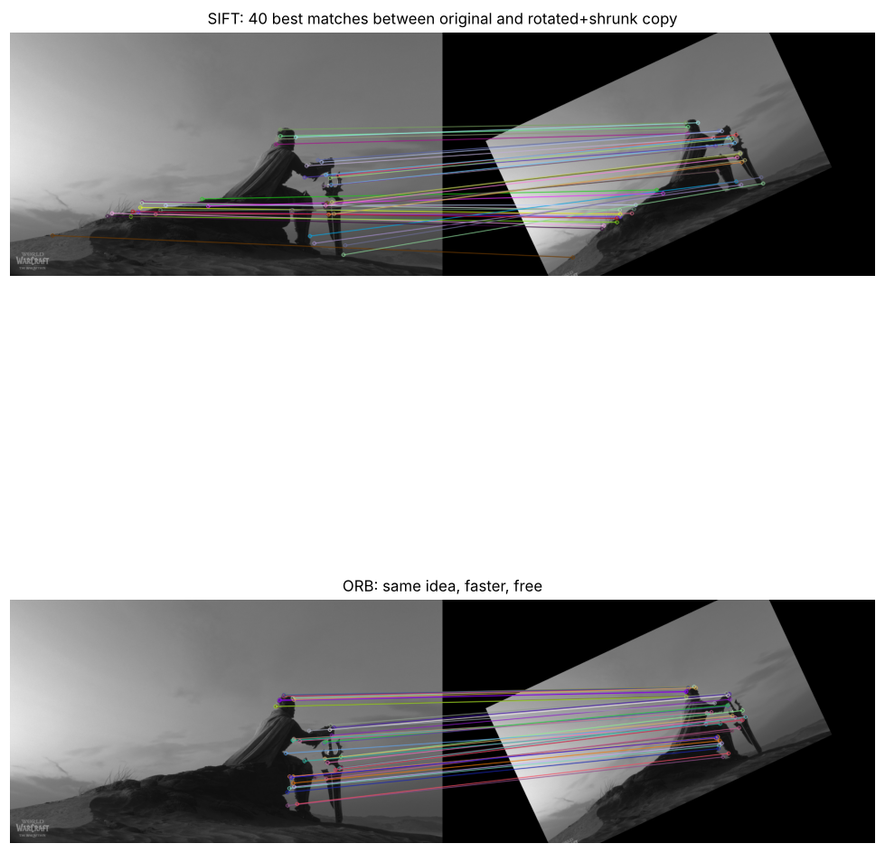
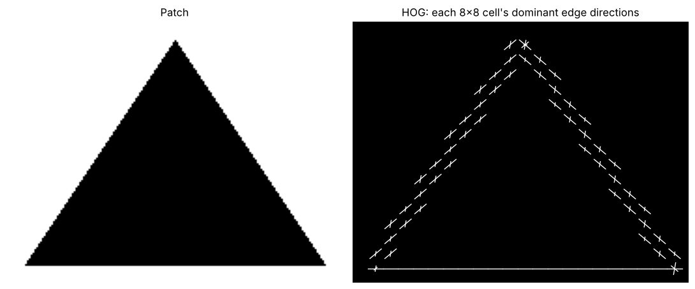
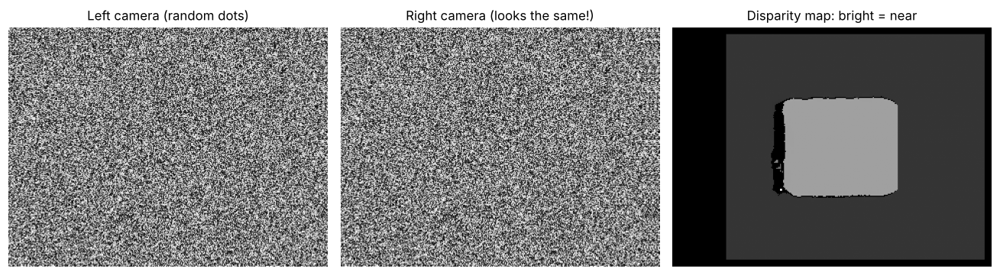
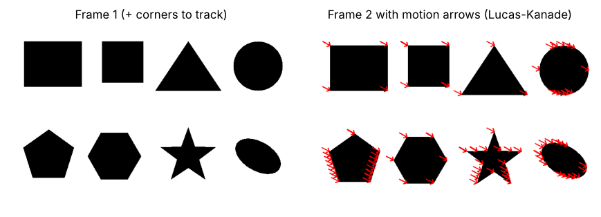
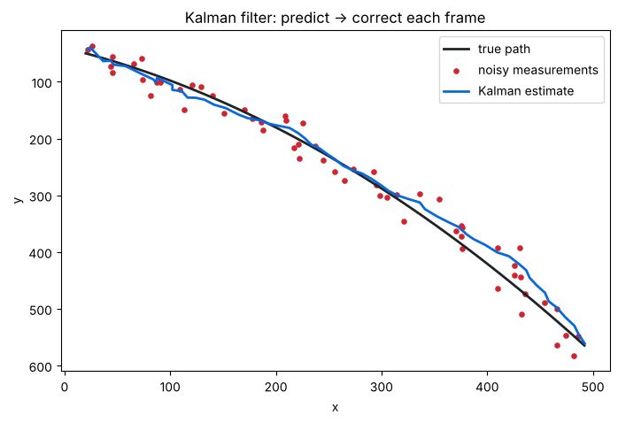

# Week 1 · Key Concepts (the summary sheet, explained)

This note covers **CV-Week-1-KeyConcepts.pdf**, the course's own summary of the week, plus the extra notebooks in `Week1.zip` (`imagerepresentation`, `colorimgrepresent`, `Convolution`).

The sheet has two halves:
- **Part A** recaps Days 1–6. If you've done the day notes, this is revision.
- **Part B** introduces **advanced topics** that have no lab: corners, SIFT, SURF, HOG, stereo vision, epipolar geometry, optical flow, Kalman filters and object tracking. Expect **"what is X / what is it used for"** questions. Each one has a runnable demo in `code/keyconcepts_01` and `keyconcepts_02`.

---

# Part A · Recap of Days 1–6

### Images as matrices (Day 1)
- **Grayscale image → 2-D matrix.** Each pixel is one number, 0 = black and 255 = white. Shape `(rows, cols)`.
- **Colour image → 3-D matrix** with 3 channels. Shape `(rows, cols, 3)`. Pixel `[255, 0, 0]` is pure red in RGB, but **pure blue in OpenCV's BGR**.
- Origin `(0, 0)` = **top-left**. x goes right, y goes **down**. Access a pixel with `image[y, x]`.
- `cv2.imread('sample.jpg', 0)` → grayscale (2-D). `cv2.imread('sample.jpg')` → colour (3-D, BGR).

The course notebook `imagerepresentation.ipynb` draws a 5×5 matrix as an image with the numbers on top. `colorimgrepresent.ipynb` does the same for a 3×3 RGB image: red, green, blue, yellow, cyan, magenta, grey, white, black. `code/day1_02_pixels_by_hand.py` covers the same idea.

### HSV (Day 1)
- **Hue** = the *type* of colour, an **angle on a colour wheel**: 0° = red, 120° = green, 240° = blue. *(OpenCV halves it: 0–179, so green = 60 and blue = 120.)*
- **Saturation** = how intense or pure: 0% = grey, 100% = vivid. *(OpenCV: 0–255.)*
- **Value** = brightness: 0% = black, 100% = brightest. *(OpenCV: 0–255.)*
- **Why it's useful:** it's closer to how humans think about colour, and you can pick out a hue range ("yellow", "red") **without worrying about brightness changes**. The sheet's example is detecting ripe fruit.

### Kernels and convolution (Day 3)
- **Kernel** (also called a *filter*, *mask* or *convolution matrix*) = a small grid of numbers (3×3, 5×5, 7×7) that says how a pixel and its neighbours are combined. **Larger kernels capture more context but are slower.**
- **Operation:** place the kernel over a pixel, multiply each kernel value by the pixel under it, and **sum** to get the new pixel value.
- **Formula:** (I∗K)(x, y) = Σₘ Σₙ I(x − m, y − n) · K(m, n), where I = image and K = kernel. *(The PDF prints it as "I(x, −my − n)", which is a typesetting slip for I(x − m, y − n).)*

| Kernel | Matrix | Effect |
|---|---|---|
| Identity | `[[0,0,0],[0,1,0],[0,0,0]]` | unchanged |
| Box blur | `1/9 · ones(3,3)` | smooths, reduces detail |
| Sharpen | `[[0,-1,0],[-1,5,-1],[0,-1,0]]` | enhances edges and fine detail |
| Sobel X | `[[-1,0,1],[-2,0,2],[-1,0,1]]` | **vertical** edges |
| Sobel Y | `[[-1,-2,-1],[0,0,0],[1,2,1]]` | **horizontal** edges |
| Edge (from `Convolution.ipynb`) | `[[-1,-1,-1],[-1,8,-1],[-1,-1,-1]]` | edges in all directions (a Laplacian-style kernel; sum = 0) |

- **Why kernels matter:** feature extraction (edges, corners, textures), image enhancement (sharpen, smooth, emboss), and **deep learning**: in CNNs the kernels are *learned automatically*.
- `Convolution.ipynb` also shows a 3×3 example: blurring `[[10,20,30],[40,50,60],[70,80,90]]` with the 1/9 box kernel turns the centre 50 into **50** (the average of all 9 values). Check: (10+20+…+90)/9 = 450/9 = 50.

### Histograms and thresholding (Day 4)
- **Histogram:** how many pixels have each intensity. x-axis = intensity 0–255, y-axis = count. Uses: check brightness and contrast, spot **under- or over-exposure**, and it's the basis for **histogram equalization**.
- **Thresholding:** intensity **> T → 255 (white)**, **≤ T → 0 (black)**. Global = one T for the whole image. Adaptive = a different T per region (for varying lighting).
- **Applications:** document scanning (text vs background), medical imaging (highlight tumours), object detection (foreground vs background).

### Morphology (Day 5)
Dilation (expand white, connect broken parts, fill gaps in text), erosion (shrink white, remove small noise, thin lines), opening (erode → dilate, cleaning scans), closing (dilate → erode, filling holes in letters). Applications: documents, medical images, industrial inspection, **cleaning shapes before contour analysis**.

### Contours (Day 6)
Curves joining continuous boundary points of objects with the same intensity. Key descriptors: **area, perimeter, centroid, bounding box, convex hull**. Used for shape recognition, object detection and classification.

### Edge detection (Days 1 & 3)
- **Purpose:** find boundaries where intensity changes sharply. **Methods:** Sobel, Canny, Laplacian. **Uses:** object segmentation, lane detection, medical imaging.
- **Edges are distinctive but not unique.** Slide a small window *along* an edge and every position looks the same, so an edge point is hard to pin down exactly. That's the motivation for corners ↓

---

# Part B · Advanced topics

## Corner detection

> **Corners are points where edges meet:** regions where intensity varies in **multiple directions**.

| Region | Slide a small window around… | Good landmark? |
|---|---|---|
| Flat | nothing changes | ❌ |
| Edge | changes only *across* the edge | ⚠️ ambiguous along it |
| **Corner** | changes in **every** direction | ✅ **repeatable and uniquely localizable** |

| Method | Idea | OpenCV |
|---|---|---|
| **Harris** | scores every pixel by how much a window changes when shifted in all directions | `cv2.cornerHarris(np.float32(gray), 2, 3, 0.04)` |
| **Shi-Tomasi** | improved Harris scoring; returns the N best corners ("good features to track") | `cv2.goodFeaturesToTrack(gray, N, quality, minDist)` |
| **FAST** | very quick test: is there a long arc of brighter or darker pixels on a 16-pixel ring? | `cv2.FastFeatureDetector_create()` |

**Applications:** image matching, tracking, **panorama stitching**.

## SIFT: Scale-Invariant Feature Transform

> **Detect and describe** keypoints so they can be found again even if the image is **resized or rotated**.

**Pipeline (learn the 4 steps):**
1. Build a **Gaussian scale space**: blur the image more and more, at several sizes.
2. Detect **extrema** in the **Difference of Gaussians** (DoG, one blur minus the next). These are blob-like keypoints at the right scale.
3. **Assign an orientation** (the dominant gradient direction), so rotation doesn't matter.
4. Build a **128-dimensional descriptor vector**: a "fingerprint" of the area around the keypoint.

- **Applications:** object recognition, image stitching, 3D reconstruction.
- **Strength:** robust to scale and rotation. **Limit:** computationally heavy.

Matching = for each fingerprint, find the closest fingerprint in the other image. **Lowe's ratio test** keeps a match only if the best match is clearly better than the second best (distance < 0.75 × second).

## SURF: Speeded-Up Robust Features

- Introduced in **2006** as a **faster alternative to SIFT**, still scale- and rotation-invariant.
- **Detection:** finds interest points (corners, blobs, junctions) with a **Hessian-matrix-based** measure.
- **Description:** a compact vector of **64 or 128** dimensions.
- **Matching:** compare descriptors across images to establish correspondences.
- It's patented, so it isn't in standard OpenCV builds. **ORB** (`cv2.ORB_create`) is the free, fast alternative used in the demo.

## HOG: Histogram of Oriented Gradients

> Describes a region by the **distribution of edge directions** in it.

**Pipeline:**
1. **Compute gradients** (Sobel x and y → strength and direction).
2. **Divide the image into cells** (e.g. 8×8 pixels).
3. In each cell, **build an orientation histogram**: count gradient directions (usually 9 bins over 0–180°), weighted by strength.
4. **Normalize over blocks** (groups of cells), so lighting changes matter less.

- **Applications:** **pedestrian detection** (the classic HOG + SVM detector), object classification.
- **Strength:** lightweight and interpretable. **Limit:** sensitive to scale changes.
- Note the connection: HOG is a **histogram** (Day 4) of **gradients** (Sobel, Day 3).

## Stereo vision

> **Two images from slightly different viewpoints** (like your two eyes) → estimate **depth**.

- **Concept:** match corresponding points between the left and right images. The horizontal shift is the **disparity**. **Near objects shift more**, so bigger disparity means closer: depth ∝ (focal length × baseline) / disparity.
- **Applications:** 3D reconstruction, autonomous driving, robotics.
- **Challenge:** finding reliable matches in **texture-less regions** (a blank wall looks the same everywhere).

The demo is a **random-dot stereogram**: the left and right images look like identical noise, but one square is shifted more, and the disparity map reveals it as "closer" (brighter).

## Epipolar geometry

> The **mathematical framework relating two camera views**.

- **Key idea:** for a point in one image, its matching point in the other image **must lie on a specific line**, the **epipolar line**. This turns a 2-D search into a **1-D search**. For aligned ("rectified") stereo cameras, it's simply the **same row**.
- **Tools:** the **Essential matrix** (calibrated cameras, internal parameters known) and the **Fundamental matrix** (uncalibrated).
- **Applications:** stereo matching, structure-from-motion, camera calibration.

## Optical flow

> Estimates the **apparent motion of pixels between consecutive frames**: a motion arrow per point.

- **How it works:** it assumes a pixel's **brightness stays constant as it moves**, then calculates displacement vectors.
- **Lucas–Kanade:** solves in a **local neighbourhood** around each point. Fast, used for tracking chosen points (`cv2.calcOpticalFlowPyrLK`).
- **Horn–Schunck:** solves for the whole image with a **global smoothness constraint**.
- **Applications:** gesture recognition, motion detection, video stabilization.
- **Limitations:** sensitive to **lighting changes** (which break the constant-brightness assumption) and **occlusions** (when something hides the point).

## Kalman filter

> A **recursive** algorithm that **predicts and corrects** the state (position and velocity) of a moving object over time.

- **Prediction step:** estimate the next position from a motion model ("it was moving right at 8 px/frame, so it should be about here").
- **Update step:** correct the prediction using the new (noisy) measurement.
- **Strengths:** handles **noisy sensor data**, smooths trajectories. **Applications:** tracking vehicles, drones and pedestrians in real time.
- Works best for **linear motion with Gaussian noise**. The **Extended Kalman Filter** handles non-linear cases.

In the demo, the raw measurements are off by 18 px on average, while the Kalman estimate is off by about 12 px. It's smoother and closer to the truth.

## Object tracking

> **Continuously locating objects across video frames.**

| Approach | How |
|---|---|
| **Detection-based tracking** | run a detector on each frame (e.g. **YOLO, Faster R-CNN**), then link detections frame to frame |
| **Tracking-by-motion** | follow the object using **optical flow** or **correlation filters** |
| **Hybrid** | detection + prediction, e.g. **SORT / DeepSORT** (which use a Kalman filter to predict) |

- **Challenges:** occlusion, scale changes, multiple objects, cluttered backgrounds.
- **Applications:** surveillance, autonomous driving, sports analytics.

▶ Run `code/keyconcepts_01_corners_and_features.py` and `code/keyconcepts_02_motion_and_depth.py`.

---

## ✅ Key concepts: check yourself

1. Why are corners better landmarks than edges? *(they change in all directions, so they're unique and repeatable; an edge looks the same along its length)*
2. Name 3 corner detectors. *(Harris, Shi-Tomasi, FAST)*
3. The 4 SIFT steps? *(Gaussian scale space → DoG extrema → orientation → 128-D descriptor)*
4. SURF vs SIFT? *(SURF, from 2006, is faster, uses a Hessian-based detector, and has 64/128-D descriptors)*
5. The HOG pipeline? Its classic use? *(gradients → 8×8 cells → orientation histograms → block normalization; pedestrian detection)*
6. What does disparity tell you in stereo vision? *(depth: bigger disparity means closer)*
7. What is the epipolar line? Essential vs Fundamental matrix? *(the line the matching point must lie on; calibrated vs uncalibrated cameras)*
8. Optical flow's key assumption? Lucas–Kanade vs Horn–Schunck? *(brightness constancy; local window vs global smoothness)*
9. The two Kalman steps? *(predict, then update/correct)*
10. Three approaches to object tracking? *(detection-based, tracking-by-motion, hybrid such as SORT/DeepSORT)*
