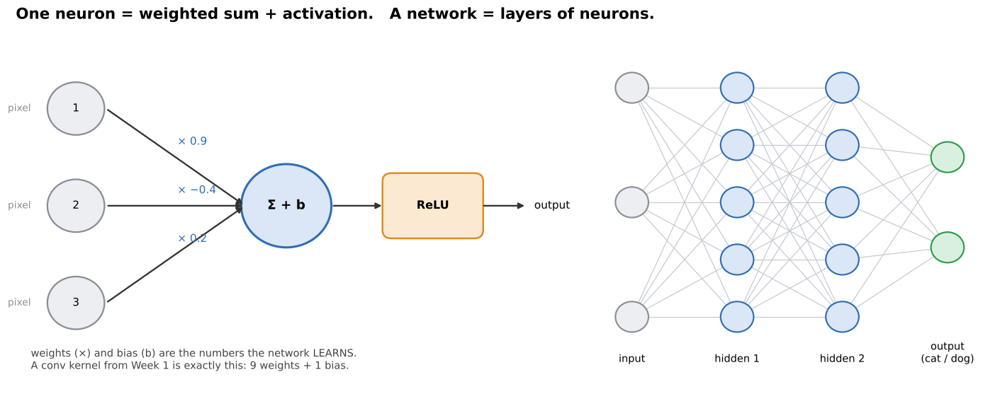
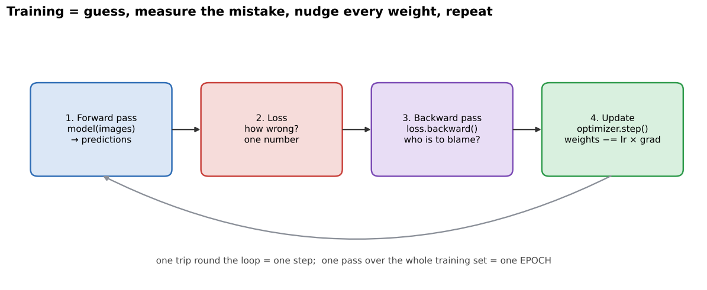
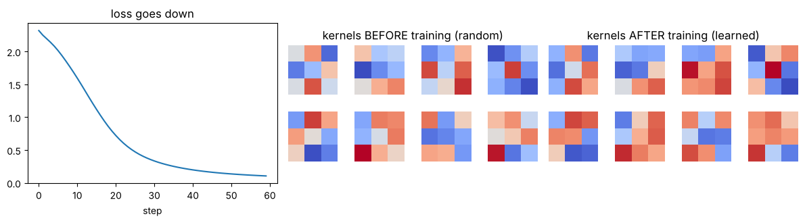

# 00 · Deep learning from zero (read this first)

Week 1 was about **hand-made** image tools. You picked the kernel (`[[0,-1,0],[-1,5,-1],[0,-1,0]]` to sharpen), you picked the threshold (127), you picked the rules. Weeks 2–3 are about letting the computer **learn those numbers by itself** from examples. That is all "deep learning" means.

**Notebook for this chapter:** `notebooks/01_neural_network_building_blocks.ipynb`

---

## 1. The big idea in one paragraph

> Show the computer thousands of labelled pictures ("this is a 3", "this is a 7"). It starts with **random** kernels, makes a guess, sees how wrong it was, and **nudges every number a tiny bit** in the direction that would have made the guess less wrong. After thousands of nudges, the random numbers have turned into useful edge detectors, stroke detectors and digit detectors.

The model never gets told "look for a loop at the top". It discovers that by itself, because it helps reduce the mistakes.

---

## 2. A neuron is a tiny calculator



A **neuron** does three things:

1. Multiplies each input by a **weight** (how important that input is).
2. Adds them all up, plus a **bias** (a constant nudge).
3. Passes the total through an **activation function** (e.g. ReLU: negative → 0).

```
output = ReLU( w1·x1 + w2·x2 + w3·x3 + b )
```

That should look familiar: **a 3×3 convolution kernel is a neuron with 9 weights**, applied at every position of the image. The only difference from Week 1 is that the 9 numbers are **learned** rather than typed in.

**Layers** are rows of neurons. A **network** is layers stacked one after another. "**Deep**" just means "many layers".

| Word | Plain meaning |
|---|---|
| **Weights / parameters** | the numbers the network learns (kernel values, connection strengths) |
| **Layer** | one stage of processing (a conv layer, a pooling layer, a dense layer) |
| **Feature map** | the output image of a conv layer (one per kernel) |
| **Architecture** | the *recipe*: which layers, in what order, how big (LeNet, VGG, ResNet are architectures) |
| **Model** | an architecture **plus** its learned weights |

---

## 3. How it learns: the training loop



| Step | What happens | PyTorch line |
|---|---|---|
| 1. **Forward pass** | push a batch of images through the network → predictions | `out = model(x)` |
| 2. **Loss** | one number that says *how wrong* the predictions are | `loss = loss_fn(out, y)` |
| 3. **Backward pass** | work out, for **every** weight, "if I nudge you up, does the loss go up or down?" That answer is the **gradient** | `loss.backward()` |
| 4. **Update** | move each weight a small step against its gradient | `optimizer.step()` |

Then repeat thousands of times. One full pass over the training images is an **epoch**.

**Analogy: walking downhill in fog.** The loss is your height on a hillside, and you want to reach the valley. You can't see far, but you can feel which way the ground slopes under your feet (the gradient). Take a small step downhill, feel again, step again. The **learning rate** is the size of your step: too big and you overshoot, too small and you take forever.

```python
for epoch in range(10):
    for x, y in train_loader:          # x = batch of images, y = correct labels
        out  = model(x)                # 1. guess
        loss = loss_fn(out, y)         # 2. how wrong?
        optimizer.zero_grad()          #    clear old gradients
        loss.backward()                # 3. who is to blame?
        optimizer.step()               # 4. nudge the weights
```



*From notebook 01: the loss goes down as training proceeds, and the 3×3 kernels go from random noise to structured patterns.*

---

## 4. Training data vs test data

- **Training set:** the pictures the network learns from.
- **Test set:** pictures it has **never seen**, used only to check how good it really is.

The real goal is to do well on **new** pictures. Doing well on the training pictures is easy: the network could simply memorise them.

> **Overfitting** = great on training data, noticeably worse on test data. The network memorised instead of understanding. This is like a student who memorised last year's answers and fails when the questions change.

Fixes you will meet: **dropout** (chapter 01), more data, **data augmentation** (Week 1 Day 2: flips, rotations, crops), smaller models.

---

## 5. Just enough PyTorch

The notebooks use **PyTorch** (`import torch`). You need very little of it:

```python
import torch, torch.nn as nn

x = torch.randn(8, 1, 28, 28)   # a batch: 8 images, 1 channel (grey), 28×28 pixels
#              N  C   H   W      ← PyTorch order: batch, channels, height, width
```

> ⚠️ OpenCV images are `(H, W, C)`. PyTorch wants `(N, C, H, W)`. Converting: `torch.from_numpy(img).permute(2, 0, 1).unsqueeze(0)`.

```python
model = nn.Sequential(
    nn.Conv2d(1, 6, kernel_size=5),   # 1 input channel → 6 learned 5×5 kernels
    nn.ReLU(),
    nn.MaxPool2d(2),                  # halve height and width
    nn.Flatten(),                     # grid → long list
    nn.Linear(6 * 12 * 12, 10),       # fully connected → 10 scores (digits 0–9)
)
print(model(x).shape)                 # torch.Size([8, 10])
print(sum(p.numel() for p in model.parameters()))   # how many weights to learn
```

| Layer | What it is |
|---|---|
| `nn.Conv2d(in, out, k)` | `out` learned kernels of size k×k (Week 1 convolution, learned) |
| `nn.ReLU()` | negatives → 0 |
| `nn.MaxPool2d(2)` | keep the max of every 2×2 block |
| `nn.Dropout(p)` | randomly zero a fraction p (training only) |
| `nn.Flatten()` | `(N, C, H, W)` → `(N, C·H·W)` |
| `nn.Linear(in, out)` | fully connected layer |

`model.train()` turns dropout on, and `model.eval()` turns it off for testing. `with torch.no_grad():` means "just predict, don't track gradients".

---

## 6. The output: scores → probabilities → answer

The last layer gives one **score** per class (called **logits**), e.g. `[1.2, -0.3, 4.1, ...]`. **Softmax** turns them into probabilities that add up to 1. The predicted class is the biggest one: `out.argmax(1)`.

The usual loss for classification is **cross-entropy**. It is small when the network puts a high probability on the correct class and large when it is confidently wrong.

---

## 7. Why this beats Week 1 methods

| Week 1 (hand-crafted) | Weeks 2–3 (learned) |
|---|---|
| you design the kernel / threshold / features (HOG, SIFT) | the network learns them from examples |
| works well when *you* understand the problem | works when the pattern is too complex to describe by hand (faces, tumours, cats) |
| needs little data, little compute | needs lots of labelled data and compute (GPUs) |
| transparent: you know what each step does | harder to interpret (we visualise kernels and feature maps to peek inside) |

Week 1 is not obsolete: preprocessing (resize, normalise, augment) and post-processing (thresholding a mask, finding contours on it) still use exactly those tools.

---

## Check yourself

1. What are "weights" and who chooses them?
2. Name the four steps of the training loop.
3. What is an epoch?
4. What is overfitting and how do you detect it?
5. What shape does PyTorch expect for a batch of 16 colour 224×224 images?

<details><summary>Answers</summary>

1. The numbers inside the layers (kernel values, connection strengths). The network learns them during training. You only choose the architecture.
2. Forward pass → loss → backward pass (gradients) → optimiser step (update).
3. One full pass through all the training data.
4. High training accuracy but clearly lower test accuracy. Compare the two.
5. `(16, 3, 224, 224)`.
</details>
