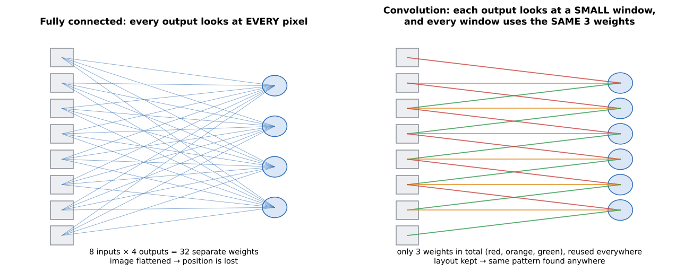
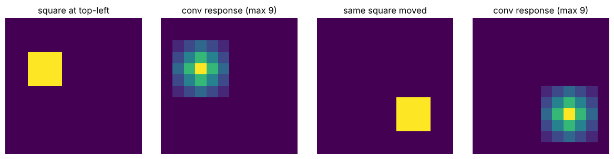
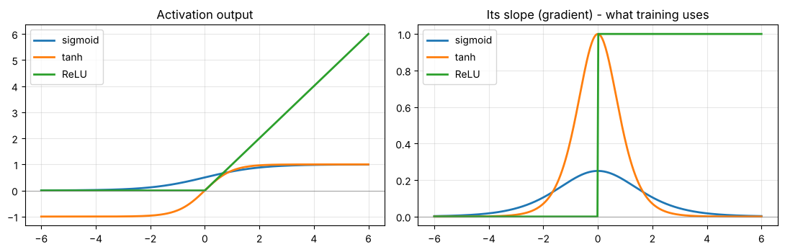
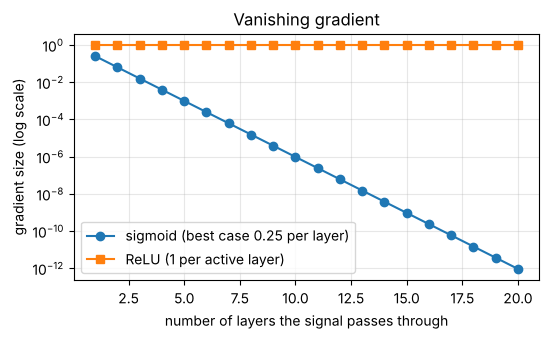
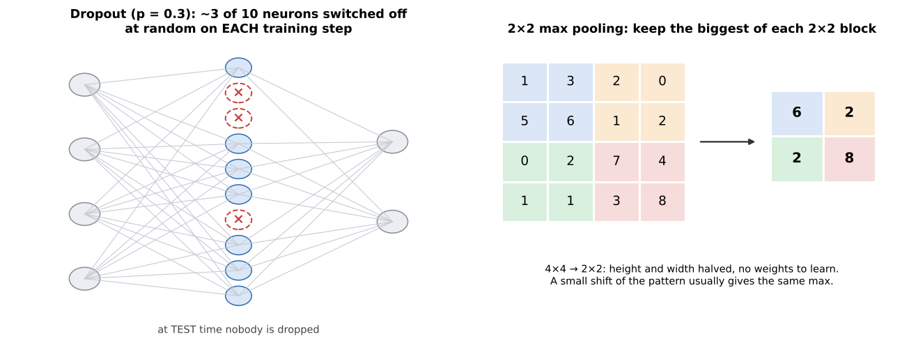

# 01 · The building blocks: conv vs dense layers, ReLU, dropout, pooling

**Key Concepts covers:** Fully connected (dense) layers · Convolutional layers · ReLU · Dropout · (and in the question bank) vanishing gradient, pooling

**Notebook:** `notebooks/01_neural_network_building_blocks.ipynb`

---

## 1. Fully connected (dense) layers

> **Every neuron connects to every value in the previous layer.**

- **Input:** a **flattened** vector. A 28×28 image becomes a list of 784 numbers, and the network no longer knows which pixels were neighbours.
- **Purpose:** combine **everything** into a final decision ("these features together mean *cat*").
- **Strength:** captures complex relationships between all features.
- **Weaknesses:**
  - **huge number of parameters** (every input × every output);
  - **ignores spatial locality** (a pixel's neighbours mean nothing special to it).

**How huge?** A 224×224 colour image has 150,528 values. One dense layer with 1,000 neurons needs **150,528 × 1,000 ≈ 150 million weights**. That is just one layer.

## 2. Convolutional layers

> **Each neuron looks only at a small local window (its *receptive field*), and the same kernel is slid across the whole image.**



This is exactly Week 1's `cv2.filter2D`, except the kernel values are **learned**.

- **Input:** keeps the spatial layout: height × width × channels.
- **Purpose:** extract **local features** such as edges, textures and shapes.
- **Advantages:**
  1. **Few parameters.** A 3×3 conv from 3 channels to 64 channels has 3·3·3·64 + 64 = **1,792** weights, *whatever the image size*. The same kernel is reused at every position (**weight sharing**).
  2. **Spatial hierarchy.** Layer 1 finds edges, layer 2 combines edges into corners and textures, and deeper layers find parts (eyes, wheels) and then whole objects.
  3. **Translation invariance.** A feature is detected **wherever** it appears, because the same kernel scans everywhere.
- **Limitation:** on its own a conv layer only sees locally. That's why CNNs usually **end with pooling and dense layers** to make the final decision.



*Notebook 01: the same square moved to another corner. The conv response just moves with it, with the same strength (max 9 both times).*

> **In practice:** conv layers for **feature extraction** (early and middle), dense layers for **decision making** (end).

| | Fully connected | Convolutional |
|---|---|---|
| Connects to | **all** inputs | a **small local window** |
| Input | flat vector (layout lost) | grid (layout kept) |
| Parameters | very many | few (shared kernel) |
| Learns | global relationships | local features, building up a hierarchy |
| Position of a pattern | matters (has to be re-learned at each spot) | doesn't matter (translation invariant) |
| Typical place | the end (classifier) | the start and middle (feature extractor) |

---

## 3. ReLU (Rectified Linear Unit)

> **If the input is positive, keep it. If it is negative, output zero.**  `ReLU(x) = max(0, x)`



**Why we need *any* activation:** without one, stacking layers is pointless. Two linear layers in a row equal one linear layer. The activation adds **non-linearity**, which lets the network learn curved, complicated decision boundaries.

**Why ReLU instead of sigmoid / tanh (the older choices):**

1. **Faster.** It is just `max(0, x)`, with no exponentials. AlexNet trained about **6× faster** with ReLU.
2. **Less vanishing gradient.** Look at the right-hand plot above:
   - the slope of **sigmoid** is at most **0.25**, and nearly 0 for big or small inputs ("saturated");
   - the slope of **ReLU** is exactly **1** for every positive input.

### The vanishing gradient problem (exam favourite)

During the backward pass, the gradient for an early layer is a **product of one factor per layer** it passes through. Multiply many numbers smaller than 1 and the result shrinks towards zero:

```
sigmoid, 20 layers:  0.25 × 0.25 × ... (20 times) ≈ 0.000000000001
ReLU,    20 layers:  1 × 1 × ... × 1              = 1
```



With a gradient of nearly 0 the early layers **stop learning**, because their weights barely change. ReLU reduces this problem, and ResNet (chapter 03) fixes it properly for very deep networks.

**Analogy:** ReLU is like a filter (or a one-way valve) that only lets positive signals through.

> ReLU's one weakness is "**dying ReLU**". A neuron whose input is always negative outputs 0 forever and has gradient 0, so it never recovers. Variants such as Leaky ReLU fix this, but they are not in the syllabus.

---

## 4. Dropout

> **During training, randomly switch off (set to zero) a fraction *p* of the neurons on every step.**



- **Purpose:** **regularisation**, i.e. preventing **overfitting**.
- **Key Concepts example:** a layer with **10 neurons** and dropout rate **0.3** drops **about 3 neurons** each training pass, a *different* random 3 each time.
- **Why it helps:**
  - no neuron can rely on one specific partner always being there, so knowledge is **spread across many neurons**;
  - the network learns **robust** features instead of memorising;
  - it **generalises** better to unseen data.
- **Only during training.** At test time all neurons are used: `model.eval()` turns dropout off. During training the surviving values are scaled up by 1/(1−p), so the average signal stays the same.

**Analogy (from the course):** a team exercise where some members randomly sit out, so everyone has to learn to contribute and the team never over-relies on one star player.

**Honest result from notebook 01:** on our small digits dataset, dropout raised test accuracy from **86.7% to 87.8%** (averaged over 5 runs). It helps, but it is not magic. The effect is biggest on large networks that have room to memorise, like AlexNet's huge dense layers.

```python
nn.Dropout(p=0.3)     # put it between dense layers
model.train()         # dropout ON
model.eval()          # dropout OFF for testing
```

---

## 5. Pooling

> **Max pooling 2×2** keeps the **largest** value in each 2×2 block (see the right half of the picture above).

- **Halves the height and width**, so there is less to compute in later layers.
- **Has no weights to learn.**
- Gives a little **tolerance to small shifts**: if the pattern moves by one pixel, the max of the block is often unchanged.
- Each later kernel now covers a **bigger part of the original image** (a bigger receptive field).

**Average pooling** takes the mean instead. **Global average pooling** averages a whole feature map down to one number. ResNet and EfficientNet use this instead of giant dense layers.

---

## 6. Putting it together: a typical small CNN

```
image → [conv → ReLU → pool] → [conv → ReLU → pool] → flatten → dense → ReLU → dropout → dense → class scores
         └────── feature extraction ──────────────┘             └────── decision ──────────────────┘
```

That is LeNet (next chapter) with ReLU and dropout added, which is almost exactly what AlexNet did at a bigger scale.

---

## Check yourself

1. Why does a dense layer on a 224×224×3 image need so many weights, and why doesn't a conv layer?
2. What does "translation invariance" mean, and which layer type gives it?
3. What does ReLU do to −3, 0 and 5?
4. Give two reasons ReLU replaced sigmoid.
5. A layer has 20 neurons and dropout 0.25. How many are dropped per training step? At test time?
6. A 64×64×16 feature map goes through 2×2 max pooling. What is the new shape? How many weights does the pooling layer have?

<details><summary>Answers</summary>

1. Every one of the 150,528 inputs connects to every neuron. A conv layer reuses one small kernel everywhere, so its weight count depends only on the kernel size and channel counts.
2. A pattern is recognised wherever it is in the image. Conv layers give it, because the same kernel is applied at every position (pooling adds a little more).
3. 0, 0 and 5.
4. It is cheaper and faster to compute, and its slope is 1 for positive inputs, so gradients don't vanish (sigmoid's slope is at most 0.25).
5. About 5 per step (a different 5 each time). At test time, none.
6. 32×32×16. Zero weights.
</details>
