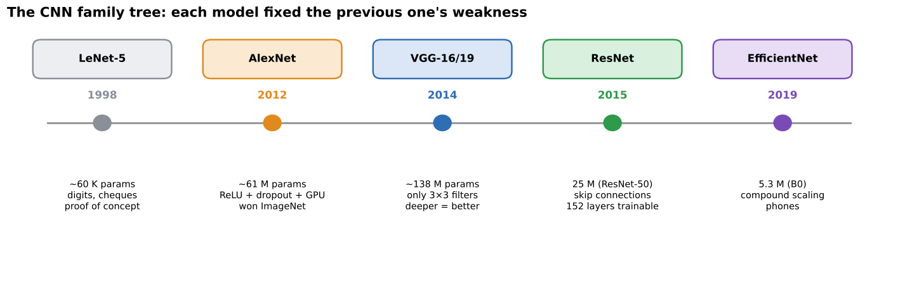
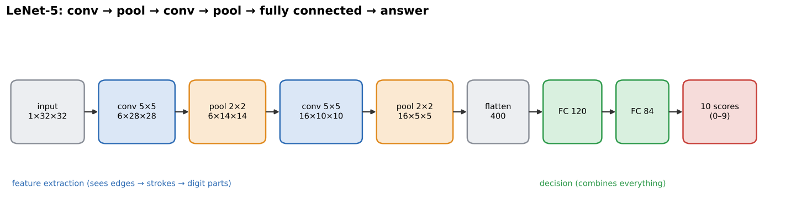
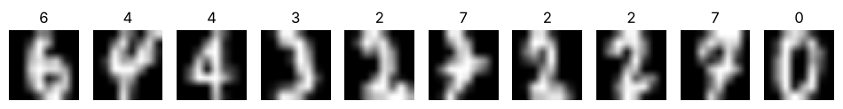
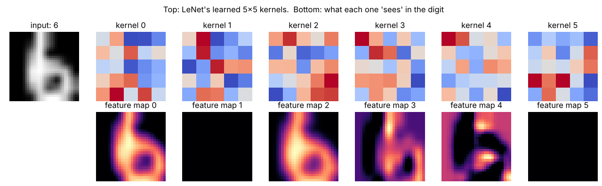
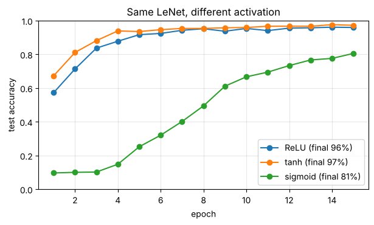
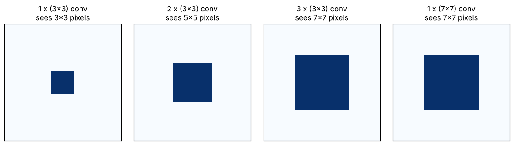

# 02 · Classic CNNs: LeNet (1998), AlexNet (2012), VGG (2014)

**Key Concepts covers:** CNN architectures intro · LeNet · AlexNet · VGG · Key takeaways · ReLU and dropout in AlexNet

**Notebook:** `notebooks/02_classic_cnns_lenet_alexnet_vgg.ipynb`

---

## Why study old architectures?

Each landmark model fixed a weakness of the one before it. If you know **what problem each one solved**, you can answer almost any "why" question in the eval.

> **One-line summary:** **LeNet** = proof of concept · **AlexNet** = the breakthrough in scale and performance · **VGG** = depth and simplicity as design principles.

---

## 1. LeNet-5 (1998): the proof of concept

| | |
|---|---|
| **Inventor** | **Yann LeCun** (and colleagues at AT&T Bell Labs) |
| **Purpose** | **handwritten digit recognition**, reading postcodes and **bank cheques** |
| **Dataset** | **MNIST**: 70,000 images of handwritten digits 0–9, 28×28 grey |
| **Architecture** | **conv → pool → conv → pool → fully connected → fully connected → output** |
| **Size** | about **60,000** parameters (tiny by today's standards) |

**Key contribution:** the first convincing proof that a network that **learns its own features** can beat **traditional machine learning** (hand-designed features + a classifier such as an SVM) on images. It was actually deployed: in the late 1990s it read a large share of the cheques written in the USA.

**How did it beat traditional methods?** Traditional pipelines needed a human to design the features (Week 1 style: edges, HOG, …). LeNet learned the features **and** the classifier **together**, end to end, using convolution's built-in advantages: weight sharing, local patterns and tolerance to shifts.

*Notebook 02: top row = LeNet's six learned 5×5 kernels; bottom row = what each one "sees" in a digit (the feature maps). Some act as stroke or edge detectors.*

**Honest note from the notebook:** on the tiny scikit-learn digits (1,257 training images, originally 8×8 pixels), a well-tuned SVM actually scored **98.9%** vs LeNet's **95.9%**. When the test digits are **shifted a few pixels**, both collapse (SVM 69.3%, LeNet 67.2%). Trained with shifted copies (**augmentation**), both recover (SVM 95.6%, LeNet 93.3% on shifted digits). In 1998, on the full MNIST, LeNet matched the best SVMs of its time while being much faster and smaller. Small, clean datasets don't show CNNs at their best. Their advantage grows with **bigger, messier images and more data**. That is exactly what AlexNet proved 14 years later.

---

## 2. AlexNet (2012): the breakthrough

| | |
|---|---|
| **Authors** | Alex Krizhevsky, Ilya Sutskever, Geoffrey Hinton (University of Toronto) |
| **Event** | won the **ImageNet** competition (ILSVRC 2012) **by a huge margin** |
| **Dataset** | ImageNet: about 1.2 million training images, **1,000 classes** |
| **Architecture** | **5 convolutional layers + 3 fully connected layers** |
| **Size** | about **61 million** parameters (about 58.6 M of them in the 3 dense layers) |
| **Key contribution** | **sparked the deep-learning revolution** in vision |

### The numbers (remember these)
- **Top-5 error:** the best traditional method had about **26%**. AlexNet got **15.3%**, a huge jump in one year.
- **Key Concepts phrasing:** accuracy before AlexNet **~70%**, after **~85%+**.
- (*Top-5* = counted correct if the right answer is anywhere in the model's 5 best guesses.)

### Three innovations (exam: "name two")

| Innovation | What it did |
|---|---|
| **ReLU** activation | trained about 6× faster than tanh and reduced vanishing gradients |
| **Dropout** (p = 0.5 in the dense layers) | reduced overfitting in the 58 M-parameter dense layers |
| **GPU training** | split across **two GTX 580 GPUs**. Training took about 5–6 days instead of weeks or months on CPUs |

Also used: data augmentation (random crops and flips), overlapping max pooling and local response normalisation.

### Why were GPUs critical?
Training means billions of multiply-adds per image (convolution is the same simple maths at millions of positions). A **GPU** has thousands of small cores that do these in **parallel**. Without GPUs, a network that size on 1.2 M images would have taken an impractically long time, so it simply wouldn't have been tried. **Big data (ImageNet) + GPUs + ReLU/dropout** arrived together, and that is why 2012 was the turning point.

*Notebook 02: the same LeNet trained three ways. Sigmoid learns much more slowly (81% vs 96–97%). In this small network tanh slightly edged out ReLU; ReLU's big advantage shows up in **deep** networks, where vanishing gradients bite.*

---

## 3. VGG (2014): depth and simplicity

| | |
|---|---|
| **Name** | **V**isual **G**eometry **G**roup, University of **Oxford** |
| **Depth** | **16–19 layers** (VGG-16 and VGG-19) |
| **Design choice** | **only small 3×3 filters**, stacked, everywhere |
| **Size** | about **138 M** (VGG-16) and **144 M** (VGG-19) parameters |
| **Key contribution** | showed that **depth improves accuracy**, and its simple, uniform design became a **standard baseline** in research |

### Why stack 3×3 filters instead of using one big one? (very common question)

- **Same view.** Two 3×3 layers in a row see a **5×5** area of the input, and three see **7×7**. That is the same "receptive field" as one 5×5 or 7×7 filter.
- **Fewer weights.** For C channels in and out:
  - three 3×3 layers: 3 × (3·3·C²) = **27 C²**;
  - one 7×7 layer: 7·7·C² = **49 C²**.
  
  That is about **45% fewer** weights.
- **More non-linearity.** Three layers means **three ReLUs** instead of one, so the network can learn more complex functions.

**VGG's weakness:** about 138 M parameters (most in the dense layers), slow and memory-hungry. Making it even deeper didn't help, because of the problem ResNet solved next.

---

## 4. Key takeaways (straight from Key Concepts)

| Model | Year | Remember it as |
|---|---|---|
| **LeNet** | 1998 | **proof of concept**: CNNs work (digits, cheques) |
| **AlexNet** | 2012 | **breakthrough**: scale + ReLU + dropout + GPUs → won ImageNet |
| **VGG** | 2014 | **depth + simplicity**: 16–19 layers of 3×3 filters → a standard baseline |

Together they form the timeline of CNN evolution, which continues in chapter 03 (ResNet, EfficientNet).

---

## Check yourself

1. Who invented LeNet, and what was it used for? On which dataset?
2. AlexNet: how many conv and FC layers? Name three innovations.
3. What happened to ImageNet error in 2012?
4. Why were GPUs essential for AlexNet?
5. VGG uses only one filter size. Which, and why is that clever?
6. How many weights do three stacked 3×3 layers use (C channels) compared with one 7×7?

Answers

1. Yann LeCun (1998). Handwritten digit recognition for postcodes and bank cheques. MNIST.
2. 5 conv + 3 FC. ReLU, dropout and GPU training (also data augmentation).
3. Top-5 error dropped from about 26% to 15.3%: a huge margin that started the deep-learning era.
4. Training needs billions of parallel multiply-adds. GPUs do these in parallel, cutting training from impractical to about 6 days.
5. 3×3. Stacking gives the same receptive field as a big filter with fewer weights and more non-linearity (more ReLUs).
6. 27C² vs 49C².

