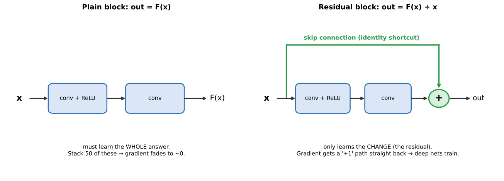
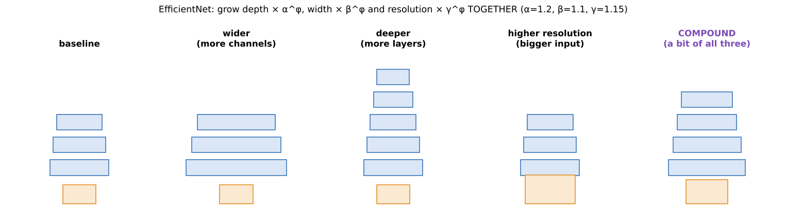

# 03 · Modern CNNs: ResNet (2015) and EfficientNet (2019)

**Key Concepts covers:** Why study modern CNNs · ResNet · EfficientNet · Key takeaways · Real-world applications

**Notebook:** `notebooks/03_modern_cnns_resnet_efficientnet.ipynb`

---

## Why "modern" CNNs?

VGG showed that **deeper is better**, but only up to a point. Two problems appeared:

1. **Depth problem:** past about 20 layers, plain networks got *worse*, even on their **training** data. Gradients vanished and weights stopped updating.
2. **Efficiency problem:** making networks bigger (deeper, wider, bigger images) was done by guesswork, wasted computation and was too heavy for phones.

**ResNet** solved problem 1. **EfficientNet** solved problem 2.

---

## 1. ResNet (2015): learn the change, not the whole thing

| | |
|---|---|
| **Authors** | Kaiming He et al., Microsoft Research |
| **Problem solved** | **vanishing gradients / degradation**: very deep networks stopped learning |
| **Innovation** | **residual (skip) connections** |
| **Impact** | trainable networks of **50, 101, even 152 layers** · won ImageNet 2015 (about 3.6% top-5 error, around human level) |
| **Key idea** | **learn residuals instead of direct mappings** |

### The skip connection



A plain block must learn the whole output: `out = F(x)`.
A **residual block** adds its input back on: **`out = F(x) + x`**.

So the layers inside only have to learn **F(x) = out − x**, the **residual**: *what needs to change*.

**Direct mapping vs residual, an analogy:** you are editing an essay. A *direct mapping* means rewriting the whole essay from scratch every time. A *residual* means "keep the essay and write down only the corrections". If the essay is already fine, the corrections are simply "none" (F(x) = 0), which is very easy to learn. So extra layers can at worst do nothing, and they never make things worse.

### Why it fixes the vanishing gradient

The backward pass through `out = F(x) + x` gives a gradient of **F′(x) + 1**. That **"+1"** is a highway: even if F′(x) is tiny, the gradient flows straight back through the shortcut to the early layers without shrinking.

### The notebook proves it

Notebook 03 trains plain and residual networks of the same depth on the same data:

| Depth | Plain network | Residual network |
|---|---|---|
| 6 layers | 78% | 88% |
| 22 layers | **10%** (= random guessing) | 76% |
| 52 layers | **10%** | 66% |

At 52 plain layers the gradient reaching the first layer was **exactly 0**: those layers never learned anything. The residual version still trains.

### ResNet sizes

| Model | Layers | Parameters |
|---|---|---|
| ResNet-18 | 18 | 11.7 M |
| ResNet-50 | 50 | 25.6 M |
| ResNet-152 | 152 | 60.2 M |

Even ResNet-152 is **smaller than VGG-16 (138 M)**. ResNet uses **global average pooling** instead of giant dense layers, and "**bottleneck**" blocks (1×1 conv to shrink the channels → 3×3 → 1×1 to expand them again).

**Real-world use (Key Concepts): medical imaging.** ResNet is a common backbone for X-ray, CT and MRI analysis and for detection and segmentation models (Faster/Mask R-CNN usually sit on a ResNet).

---

## 2. EfficientNet (2019): grow in a balanced way

| | |
|---|---|
| **Authors** | Mingxing Tan & Quoc Le, Google |
| **Problem solved** | scaling (deeper, wider or higher resolution) was **inefficient and unbalanced** |
| **Innovation** | **compound scaling**: scale **depth, width and resolution together** with one formula |
| **Impact** | higher accuracy with **far fewer parameters** · EfficientNet-B0 (**5.3 M**) beats ResNet-50 (25.6 M) |
| **Key idea** | **balanced scaling across dimensions** |

### Three ways to make a CNN bigger



| Dimension | Means | Gives on its own | Problem when it is the only one scaled |
|---|---|---|---|
| **Depth** | more layers | more complex features | gains flatten, harder to train |
| **Width** | more channels per layer | more fine-grained features | misses high-level features |
| **Resolution** | bigger input image | more fine detail | needs more depth and width to use it |

Scaling **only one** gives diminishing returns. They depend on each other: a bigger image needs **more layers** (for a bigger receptive field) and **more channels** (to capture the extra detail).

### The compound scaling formula

```
depth      d = α^φ        α = 1.2
width      w = β^φ        β = 1.1
resolution r = γ^φ        γ = 1.15
constraint: α · β² · γ² ≈ 2
```

- **φ (phi)** is the single dial you turn: φ = 0 → B0, φ = 1 → B1, … up to B7.
- α, β and γ were found **once** by a small search on the baseline network.
- Why **α · β² · γ² ≈ 2**? Computation grows with depth × width² × resolution², because doubling the channels or the image side roughly quadruples the work. So each step of φ roughly **doubles the compute**.

**Analogy:** making a bigger cake. You don't just add more flour (depth only). You scale **all** the ingredients in the right proportions.

**Real-world use (Key Concepts): mobile vision apps.** These run on phones and edge devices with little memory and battery (EfficientNet-Lite, on-device photo classification).

### Bonus: MobileNet and depthwise-separable convolution

Mobile models also use **depthwise-separable convolutions**. A normal convolution is split into:
1. a K×K filter on **each channel separately** (depthwise), then
2. a **1×1** convolution that mixes the channels (pointwise).

Notebook 03 counts the weights: about **8.4× fewer** than a normal 3×3 conv with the same input and output channels. EfficientNet's building block (MBConv) uses this.

---

## 3. Key takeaways

- **ResNet:** made **very deep** networks trainable (skip connections, residual learning).
- **EfficientNet:** made **scaling efficient** and practical (compound scaling).
- Together they represent the **modern era** of CNNs: solving **depth** and **efficiency**.
- Their ideas carry over to **Vision Transformers**: every transformer layer uses **residual connections**, and ViTs are scaled up systematically too (chapter 07).

### The full evolution in one table (Hard Q10)

| Step | Lesson passed on |
|---|---|
| LeNet → AlexNet | learned features + **scale, data, GPUs, ReLU, dropout** |
| AlexNet → VGG | **depth** with small, uniform blocks |
| VGG → ResNet | depth needs **skip connections** to train |
| ResNet → EfficientNet | **scale in a balanced way**, care about efficiency |
| → **Vision Transformers** | keep residuals, layer norm, big data and scaling laws, but swap convolution for **attention** |

---

## Check yourself

1. What problem made networks deeper than about 20 layers perform worse?
2. Write the formula for a residual block. What is the "residual"?
3. Why does the skip connection help the gradient?
4. Which network trained successfully with 152 layers?
5. What three things does EfficientNet scale, and what does φ control?
6. Give one real-world application each for ResNet and EfficientNet.

<details><summary>Answers</summary>

1. Vanishing gradients / degradation: the gradient shrinks layer by layer, so early layers stop updating.
2. out = F(x) + x. The residual F(x) = out − x is the change the block adds on top of its input.
3. Its derivative contributes a +1, so the gradient passes back unchanged through the shortcut even when F′ is tiny.
4. ResNet (ResNet-152).
5. Depth, width and resolution, together. φ is the single scaling dial (B0 → B7), and each step roughly doubles the computation.
6. ResNet: medical imaging (X-ray/CT/MRI analysis, a backbone for detectors). EfficientNet: mobile and on-device vision apps.
</details>
