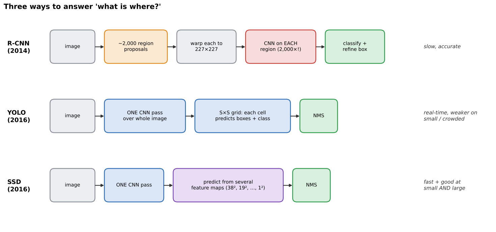
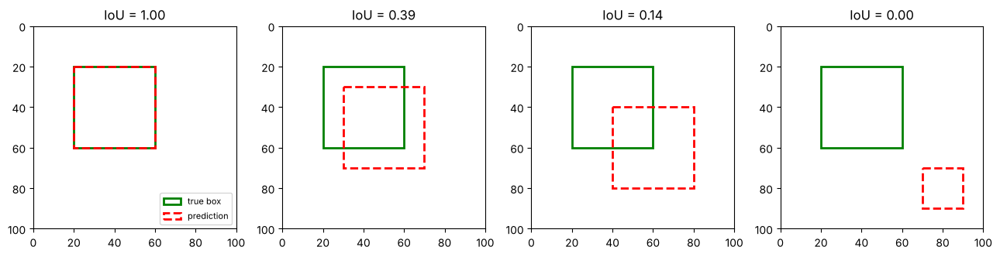
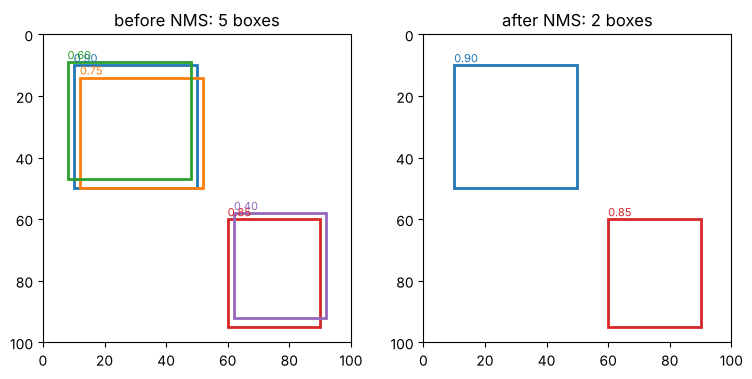
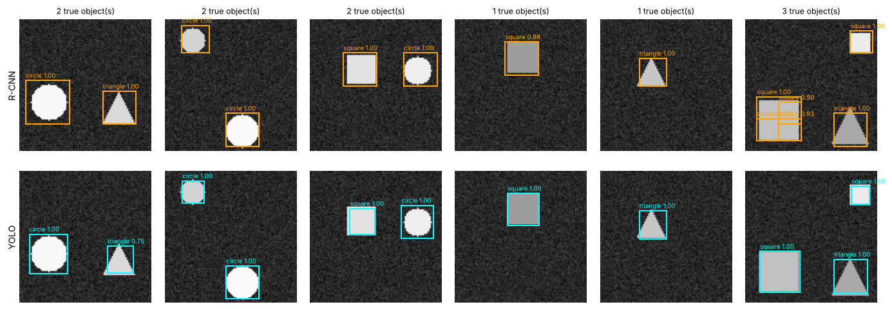
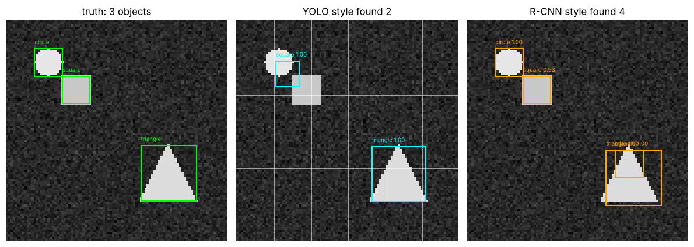
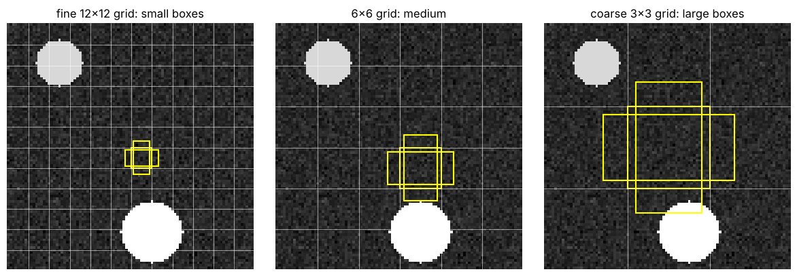

# 04 · Object detection: R-CNN, YOLO, SSD

**Key Concepts covers:** Object detection intro · R-CNN (2014) · YOLO (2016) · SSD (2016) · Key takeaways · Medical imaging vs autonomous driving

**Notebook:** `notebooks/04_object_detection_rcnn_yolo_ssd.ipynb`

---

## 1. What is object detection?

| Task | Answers | Output |
|---|---|---|
| **Classification** (chapters 02–03) | *what* is in the image? | one label: "dog" |
| **Object detection** | *what* is in the image **and where**? | for **every** object: a class + a **bounding box** + a confidence score |
| **Segmentation** (chapter 05) | which **pixels** belong to what? | a label per pixel |

A **bounding box** is a rectangle `(x1, y1, x2, y2)`, exactly like `cv2.rectangle` in Week 1.

Detection is harder than classification because the number of objects varies, they come in every size, and they can overlap. Different architectures balance **accuracy versus speed** differently.



---

## 2. Two tools every detector needs

### IoU: Intersection over Union (how good is a box?)

```
IoU = area of overlap / area of union        (0 = no overlap, 1 = perfect match)
```



A predicted box usually counts as **correct if IoU ≥ 0.5** with the true box.

### NMS: Non-Maximum Suppression (remove duplicates)

Detectors usually fire **several overlapping boxes** on the same object. NMS cleans this up:
1. Take the box with the **highest score** and keep it.
2. Delete every other box that overlaps it with IoU > threshold (e.g. 0.5).
3. Repeat with the next highest remaining box.



```python
from torchvision.ops import box_iou, nms
keep = nms(boxes, scores, iou_threshold=0.5)
```

---

## 3. R-CNN (2014): accurate but slow

**Full name:** **R**egion-based **C**onvolutional **N**eural **N**etwork (Ross Girshick et al.)

**Process:**
1. **Generate region proposals:** about **2,000** candidate boxes that *might* contain an object ("selective search" groups similar-coloured and similar-textured pixels, a Week 1-style method).
2. **Run a CNN on each region:** warp each crop to 227×227 and pass it through a CNN (AlexNet) → a feature vector.
3. **Classify and refine:** an SVM per class says what it is, and a regressor nudges the box to fit better.

**Example (Key Concepts):** an image of a dog → about 2,000 proposals, some on the dog, some on grass → each is classified → the "dog" boxes win, and NMS keeps the best one.

| Strengths | Weaknesses |
|---|---|
| **high accuracy** (careful look at each region) | **very slow**: the CNN runs about **2,000 times per image** (around 47 s per image in the original paper) |
| first major CNN-based detector, **proved deep learning works for detection** | multi-stage pipeline, complicated to train |

### The faster successors (good to know)
- **Fast R-CNN (2015):** run the CNN **once** on the whole image, then cut each region out of the **feature map** ("RoI pooling").
- **Faster R-CNN (2015):** replace selective search with a small learned **Region Proposal Network (RPN)**. Everything becomes one network, close to real time.
- **Mask R-CNN (2017):** Faster R-CNN plus a **mask** per object (chapter 05).

---

## 4. YOLO (2016): You Only Look Once

**Full name:** **Y**ou **O**nly **L**ook **O**nce (Joseph Redmon et al.)

**Process:**
- Treats detection as **one regression problem**: predict the numbers (box coordinates + class probabilities) directly.
- Divides the image into an **S × S grid** (7×7 in YOLOv1). Each cell predicts a few boxes (x, y, w, h, confidence) and class probabilities **for objects whose centre falls in that cell**.
- **All in one forward pass** of a single CNN, followed by NMS.

**Why it is fast:** the whole image goes through the network **once**, with no thousands of crops. YOLOv1 ran at about **45 frames per second**.

**Example (Key Concepts):** a street scene → one pass → cars, people and traffic lights all boxed at once.

| Strengths | Weaknesses |
|---|---|
| **real-time** speed | **less accurate for small objects** |
| sees the whole image, so fewer false alarms on background | each cell predicts only a few objects, so **crowded groups** of small objects get missed |
| made detection practical (**self-driving cars**, video) | coarse grid → less precise box edges |

### Notebook 04 race: tiny R-CNN vs tiny YOLO on a synthetic shapes dataset



| | R-CNN-style (sliding windows) | YOLO-style (grid) |
|---|---|---|
| Regions per image | 2,299 | 1 pass |
| Precision / recall | 72.2% / 91.9% | 99.5% / 99.0% |
| Speed | slow | **over 100× faster** (laptop CPU) |

(Our toy R-CNN uses crude sliding-window proposals, which is why its precision is low. The *real* R-CNN is more accurate than YOLOv1. The speed gap is the point here.)



*YOLO's weakness made visible: several small objects inside one grid cell, and the cell can only report one of them.*

### How to adapt YOLO for very small objects (Hard Q6)
1. **Higher input resolution** (e.g. 640 → 1280), so small objects cover more pixels.
2. **Finer grid / more output scales:** add a high-resolution detection head (feature pyramid, FPN).
3. **Small anchor boxes** matched to the object sizes in your data.
4. **Tiling:** cut a big image into overlapping tiles and detect on each.
5. **Augmentation:** copy-paste small objects, use mosaic images, oversample them.

---

## 5. SSD (2016): Single Shot MultiBox Detector

**Full name:** **S**ingle **S**hot Multi**B**ox **D**etector (Wei Liu et al.)

**Process:**
- One pass like YOLO (**single shot**), **but** it makes predictions from **several feature maps of different sizes**.
- **Early, big maps** (38×38, fine detail) → detect **small** objects.
- **Late, small maps** (3×3, 1×1, large receptive field) → detect **large** objects.
- Each map position has several **default boxes** (anchors) of different shapes. SSD300 checks **8,732** default boxes in total.



**Example (Key Concepts):** a **small cat and a large cat** in the same image: the fine map catches the small one, the coarse map the large one.

| Strengths | Weaknesses |
|---|---|
| **faster than R-CNN**, competitive accuracy | slightly less accurate than R-CNN-family models on very complex scenes |
| handles **small and large objects at the same time** | very small objects are still hard (early maps carry little meaning) |
| widely used in **mobile vision** (e.g. MobileNet-SSD) | |

---

## 6. Key takeaways and the "which one would you use?" question

| | R-CNN | YOLO | SSD |
|---|---|---|---|
| Passes | about 2,000 CNN runs | **1** | **1** |
| Speed | slow | **fastest** | fast |
| Accuracy | **highest** | lower (small objects) | good, across scales |
| Remember as | research breakthrough | real-time practical | balanced |

### Medical imaging → **R-CNN family** (Faster R-CNN)
- Tumours and lesions demand **high accuracy and careful localisation**.
- **False negatives (missing a tumour) are unacceptable.**
- Analysis is **offline**: a few seconds per scan is fine.
- *Example:* detecting small tumours in MRI scans.

### Autonomous driving → **YOLO** (or SSD)
- Must detect pedestrians, vehicles and signs in **real time** (many frames per second).
- One pass = high speed. SSD adds good multi-scale detection (near and far objects).
- *Example:* a pedestrian stepping into the road. A slightly less precise box **now** beats a perfect box **too late**.

> **Key insight:** medical imaging: accuracy > speed → R-CNN. Driving: speed > accuracy → YOLO/SSD. The choice depends on the application's **tolerance for errors** versus its **need for real-time speed**.

### Try a real detector
The project folder (`../project/project2_...ipynb`) runs a real pretrained **YOLOv8** on a street photo with `ultralytics`:
```python
from ultralytics import YOLO
results = YOLO("yolov8n.pt")("bus.jpg")
results[0].show()
```

---

## Check yourself

1. What does detection output that classification doesn't?
2. Box A and box B each have area 100 and overlap by 50. What is the IoU?
3. Why is R-CNN slow?
4. Why is YOLO fast? What is its main weakness?
5. How does SSD handle different object sizes?
6. Which detector for a tumour-detection system? For a self-driving car? Why?

<details><summary>Answers</summary>

1. Where each object is (a bounding box), for every object, with a confidence score.
2. 50 / (100 + 100 − 50) = 50/150 ≈ 0.33.
3. It runs the CNN separately on about 2,000 region proposals per image.
4. One forward pass over the whole image treats detection as a single regression. Its weakness is small and crowded objects (few predictions per grid cell, coarse grid).
5. It predicts from several feature maps: big early maps for small objects, small late maps for large objects, each with default boxes.
6. Tumour: R-CNN family (accuracy matters most, missing one is unacceptable, offline). Car: YOLO/SSD (real-time speed matters most).
</details>
