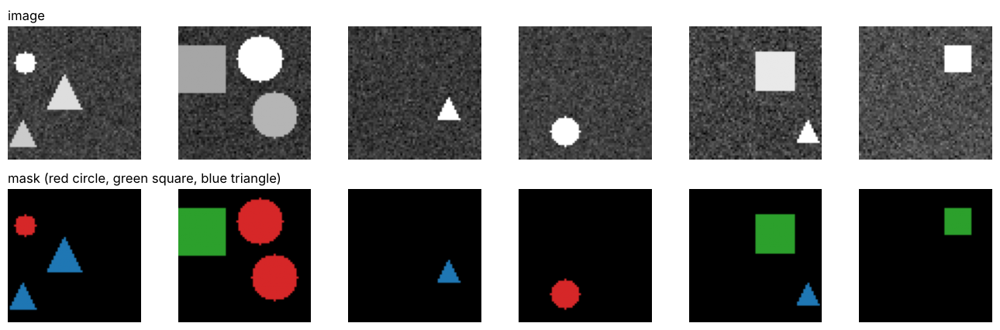
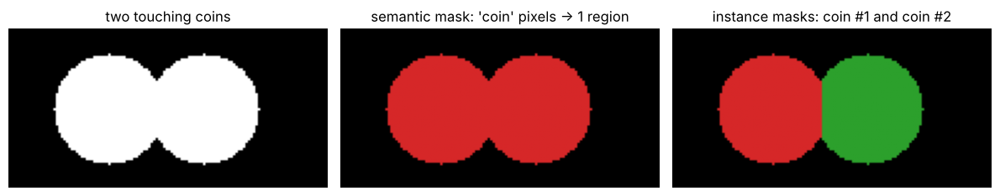
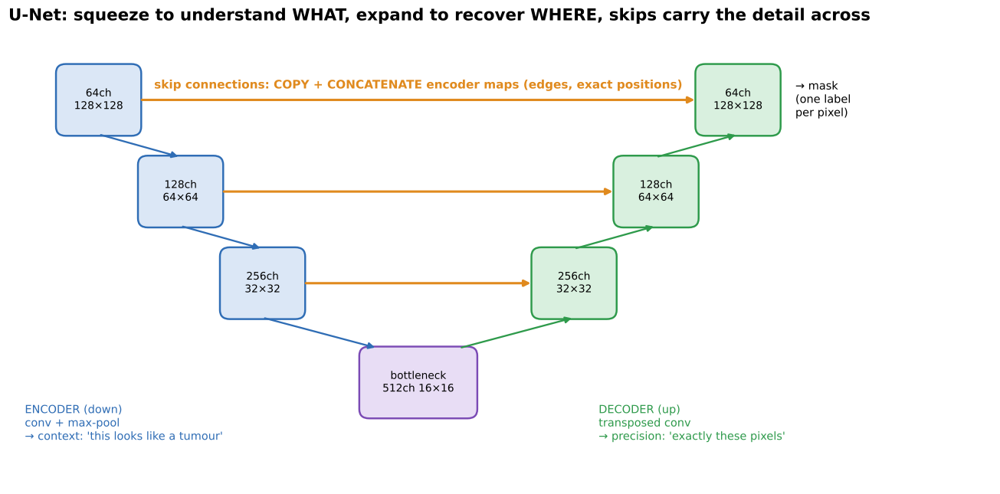
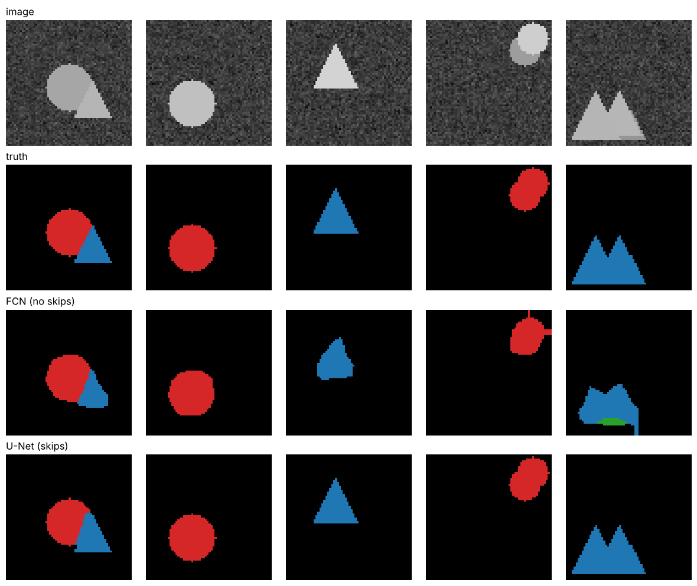

# 05 · Segmentation: FCN, U-Net, Mask R-CNN

**Key Concepts covers:** Semantic segmentation · FCN · U-Net · Skip connections · Encoder & decoder · Mask R-CNN · Why masks beat boxes in medicine

**Notebook:** `notebooks/05_segmentation_fcn_unet_mask_rcnn.ipynb`

---

## 1. What is segmentation?

> **Semantic segmentation = assigning a class label to *every pixel* in an image.**

The output is an image the same size as the input, where each pixel says "cat", "road" or "background". It is like Week 1 thresholding, but **learned**, and with many classes instead of just black and white.

| Type | Question | Two touching coins become… |
|---|---|---|
| **Semantic** segmentation | what class is each pixel? | **one** "coin" region |
| **Instance** segmentation | which **object** does each pixel belong to? | coin #1 and coin #2, **separately** |

**Applications:** medical imaging (tumours, organs, cells), autonomous driving (road, lanes, pedestrians), satellite imagery (buildings, roads, crops, flooding).

### The core challenge: context **and** precision
- **Context (what):** to know a region is a *tumour* you need to see a wide area, so the image has to be shrunk down (deep layers, large receptive field).
- **Precision (where):** to draw its exact border you need **full resolution**, but shrinking threw that away.

Classification only needs the "what". Segmentation needs both at once. Every architecture below is a way to solve this tension.

---

## 2. FCN (2015): Fully Convolutional Network

**Problem solved:** classic CNNs end with **fully connected layers**, which **flatten** the feature maps. All spatial information is lost and the output is a single label for the whole image.

**Innovation:** **replace the fully connected layers with convolutional layers** (1×1 convolutions). The network is now **convolutional all the way through**, so the output is still a grid, with a class score at every location. Upsample that grid back to the image size → a **dense, pixel-wise prediction map**.

- **Key idea:** end-to-end segmentation using **only convolutional layers**.
- **Bonus:** with no fixed-size dense layer it accepts **any input size**.
- **Example (Key Concepts):** an image of a cat → a mask labelling each pixel "cat" or "background".

| Strengths | Weaknesses |
|---|---|
| simple, effective, **first major CNN for segmentation** | **coarse predictions**, struggles with **fine boundaries** |

### Why are FCN predictions coarse?
The encoder downsamples by **32×** (five 2× poolings). A 224×224 image becomes a 7×7 grid of predictions. Blowing 7×7 back up to 224×224 is like enlarging a thumbnail: the **edges come out blobby**, and thin or small things vanish. FCN-16s and FCN-8s added some skips from earlier layers to help a bit.

---

## 3. U-Net (2015): encoder + decoder + skip connections

Originally designed for **biomedical** images (Ronneberger et al.), it is named after its **U shape**.

### Encoder (the downsampling path, left side)
- Repeated **conv + max pooling**, so the image gets smaller and the channels increase.
- Captures **context and high-level meaning**: "this region looks like a tumour".
- **Analogy:** compressing a photo into a summary. You lose fine detail but keep the big picture.

### Decoder (the upsampling path, right side)
- **Transposed convolutions** (learned upsampling) gradually restore the original resolution.
- Rebuilds a **pixel-level prediction**.
- **Analogy:** expanding the summary back to full resolution, now with a label on every pixel.

### Skip connections (the horizontal bridges)
- At each level, the encoder's feature map is **copied and concatenated** onto the decoder's feature map of the same size.
- **Why they help (Key Concepts):**
  1. **Preserve fine detail.** Downsampling lost the exact edges, and the skip brings them back from the early layers.
  2. **Combine low-level and high-level features.** Early layers know *edges and textures* (where), deep layers know *what the object is*. The decoder gets both.
  3. **Improve gradient flow.** Gradients have a short path back to early layers.

> **In short:** the encoder compresses for **context** (*what*), the decoder reconstructs for **precision** (*where*), and skip connections bridge the two so no important detail is lost.

**Example:** segmenting a tumour in an MRI. The encoder recognises "tissue that looks like a tumour" but loses the exact boundary. The skips bring back the original edges, and the decoder combines both → **sharp, accurate tumour borders**.

### Notebook 05: FCN vs U-Net on the same data

| | FCN-style | U-Net |
|---|---|---|
| mean IoU | 0.824 | **0.941** |
| accuracy on **boundary pixels** | 77.2% | **99.2%** |

Look at the triangles' sharp corners: FCN rounds them off, U-Net keeps them.

### Why U-Net is the standard in medical imaging
1. **Precise boundaries:** tumour and organ outlines are needed for measurement and treatment planning.
2. **Small structures:** cells, vessels and small lesions survive thanks to the skips.
3. **Small datasets:** works well with a few hundred labelled scans (plus heavy augmentation), and medical labels are expensive.
4. **Every pixel matters:** the output is a full mask, not a box.

### Skip connections in ResNet vs U-Net (Hard Q7)

| | ResNet | U-Net |
|---|---|---|
| Operation | **add**: F(x) + x | **concatenate** encoder map onto decoder map |
| Connects | input and output of a **block** (short, same level) | encoder ↔ decoder at the **same resolution** (long, across the U) |
| Main purpose | **gradient flow → train very deep nets** | **carry spatial detail → sharp boundaries** |

Both are "shortcuts that let information skip layers", used for different reasons.

### Satellite imagery (Hard Q9)
Choose a **U-Net** (often with a ResNet/EfficientNet encoder). Satellite tiles are large and full of thin, small structures (roads, field edges, buildings) that need precise boundaries. Labelled data is limited, and the image is split into tiles. Use **Mask R-CNN** if you need individual instances (counting buildings).

---

## 4. Mask R-CNN (2017): detection + a mask for every object

**The limitation it addresses:** detectors output only **boxes + labels**, and many applications need the **exact shape** of each individual object. That is **instance segmentation**.

**Architecture:** built on **Faster R-CNN**, plus a **mask branch** for each Region of Interest (RoI).

### How it works (4 steps)
1. **Region Proposal Network (RPN):** a small network sliding over the backbone's feature map that **suggests candidate object regions** ("something is probably here"), with no slow selective search.
2. **RoI Align:** cuts out an **exactly aligned** fixed-size feature patch (e.g. 7×7 or 14×14) for each proposal.
3. **Classification + bounding-box regression:** what is it, plus a refined box.
4. **Mask branch:** a small FCN that predicts a **binary mask** (e.g. 28×28) for each object, i.e. *which pixels inside the box belong to it*.

**Outputs for each object (three things):** a **bounding box** (where) · a **class label** (what) · a **pixel-level mask** (exact shape).

### RoI Pooling vs RoI Align (why RoI Align was introduced)
- A proposal box rarely lines up with the feature-map grid. For example, it might start at x = 3.7 cells.
- **RoI Pooling** (Fast/Faster R-CNN) **rounds** these positions to whole numbers (**quantisation**). Each feature-map cell covers about 16–32 pixels, so rounding shifts the box by many pixels. That doesn't matter much for a class label, but it **ruins a pixel-accurate mask**.
- **RoI Align** **does not round**. It samples the feature map at the exact (fractional) positions using **bilinear interpolation** (Week 1 Day 2!). The features stay aligned with the object, which gives much better masks.

### Handling overlapping objects (crowds)
Each person gets their **own RoI and their own mask**, predicted separately. Overlapping people are therefore **separated**, which semantic segmentation (one "person" blob) cannot do.

### Applications
- **Medical:** tumour segmentation, organ boundaries.
- **Autonomous driving:** pedestrians, vehicles and lane markings with exact shapes.
- **Crowd analysis:** separating overlapping people.
- Also: robotics (grasping an object by its exact outline), photo editing (cut out a person), agriculture (individual fruit and leaves), retail shelf counting.

**Key contributions:** extended detection to **instance segmentation**, introduced **RoI Align**, and became a **benchmark** model.

---

## 5. Why pixel masks beat bounding boxes in medical imaging

1. **Precise localisation:** tumours and organs are irregular, and a rectangle includes healthy tissue.
2. **Quantitative analysis:** masks give the true **area and volume** (e.g. tumour volume for **chemotherapy dosage**). Boxes overestimate because they include background.
3. **Clinical decisions:** surgery and radiotherapy planning, and monitoring growth, need exact borders and spread.
4. **Overlaps:** structures inside structures (a tumour within an organ) can't be separated by boxes.

> Boxes say "there's a tumour **here**". Masks say exactly **which pixels**, **how big** and **how it spreads**.

---

## Check yourself

1. Semantic vs instance segmentation: what's the difference?
2. Why does segmentation need both context and precision?
3. What did FCN replace, and with what? Why are its outputs coarse?
4. Roles of the encoder, decoder and skip connections in U-Net?
5. How does ResNet's skip differ from U-Net's?
6. Mask R-CNN: what are the three outputs per object? What does the RPN do? Why RoI Align?

Answers

1. Semantic gives each pixel a class (touching objects merge). Instance separates individual objects.
2. Context to know what an object is (needs a wide view and downsampling). Precision to know exactly which pixels (needs full resolution).
3. It replaced the fully connected layers with convolutional layers. Coarse because it predicts at 1/32 resolution and upsamples, so edges are blurry.
4. Encoder: downsample → context (what). Decoder: upsample → precision (where). Skips: copy fine detail from the encoder to the decoder and improve gradient flow.
5. ResNet adds (short, for gradient flow and depth). U-Net concatenates (long, across the U, for spatial detail).
6. Box, class and mask. The RPN proposes candidate regions. RoI Align avoids RoI Pooling's rounding by using bilinear interpolation, so features align with pixels and masks are accurate.

