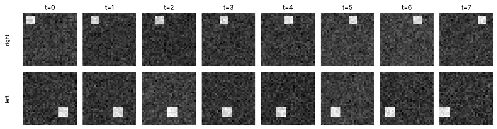
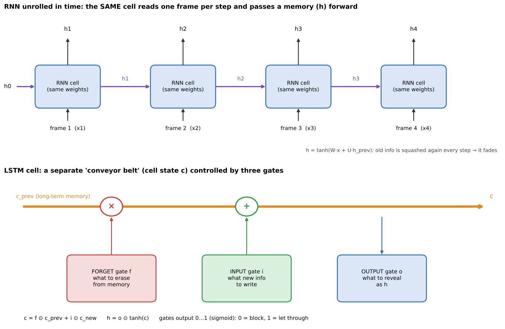
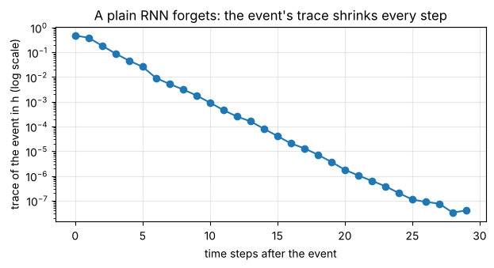
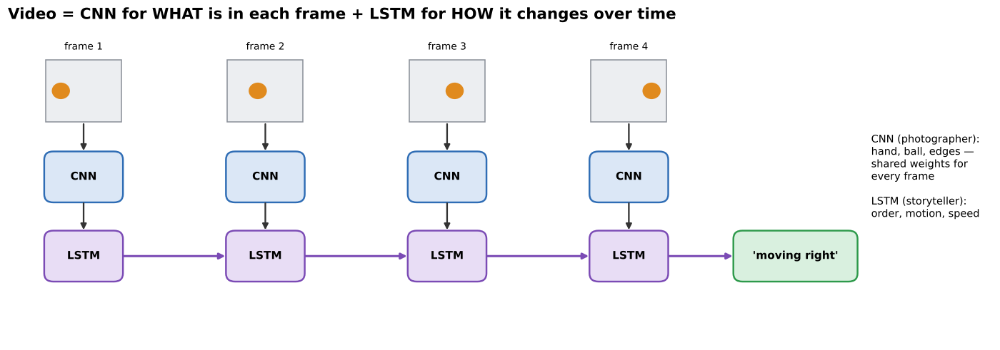
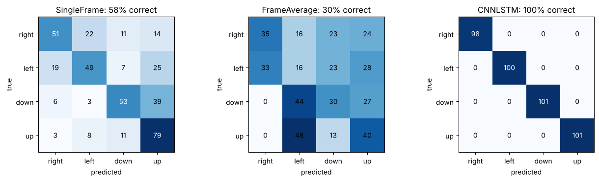

# 06 · Video & sequence models: RNN, LSTM, CNN + LSTM

**Key Concepts covers:** Sequence modelling for video · CNNs for spatial features · RNNs/LSTMs for temporal dependencies · CNN + LSTM pipeline · RNN vs LSTM · What CNNs and LSTMs capture · Features captured by RNNs

**Notebook:** `notebooks/06_video_sequence_models_rnn_lstm.ipynb`

---

## 1. What is sequence modelling?

> **Sequence modelling** = building models that understand and predict data that comes **in order** (steps over time).

Unlike a single photo, in a sequence **the current element depends on what came before** (*temporal dependencies*). Examples:
- **Text:** a word's meaning depends on the earlier words.
- **Speech, music, sensor readings, stock prices.**
- **Video:** a sequence of frames (images over time).

### Why video is hard: two kinds of information

| | Spatial | Temporal |
|---|---|---|
| Question | **what** is in each frame? | **how** does it change across frames? |
| Examples | a hand, a ball, a car, edges, textures | motion, order, speed, rhythm |
| Tool | **CNN** | **RNN / LSTM** |



*Notebook 06's toy videos: a square moving left vs moving right. Any **single frame** looks the same for both classes, so only the **order** tells them apart.*

### Why can't a CNN alone do it?
A CNN looks at **one frame at a time** and has no memory of the previous frame. It can recognise a *hand shape* in one frame but not the *waving gesture* across frames. Even averaging all the frames throws the order away: "left then right" and "right then left" average to the same thing.

---

## 2. RNN: Recurrent Neural Network



**How it works:**
- Processes the sequence **step by step** (frame 1, then frame 2, …).
- Keeps a **hidden state h**, a small memory vector carried forward.
- At every step it combines **the new input** with **the previous memory**:

```
h_t = tanh( W · x_t + U · h_(t−1) + b )
```

- The **same weights** (W, U) are used at every step, just as a conv kernel is reused at every position.

**What RNNs capture (Key Concepts):**
1. **Sequential patterns:** order ("the cat" comes before "sat on the mat").
2. **Temporal dependencies:** how a hand moves frame to frame.
3. **Context:** the hidden state carries the meaning of earlier inputs ("bank" means a riverbank if "river" came earlier).
4. **Short-term memory:** good at **recent** steps (the next note in a melody from the last few notes).

**Limitations:**
- **Vanishing gradient over long sequences.** Information from early steps gets squashed by `tanh` and multiplied by U **again at every step**, so it fades away (chapter 01's vanishing-gradient problem, but through **time**).
- **Slow training:** steps must be processed in order, one after another (not parallel).



*Notebook 06: the trace of one event inside a plain RNN's memory shrinks by about 10× every few steps. After 25 steps it is essentially gone.*

---

## 3. LSTM: Long Short-Term Memory

A special RNN designed to **remember over long sequences**.

**Innovation:** besides h, an LSTM keeps a separate **cell state c**, a "conveyor belt" of memory that runs straight through time. Information on the belt is changed only by **gentle additions and gated erasing**, not squashed every step. Three **gates** (each a value from 0 = block to 1 = let through, computed with a sigmoid) control it:

| Gate | Decides | Everyday analogy |
|---|---|---|
| **Forget gate f** | what **old** information to **discard** from c | wiping an old note off the whiteboard |
| **Input gate i** | what **new** information to **store** in c | writing a new note on the whiteboard |
| **Output gate o** | what information to **pass on** as the output h | deciding which notes to read out right now |

```
c_t = f ⊙ c_(t−1)  +  i ⊙ c̃_t        ← keep some old, add some new
h_t = o ⊙ tanh(c_t)                   ← reveal part of it
```

**Why this solves vanishing gradients:** when the forget gate is near 1, `c_t ≈ c_(t−1) + …`, so memory (and the gradient) flows back through time **almost unchanged**. That is the same trick as ResNet's "+x" highway, applied across time.

**Strengths:**
- remembers information **over long sequences**;
- handles **variable-length input** (short and long videos).

### Notebook 06: a memory test

Each sequence is T = 50 steps of random noise, except that the **first** step secretly encodes a class (0–3). The model must report that class at the end, so it has to carry information from step 1 all the way through.

| Model | Accuracy |
|---|---|
| plain RNN | 24.6% (= guessing among 4 classes: it forgot) |
| **LSTM** | **99.8%** |

### RNN vs LSTM (table from Key Concepts)

| Aspect | RNN | LSTM |
|---|---|---|
| Memory | **short-term** | **long-term** (long dependencies) |
| Problem | vanishing gradients | **solves** vanishing gradients (gates + cell state) |
| Best for | simple, short sequences | complex, long sequences |
| Example | next word in a short sentence | context across a long paragraph or a video |

**When is a plain RNN still enough?** Short sequences where only the last few steps matter: next character prediction, smoothing the last few sensor readings, short gesture snippets. It is also smaller and faster than an LSTM. (A **GRU** is a lighter LSTM with 2 gates, a good middle ground.)

---

## 4. The CNN + LSTM pipeline



1. **CNN** extracts **spatial features** from **each frame** (the same CNN, shared weights). Each frame becomes a feature vector.
2. **LSTM** processes the **sequence of feature vectors** across frames.
3. **Output layer** predicts the action or gesture class from the LSTM's last hidden state.

Result: an **end-to-end** system that understands **what** is in each frame and **how** it changes.

### What does each part capture? (Key Concepts)

| | CNN, "the photographer" | LSTM, "the storyteller" |
|---|---|---|
| Captures | **objects** (hand, ball, car), **shapes and edges**, **textures** | **motion** (left → right), **order** (first → last), **dynamics** (speed, rhythm) |
| Gesture example | the hand shape in each frame | the sequence of movements → "wave" |
| Action example | a person and a ball | the sequence → "throwing a ball" |

### Notebook 06: three models on the left/right/up/down motion videos



| Model | Sees | Accuracy |
|---|---|---|
| SingleFrame (CNN on one frame) | no time | 58% |
| FrameAverage (CNN on every frame, averaged) | all frames but **no order** | 30% |
| **CNN + LSTM** | frames **in order** | **100%** |

That is the whole point in one table: **order matters, and only the LSTM uses it.**

```python
class CNNLSTM(nn.Module):
    def __init__(self):
        super().__init__()
        self.cnn  = nn.Sequential(nn.Conv2d(1, 8, 3, padding=1), nn.ReLU(), nn.MaxPool2d(2),
                                  nn.Flatten(), nn.Linear(8 * 16 * 16, 32))
        self.lstm = nn.LSTM(32, 64, batch_first=True)
        self.head = nn.Linear(64, 4)
    def forward(self, video):                     # video: (N, T, 1, 32, 32)
        N, T = video.shape[:2]
        feats = self.cnn(video.flatten(0, 1))     # every frame through the SAME CNN
        out, (h, c) = self.lstm(feats.view(N, T, -1))
        return self.head(h[-1])                   # classify from the final memory
```

### Applications
- **Action recognition:** sports analysis, surveillance.
- **Gesture recognition:** sign language, human–computer interaction.
- **Video captioning:** describe a clip in words.
- **Autonomous driving:** predicting how pedestrians and cars will move.

> **In short:** CNNs capture the **what** (spatial), RNNs/LSTMs capture the **when / how** (temporal). Together they make video understanding possible.

---

## Check yourself

1. What is a temporal dependency? Give a video example.
2. Why can't a CNN alone recognise a waving gesture?
3. What does an RNN's hidden state do? What is its main limitation?
4. Name the three LSTM gates and what each one does.
5. Why does the LSTM remember longer than an RNN?
6. In a CNN + LSTM, what does each part contribute?

<details><summary>Answers</summary>

1. The current element depends on earlier ones. For example, whether a hand is "waving" depends on where it was in the previous frames.
2. It sees one frame at a time with no memory of order or motion. One frame shows a hand, not a wave.
3. It carries a summary of past inputs forward to the next step. Over long sequences that information fades (vanishing gradient), so it is only short-term memory.
4. Forget: what to discard from memory. Input: what new information to store. Output: what to pass on as the output.
5. The cell state is updated by addition and gated forgetting, not squashed every step, so information and gradients flow through time almost unchanged when the forget gate is about 1.
6. CNN: spatial features of each frame (objects, shapes, textures). LSTM: temporal pattern across frames (motion, order, speed), leading to the action class.
</details>
