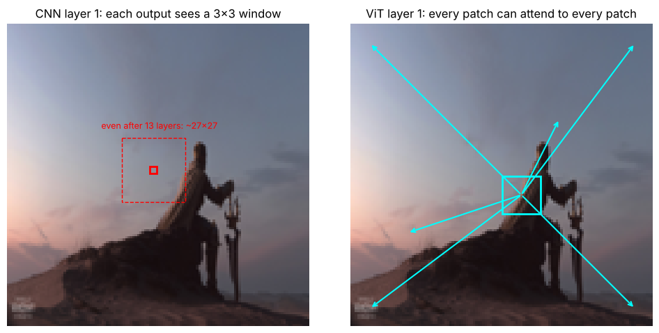
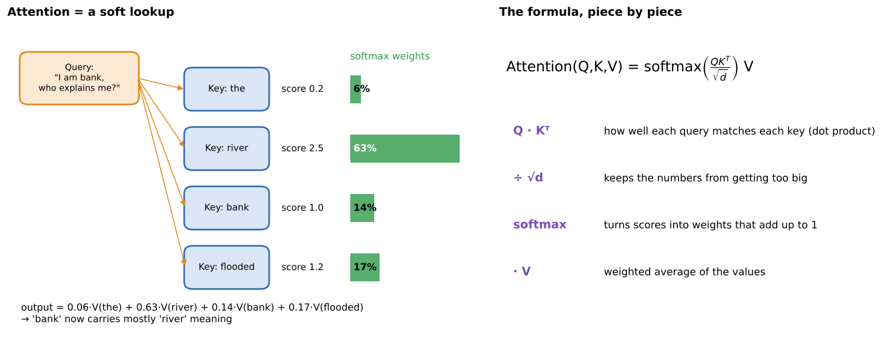
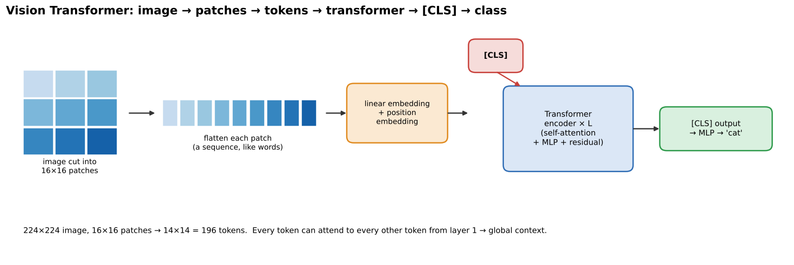
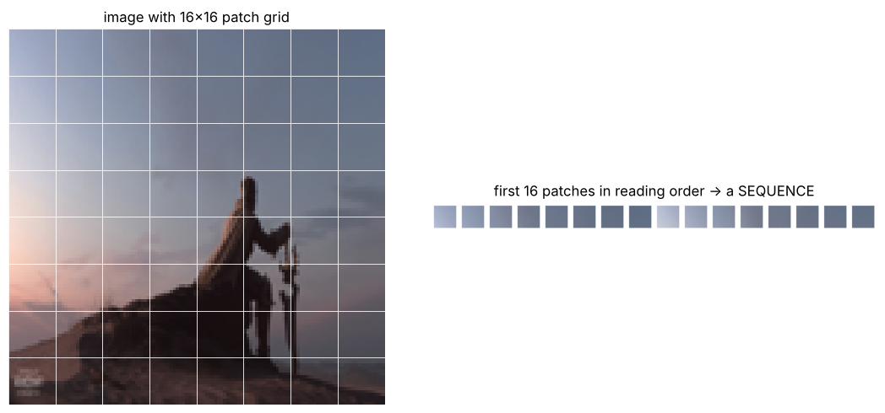
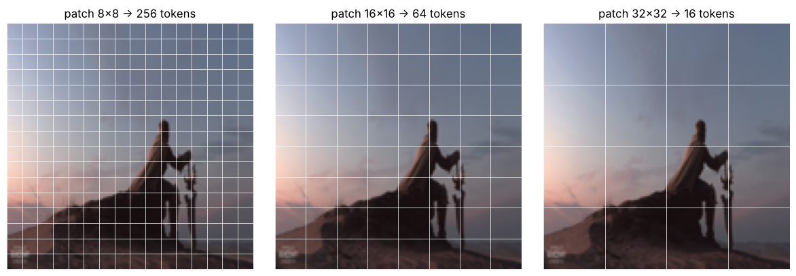
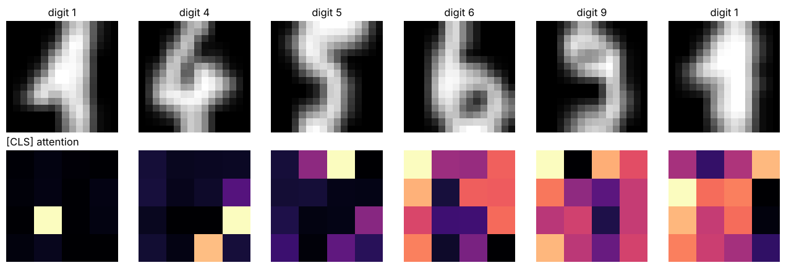

# 07 · Attention & Vision Transformers (ViT)

**Key Concepts covers:** Attention mechanism (Q, K, V) · Vision Transformer steps · Benefits of ViT · Applications · Why patches help capture global context

**Notebook:** `notebooks/07_vision_transformers_attention.ipynb` · course originals: `course-files/CV-Week3-vit1.ipynb`, `CV-Week3-vit2.ipynb`

---

## 1. Why something beyond CNNs?

CNNs are excellent at **local** features, but each layer only sees a small window (3×3). To connect the **top-left corner with the bottom-right corner**, information has to travel through many layers. CNNs **struggle with long-range dependencies**.

**Transformers** were invented for language (2017, "Attention Is All You Need"). Their **attention mechanism** lets **every element look at every other element directly**, in one step. The **Vision Transformer (ViT, 2020)** applies the same idea to images.



*Notebook 07: in layer 1, a CNN output sees only a 3×3 window, while a ViT patch can attend to **every** patch in the image.*

---

## 2. Attention: a soft lookup

> **Attention computes how relevant every element is to every other element, then mixes their information accordingly.**

Every element (word or image patch) produces three vectors:

| | Name | Plain meaning | Library analogy |
|---|---|---|---|
| **Q** | **Query** | what I am **looking for** | your search request |
| **K** | **Key** | what I **contain / offer** (a label) | the titles on the book spines |
| **V** | **Value** | the actual **information** I hand over | the contents of the books |

**Process:**
1. **Compare** the query with every key (dot product) → **similarity scores**.
2. **Softmax** the scores → **weights** that add up to 1.
3. Output = **weighted sum of the values**.



```
Attention(Q, K, V) = softmax( Q·Kᵀ / √d ) · V
```

(The **÷ √d**, where d is the vector length, keeps the scores from getting huge, which would make softmax too spiky.)

**The "bank" example (Key Concepts):** in "*the river bank flooded*", the word *bank* attends most strongly to *river*, so its output representation leans towards "riverbank". In "*the bank approved my loan*" it would attend to *loan* / *approved* → "money bank". **Same word, different meaning, decided by context.** Notebook 07 computes this with real numbers.

**Benefits:**
- captures **long-range dependencies** (pixels far apart but related);
- **flexible:** it **learns** which parts matter, separately for each input (a CNN's kernel is fixed after training).

**Self-attention** = Q, K and V all come from the **same** sequence (every patch attends to every patch). **Multi-head attention** runs several attentions in parallel, so different heads can focus on different relationships.

```python
attn = nn.MultiheadAttention(embed_dim=64, num_heads=4, batch_first=True)
out, weights = attn(x, x, x)      # self-attention: Q = K = V = x
```

---

## 3. The Vision Transformer, step by step



### Step 1: split the image into patches
- e.g. **16×16-pixel patches**. A 224×224 image → 14 × 14 = **196 patches**.
- Each patch is **flattened** (16·16·3 = 768 numbers) and passed through a **linear layer** (the "**patch embedding**") → a vector called a **token**, like a word in a sentence.





*Smaller patches → more tokens → finer detail but much more computation (attention compares every pair, so cost grows with tokens²).*

```python
# patch embedding in one line: a conv whose kernel size = stride = patch size
patch_embed = nn.Conv2d(3, 768, kernel_size=16, stride=16)    # (1,3,224,224) → (1,768,14,14)
tokens = patch_embed(img).flatten(2).transpose(1, 2)           # → (1, 196, 768)
```

### Step 1½: position embeddings
Attention by itself has **no idea of order**: shuffle the patches and it gives the same result. So a learned **position embedding** is **added** to each token, telling the model *where* each patch came from.

### Step 2: transformer encoder
A stack of identical layers, each containing:
- **multi-head self-attention:** every patch looks at every patch (**global context**);
- an **MLP** (two dense layers) applied to each token;
- **residual connections** (from ResNet!) and layer normalisation around both.

### Step 3: the classification token [CLS]
- An extra learnable token is placed at the **front** of the sequence.
- It owns no patch of its own. Through attention it **gathers a summary of the whole image**.
- Its final output goes to a small classifier → "cat" / "dog".



*Notebook 07: where the [CLS] token "looks" in our tiny ViT's last block. For some digits it focuses on one or two stroke patches; for others it is spread out, because earlier layers have already mixed information between patches. Attention maps are a useful hint, not a full explanation. The key point: the model chooses where to look by itself.*

> **Key idea:** apply the transformer architecture **directly to images**, bypassing convolutions.

---

## 4. Why split the image into patches? (Key Concepts question)

1. **Treats the image like a sequence.** Patches become tokens, like words, so the transformer's attention can be applied across them.
2. **Captures long-range dependencies.** Any patch can directly compare itself to any other patch, from the very first layer. *Zebra example:* stripes on the head and on the legs are related, and attention links them directly.
3. **Reduces complexity.** Attention compares **every pair**. Using individual pixels (224 × 224 = 50,176 tokens) would mean about 2.5 **billion** pairs, while 196 patches give only about 38,000. Patches make it **affordable**.
4. **Balances local and global.** **Inside** each patch: local detail (edges, texture). **Across** patches: attention builds the global picture (shape, scene).

> **In short:** patches turn an image into a sequence, so transformers can connect distant regions and capture global context efficiently.

---

## 5. CNN vs ViT

| | CNN | Vision Transformer |
|---|---|---|
| Basic operation | convolution (local window) | self-attention (all patches) |
| View in layer 1 | **local** (3×3) | **global** (every patch) |
| Built-in assumptions | "nearby pixels are related", "patterns can be anywhere" | very few, so it has to learn them |
| Data needed | works with **less data** | needs **large datasets** (or pretraining) to shine |
| Scaling | improves, then saturates | **keeps improving** with more data and size |
| Weakness | long-range relationships | data-hungry, cost grows with tokens² |

**Honest result from notebook 07:** on our small digits dataset, a tiny ViT got **96.9%** and a tiny CNN **98.1%**. With little data the CNN's built-in assumptions ("look locally") are a free head start. The original ViT paper beat CNNs only after pretraining on **hundreds of millions of images**. This is exactly why **hybrid models** (CNN layers first, transformer on top) are popular.

### Benefits of ViT (Key Concepts)
- captures **global context** better than CNNs;
- **scales well** with large datasets;
- **flexible:** classification, detection (DETR), segmentation (SegFormer);
- inspired many **hybrid** models (CNN + Transformer).

### Applications
- image classification (ImageNet benchmarks);
- **medical imaging** (global patterns across a whole scan);
- **video understanding** (add **temporal attention** across frames, replacing the LSTM of chapter 06);
- **multimodal** vision + language (image captioning, CLIP, visual question answering).

> **Impact:** shifted computer vision from **CNN-centric** to **transformer-centric** approaches.

---

## 6. How the course's own ViT notebooks fit in

`course-files/CV-Week3-vit1.ipynb` and `vit2.ipynb` load an image, cut it into patches and display them as a grid. That is Step 1 above. They expect a `cat.jpg` that was not in the zip, so our notebook 07 runs the same exercises on `../../week-1/code/sample.jpg`. Any photo works.

---

## Check yourself

1. What do Query, Key and Value mean, in plain words?
2. Write the attention formula. Why divide by √d?
3. A 224×224 image with 16×16 patches gives how many tokens? With 32×32 patches?
4. Why does ViT need position embeddings?
5. What is the [CLS] token for?
6. Give four reasons for splitting the image into patches.
7. When would you still pick a CNN over a ViT?

<details><summary>Answers</summary>

1. Query: what I'm looking for. Key: what each element offers (used for matching). Value: the information actually passed on.
2. softmax(QKᵀ/√d)·V. Dividing keeps the dot products from growing with the vector length, so softmax doesn't become extremely peaked.
3. 14 × 14 = 196 with 16×16 patches; 7 × 7 = 49 with 32×32 patches.
4. Attention ignores order. Without position embeddings, shuffled patches would look the same.
5. A learnable summary token that gathers information from all patches through attention. Its output is used for classification.
6. Image becomes a sequence of tokens · direct long-range comparisons · far fewer tokens than pixels, so it is affordable · local detail inside patches, global context across them.
7. Small datasets, limited compute, or edge and mobile devices, where the CNN's built-in locality makes it data-efficient and cheap.
</details>
