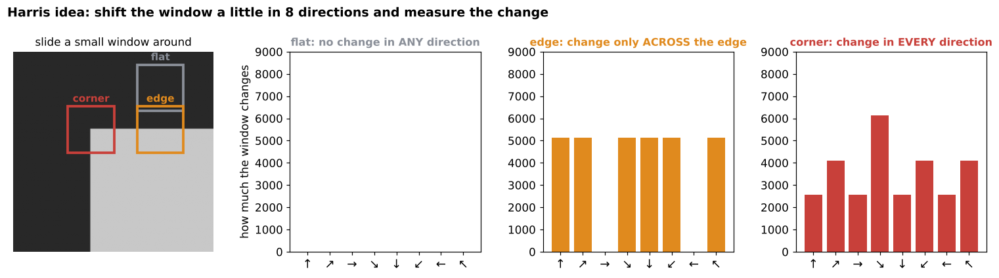
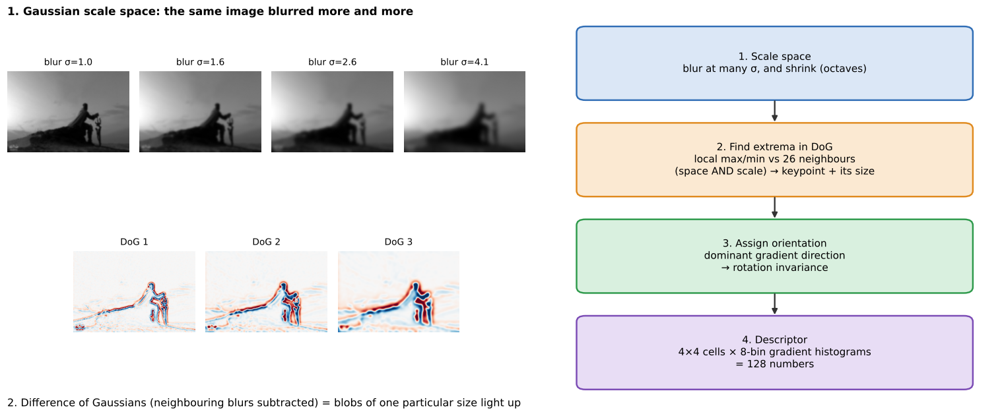
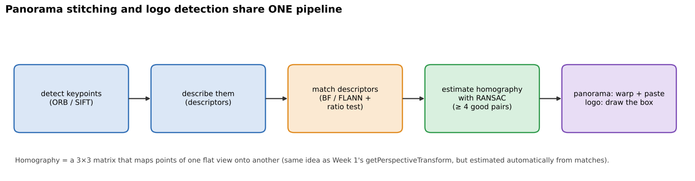
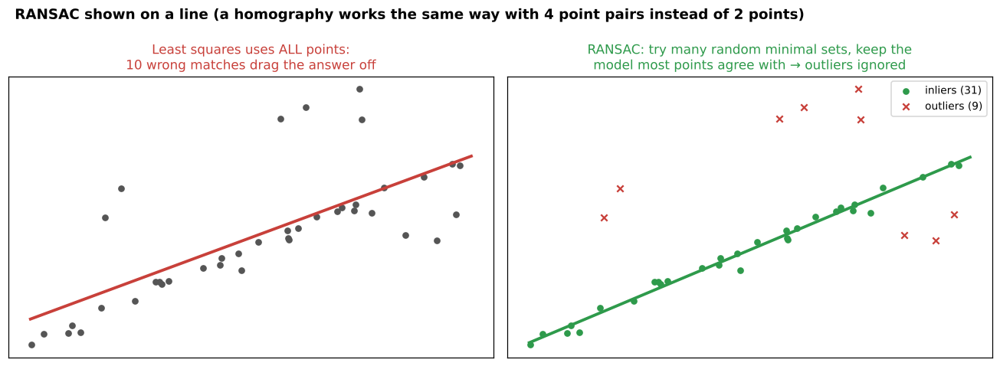

# 01 · Feature detection: Harris, SIFT, ORB (+ panorama stitching)

**Key Concepts covers:** What features represent · Why features matter · Harris · SIFT · ORB · Detect-keypoints exercise · Panorama mini project · What are keypoints?

**Lab notebook:** `labs/day08_feature_detection_panorama.ipynb` (course lab `CV-Week2-Lecture1.ipynb`, Day 8)

> Week 1's Key Concepts already introduced corners, SIFT and optical flow in one paragraph each (`../week-1/notes/key_concepts.md`). Week 2 is where you actually **use** them.

---

## 1. What is a "feature"?

> A **feature** is a **distinctive, informative pattern** in an image that can be **detected** (found), **described** (turned into numbers) and **compared** (matched with another image).

Think of how you'd describe a building to a friend so they can find it. You wouldn't say "it has grey pixels". You'd say "the corner with the red door, the round window above it". Those are **features**: small, unusual, recognisable spots.

| Kind | What it is | Example detector |
|---|---|---|
| **Corners** | intensity changes in **two** directions | Harris, Shi–Tomasi |
| **Edges** | boundaries between regions of different brightness or texture | Canny (Week 1) |
| **Blobs / keypoints** | regions that stand out from their surroundings | SIFT, ORB |
| **Descriptors** | a **vector of numbers** describing the neighbourhood around a feature | SIFT (128 floats), ORB (256 bits) |

### Why features matter (the three magic properties)
1. **Uniqueness:** distinctive enough to be matched across different images. A plain blue sky is not unique, but a window corner is.
2. **Repeatability:** the same feature is found again even if the image changes (scale, rotation, lighting).
3. **Compact representation:** instead of comparing millions of pixels, compare a few hundred features.

---

## 2. Keypoint vs descriptor (exam favourite: "detection vs description")

| | **Keypoint** (detection) | **Descriptor** (description) |
|---|---|---|
| Answers | **where** is something interesting? | **what does it look like** there? |
| Is | a location + extra info | a vector of numbers |
| In OpenCV | `cv2.KeyPoint`: `.pt` (x, y), `.size` (scale), `.angle` (orientation), `.response` (strength) | a row of the `des` array |

```python
kp, des = sift.detectAndCompute(gray, None)   # detect AND describe in one call
print(len(kp), des.shape)                      # e.g. 1200 keypoints → des is (1200, 128)
print(kp[0].pt, kp[0].size, kp[0].angle, kp[0].response)
```

**Analogy:** a keypoint is a **pin on a map** (the location). A descriptor is the **written description** of that spot ("red door, brick wall, step on the left") that lets someone recognise it in another photo.

---

## 3. Harris corner detection



**Concept:** put a small window on the image and imagine sliding it a little in every direction.
- **Flat region:** nothing changes, whichever way you slide.
- **Edge:** changes only when you slide **across** the edge, not along it.
- **Corner:** changes in **every** direction. That's what Harris looks for.

**Method:** it uses the image **gradients** (Week 1's Sobel) inside the window to compute a **corner response score R** for every pixel (the course says "corner response"). Big positive R means corner, negative R means edge, and R near 0 means flat.

```python
gray = np.float32(gray)                       # cornerHarris needs float input
dst = cv2.cornerHarris(gray, 2, 3, 0.04)
#                            │  │   └─ k: sensitivity constant (0.04–0.06 typical)
#                            │  └──── ksize: Sobel kernel size for gradients
#                            └─────── blockSize: neighbourhood (window) size
img[dst > 0.01 * dst.max()] = [0, 0, 255]     # mark pixels whose score is > 1% of the best one: red
```

| Pros | Cons |
|---|---|
| simple and effective | **not scale-invariant**: a corner seen from far away can look like a smooth curve when zoomed in |
| good for rigid structures (buildings, checkerboards) | **not rotation-invariant** as a *descriptor* (it doesn't describe anything) |
| fast | sensitive to image transformations; only gives *locations*, no descriptor |

> Strictly speaking, the Harris *response* itself is fairly rotation-tolerant (a rotated corner is still a corner), but Harris has **no scale handling and no descriptor**, so it can't match features across zoom or rotation. The course's line "not invariant to scale or rotation" refers to using it for matching. The Day 8 lab measures this.

**Lab outcome:** red dots on the corners of the sample image.

---

## 4. SIFT: Scale-Invariant Feature Transform

**Concept:** detect **and describe** keypoints that survive **zoom, rotation and lighting changes**. It was invented by David Lowe (1999/2004).



**The 4-step pipeline (learn it in order):**
1. **Build a Gaussian scale space.** Blur the image more and more, and shrink it into "octaves". This lets SIFT look for features of **every size**.
2. **Detect extrema in the Difference of Gaussians (DoG).** Subtract neighbouring blur levels. A point is a keypoint if it is a local max or min compared with its **26 neighbours** (8 in the same level, 9 above, 9 below). It is found **at its own scale**, so the keypoint knows its **size**. That gives **scale invariance**.
3. **Assign an orientation.** Find the dominant gradient direction around the keypoint. Descriptors are measured **relative to it**, which gives **rotation invariance**.
4. **Create the descriptor.** Take a 16×16 area around the keypoint, split it into 4×4 cells, and make an 8-bin gradient-direction histogram in each: 4 × 4 × 8 = **128 numbers**. Normalising the vector gives some **illumination** robustness.

```python
sift = cv2.SIFT_create()                       # free in OpenCV ≥ 4.4 (the patent expired in 2020)
kp, des = sift.detectAndCompute(gray, None)
out = cv2.drawKeypoints(img, kp, None, flags=cv2.DRAW_MATCHES_FLAGS_DRAW_RICH_KEYPOINTS)
#                                               └─ draws a circle sized by scale + a line showing orientation
```

| Pros | Cons |
|---|---|
| very robust: scale, rotation, illumination | **computationally heavy** (slow) |
| widely used in research and industry | **historically patented**, now free in OpenCV ≥ 4.4 |
| rich 128-D descriptor → reliable matching | 128 floats per keypoint = more memory |

**Lab outcome:** "rich" keypoints drawn as circles (size = scale) with a line (orientation).

---

## 5. ORB: Oriented FAST and Rotated BRIEF

**Concept:** a **fast, free** alternative to SIFT, built from two older parts:
- **FAST** (detector): looks at a ring of 16 pixels around a candidate. If enough of them are all much brighter or all much darker than the centre, it's a corner. Very quick.
- **BRIEF** (descriptor): compares the brightness of **256 pairs** of pixels around the keypoint ("is A brighter than B?"). That gives a **256-bit binary string**.
- ORB **adds orientation** (so it is rotation invariant), uses an **image pyramid** (some scale tolerance), and ranks corners by Harris score.

```python
orb = cv2.ORB_create()                         # default nfeatures = 500 keypoints
kp_orb, des_orb = orb.detectAndCompute(gray, None)
print(des_orb.shape, des_orb.dtype)            # (500, 32) uint8 → 32 bytes = 256 bits
```

Binary descriptors are compared with **Hamming distance** (how many bits differ). A computer does that with one XOR and a bit count, which is extremely fast.

| Pros | Cons |
|---|---|
| **free**, **fast**, efficient (real-time, phones, robots) | **less robust than SIFT for large scale changes** |
| rotation invariant | binary descriptor is less discriminative than SIFT's 128 floats |

### Harris vs SIFT vs ORB (the exercise's learning point)

| | Harris | SIFT | ORB |
|---|---|---|---|
| Finds | corners | blobs at any scale | FAST corners |
| Descriptor | **none** | 128 floats | 256 bits |
| Scale invariant | ❌ | ✅ | partly (pyramid) |
| Rotation invariant | ❌ (for matching) | ✅ | ✅ |
| Speed | fast | slow | **very fast** |
| Course summary | finds corners but misses scale/rotation changes | finds **fewer but more reliable** keypoints | finds **many fast** keypoints, good for real time |

---

## 6. Mini project: panorama stitching



**Workflow:**
1. **Detect features** (ORB) in both overlapping photos.
2. **Match features** between them (Brute-Force matcher with Hamming distance; see chapter 02).
3. **Estimate a homography** with **RANSAC**.
4. **Warp** one image into the other's frame and **stitch** them together.

### Homography
> A **homography** is a 3×3 matrix that maps points on one image plane to another. It is the same "perspective transform" as Week 1 Day 2 (`getPerspectiveTransform`), but here it is **estimated automatically from matched features** instead of 4 hand-picked corners.

It is exactly right when the camera **rotates without moving** (a panorama taken from one spot), or when the scene is **flat** (a poster, a logo, a document).

### RANSAC (RANdom SAmple Consensus)
Some matches are always **wrong** (outliers). Normal fitting uses every point, so a few bad matches ruin the answer. RANSAC instead:
1. picks a **random minimal set** (4 matches for a homography);
2. computes the homography from just those;
3. counts how many **other** matches agree with it (within a threshold, e.g. 5 pixels, which are the **inliers**);
4. repeats many times and keeps the homography with the **most inliers**.



```python
M, mask = cv2.findHomography(src_pts, dst_pts, cv2.RANSAC, 5.0)
#                                                          └─ max reprojection error (pixels) to count as an inlier
print("inliers:", mask.sum(), "of", len(mask))
result = cv2.warpPerspective(img1, M, (w1 + w2, h))   # warp img1 into img2's coordinate frame
```

> ⚠️ **Watch out in the course code:** it warps `img1` (left) into `img2`'s (right) frame and then pastes `img2` at the left of the canvas. For a normal left/right pair, the left image lands at **negative x** and gets cut off. The lab notebook shows the bug and the fix: map the **right** image into the **left** image's frame, or shift the canvas.

**Real-world uses:** phone panorama mode, satellite and drone image mosaics, Google Street View, medical slide scanning.

---

## Check yourself

1. What three properties make a good feature?
2. What's the difference between a keypoint and a descriptor? What does a `cv2.KeyPoint` store?
3. How does Harris tell a corner from an edge?
4. List SIFT's 4 steps. Which step gives scale invariance and which gives rotation invariance?
5. Why is ORB so fast? How are ORB descriptors compared?
6. What does a homography do, and why do we need RANSAC to estimate it?

<details><summary>Answers</summary>

1. Uniqueness (distinctive), repeatability (found again after scale, rotation or lighting changes) and compactness (few numbers instead of all the pixels).
2. A keypoint is where something interesting is (x, y, size, angle, response). A descriptor is a vector describing what the area around it looks like.
3. Sliding a window over an edge changes it in one direction only. Over a corner, every direction changes. Harris turns this into a response score from the gradients.
4. Scale space → DoG extrema (scale invariance) → orientation assignment (rotation invariance) → 128-D descriptor.
5. FAST is a quick brightness test on a 16-pixel ring, and BRIEF is 256 simple brightness comparisons. Descriptors are binary and compared with Hamming distance (count of differing bits).
6. It maps points of one image plane onto another (warping, stitching, locating). Some matches are wrong, and RANSAC finds the homography most matches agree with, ignoring the outliers.
</details>
