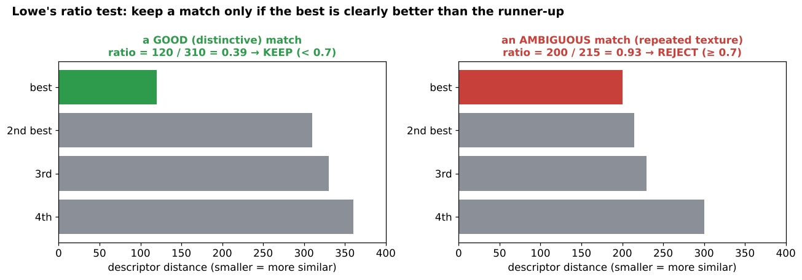

# 02 · Image matching: descriptors, FLANN, the ratio test (+ logo detector)

**Key Concepts covers:** Why image matching · Feature descriptors · FLANN · Match-logos exercise · Logo detector mini project · Tips

**Lab notebook:** `labs/day09_image_matching_logo_detector.ipynb` (course lab `CV-Week2-Lecture2.ipynb`, Day 9)

---

## 1. What is image matching?

> **Image matching** = finding **correspondences** between features in two or more images: "this point in image A is the same physical point as that point in image B".

**Applications:**
- **logo detection** in adverts and media (brand monitoring: how often does our logo appear on TV?);
- **object recognition** in robotics and surveillance;
- **image retrieval** in search engines ("search by image");
- panoramas (chapter 01), augmented reality (stick a 3-D model on a recognised poster), visual SLAM for robots.

It always follows the same recipe: **detect → describe → match → verify geometry.**

---

## 2. Feature descriptors

> A **descriptor** encodes the neighbourhood around a keypoint into a **vector of numbers**. Two keypoints **match** if their descriptors are **similar** (a small distance).

| Descriptor | Type | Size | Compare with | Notes |
|---|---|---|---|---|
| **SIFT** | float | 128 numbers | **Euclidean (L2)** distance | robust to scale and rotation |
| **ORB** | binary | 256 bits (32 bytes) | **Hamming** distance | fast, free |
| **SURF** | float | 64 numbers | L2 | faster than SIFT, but **patented** (not in standard OpenCV builds) |

**Distance in plain words:**
- **L2 (Euclidean):** the straight-line distance between two lists of numbers, √Σ(aᵢ − bᵢ)².
- **Hamming:** the number of bits that differ. `10110` vs `10011` → 2.

---

## 3. Two ways to match

### Brute-Force (BF) matcher
Compare **every** descriptor in image A with **every** descriptor in image B and take the closest. It is exact but slow when there are many features (N × M comparisons).

```python
bf = cv2.BFMatcher(cv2.NORM_HAMMING, crossCheck=True)   # Hamming for ORB; use cv2.NORM_L2 for SIFT
matches = sorted(bf.match(des1, des2), key=lambda m: m.distance)   # best (smallest distance) first
```

`crossCheck=True` keeps a match only if **A's best is B and B's best is A** (they choose each other), which removes many wrong matches.

### FLANN (Fast Library for Approximate Nearest Neighbours)
> A library optimised for **fast matching of high-dimensional descriptors**. It builds a smart **index** (like the index at the back of a book) so it doesn't have to compare everything.

- For **SIFT** (floats) → a **KD-tree** index: `dict(algorithm=1, trees=5)`.
- For **ORB** (binary) → **LSH** (Locality Sensitive Hashing): `dict(algorithm=6, table_number=6, key_size=12, multi_probe_level=1)`. Hashing puts similar bit strings in the same "bucket".
- `search_params = dict(checks=50)` sets how many index entries to check. More checks are more accurate but slower.

| Pros | Cons |
|---|---|
| **efficient for large datasets** | **approximate**: may miss the exact best match |
| scales well with many features | needs **parameter tuning** |

---

## 4. Lowe's ratio test (the key technique)

```python
matches = flann.knnMatch(des1, des2, k=2)    # for each feature, the BEST and SECOND-BEST match
good = [m for m, n in matches if m.distance < 0.7 * n.distance]
```



**Idea:** a truly matching feature has **one** clearly closest partner. If the best and second-best candidates are almost equally close, the feature is **ambiguous** (repeated texture: windows on a building, letters in text), so throw it away.

- **Ratio 0.7–0.8** is typical (Lowe used 0.8, the course uses 0.7).
- **Lower ratio** → fewer matches, but more of them correct.
- **Higher ratio** → more matches, but more of them wrong.

> In the course code, `for m, n in matches` crashes if FLANN returns fewer than 2 neighbours for some feature, which can happen with LSH. The lab notebook guards against this.

---

## 5. Mini project: logo detector

**Workflow:**
1. **Detect features** in both the logo and the scene.
2. **Match descriptors** using FLANN.
3. **Apply Lowe's ratio test** to keep good matches.
4. **Estimate a homography** (logo → scene) with **RANSAC** (needs at least 4 pairs; the course requires > 10 to be safe).
5. **Draw a bounding box**: transform the logo's 4 corners with the homography and draw the resulting quadrilateral.

```python
if len(good) > 10:
    M, mask = cv2.findHomography(src_pts, dst_pts, cv2.RANSAC, 5.0)
    h, w = logo.shape
    corners = np.float32([[0, 0], [0, h - 1], [w - 1, h - 1], [w - 1, 0]]).reshape(-1, 1, 2)
    box = cv2.perspectiveTransform(corners, M)                # where the logo's corners land in the scene
    cv2.polylines(scene_color, [np.int32(box)], True, (0, 255, 0), 3)
else:
    print("Not enough matches - logo probably not in the scene")
```

> ⚠️ **What the Day 9 lab found:**
> - `len(good) > 10` alone is a weak "logo found" rule. At ratio 0.8 it wrongly reported the logo in **all 10** scenes that didn't contain it.
> - Counting **RANSAC inliers** and checking that the box is a sensible shape gave 0 false detections in 20 logo-free tests.
> - In scenes with the logo pasted at known positions, ORB found it 8 times out of 9 and SIFT 9 out of 9 (SIFT still worked at 0.35× zoom, where ORB failed).

The box is a **tilted quadrilateral**, not a rectangle, because the homography includes perspective: a logo seen at an angle.

**Outcome:** the logo localised in the scene, even when it is rotated, scaled, partly hidden or surrounded by clutter.

### Evaluating matches (the exercise's discussion)
- **How many matches** were found?
- **Accuracy:** are the matches **clustered on the logo** or **scattered** across the scene? Scattered means false matches.
- **Inlier ratio** after RANSAC (`mask.sum() / len(mask)`) is a good confidence number.
- **ORB vs SIFT:** SIFT usually gives more correct matches when the logo is small or scaled. ORB is much faster.

### Tips from the course
- Remember the difference between **detection and description** (keypoints vs descriptors).
- Matching quality depends on the **descriptor choice** and the **ratio-test threshold**.
- Real-world uses: **brand monitoring, AR, visual search**.
- Test with different logos and **cluttered scenes**. Plain, textureless logos (a single coloured circle) have almost no keypoints and **can't** be found this way.

---

## Check yourself

1. Which distance measure do you use for SIFT descriptors, and which for ORB? Why?
2. What does `crossCheck=True` do?
3. Why is FLANN faster than brute force, and what's the trade-off?
4. Explain Lowe's ratio test in one sentence. What happens if you raise the ratio from 0.7 to 0.9?
5. Why does the logo detector need a homography and not just the matches?
6. Why can't this method find a plain, single-colour logo?

<details><summary>Answers</summary>

1. SIFT uses L2 (Euclidean), because it is float vectors. ORB uses Hamming, because it is binary strings, and counting differing bits is natural and very fast.
2. It keeps a match only if the two features are each other's best match (mutual).
3. It uses an index (KD-tree or LSH) to search only likely candidates. It is approximate, so it may miss the true best match, and it needs tuning.
4. Keep a match only if the best distance is clearly smaller than the second best (best < 0.7 × second). At 0.9 you get more matches but many more wrong ones.
5. Matches are just point pairs and some are wrong. The homography (with RANSAC) finds the one consistent geometric transformation, rejects outliers and tells you where the logo's outline is.
6. A plain shape has no corners or texture, so it has no keypoints and nothing to describe or match.
</details>
