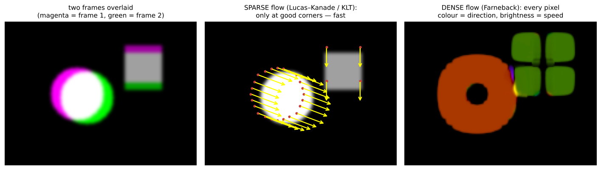

# 03 · Object tracking: optical flow, KLT, dense flow

**Key Concepts covers:** Why object tracking · Optical flow (dense vs sparse) · KLT tracker · Track-a-ball exercise · Motion tracker mini project (Farneback) · Tips

**Lab notebook:** `labs/day10_object_tracking_optical_flow.ipynb` (course lab `CV-Week2-Lecture3.ipynb`, Day 10)

---

## 1. What is object tracking?

> **Object tracking** = following a moving target across **consecutive video frames**.

**Uses:** surveillance (following a person across CCTV), sports analytics (ball and player paths), autonomous driving (where is that car going?), human–computer interaction (hand and eye tracking).

**Why it's hard:** objects **change appearance** (turn, deform, get lit differently), get **occluded** (hidden behind something) and **move quickly** (big jumps between frames, motion blur).

**Detection vs tracking:** detection finds objects in *one* frame from scratch. Tracking uses the *previous* frame's answer to find the object again, which is faster and keeps each object's **identity** (this is still car #3).

---

## 2. Optical flow

> **Optical flow** estimates how each pixel **moves** between two consecutive frames: a motion vector (dx, dy).

**Key idea, "brightness constancy":** a point keeps the same brightness as it moves, so if a bright spot was at (10, 20) and the same bright pattern is now at (13, 21), that point moved (+3, +1).



| | **Sparse** optical flow | **Dense** optical flow |
|---|---|---|
| Computes motion for | only selected **keypoints** (good corners) | **every pixel** |
| Typical algorithm | **Lucas–Kanade** → KLT tracker | **Farneback** |
| Speed | **fast**, often used in real-time systems | slower |
| Gives | tracks of specific points | a full motion map, great for **visualisation** |
| OpenCV | `cv2.calcOpticalFlowPyrLK` | `cv2.calcOpticalFlowFarneback` |

**Limitations:** sensitive to **large displacements** (fast motion), **lighting changes** (which break brightness constancy) and **occlusions** (the point disappears).

---

## 3. The KLT (Kanade–Lucas–Tomasi) tracker

> A widely used tracker based on **sparse** optical flow.

**Two steps:**
1. **Detect "good features to track"**, usually corners (the Shi–Tomasi corner detector, a refinement of Harris). You can only track points you can see moving: a flat wall has no texture to follow, and a point on an edge can slide along it (the "aperture problem").
2. **Follow them with Lucas–Kanade optical flow**, frame by frame.

```python
feature_params = dict(maxCorners=100,     # at most 100 points
                      qualityLevel=0.3,   # keep corners ≥ 30% as strong as the best one
                      minDistance=7,      # at least 7 px apart (spread them out)
                      blockSize=7)        # neighbourhood used to judge "corneriness"
p0 = cv2.goodFeaturesToTrack(old_gray, mask=None, **feature_params)

lk_params = dict(winSize=(15, 15),        # search window around each point
                 maxLevel=2,              # pyramid levels: 0 = no pyramid; 2 = also search at 1/2 and 1/4 size
                 criteria=(cv2.TERM_CRITERIA_EPS | cv2.TERM_CRITERIA_COUNT, 10, 0.03))
#                           stop after 10 iterations OR when the update is smaller than 0.03

p1, st, err = cv2.calcOpticalFlowPyrLK(old_gray, frame_gray, p0, None, **lk_params)
good_new = p1[st == 1]                    # st = 1: this point was found again, st = 0: lost
```

**Why the pyramid (`maxLevel`) matters:** Lucas–Kanade assumes **small** motion, within the window. Shrinking the image makes a 40-pixel jump only 10 pixels at quarter size, so it can be found. Then the estimate is refined at full size. This is the fix for "**large motion jumps**".

| Pros | Cons |
|---|---|
| **efficient** and relatively simple | struggles with **occlusion** (object hidden) |
| works well for **moderate motion and stable lighting** | struggles with **large motion jumps** (use pyramids and a bigger winSize) |
| | points get lost over time, so it **needs re-initialisation** (re-detect features every N frames) |

### Exercise: track a moving ball
- Run KLT on a ball video. The course's `ball.mp4` wasn't provided, so the lab generates one.
- **maxCorners:** more points means a sturdier track but more work.
- **winSize:** bigger windows cope with faster motion but blur detail and cost more. Too small and a fast ball is lost.

---

## 4. Mini project: motion tracker with dense optical flow (Farneback)

**Workflow:**
1. Compute dense optical flow with **Farneback's algorithm**.
2. Convert the flow vectors (dx, dy) into **magnitude** (speed) and **angle** (direction): `cv2.cartToPolar`.
3. Visualise with **colour coding**: put angle into **Hue**, speed into **Value (brightness)**, then convert **HSV → BGR**.

```python
flow = cv2.calcOpticalFlowFarneback(prvs, next, None,
                                    0.5,   # pyr_scale: each pyramid level is half the size
                                    3,     # levels: number of pyramid levels
                                    15,    # winsize: averaging window (bigger = smoother, less detail)
                                    3,     # iterations at each level
                                    5,     # poly_n: neighbourhood for the polynomial fit
                                    1.2,   # poly_sigma: Gaussian smoothing for that fit
                                    0)     # flags
mag, ang = cv2.cartToPolar(flow[..., 0], flow[..., 1])
hsv[..., 0] = ang * 180 / np.pi / 2                          # direction → hue (OpenCV hue is 0–179)
hsv[..., 1] = 255                                            # full saturation
hsv[..., 2] = cv2.normalize(mag, None, 0, 255, cv2.NORM_MINMAX)   # speed → brightness
bgr = cv2.cvtColor(hsv, cv2.COLOR_HSV2BGR)
```

**How to read the picture:** **black** means nothing moves. **Bright colour** means motion, and the **colour tells the direction** (e.g. red = moving right, cyan = moving left), the same HSV colour wheel as Week 1 Day 1.

**Outcome:** moving regions are highlighted, a clear visualisation of motion patterns.

**Applications:**
- detecting **unusual movement** in surveillance (someone running against the crowd);
- **player motion** in sports;
- **traffic-flow** visualisation in driving research.

> The course code uses `cv2.imshow` in a `while` loop, which only works when run as a desktop script, not inside a notebook. The lab notebook shows frames with matplotlib instead and can write an output video.

---

## 5. Tips (from the course)
- **Sparse vs dense:** efficiency vs detail.
- KLT builds on optical flow by focusing on **good features to track**.
- Test with different videos: **fast motion, occlusion, multiple objects**.
- Real-world systems: **CCTV tracking, sports replay analysis, driver-assistance systems**.
- Week 1's **Kalman filter** (`../week-1/notes/key_concepts.md`) is the classic partner of a tracker: it **predicts** where the object should be next, which helps it survive short occlusions.

---

## Check yourself

1. What assumption does optical flow rely on?
2. Sparse vs dense optical flow: which is faster? Which gives a motion map for every pixel? Name the OpenCV function for each.
3. What are the two steps of KLT? Why does it track corners rather than flat areas?
4. What do `winSize` and `maxLevel` control? How would you fix a tracker that loses a fast ball?
5. In the dense-flow visualisation, what do hue and brightness mean?
6. Give two situations where KLT fails and how to handle them.

<details><summary>Answers</summary>

1. Brightness constancy: a point keeps its brightness as it moves (and motion between frames is small).
2. Sparse (Lucas–Kanade, `calcOpticalFlowPyrLK`) is faster. Dense (Farneback, `calcOpticalFlowFarneback`) gives every pixel.
3. Detect good features to track (Shi–Tomasi corners), then follow them with Lucas–Kanade. Corners have texture in two directions, so their motion is unambiguous. Flat areas and edges are not.
4. `winSize` is the search window size. `maxLevel` is the number of pyramid levels, which lets it handle bigger motion. For a fast ball: increase `maxLevel` and/or `winSize`, and re-detect lost points.
5. Hue is the direction of motion. Brightness is the speed. Black means static.
6. Occlusion (the points vanish): re-detect features, or use prediction (Kalman). Large jumps: use pyramids and a bigger window. Lighting changes: brightness constancy breaks, so re-initialise.
</details>
