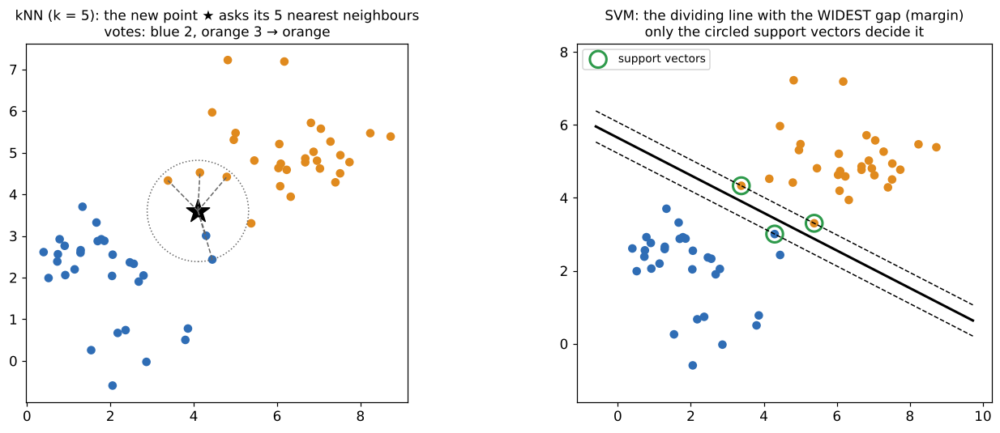

# 04 · Machine learning in CV: kNN and SVM (+ digit recogniser)

**Key Concepts covers:** Why ML in computer vision · k-Nearest Neighbours · Support Vector Machines · Handwritten digit recogniser mini project

**Lab notebook:** `labs/day11_ml_knn_svm_digits.ipynb` (course lab `CV-Week2-Lecture4.ipynb`, Day 11)

---

## 1. Why machine learning in computer vision?

Week 1 and Days 8–10 used **hand-written rules**: "a corner is where the window changes in every direction", "red is hue 0–10". That works when **you** can describe the rule. But try writing rules that tell a handwritten **4** from a **9** for every person's handwriting. It's hopeless.

> **Machine learning (ML)** algorithms **learn patterns from examples (data)** and use them to classify or recognise new inputs. You provide labelled examples instead of rules.

**Applications:** handwritten digit recognition (**MNIST**: post codes, bank cheques), object classification in photos, medical image analysis.

### The ML vocabulary you need

| Word | Meaning | In the digits lab |
|---|---|---|
| **Sample** | one example | one 8×8 digit image |
| **Features (X)** | the numbers describing a sample | its 64 pixel values (flattened) |
| **Label (y)** | the correct answer | 0–9 |
| **Training set** | examples the model learns from | 70% of the images |
| **Test set** | held-back examples used only to check it | the other 30% |
| **Classifier** | the model that predicts labels | kNN, SVM |

```python
digits = datasets.load_digits()                       # 1,797 tiny 8×8 digits, pixel values 0–16
X = digits.images.reshape((len(digits.images), -1))   # 8×8 grid → 64 numbers per sample
X_train, X_test, y_train, y_test = train_test_split(X, y, test_size=0.3, random_state=42)
```

> ⚠️ `load_digits` is **not** the real MNIST (which is 70,000 images of 28×28). It's a small 8×8 dataset that ships with scikit-learn, so nothing needs downloading. The Day 15 lab uses real MNIST.

---

## 2. k-Nearest Neighbours (kNN)



> **Classify a new sample by the majority label of its k closest training examples.** "Tell me who your neighbours are and I'll tell you who you are."

**Steps:**
1. Compute the **distance** (e.g. Euclidean) between the test sample and **every** training sample.
2. Pick the **k nearest**.
3. **Vote:** assign the most common label among them.

```python
knn = KNeighborsClassifier(n_neighbors=5)   # k = 5
knn.fit(X_train, y_train)                   # "training" = just storing the data!
y_pred_knn = knn.predict(X_test)            # the real work (all the distances) happens here
```

| Pros | Cons |
|---|---|
| simple, intuitive | **slow at prediction for large datasets**: compares with *every* training sample |
| **no training phase** (it just memorises) | sensitive to **irrelevant features** and the **choice of distance metric** |
| works well for small datasets | needs features on the same scale; memory grows with the data |

**Choosing k:**
- **k = 1** follows every noisy point (overfits).
- A **huge k** always votes for the most common class (underfits).
- Use an **odd** k for two classes to avoid ties, and try several values on validation data.

---

## 3. Support Vector Machines (SVM)

> **Find the dividing line (in many dimensions, a hyperplane) that separates the classes with the maximum margin**, i.e. the widest possible "street" between them.

**Steps (course version):**
1. **Map** the data into a high-dimensional space (the **kernel** does this implicitly).
2. Find the separating **hyperplane** with the **largest margin**.
3. Classify new samples by **which side** of the hyperplane they fall on.

- **Support vectors** = the training points closest to the boundary (circled in the picture). **Only they** determine the line, and the rest could be deleted without changing it.
- **Why the widest margin?** A boundary that sits far from both classes is less likely to misclassify slightly different new samples, so it generalises better.

### Kernels: what if no straight line separates the classes?
- **Linear kernel:** a flat hyperplane in the original space.
- **RBF (Gaussian) kernel**, the default in scikit-learn: implicitly maps the data into a very high-dimensional space where a flat cut becomes a **curved** boundary in the original space. This is the "kernel trick": it is computed without ever building that space.

```python
svm = SVC(kernel='linear')        # course code also passes gamma='scale', which a LINEAR kernel ignores
svm = SVC(kernel='rbf', C=1.0, gamma='scale')   # C: how hard to punish mistakes; gamma: how "curvy" the boundary is
svm.fit(X_train, y_train)
```

| Pros | Cons |
|---|---|
| **effective in high-dimensional spaces** (64 pixels, 128-D SIFT, BoVW histograms) | **computationally expensive** to train on large datasets |
| **robust to overfitting** when tuned (margin maximisation) | needs a careful choice of **kernel and parameters** (C, gamma) |
| fast prediction (only support vectors matter) | multi-class is done by combining many 2-class SVMs |

### kNN vs SVM

| | kNN | SVM |
|---|---|---|
| Training | none (store the data) | solve an optimisation (slow on big data) |
| Prediction | slow (distances to everything) | fast |
| Memory | keeps all training data | keeps only the support vectors |
| Idea | majority vote of neighbours | best dividing line |
| Course one-liner | "majority vote of neighbours" | "find the best dividing line" |

---

### What the Day 11 lab measured
- **On the 8×8 digits (30% test split):** kNN (k = 5) **99.26%**, linear SVM 97.96%, RBF SVM 98.70%.
- **With 5-fold cross-validation:** the best k was 1 (98.65%), and a tuned RBF SVM reached 99.21%.
- **On real MNIST (20,000 training images):** kNN 94.0%, RBF SVM **95.9%**, linear SVM 88.2%.
- **Prediction speed:** kNN does get slower as the training set grows, which confirms the textbook. But an **RBF SVM was even slower** at prediction here (about 5 s vs 1.3–1.7 s), because it keeps thousands of support vectors. Only the *linear* SVM is really fast.
- **Your own drawn digits:** 0/30 correct when fed in directly, 21/30 after preprocessing them to look like the training data.

## 4. Reading `classification_report`

```
              precision    recall  f1-score   support
           3       0.98      1.00      0.99        54
```

| Column | Plain meaning |
|---|---|
| **precision** | of everything predicted as "3", how many really were 3? (few false alarms) |
| **recall** | of all the real 3s, how many did we find? (few misses) |
| **f1-score** | one number balancing precision and recall (their harmonic mean) |
| **support** | how many real 3s are in the test set |
| **accuracy** | overall fraction correct |

A **confusion matrix** shows *which* digits get mixed up (e.g. 8 ↔ 1 or 9 ↔ 3). It is more useful than a single accuracy number.

---

## 5. Mini project: handwritten digit recogniser

**Workflow:**
1. Train an SVM on the digits.
2. Write a function that predicts the label of a new digit image.
3. Test it with sample digits.

```python
def recognize_digit(image):            # image must be 8×8 with values 0–16, like the training data
    return svm.predict(image.reshape(1, -1))[0]
```

> ⚠️ **Two traps the lab notebook demonstrates:**
> 1. The course tests on `digits.images[10]`, which may well be in the **training** set. Testing on data the model has seen proves nothing.
> 2. A **new** digit (your own drawing) must be **preprocessed to look like the training data**: 8×8, white-on-black, centred, values 0–16. Otherwise the predictions are garbage.

**Real-world uses (course tips):** postal-code recognition, bank-cheque processing, OCR systems.

---

## Check yourself

1. What does "training" mean for kNN? Why is kNN slow at prediction time?
2. What happens with k = 1 vs a very large k?
3. What is the margin in an SVM, and what are support vectors?
4. When do you need a non-linear (RBF) kernel?
5. Precision vs recall: explain each with the digit "3".
6. Why must you test on data the model hasn't seen?

<details><summary>Answers</summary>

1. It just stores the training data. Prediction computes the distance to every stored sample.
2. k = 1 is noisy and overfits. A huge k is too smooth: it votes for the majority class and underfits.
3. The margin is the gap between the boundary and the nearest points of each class (SVM maximises it). Support vectors are those nearest points, and they alone define the boundary.
4. When the classes can't be separated by a straight line or flat plane in the original feature space.
5. Precision: of the predicted 3s, the fraction that were really 3. Recall: of the real 3s, the fraction found.
6. Accuracy on training data measures memorisation. Only unseen data shows how well it generalises to new inputs.
</details>
