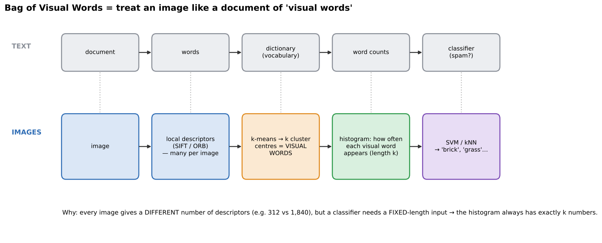

# 05 · Bag of Visual Words (BoVW) (+ texture classifier)

**Key Concepts covers:** Why BoVW · Feature clustering · Histogram representation · BoVW-for-textures exercise · Texture classifier mini project · Tips

**Lab notebook:** `labs/day12_bag_of_visual_words_textures.ipynb` (course lab `CV-Week2-Lecture5.ipynb`, Day 12)

---

## 1. The problem BoVW solves

Chapters 01–02 give you **many descriptors per image**, e.g. 312 SIFT vectors for one image and 1,840 for another. Chapter 04's classifiers (SVM, kNN) need **one fixed-length vector per image**. How do you turn a variable-sized **bag** of descriptors into one fixed-size vector?

> **BoVW** clusters local descriptors into a vocabulary of **visual words**, then represents each image as a **histogram** counting how often each visual word appears. That gives a **fixed-length** vector, ready for standard ML.

---

## 2. The analogy with text (the course's main tip)



A spam filter doesn't understand sentences. It counts words: an email with "winner" ×3, "free" ×5 and "click" ×4 is probably spam. Word order is ignored, hence a "**bag** of words".

| Text | Images |
|---|---|
| word | **visual word** = a typical small patch pattern (a cluster of similar descriptors) |
| dictionary / vocabulary | the **k cluster centres** from k-means |
| document | **image** |
| word-frequency histogram | **visual-word histogram** |
| spam / not spam classifier | SVM / kNN → "brick", "grass", "fabric" |

---

## 3. Step 1: feature clustering (building the vocabulary)

1. **Extract local features** from all **training** images (e.g. SIFT descriptors, 128 numbers each).
2. **Cluster** all those descriptors with **k-means** into k groups.
3. Each **cluster centre** is a **visual word**.

**k-means in plain words:**
1. Drop k random "centres" among the points.
2. Assign every point to its nearest centre.
3. Move each centre to the average of its points.
4. Repeat 2–3 until nothing changes.

It is **unsupervised** (no labels needed, see chapter 07).

**Analogy (course):** like grouping **synonyms** in language. "Big", "large" and "huge" become one word. Slightly different-looking corner patches become one visual word.

```python
k = 20                                             # vocabulary size = number of visual words
kmeans = KMeans(n_clusters=k, random_state=42).fit(all_train_descriptors)
```

## 4. Step 2: histogram representation

1. **Assign** each descriptor of an image to its **nearest** cluster (visual word): `kmeans.predict(des)`.
2. **Count** how often each word occurs, giving a histogram of length k.
3. That histogram **is** the image's representation.

```python
def build_histogram(des):
    words = kmeans.predict(des)                    # e.g. [3, 17, 3, 0, 9, ...]
    hist = np.bincount(words, minlength=k).astype(float)
    return hist / hist.sum()                       # normalise: images with more keypoints aren't "bigger"
```

**Benefit:** a **fixed-length** vector (k numbers) no matter how many features the image had. It can be fed to **SVM or kNN**.

---

## 5. Mini project: texture classifier

**Workflow:**
1. Extract features from texture images.
2. Cluster the descriptors into visual words.
3. Build a histogram for each image.
4. Train an SVM on these histograms.

**Why textures suit BoVW:** texture is about **which small patterns appear and how often** (bricks: many horizontal and vertical edge corners; grass: many thin random strokes), not about where they are, and BoVW deliberately throws away *where*.

**Applications:** material recognition, surface inspection (defects on fabric or metal), texture-based retrieval, recognising fabrics in fashion, natural textures in environmental monitoring. It is also used for **scene recognition** and **object categorisation**.

### Choosing k (vocabulary size)
- **Too small** (e.g. 5): very different patterns get lumped together, so the histograms can't tell classes apart.
- **Too large** (e.g. 5,000 with little data): words become so specific that each image's histogram is sparse and noisy.
- The exercise's discussion: **changing k changes the vocabulary size and the accuracy**. Try several values. The lab notebook sweeps k and plots accuracy.

> ⚠️ **The course notebook as given can't work.** It uses **3 images, one per class**, so the train/test split leaves 2 histograms to train on and 1 to test, which is why it reports **0%** (and k-means prints overflow warnings). A classifier needs **many** examples per class. The lab notebook rebuilds it on a real texture dataset with a proper train/test split.

**Important rule:** build the vocabulary from **training images only**. If test images help choose the words, the test isn't fair ("data leakage").

---

## 6. Where BoVW sits in history
BoVW (around 2003–2012) was the **state of the art for image classification before CNNs**. It bridges **feature extraction** (SIFT) and **machine-learning classification** (SVM). Its weakness is that it throws away **spatial layout**: a face with the mouth above the eyes gets the same histogram. "Spatial pyramid" versions patched this. CNNs (Day 15 and Week 3) learn **features and classifier together** and keep spatial structure, which is why they replaced BoVW.

---

## Check yourself

1. Why can't you feed SIFT descriptors straight into an SVM?
2. What is a visual word, and how is the vocabulary built?
3. Give the text ↔ image analogy for four terms.
4. What happens if k is too small? Too large?
5. Why is BoVW good for textures but weak for objects where layout matters?
6. Why did the course notebook report 0% accuracy?

<details><summary>Answers</summary>

1. Each image has a different number of descriptors, but an SVM needs one fixed-length vector per image.
2. A cluster centre of similar local descriptors. Run k-means on the descriptors from the training images, and the k centres are the vocabulary.
3. Word ↔ visual word, dictionary ↔ cluster centres, document ↔ image, word-frequency histogram ↔ visual-word histogram.
4. Too small: different patterns are merged and classes look alike. Too large: words are too specific and the histograms are sparse and noisy (needs more data and is slower).
5. Textures are defined by which patterns occur and how often, which is exactly what the histogram captures. Objects also depend on where parts are, and BoVW discards position.
6. Only 3 images (one per class): there is nothing to learn from and only 1 test image. You need many images per class and a proper split.
</details>
