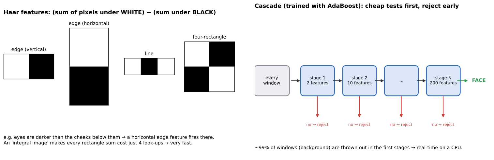
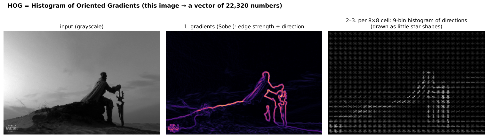

# 06 · Face detection: Haar cascades and HOG (+ face detector app)

**Key Concepts covers:** Why face detection · Haar cascades · HOG · Webcam exercise · Face detector app mini project · Tips

**Lab notebook:** `labs/day13_face_detection_haar_hog.ipynb` (course lab `CV-Week2-Lecture6.ipynb`, Day 13)

---

## 1. Detection vs recognition

| | Face **detection** | Face **recognition** |
|---|---|---|
| Question | **where** are the faces? | **whose** face is this? |
| Output | boxes | a name / identity |
| Order | first | second (needs the detected face) |

> **Face detection** = locating human faces in images or video. It is the **fundamental first step** before face recognition, emotion analysis or biometrics.

**Applications:** security and surveillance, human–computer interaction (face unlock), social-media filters and AR (they must find your face before adding dog ears), camera autofocus, counting people. The `../project/` notebooks use a modern deep-learning detector (YuNet) for the same job.

---

## 2. Haar cascades (Viola–Jones, 2001)



### Haar features
> **Haar features** are simple **rectangular patterns** (like edge detectors): value = (sum of pixels under the white part) − (sum under the black part).

Faces have consistent light and dark patterns: the **eye region is darker than the cheeks** below it, and the **bridge of the nose is brighter than the eyes** on either side. A rectangle feature placed there gives a big value on faces and a small one elsewhere.

**Speed trick, the integral image:** pre-compute running sums once, and then **any** rectangle's sum costs just 4 look-ups, whatever its size.

### Training with AdaBoost → a cascade
- A 24×24 window has **over 160,000** possible Haar features, and most are useless.
- **AdaBoost** selects the **most important** few and weights them. Each one alone is a weak classifier (a bit better than guessing), but together they are strong.
- They are arranged in a **cascade** of stages: stage 1 uses 2 cheap features, and later stages use more. A window is **rejected as soon as any stage says "no"**.
- Most windows in a photo are background and get thrown out in the first stages, so the expensive stages run rarely. That is why it is **real-time on a CPU**.

### Using it in OpenCV
```python
face_cascade = cv2.CascadeClassifier(cv2.data.haarcascades + 'haarcascade_frontalface_default.xml')
gray = cv2.cvtColor(img, cv2.COLOR_BGR2GRAY)          # Haar works on brightness only
faces = face_cascade.detectMultiScale(gray, scaleFactor=1.3, minNeighbors=5)
for (x, y, w, h) in faces:                            # each face = top-left corner + width + height
    cv2.rectangle(img, (x, y), (x + w, y + h), (255, 0, 0), 2)
```

| Parameter | Meaning | Turn it… |
|---|---|---|
| **scaleFactor** | how much the image is shrunk at each step of the search pyramid (1.3 = 30% each time), to find faces of different sizes | **lower** (1.05–1.1): finds more faces at more sizes, but slower and more false alarms. **Higher**: faster, may skip faces |
| **minNeighbors** | how many overlapping detections a spot needs before it counts as a face | **higher**: fewer false positives, may miss faces. **Lower**: catches more but adds junk |
| **minSize** | ignore detections smaller than this | raise it to skip tiny false positives |

| Pros | Cons |
|---|---|
| **fast and lightweight** | sensitive to **lighting, pose (turned or tilted heads) and occlusion** (hands, masks) |
| works well for **frontal faces** in controlled settings | **less robust in complex scenes**: false positives on textured backgrounds |
| ships with OpenCV, no download | one cascade per view (frontal and profile need separate files) |

---

## 3. HOG: Histogram of Oriented Gradients (Dalal & Triggs, 2005)



> **HOG** describes shape by the **distribution of edge directions** in small regions of the image.

**How it's computed:**
1. Compute **gradients** (Sobel): edge strength and direction at each pixel.
2. Split the image into small **cells** (e.g. 8×8 pixels). In each, build a **histogram of gradient directions** (9 bins, 0–180°), weighted by strength.
3. Group cells into **blocks** (2×2 cells) and **normalise** each block. This is what makes HOG **robust to illumination**: brighter lighting scales all gradients equally, and normalising cancels that out.
4. Concatenate everything into one long feature vector → feed it to a **linear SVM** (chapter 04), sliding a window over the image.

**Usage:** the classical method for detecting **pedestrians** (OpenCV ships a HOG people detector) and **faces** (dlib's famous frontal-face detector is HOG + SVM).

| Pros | Cons |
|---|---|
| **robust to illumination changes** (block normalisation) | **computationally heavier** than Haar cascades |
| captures **shape and edge information** effectively | may need more preprocessing (resizing, window scanning) |
| fewer false positives than Haar in cluttered scenes | still struggles with big pose changes and heavy occlusion |

### Haar vs HOG (the course's discussion question)

| | Haar cascade | HOG + SVM |
|---|---|---|
| Features | rectangle brightness differences | histograms of edge directions |
| Speed | **faster** (integral image + early rejection) | slower |
| Robustness | sensitive to lighting and pose | **more robust**, especially to lighting |
| Typical use | quick frontal-face detection on weak hardware | pedestrians, faces in harder conditions |
| One-liner | **fast, lightweight** | **robust, heavier** |

Both are "classical". Modern systems use CNN detectors (e.g. YuNet, RetinaFace, YOLO-face), which handle pose, lighting and occlusion far better (Week 3 detection chapter).

---

## 4. Exercise: faces in a webcam feed

```python
cap = cv2.VideoCapture(0)                  # 0 = the default webcam
while True:
    ret, frame = cap.read()                # grab a frame
    if not ret:
        break                              # camera unplugged / no frame
    gray = cv2.cvtColor(frame, cv2.COLOR_BGR2GRAY)
    for (x, y, w, h) in face_cascade.detectMultiScale(gray, 1.3, 5):
        cv2.rectangle(frame, (x, y), (x + w, y + h), (255, 0, 0), 2)
    cv2.imshow('Webcam Face Detection', frame)
    if cv2.waitKey(1) & 0xFF == ord('q'):  # press q to quit
        break
cap.release(); cv2.destroyAllWindows()
```

- **Observe:** it is real time, but watch the **false positives** (boxes on a patterned shirt) and the **missed detections** (turn your head, cover half your face, dim the lights).
- **Experiment:** change `scaleFactor` and `minNeighbors` and see the trade-off.
- This must run as a **desktop Python script** (`cv2.imshow` windows don't work inside Jupyter or Colab). The lab notebook keeps it behind a `RUN_WEBCAM = False` switch.

## 5. Mini project: face detector app
**Workflow:** load the Haar cascade → detect faces in a **static image or the webcam** → draw bounding boxes.
**Outcome:** an interactive face-detection app, an entry-level prototype for **security systems, attendance monitoring or AR filters**. Compare `../project/project3_attendance_system.ipynb`, which goes further: it detects **and recognises** faces.

---

## Check yourself

1. Detection vs recognition: which comes first, and what does each output?
2. What is a Haar feature? Why are Haar cascades so fast (two reasons)?
3. What does AdaBoost do in Viola–Jones?
4. What do `scaleFactor` and `minNeighbors` control? How do you reduce false positives?
5. List the HOG steps. Which step makes it robust to lighting?
6. Haar vs HOG: which is faster, which is more robust, and why?

<details><summary>Answers</summary>

1. Detection first (where the faces are, as boxes), then recognition (whose face, as an identity).
2. A difference of pixel sums between adjacent light and dark rectangles. Fast because of the integral image (any rectangle sum in 4 look-ups) and the cascade (most windows are rejected in the first cheap stages).
3. It picks the most useful few features out of more than 160,000 candidates, weights them into a strong classifier, and builds the stages of the cascade.
4. `scaleFactor` is the size step of the image pyramid (smaller steps find more sizes but are slower). `minNeighbors` is how many overlapping detections are needed to accept a face. To reduce false positives, raise `minNeighbors` (and/or `minSize`).
5. Gradients → per-cell orientation histograms → block normalisation → concatenate → SVM. Block normalisation gives the lighting robustness.
6. Haar is faster (simple sums, early rejection). HOG is more robust (normalised edge-direction histograms capture shape and are less sensitive to lighting).
</details>
