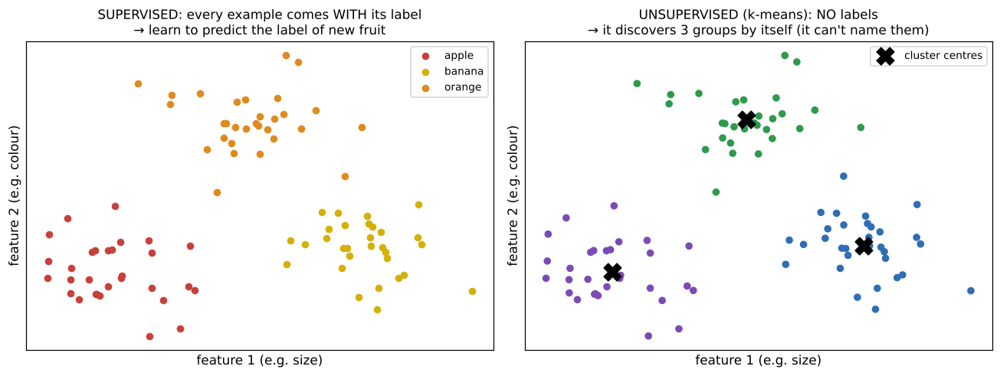

# 07 · Pre-CNN module: maths, ML fundamentals, the artificial neuron

**Key Concepts covers:** Programming basics (Python + NumPy) · Mathematics foundations · Image basics · Machine-learning fundamentals (supervised vs unsupervised) · Artificial neuron · Neural network basics (ANN) · Bridge to CNNs

**Lab notebook:** `labs/day14_pre_cnn_foundations.ipynb`. There is no course lab file for this day. The notebook does the activities the Key Concepts sheet lists.

> This chapter is the "ladder" from Week 1 to deep learning. The course says to **build progressive complexity: pixels → features → ML → ANN → CNN.**

---

## 1. Programming basics (Python + NumPy)

You need variables, loops, functions, classes, NumPy arrays and Matplotlib plots. Week 1's `00_python_numpy_basics.md` covers exactly this.

**Analogy (course):** a NumPy array is like an **Excel sheet** where each cell holds a number, **with superpowers for maths**. You can add, multiply or average the whole sheet in one line.

---

## 2. Mathematics foundations

### Linear algebra
- **Vectors and matrices:** lists and grids of numbers. An image is a matrix, and a flattened image or a descriptor is a vector.
- **Dot product → a similarity measure:** `a · b = a₁b₁ + a₂b₂ + …`. It is large when two vectors point the same way.
  ```python
  np.dot([1, 2, 3], [1, 2, 3])   # 14  (similar → big)
  np.dot([1, 2, 3], [3, -2, 0])  # -1  (different → small or negative)
  ```
- **Convolution = a sliding dot product.** At each position you take the dot product of the kernel with the patch under it (Week 1 Day 3). Every CNN layer is built on this one fact.

### Calculus
- **Derivative** = the **slope** of a curve: how fast the output changes when you nudge the input.
- **Gradient** = the derivatives for every input together. It points in the **direction of steepest increase**.
- **Analogy (course):** the gradient is "**how steep the hill is**". Training a network = walking **downhill** on the error landscape by stepping **against** the gradient (gradient descent, see `../week-2-3/notes/00_deep_learning_basics.md`).
- You already met gradients in images: Sobel computes the brightness gradient, i.e. the edges.

### Probability and statistics
- **Mean** (average) and **variance** (how spread out the values are), and **distributions** (bell curves etc.).
- **Why normalisation matters:** if one feature ranges 0–255 and another 0–1, the big one dominates distances (kNN) and gradients (neural nets). Rescaling to similar ranges, e.g. subtracting the mean and dividing by the standard deviation, makes learning fair and faster. That's what `transforms.Normalize((0.1307,), (0.3081,))` does in the Day 15 MNIST lab: 0.1307 and 0.3081 are the mean and standard deviation of MNIST's pixels.

---

## 3. Image basics (recap)
- **Pixels and channels:** grayscale = **one channel**, RGB = **three** (red, green, blue).
- **Image as a matrix:** each pixel is a number (or 3 numbers).
- **Transformations:** scaling, rotation, cropping (Week 1 Day 2).
- **Analogy (course):** pixels are **Lego blocks**, and arranging them builds the image.
- **Activity:** rotate and flip an image in code, then discuss **how transformations affect recognition**. A digit "6" flipped upside down becomes a "9"! That's why data augmentation must be chosen carefully: flipping is fine for cats, but not for digits.

---

## 4. Machine-learning fundamentals

> **Machine learning** lets computers **learn from data and improve without being explicitly programmed**: you give examples and it figures out the patterns.



### Supervised learning: learning with guidance
- The data has **inputs (features) AND correct outputs (labels)**.
- Goal: learn the input → output relationship so it can **predict labels for new, unseen inputs**.
- **Fruit example (course):** features = colour, size, shape; labels = apple, banana, orange. After seeing many examples, it labels a new fruit.
- **Key points:** training data needs inputs **and** outputs. **Prediction** guesses the output for new inputs. **Evaluation** compares predictions with the true labels (accuracy).
- **Two task types:**
  - **classification**: predict a **category** (spam / not spam, digit 0–9);
  - **regression**: predict a **number** (a house price).
- **Basic models:** **kNN** = "majority vote of neighbours", **SVM** = "find the best dividing line" (chapter 04).

### Unsupervised learning: learning without guidance
- Only **inputs, no labels**. The model must **discover structure by itself**.
- **Fruit example (course):** an unlabelled basket. It groups red round fruits together and long yellow ones together, without knowing the words "apple" or "banana".
- **Key techniques:**
  - **clustering:** group similar points (**k-means**, as used in BoVW; hierarchical clustering);
  - **dimensionality reduction:** simplify the data but keep the important patterns (**PCA**, **t-SNE**);
  - **association rules:** "people who buy bread also buy butter".
- **Applications:** customer segmentation, organising photo collections, anomaly detection (fraud, unusual behaviour), recommendation systems.

### The comparison table (exam favourite)

| Aspect | Supervised | Unsupervised |
|---|---|---|
| Definition | learns from **labelled** data (inputs + correct outputs) | learns from **unlabelled** data (inputs only) |
| Goal | **predict** outcomes for new data | **discover** hidden patterns, groups, structure |
| Data | labelled dataset (images with categories, emails marked spam) | raw unlabelled data (purchase records with no categories) |
| Techniques | classification, regression | clustering, dimensionality reduction, association |
| Output | a specific prediction (class label or number) | groups, clusters or a reduced representation |
| Analogy | a teacher giving questions **with answers** | exploring a new city **without a guide** |
| Examples | digit recognition (MNIST), medical diagnosis, sentiment analysis | customer segmentation, organising photos, anomaly detection |

---

## 5. The artificial neuron

> The basic computational unit of an **Artificial Neural Network (ANN)**, inspired by biological neurons but purely mathematical.


**Structure:**
- **inputs** x₁, x₂, …, xₙ: features or signals (e.g. pixel values);
- **weights** w₁, …, wₙ: how **important** each input is (learned);
- **bias** b: a constant that shifts the result (learned);
- **summation:** z = Σ wᵢxᵢ + b = w₁x₁ + w₂x₂ + … + wₙxₙ + b;
- **activation function** f(z): adds non-linearity and decides whether and how strongly the neuron "fires" (ReLU, sigmoid, tanh);
- **output** f(z): passed on to the next layer.

**Worked example:** inputs x = (0.5, 0.8), weights w = (0.4, −0.2), bias b = 0.1.
z = 0.4·0.5 + (−0.2)·0.8 + 0.1 = 0.2 − 0.16 + 0.1 = **0.14** → ReLU(0.14) = **0.14**, and sigmoid(0.14) ≈ **0.535**.

**Analogy (course), a decision unit:**
- inputs = **evidence**;
- weights = **importance** of each piece of evidence;
- bias = **prior tendency** (how easily it says yes);
- activation = the **final decision** (yes/no, strong/weak).

**Digit example:** inputs = pixel values of a handwritten "5". The weights learn the importance of certain strokes. The output is the probability that it's a "5".

---

## 6. Neural network basics (ANN)
- **Artificial neurons** = weighted sum + activation.
- **Layers:** input → hidden → output.
- **Forward pass:** data flows forward and predictions are made.
- **Backpropagation:** the error flows **backward** and the weights are updated (using the gradients from section 2).
- **Analogy (course):** each neuron is like a student giving a small opinion, and the network combines them into a final decision.
- **Activity:** build a small feed-forward network to classify digits and **watch the accuracy improve** epoch by epoch (done in the Day 14 notebook).

---

## 7. Bridge to CNNs

**Problems with fully connected networks on images:**
1. **Too many parameters:** a 224×224×3 image has 150,528 inputs. One layer of 1,000 neurons needs about **150 million** weights.
2. **They lose spatial structure:** the image is flattened, so pixels are treated independently and the network doesn't know which pixels were neighbours.

**Motivation for CNNs:**
- **Convolutions preserve spatial locality:** each neuron looks at a small neighbourhood.
- **Filters detect edges, textures and shapes**, reusing the same small kernel everywhere (few parameters).
- **Analogy (course):** CNNs are like **detectives with magnifying glasses** (filters), spotting clues (features) in different parts of the image.
- **Activity:** apply an edge-detector kernel **by hand** (a sliding dot product), then show that a CNN layer does the same thing but **learns** the kernel values.

Next chapter: CNN basics.

---

## Check yourself

1. Why is the dot product a similarity measure? How does it relate to convolution?
2. What is a gradient, and how is it used in training?
3. Why normalise inputs?
4. Supervised vs unsupervised: definition, data, goal, one example each.
5. Classification vs regression?
6. Compute a neuron: x = (1, 2), w = (0.5, −1), b = 1, with ReLU.
7. Give two reasons fully connected networks are a poor fit for images.

<details><summary>Answers</summary>

1. It is large when vectors point the same way. Convolution is a dot product of the kernel with each image patch, slid across the image.
2. The direction and steepness of the error's increase. Training steps the weights against it (gradient descent).
3. So features on big scales don't dominate distances or gradients, and training is faster and more stable.
4. Supervised: labelled data, predict labels (digit recognition). Unsupervised: unlabelled data, find structure (customer segmentation or k-means clustering).
5. Classification predicts a category. Regression predicts a continuous number.
6. z = 0.5·1 + (−1)·2 + 1 = −0.5 → ReLU = 0.
7. A huge number of parameters, and the loss of spatial structure (neighbouring pixels are treated independently).
</details>
