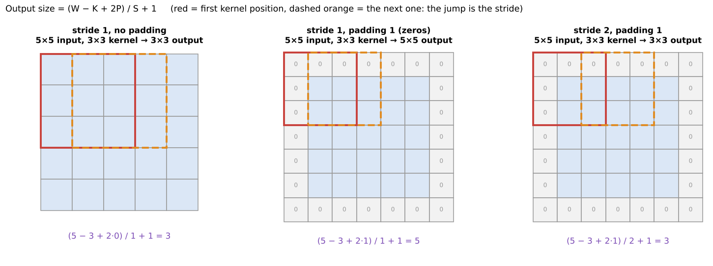
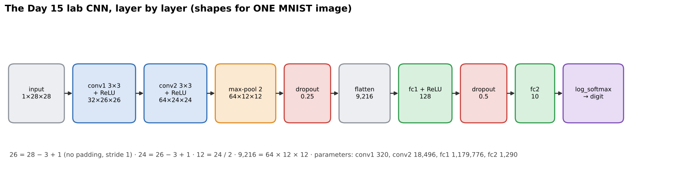

# 08 · CNN basics: convolution, pooling, activations, stride, padding, flatten (+ MNIST CNN)

**Key Concepts covers:** Why CNNs · Convolutions · Pooling · Activation functions · CNN in PyTorch for MNIST · Training & testing loop · Digit classifier mini project · What are feature maps / pooling / stride / padding / flatten

**Lab notebook:** `labs/day15_cnn_basics_mnist.ipynb` (course lab `CV-Week2-Lecture7.ipynb`, Day 15)

> Week 3 goes deeper into all of this (`../week-2-3/notes/00_deep_learning_basics.md` and `01_building_blocks.md`). This chapter is what the Day 15 lab and the Week 2 viva need.

---

## 1. Why CNNs?

> **Convolutional Neural Networks** are neural networks specialised for images. They **automatically learn a spatial hierarchy of features**: edges and textures in early layers, then shapes, then objects in deeper layers.

**Applications:** image classification, object detection, face recognition, medical imaging.

Compared with Day 11–13 methods: SIFT, HOG and Haar features were **designed by people**. A CNN **learns its own features** from the data, and learns the classifier at the same time.

---

## 2. The building blocks (Key Concepts definitions)

### Convolution → feature maps
- Small **filters (kernels)** slide across the image to detect local patterns (Week 1 Day 3, but the kernel values are **learned**).
- A **feature map** is the 2-D grid of results: how strongly **one** filter responds at each position.
  1. A kernel (e.g. 3×3) slides over the image.
  2. At each position it computes a weighted sum (dot product) of the pixels under it.
  3. The result is stored in the feature map.
- `Conv2d(1, 32, 3)` = **32 different kernels**, giving **32 feature maps**.
- **Benefit:** far fewer parameters than fully connected layers (one small kernel reused everywhere), so CNNs are efficient and scalable.

### Stride
> The **step size** of the kernel as it slides.

Stride 1 moves one pixel at a time (overlapping windows). Stride 2 jumps two pixels, which roughly **halves** the output size. It controls how much the receptive fields overlap and the **output size**.

### Padding
> Surrounding the input with extra pixels (usually **zeros**).

- **Prevents the image shrinking** after each convolution: a 3×3 kernel without padding loses 1 pixel on every side.
- Lets filters **cover the edge pixels** properly.
- Helps **control the output size**. `padding=1` with a 3×3 kernel keeps the size the same ("same" padding).



### The output-size formula (learn it!)

**Output = (W − K + 2P) / S + 1**

where W = input size, K = kernel size, P = padding, S = stride.

| Input | Kernel | Padding | Stride | Output |
|---|---|---|---|---|
| 28 | 3 | 0 | 1 | (28 − 3 + 0)/1 + 1 = **26** |
| 28 | 3 | 1 | 1 | (28 − 3 + 2)/1 + 1 = **28** (same size) |
| 28 | 3 | 1 | 2 | (28 − 3 + 2)/2 + 1 = **14** (rounded down) |
| 32 | 5 | 0 | 1 | 28 (LeNet's first layer) |

### Pooling
> Pooling **summarises regions** of a feature map into single values (downsampling).

- **Max pooling:** take the **maximum** of each region, which captures the **strongest** response.
- **Average pooling:** take the **average**, which **smooths** the features.
- **Purpose:**
  - **reduces computation** (smaller maps);
  - **translation invariance**: robust to small shifts;
  - **helps control overfitting** (fewer numbers downstream).
- No weights to learn. `max_pool2d(x, 2)` halves the height and width.

### Activation functions
> Introduce **non-linearity** so the network can learn complex patterns. Without them, stacked layers collapse into one linear model.

| Function | Output range | Notes |
|---|---|---|
| **ReLU** max(0, x) | 0 → ∞ | **fast, effective, the most widely used** |
| **Sigmoid** 1/(1 + e⁻ˣ) | 0 → 1 | useful for **probabilities** (e.g. yes/no outputs) |
| **Tanh** | −1 → 1 | zero-centred, but less common today (vanishing gradients) |

### Flatten
> Reshapes the 3-D output of the conv and pool layers (channels × height × width) into **one long vector**.

Fully connected layers expect 1-D input, so **flatten bridges** spatial feature maps → classification layers.

---

## 3. The Day 15 lab CNN, shape by shape



```python
class CNN(nn.Module):
    def __init__(self):
        super(CNN, self).__init__()
        self.conv1 = nn.Conv2d(1, 32, 3, 1)      # 1 input channel (grey) → 32 maps, 3×3 kernel, stride 1
        self.conv2 = nn.Conv2d(32, 64, 3, 1)     # 32 → 64 maps
        self.dropout1 = nn.Dropout(0.25)         # drop 25% of values (training only)
        self.dropout2 = nn.Dropout(0.5)          # drop 50%
        self.fc1 = nn.Linear(9216, 128)          # 9216 = 64 × 12 × 12 (see below)
        self.fc2 = nn.Linear(128, 10)            # 10 digits

    def forward(self, x):                        # x: (batch, 1, 28, 28)
        x = F.relu(self.conv1(x))                # → (batch, 32, 26, 26)   26 = 28 − 3 + 1
        x = F.relu(self.conv2(x))                # → (batch, 64, 24, 24)   24 = 26 − 3 + 1
        x = F.max_pool2d(x, 2)                   # → (batch, 64, 12, 12)   halve
        x = self.dropout1(x)
        x = torch.flatten(x, 1)                  # → (batch, 9216)         64 × 12 × 12
        x = F.relu(self.fc1(x))                  # → (batch, 128)
        x = self.dropout2(x)
        x = self.fc2(x)                          # → (batch, 10)  one score per digit
        return F.log_softmax(x, dim=1)           # → log-probabilities
```

**The famous viva question, "where does 9216 come from?":** 28 → conv 3×3 → 26 → conv 3×3 → 24 → max-pool 2 → 12. There are 64 channels, so **64 × 12 × 12 = 9,216**. If you change the input size or a layer, this number changes and you get a "shape mismatch" error.

**Parameter count:** conv1 = 32·(1·3·3) + 32 = **320**, conv2 = 64·(32·3·3) + 64 = **18,496**, fc1 = 9216·128 + 128 = **1,179,776**, fc2 = 128·10 + 10 = **1,290**. The single dense layer fc1 holds about **98%** of all the weights. That is the "too many parameters" problem of dense layers, seen in real numbers.

---

## 4. Data preparation

```python
transform = transforms.Compose([
    transforms.ToTensor(),                         # PIL image 0–255 → tensor 0.0–1.0, shape (1, 28, 28)
    transforms.Normalize((0.1307,), (0.3081,))     # subtract MNIST's mean, divide by its std
])
train_dataset = datasets.MNIST('./data', train=True, download=True, transform=transform)   # 60,000 images
test_dataset  = datasets.MNIST('./data', train=False, transform=transform)                 # 10,000 images
train_loader = DataLoader(train_dataset, batch_size=64, shuffle=True)     # 64 images per step, shuffled each epoch
```

---

## 5. Training and testing loop

**Training:**
1. **Forward pass** → predictions.
2. **Loss function:** **negative log-likelihood** (`F.nll_loss`). Combined with `log_softmax` in the model, this is exactly **cross-entropy**: a small loss when the correct digit gets a high probability.
3. **Backpropagation** (`loss.backward()`) → **update the weights** with the **Adam** optimiser (`optimizer.step()`, lr = 0.001). Adam is gradient descent with an automatically adapted step size for each weight.

```python
model.train()                                   # dropout ON
for data, target in train_loader:
    optimizer.zero_grad()                       # clear last step's gradients (they accumulate otherwise!)
    output = model(data)
    loss = F.nll_loss(output, target)
    loss.backward()
    optimizer.step()
```

**Testing:** evaluate on **unseen** data and report accuracy and loss.
```python
model.eval()                                    # dropout OFF
with torch.no_grad():                           # no gradients needed → faster, less memory
    pred = model(data).argmax(dim=1)            # the digit with the highest score
```

**Outcome:** accuracy improves with each epoch. The course's own run reached **98.79%** test accuracy after 2 epochs.

---

## 6. Mini project: digit classifier
1. Train the CNN on MNIST.
2. Test it with **custom digit images or drawings**.
3. Evaluate the predictions.

> ⚠️ Your own drawing must look like MNIST: **white digit on a black background, centred, 28×28, normalised** the same way. A black-on-white phone photo fed in directly gives nonsense. The lab notebook shows this.

**Applications:** OCR, postal-code recognition, bank-cheque processing, digit-recognition apps, face unlock, medical image classifiers.

### Data flow to remember (course tip)
**Input → Convolution → Pooling → Flatten → Fully connected → Output**

---

## Check yourself

1. What is a feature map? How many does `Conv2d(1, 32, 3)` produce?
2. Define stride and padding. What is the output size for input 32, kernel 3, padding 1, stride 2?
3. Max vs average pooling, and three purposes of pooling?
4. Why do we need activation functions? When would you use sigmoid?
5. What does flatten do and why is it needed?
6. Explain 9216 in the lab CNN.
7. What do `model.train()`, `model.eval()`, `optimizer.zero_grad()` and `torch.no_grad()` do?
8. `log_softmax` + `nll_loss` equals which loss?

<details><summary>Answers</summary>

1. A 2-D grid of how strongly one filter responds at each position. It produces 32.
2. Stride: the step of the kernel. Padding: extra border pixels (zeros). (32 − 3 + 2)/2 + 1 = 16 (15.5 rounded down).
3. Max keeps the strongest response, average smooths. Purposes: reduce computation, give translation invariance, help control overfitting.
4. Without them the network is linear and can't learn complex patterns. Sigmoid is used for probability outputs between 0 and 1 (e.g. binary yes/no).
5. It turns the C×H×W feature maps into one vector, because fully connected layers need 1-D input.
6. 28 → 26 (conv) → 24 (conv) → 12 (pool), and 64 channels × 12 × 12 = 9,216.
7. `train()` turns dropout on. `eval()` turns it off. `zero_grad()` clears the accumulated gradients. `no_grad()` skips gradient tracking during testing.
8. Cross-entropy loss.
</details>
