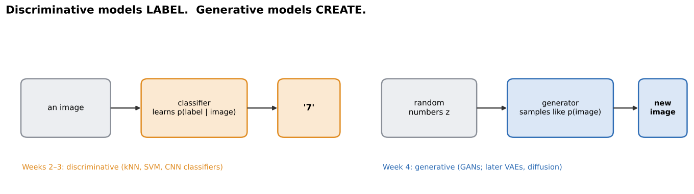
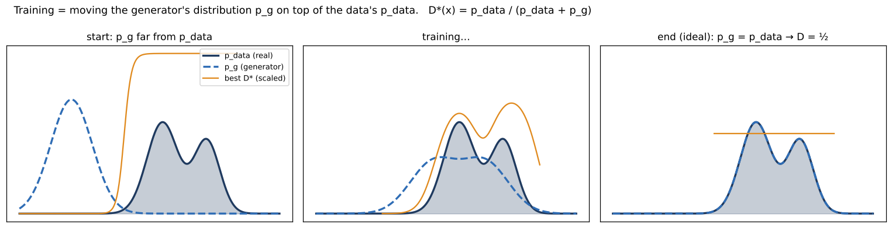
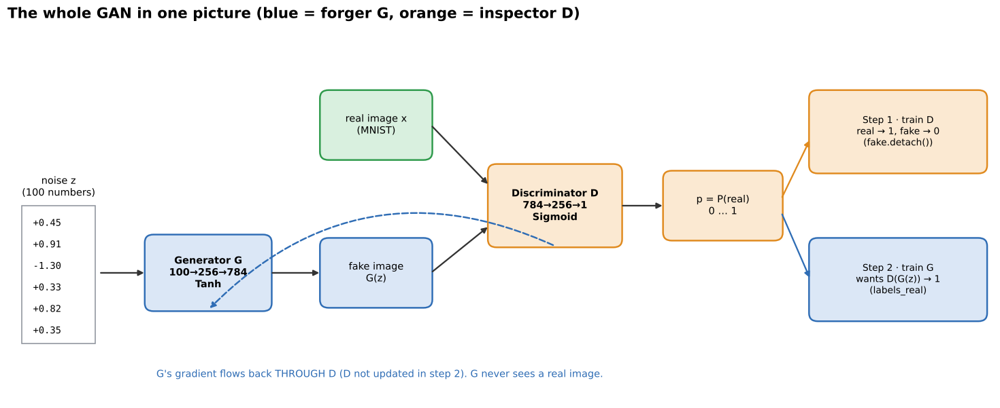
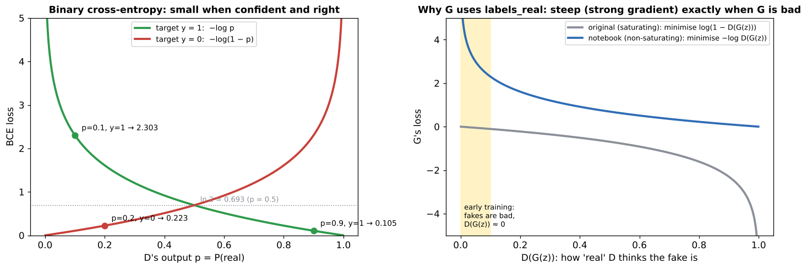

# 01 · GAN basics: generator, discriminator and the minimax game

**Covers:** GAN Class 1 slides ("The GAN framework") and the guide to the course notebook `CV-Week4-Lecture1.ipynb`

**Notebook:** `notebooks/01_gan_basics_mnist.ipynb` (the course's MNIST GAN rebuilt and run, plus the in-class Tasks 1–4)

---

## 1. What does GAN stand for?

**GAN = Generative Adversarial Network.** Take the three words one at a time:

| Letter | Word | Meaning |
|---|---|---|
| **G** | **Generative** | it **creates new data**: a new image, not a label. It answers "what could a new sample look like?" |
| **A** | **Adversarial** | it learns through a **contest between two opponents** with opposite goals |
| **N** | **Network(s)** | both players are ordinary **neural networks** trained with backpropagation. There are **two** networks, not one |

Origin: Ian **Goodfellow** et al., "Generative Adversarial Nets", **NeurIPS 2014**.

### Generative vs discriminative



| | Discriminative (what you know) | Generative (now) |
|---|---|---|
| Example | a classifier | a generator |
| Input → output | image → **label** | random numbers → **new image** |
| Learns | p(label \| image) | to **sample like p(image)** |

### What "generate" really means
Every real photo is **one sample** from an unknown distribution **p_data**. We never see its formula, only examples. The generator defines its own distribution **p_g**: whatever comes out when we feed it random noise. **Training = moving p_g until it sits on top of p_data.** Then every new sample looks like it came from the real collection.



### What GANs are used for
- **New images:** realistic faces, objects and scenes that never existed (the StyleGAN family).
- **Image-to-image:** sketch → photo, day → night, horse → zebra (pix2pix, CycleGAN).
- **Super-resolution:** low-resolution → sharper (SRGAN).
- **Data augmentation:** extra synthetic training images when real ones are rare or private (e.g. medical).
- **Video and art:** predicting the next frame, generative art.
- ⚠️ **Caution:** the same power makes **deepfakes** possible. Detecting fakes is its own research area.

---

## 2. What does "adversarial" mean?

An **adversary** is an opponent (Latin *adversus*, "turned against"). Think of chess players, prosecution vs defence, or a sparring partner who fights you and so makes you better.

### The counterfeiter and the police (from the original paper)

| Story | GAN |
|---|---|
| **Counterfeiter** prints fake banknotes and tries to spend them | **Generator (G)** |
| **Police** inspect notes and try to detect the fakes | **Discriminator (D)** |

> "Competition in this game drives both teams to improve their methods until the counterfeits are indistinguishable from the genuine articles." (Goodfellow et al., 2014)

The course's running example is the same story with a **flower forger** (G) and an **inspector** (D).

**Round by round:**
- **Round 1:** G paints a random scribble and D catches it easily.
- **Round 2:** G learns "flowers are colourful blobs", so D learns to check the shape.
- **Round 3:** G adds petals and a centre, so D checks petal detail.
- **Round N:** G paints convincing flowers, and D can only guess, about 50/50.

Each side's improvement forces the other to improve.

**Zero-sum game:** one side's gain is the other's loss. "Winner and loser" is the intuition. In the code, **both** networks take one gradient step on **every** batch: first D, then G.

**What adversarial does NOT mean:** hacking or attacking. It is also **not** "adversarial examples/attacks", which is a different topic where tiny input changes fool a trained classifier. The two networks are opponents in training but **partners in the result**: D's job is to push G to improve. After training we keep G and usually throw D away.

---

## 3. The generator (the forger)

**Job:** turn a **random vector z** (not a photo, not a label) into a **new image G(z)**.

```python
class Generator(nn.Module):
    def __init__(self):
        super().__init__()
        self.fc = nn.Sequential(
            nn.Linear(100, 256),     # 100 noise numbers → 256 hidden values
            nn.ReLU(),
            nn.Linear(256, 784),     # → 784 values = one per pixel (28 × 28)
            nn.Tanh())               # squash to −1…1, the same range as the normalised real images
    def forward(self, x):
        return self.fc(x).view(-1, 1, 28, 28)   # 784 numbers → a 1-channel 28×28 image
```

- **Why random input?** G is **deterministic**: the same z always gives the same image. **All the variety comes from z.** Different z gives a different digit. `torch.randn(64, 100)` is an endless, easy supply. The space z lives in is the **latent space**.
- **Why Tanh?** Real images are normalised to −1…+1 (`Normalize((0.5,), (0.5,))`). If fake pixels could be 5.0, D could spot fakes from their range alone, and G would learn nothing useful.
- **The surprising part:** **G never sees a real image.** There is no target picture and no pixel-by-pixel comparison. It learns **only from D's reaction**: the gradient flows **backwards through D into G**. **D is G's only teacher.**
- **Best way to watch it learn:** keep one `z_fixed` and plot `G(z_fixed)` after every epoch. The input is fixed, so any change comes from G's weights.

## 4. The discriminator (the inspector)

**Job:** look at an image and output **one number, P(real)**, between 0 and 1.

```python
class Discriminator(nn.Module):
    def __init__(self):
        super().__init__()
        self.fc = nn.Sequential(
            nn.Linear(784, 256),
            nn.LeakyReLU(0.2),       # lets a little gradient through for negatives → G keeps getting a signal
            nn.Linear(256, 1),
            nn.Sigmoid())            # a score → a probability 0…1
    def forward(self, x):
        return self.fc(x.view(-1, 784))   # flatten the image first
```

- **Its labels come for free:** an image picked from the dataset gets label **1**, and an image just painted by G gets label **0**. No human labelling. The label means "which pile it came from", not "is it pretty": a beautiful fake is still label 0 when training D.
- **Why LeakyReLU, not ReLU?** G learns only through gradients passing back through D. A plain ReLU passes **zero** gradient for negative inputs and can block that signal. LeakyReLU always lets a little through (×0.2).
- G and D are **mirror images**: G is 100 → 256 → 784, D is 784 → 256 → 1.

### A tug-of-war over one number
For a fake image, p = D(G(z)). **D wants p → 0. G wants p → 1.** At the start p is tiny (e.g. 0.001). If G became perfect, the best D could do is **p = 0.5 for everything**: a coin flip.

### G vs D at a glance (cover the columns and test yourself)

| | Generator G (forger) | Discriminator D (inspector) |
|---|---|---|
| Input | random noise z (100 numbers) | an image (real or fake) |
| Output | an image G(z) | one probability P(real) |
| Sees real data? | **never** | yes, half of what it sees |
| Wants on fakes | D(G(z)) → 1 | D(G(z)) → 0 |
| Wants on reals | (not involved) | D(x) → 1 |
| Kept after training? | **yes**: it makes the images | usually discarded |

---

## 5. Training: the rules of the game



Every mini-batch plays one round in **two steps**.

### Step 1: train D (G frozen)
```python
optimizer_d.zero_grad()
outputs_real = discriminator(real)
loss_real = criterion(outputs_real, labels_real)        # real → target 1
noise = torch.randn(batch_size, 100)
fake = generator(noise)
outputs_fake = discriminator(fake.detach())             # .detach(): cut the wire back to G
loss_fake = criterion(outputs_fake, labels_fake)        # fake → target 0
loss_d = loss_real + loss_fake
loss_d.backward()
optimizer_d.step()                                      # only D's weights change
```

### Step 2: train G (D not updated)
```python
optimizer_g.zero_grad()
outputs_fake = discriminator(fake)                      # NO detach: gradients must reach G
loss_g = criterion(outputs_fake, labels_real)           # target 1 for FAKES: "my loss is low when D is fooled"
loss_g.backward()
optimizer_g.step()                                      # only G's weights change
```

- **Two optimizers:** `optimizer_g` only knows G's weights and `optimizer_d` only knows D's. That is how the code keeps the steps separate.
- **Using `labels_real` for fakes is not cheating.** When D is trained, fakes get target 0 (the truth about where they came from). When G is trained, target 1 is **G's wish**, not a claim about the image.
- **Settings:** `nn.BCELoss()`, Adam with **lr = 0.0002** for both, batch 64 (938 batches per epoch, the last one has 32 images, hence `batch_size = real.size(0)`), `epochs = 2`.

### The loss: binary cross-entropy (BCE)

**BCE(p, y) = −[ y·log p + (1 − y)·log(1 − p) ]**

So y = 1 gives a loss of −log p, and y = 0 gives −log(1 − p). The loss is small when the prediction is confident and right, and big when it is confident and wrong.



| Case | y | p | Loss |
|---|---|---|---|
| D, real image, confident | 1 | 0.9 | 0.105 |
| D, real image, wrong | 1 | 0.1 | 2.303 |
| D, fake image, confident | 0 | 0.2 | 0.223 |
| **G**, the same fake (wants y = 1) | 1 | 0.2 | **1.609** |

The same image and the same score 0.2 are good news for D (0.223) and bad news for G (1.609). That's "adversarial" in numbers.

### The minimax objective (Goodfellow et al. 2014)

**min_G max_D V(D, G) = E_x[ log D(x) ] + E_z[ log(1 − D(G(z))) ]**

- **Term 1 (real images):** largest (0) when D(x) = 1. D maximises it. G can't touch it.
- **Term 2 (fake images):** D maximises it by pushing D(G(z)) → 0. G minimises it by pushing D(G(z)) → 1.
- **Minimax:** G minimises what the best D can maximise, a zero-sum game. Maximising V is the same as minimising the notebook's `loss_d`.

### Where the game settles
- For a fixed G, the best D is **D\*(x) = p_data(x) / (p_data(x) + p_g(x))**: "how much of the probability at x comes from real data?"
- The best G makes **p_g = p_data**, so **D\*(x) = ½** everywhere: D can only flip a coin.
- This is a **Nash equilibrium** (chapter 02): neither player can improve by changing alone.
- **Reference numbers:** if D outputs 0.5 for everything, `loss_d` = 2 × ln 2 ≈ **1.386** and `loss_g` = ln 2 ≈ **0.693**.

### The non-saturating generator loss (why the code differs from the formula)
Early in training the fakes are bad, so D(G(z)) ≈ 0. The original term log(1 − D(G(z))) is almost **flat** there, so G gets tiny gradients and barely learns (the grey curve above). The code instead minimises **−log D(G(z))** (BCE with target 1), which is **steep** near 0 and gives a strong push exactly when G needs it (the blue curve). It has the same goal (D(G(z)) → 1). The original paper suggests it too.

### Recap in three languages

| Story | Maths | Code |
|---|---|---|
| real photos | x ~ p_data | `for real, _ in train_loader` |
| forger's blank idea | z ~ N(0, I) | `torch.randn(batch_size, 100)` |
| forger paints | G(z) | `fake = generator(noise)` |
| inspector's verdict | D(x), D(G(z)) | `discriminator(real)`, `discriminator(fake)` |
| inspector studies | max_D V | `loss_d = loss_real + loss_fake` |
| forger improves | min_G (non-saturating) | `criterion(outputs_fake, labels_real)` |
| fakes pass as real | p_g = p_data, D = ½ | `loss_d ≈ 1.386`, `loss_g ≈ 0.693` |

---

## 6. Reading your results (from the course)
- **The first rule: GAN losses alone don't tell you image quality. Always look at the images.** Each loss is measured against an opponent who is also changing.

| You see… | It probably means… |
|---|---|
| blotchy, half-formed digits | normal for 2 epochs of a small MLP GAN |
| Loss D well below 1.386, Loss G above 0.693 | D is still ahead, and G has more to learn |
| losses jump around between runs | they're last-batch snapshots of a moving target |
| many samples are the same digit | possible **mode collapse** (chapter 02) |
| Loss G keeps rising, samples look like noise | D may be too strong |
| shape-mismatch error | the noise size and `nn.Linear` input size disagree |

> **What our rebuilt notebook actually got** (`notebooks/01_gan_basics_mnist.ipynb`, seed 0, CPU):
> - **The course's exact settings collapsed.** With Adam's default β1 = 0.9, every sample became the same blob, and a digit classifier read all 1,000 samples as "8". The Class 1 guide expected "blotchy digits", but the Class 2–3 guide reports exactly this collapse for the same settings (its "Run A"). GANs are that sensitive to seeds and settings.
> - **Losses (last batch of each epoch):** epoch 1 D 0.590 / G 1.404, epoch 2 D 1.042 / G 1.058, against the reference values 1.386 / 0.693. They look "reasonable" even though the output had collapsed: **losses don't show quality**.
> - **Experiment results (Task 3):**
>   - A (5 epochs, watching fixed noise): the collapse slowly breaks.
>   - B (latent size 10): still collapsed.
>   - C (D's learning rate 10×): D wins outright (Loss D 0.048, Loss G 5.1).
>   - **D (betas = (0.5, 0.999)): the fix.** All ten digits appear (42–166 of each per 1,000 samples).

**Preview of what goes wrong (chapter 02):**
- **mode collapse:** one output that fools D, repeated;
- **non-convergence:** the players chase each other in circles;
- **D too strong:** G's gradient vanishes.

---

## 7. GANs among other generative models

| | GAN | VAE | Diffusion |
|---|---|---|---|
| How it learns | generator vs discriminator game | encode → decode; reconstruction + KL loss | learn to remove noise a little at a time |
| Making a sample | one forward pass: **fast** | one decoder pass: fast | many denoising steps: **slow** |
| Typical images | **sharp** | often blurrier | sharp and varied |
| Main difficulty | unstable training, mode collapse | blur; quality vs latent-structure trade-off | slow sampling, heavy compute |

---

## Exit ticket / check yourself

1. Write the full form of GAN. Explain "adversarial" in one sentence.
2. In the counterfeiter story, who is G and who is D?
3. D(G(z)) = 0.3 for a fake. Which way does D want it to move? Which way does G?
4. What does `fake.detach()` do in the discriminator step? Why is there no detach in the generator step?
5. Why does the generator's loss use `labels_real`?
6. Why Tanh in G, and why LeakyReLU in D?
7. What are the reference losses when D outputs 0.5 everywhere?
8. If D is thrown away after training, why do we need it at all?

<details><summary>Answers</summary>

1. Generative Adversarial Network. Two networks with opposite goals on the same score.
2. Counterfeiter = G (makes fakes). Police = D (detects fakes).
3. D wants it to go to 0. G wants it to go to 1.
4. It stops gradients flowing into G, so only D learns in step 1. In step 2 the gradient must travel through D back into G.
5. G's goal is for D to say "real". It is the non-saturating loss −log D(G(z)), which gives strong gradients early on.
6. Tanh matches the −1…1 range of the normalised real images. LeakyReLU keeps a small gradient flowing back to G.
7. loss_d = 2 ln 2 ≈ 1.386 and loss_g = ln 2 ≈ 0.693.
8. There is no formula for "all digits", so G can't be scored directly. D learns that score from data, and its gradient is G's only teacher.
</details>
