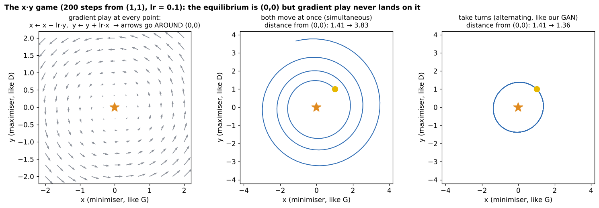

# 02 · GAN training dynamics: Nash equilibrium, instability, mode collapse

**Covers:** GAN Class 2 & 3 slides ("Training Dynamics") and the guide to the course notebook `GAN-Class-2-3-Training-Dynamics.ipynb`

**Notebook:** `notebooks/02_gan_training_dynamics.ipynb` (the course notebook rebuilt and run: the x·y game, the 8-cluster ring, five fixes, MNIST diagnostics)

---

## 1. Why GAN training is different

| | Training a classifier | Training a GAN |
|---|---|---|
| Target | **fixed**: a 7 is always a 7 | **moving**: G's "label" is D's opinion, and D changes every batch |
| What is optimised | one loss, minimised | one value V: **D maximises, G minimises** |
| Goal | the lowest point (a **minimum**) | a balance point (an **equilibrium**) |
| "Done" looks like | loss low and flat | D ≈ 0.5 **and** good, varied samples |
| Loss going up means | something got worse | maybe the **other player** got better |
| Analogy | hiking down a valley that stays still | hiking down a valley while someone reshapes the ground |

A GAN is looking for a **saddle point**: lowest in G's direction, highest in D's. Gradient descent is built for valleys, not saddles.

**True or false (from the slides):**
- "If G's loss goes up, G got worse." **False:** D may have improved instead.
- "D's labels change during training." **False:** real → 1 and fake → 0 always. But the fakes D sees keep changing.
- "A GAN is finished when both losses are as low as possible." **False:** both can't be low at once.

---

## 2. Games and Nash equilibrium

**A game has:**
- **players** (G and D);
- **strategies**: their choices (the values of each network's weights);
- **payoffs**: what each gets (D gets V, G gets −V).

A **zero-sum game** is one where the payoffs add to zero, which is what the GAN's minimax objective is.

> **Nash equilibrium:** a choice for every player such that **no player can do better by changing only their own choice** while the others keep theirs. It is named after John Nash (1950).

- **"No regrets" test:** ask each player "knowing what the others did, would you change your move?" If everyone says no, it's a Nash equilibrium.
- **Everyday example:** everyone drives on the left. Switching to the right alone only hurts you.
- **Penalty kick:** if the kicker always shoots left, the keeper learns to dive left. The kicker switches, the keeper follows, and they go round in circles. The equilibrium is for **both to randomise 50/50**, so nobody can exploit anybody. The guesser is left with a coin flip, just like **D = 0.5**.

### The GAN's equilibrium (Goodfellow et al. 2014)
- **D's no-regret check:** for a fixed G, the best D is D\*(x) = p_data / (p_data + p_g).
- **G's no-regret check:** against that D, the best G has **p_g = p_data**.
- Together: **p_g = p_data and D\*(x) = ½ everywhere**, with V = −log 4 ≈ −1.386.
- ⚠️ The theory guarantees this point **exists**, not that gradient training **reaches** it.

### The smallest GAN-like game: V(x, y) = x · y
- Player **x** wants V small (like G). Player **y** wants V large (like D).
- **Equilibrium: (0, 0).** If y = 0, V = 0 whatever x does, and vice versa. No regrets.
- **Gradient play:** x ← x − lr·y (descent), y ← y + lr·x (ascent).

- **Both move at once (simultaneous):** it spirals **outwards**. The distance grows by √(1 + lr²) each step: 1.41 → **3.83** after 200 steps.
- **Taking turns (alternating, like our GAN loop):** it **orbits forever** (1.41 → 1.36).
- **Why it circles:** each player's best move depends on the other's position. For example, at x > 0, y > 0, x moves left and y moves up. Follow the four quadrants and you get a **rotation**. Nobody's step aims at (0, 0).
- **A smaller learning rate only slows the circling** (lr 0.01 → 1.43, lr 0.1 → 3.83, lr 0.5 → it explodes). Fixing it needs a change to the **game or the optimiser**.

---

## 3. Instability

### Four symptoms
1. **Oscillating losses:** D and G swing in turn and never settle (the circling above).
2. **Quality goes backwards:** good at one epoch, worse at the next. More training is not always better.
3. **One player wins outright:** D's loss drops near 0, G's loss climbs, and the samples stay noise.
4. **Fragile settings:** a small change of learning rate, optimiser setting or seed turns success into failure.

### Cause 1: D too good → vanishing gradient (Arjovsky & Bottou 2017)
Early on, fakes and reals look completely different, so D separates them perfectly (D(G(z)) ≈ 0). A perfect D is **flat** around the fakes: nudging a fake still scores ≈ 0. A flat function has ≈ 0 gradient, and **G only learns through D's gradient**, so G stops learning. The non-saturating loss softens this, but **balance matters**.

### Cause 2: momentum and step size
Adam's **β1** sets how much of the previous direction it keeps (its momentum). The default is β1 = 0.9 (used in Class 1).
- Against a **fixed** landscape (a classifier), momentum helps.
- Against a **moving opponent**, momentum makes a player chase where the opponent **used to be**. It overshoots and widens the circles.

That's why **DCGAN recommends Adam lr = 0.0002, β1 = 0.5**.

### A better diagnostic than the loss: D's average opinions

| mean D(x) | mean D(G(z)) | Meaning | Check next |
|---|---|---|---|
| ≈ 1 | ≈ 0 | D winning easily | is G stuck? (vanishing gradient) |
| ≈ 0.6–0.8 | ≈ 0.2–0.4 | healthy contest, D slightly ahead | are the samples improving? |
| ≈ 0.5 | ≈ 0.5 | D can't tell, **or** D is broken | look at samples: good and varied? |
| swinging | swinging | oscillation | try β1 = 0.5 or a smaller lr |

These numbers are already in the loop (`outputs_real.mean()`, `outputs_fake.mean()`), so tracking them costs nothing.

| Cause | What you see | Typical fix |
|---|---|---|
| circling (game structure) | losses and D scores swing in turn | damping: β1 = 0.5, lower lr, better losses |
| D too strong | D(x) ≈ 1, D(G(z)) ≈ 0, G stuck | non-saturating loss, label smoothing, instance noise, WGAN-GP |
| momentum overshoot | wide swings, quality goes backwards | Adam β1 = 0.5 |
| fragile settings | works with one seed, fails with another | test several seeds, keep checkpoints |

---

## 4. Mode collapse

- A **mode** is a peak of the data distribution, i.e. one "kind" of sample:
  - the notebook's 2-D ring has 8 clusters = **8 modes**;
  - MNIST has about **10** (one per digit), plus smaller ones for writing styles;
  - faces have many (age, hair, pose, lighting).
- **Mode collapse:** G produces only **one or a few** modes. Each sample may look real, but the **variety is missing**. The original paper called it the "**Helvetica scenario**": G maps too many values of z to the same x.
- **Mode hopping:** the collapsed output **jumps** around (all 1s now, all 8s an epoch later). G sits on a cluster, D learns "points here are fake", G jumps elsewhere, and D follows. It is the penalty-kick chase inside a real GAN.

### Why it happens
1. **D judges one sample at a time.** A perfect "1" looks real on its own. D never sees that **all** the samples are 1s.
2. **G optimises against today's D.** The fastest way to lower its loss is to send **every** z to D's current favourite spot.
3. **Nothing rewards spreading out.** The standard loss scores each fake separately.

### Kinds and detection

| Kind | MNIST example |
|---|---|
| complete | every sample is the same "1" |
| partial | only 3, 7 and 1 appear |
| within a mode | all 7s in the same style |
| hopping | all 1s now, all 8s an epoch later |

**How to catch it:**
1. Look at a **grid of 64+ samples**, not one image.
2. Plot a **fixed-noise grid** every epoch to spot hopping.
3. **Count classes with a pretrained classifier:** a flat histogram is good, a few tall bars means collapse. Read it together with the grid, because the classifier always answers *some* digit, even for junk.
4. Use **coverage metrics** (the notebook's "modes covered"; FID in research papers).

⚠️ **Calm losses can hide collapse.** In the course's run, the ring GAN covered **at most 1 of 8** clusters the whole time while the losses just wobbled normally.

---

## 5. The stabilisation toolbox (each fix targets a specific problem)

| Fix | How it works | Targets |
|---|---|---|
| **Non-saturating G loss** (2014) | G minimises −log D(G(z)) | vanishing gradients early |
| **Adam β1 = 0.5** (DCGAN, 2015) | less momentum | oscillation, overshoot |
| **One-sided label smoothing** (2016) | real target 0.9 instead of 1 | over-confident D |
| **Instance noise** (2016–17) | add noise to D's real and fake inputs | D separates too easily |
| **TTUR** (2017) | different learning rates for D and G | D lagging behind G |
| **Minibatch discrimination / minibatch std** (2016, 2018) | D sees **statistics of the whole batch** | **mode collapse** |
| **Spectral normalisation** (2018) | limits how steep D can be | unstable D gradients |
| **WGAN / WGAN-GP** (2017) | a new loss: a **distance**, not a probability | vanishing gradients, instability |

**The course's experiment on the collapsed ring GAN (seed 0, 4,000 steps):**

| Baseline | A smoothing | B noise | C TTUR | D minibatch std | E z_dim 2 |
|---|---|---|---|---|---|
| 1/8 modes | 0/8, scattered | 1/8 | 1/8, sharper | **8/8** | **8/8** (thin ring) |

> **Lesson:** match the fix to the cause. Collapse happens because D **can't see variety**. Minibatch std gives D exactly that information (the spread of the whole batch), so it fixed the collapse. Smoothing and noise calm an **over-confident** D, which is a different problem, so they didn't help. Better quality (TTUR) is not better variety. Our rebuilt notebook reruns this, and your numbers may differ.

### WGAN (intuition only)
- A standard D outputs a probability. When fakes are far from the real data it just says "0, fake", however far away they are, so G gets a near-zero gradient and doesn't know which way to go.
- A **WGAN critic** outputs an unbounded score estimating the **earth mover's distance**: how much "earth" must move to turn the fake pile into the real pile. Farther away means a bigger score, so there is always a useful slope.
- The critic must be smooth (1-Lipschitz). WGAN uses weight clipping, and **WGAN-GP** adds a gradient penalty, which is more reliable.
- It is **not a cure-all**: in the course's short test it didn't fix the ring collapse.

### MNIST: Run A vs Run B (course's run, seed 0, 3 epochs)
- **Run A** (Class 1 settings, β1 = 0.9): **collapsed completely**. Every fixed-noise image was the same noisy blob, and the digit counter said "1,000 eights" even though the grid showed no eights at all.
- **Run B** (β1 = 0.5 + label smoothing 0.9): recognisable digits with all **ten** present.
- **One optimiser setting changed everything, and the losses alone couldn't tell you which run was healthy.**

---

## 6. Today in five sentences
1. A GAN chases a **moving target**, so its losses don't show quality.
2. Its goal is a **Nash equilibrium**: p_g = p_data and D = ½, where no player gains by changing alone.
3. **Gradient play circles that point**, so training can oscillate, overshoot or stall (**instability**).
4. G can fool a one-sample-at-a-time D with a few outputs: **mode collapse** and hopping.
5. **Fixes target specific causes.** Diagnose with D scores, fixed-noise grids and histograms, then test.

---

## Exit ticket / check yourself

1. Define Nash equilibrium. What is the GAN's equilibrium?
2. In the x·y game, why doesn't gradient play reach (0, 0)? Does a smaller learning rate fix it?
3. Losses look calm, but 900 of 1,000 samples are the digit 1. Name the problem and one fix.
4. Mean D(x) ≈ 1.0 and D(G(z)) ≈ 0.0 for a long time. What is happening to G?
5. Why can't a one-sample discriminator detect mode collapse?
6. Why does Adam β1 = 0.5 help GANs but momentum help classifiers?
7. Why did label smoothing not fix mode collapse on the ring?
8. Which diagnostic would you check first for mode collapse?

Answers

1. Choices where no player can do better by changing only their own. For a GAN: p_g = p_data and D outputs ½ for every image.
2. Each gradient depends on the other player, so the combined step rotates around (0, 0) instead of pointing at it. A smaller lr only slows the circling.
3. Mode collapse. Fix: minibatch std / minibatch discrimination (also check Adam β1 = 0.5).
4. D is too strong, so G's gradients vanish and it stops learning.
5. It scores each image alone. A single realistic image looks real even if every other sample is identical, so the loss has no penalty for missing variety.
6. With a moving opponent, momentum makes a player chase where the opponent used to be and overshoot. With a fixed landscape the downhill direction stays put, so momentum speeds things up.
7. It targets an over-confident D, not D's inability to see variety. Fixes only work on the problem they're designed for.
8. A grid of many samples (and/or a class histogram), not the losses.

