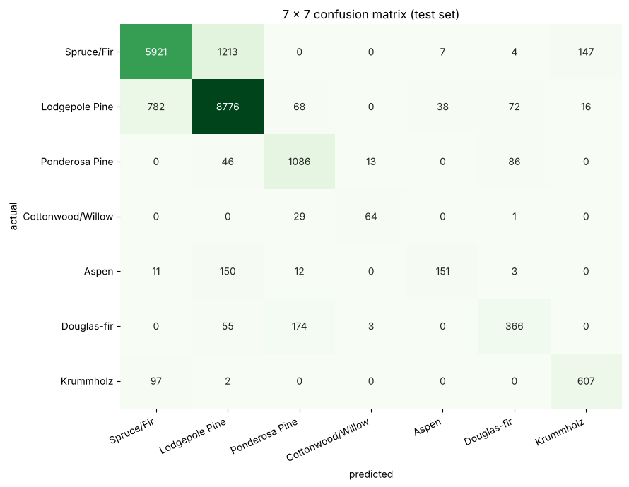
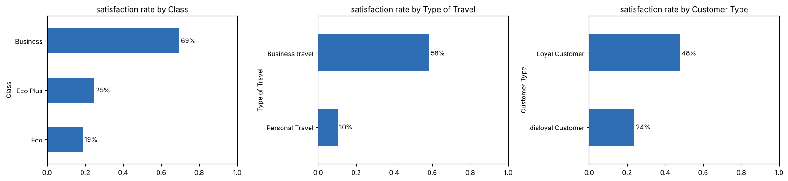

# Case studies: ANNs on real tables

Two end-to-end projects that put chapters 02–10 to work on real datasets: load → inspect → explore → split → scale → model → train → evaluate → interpret → compare. Both use **Keras 3 with the PyTorch backend**, as in the class Colab notebooks.

| # | Notebook | Task | Data | Run time (CPU) |
|---|---|---|---|---|
| 1 | `01_forest_cover_multiclass_ann.ipynb` | **7-class**: which tree species covers a 30 m patch? | `data/forest_cover_type.csv` (100,000 × 55) | ~10 min |
| 2 | `02_airline_satisfaction_binary_ann.ipynb` | **binary**: is a passenger satisfied? | `data/airline_passenger_satisfaction.csv` (103,904 × 25) | ~5 min |

Case study 1 **reproduces the class notebook** (`../course-files/Case_Study_ANN_MultiClass_Forest_CoverType.pdf`) step by step, with the same split, scaler, model and settings, then goes further. Case study 2 **reproduces the class airline notebook** (`../course-files/Case_Study_ANN_Airline_Passenger_Satisfaction.pdf`) the same way, and adds what a binary problem needs: text encoding, imputation, thresholds, permutation importance.

```
pip install keras torch scikit-learn pandas seaborn matplotlib
jupyter notebook          # run from this folder so data/... paths work
```

## Results at a glance

### 1 · Forest cover (multi-class, 7 species)


| Model | Test accuracy | Macro F1 |
|---|---|---|
| always "Lodgepole Pine" (baseline) | 48.76% | 9.37% |
| **case-study ANN, our run** | **84.86%** | **76.23%** |
| case-study ANN, class PDF run | 82.25% | 70.97% |
| ANN + sqrt class weights | 78.75% | 70.76% |
| ANN + balanced class weights | 67.26% | 58.01% |
| random forest (100 trees, 4 s) | **90.68%** | **83.87%** |

- **Heavy imbalance:** two species are 85% of the data; Cottonwood/Willow is 0.47%. Accuracy hides this, so **macro F1** and per-class recall tell the real story (Aspen recall only 0.46).
- **Main confusions:** Spruce/Fir ↔ Lodgepole Pine, and Douglas-fir → Ponderosa Pine, the pairs whose elevations overlap.
- **Validation accuracy > training accuracy** throughout: dropout is on when training accuracy is measured. Normal, not a bug.
- The model was **still improving at epoch 49 of 50**: early stopping never fired.
- **Class weights** raised rare-class recall (Aspen 0.46 → 0.95) but crushed the common classes, and even macro F1 fell. They're a dial to tune, not a free win.
- **The random forest beat the ANN by ~6 points in 4 seconds.** On tabular data, always compare with a tree ensemble.
- **Note on the class PDF:** its loss/accuracy figure covers 20 epochs, while its training log shows 50, so the figure is from a different run. Run-to-run differences of a few points (82.3% vs our 84.9%) are normal.

### 2 · Airline satisfaction (binary)


| Model | Test accuracy | ROC AUC |
|---|---|---|
| always "not satisfied" (baseline) | 56.67% | n/a |
| logistic regression (= one sigmoid neuron) | 87.64% | 0.928 |
| **class ANN, 15 epochs (our run)** | **95.85%** | **0.994** |
| class ANN (class PDF run) | 95.83% | 0.994 |
| class ANN, up to 40 epochs (best epoch 29) | 96.03% | 0.994 |
| random forest (200 trees, 5 s) | 96.20% | 0.994 |

- **The reproduction matches the class PDF** (95.85% vs 95.83%; F1 95.11% in both).
- **Cleaning** (class steps): drop `Unnamed: 0` and `id` (identifiers), one-hot the 4 text columns with `drop_first=True` (23 features), fill the 310 missing arrival delays with the median (here the **training** median, after the split), scale with training statistics.
- **Non-linear effects:** wifi rating vs satisfaction is **U-shaped** (99.7% satisfied at rating 0, "not rated"; ~25% at 2–3; 99.1% at 5). Correlation (0.28) misses it, but permutation importance shows wifi is the **most important** feature for the ANN. That's why hidden layers add **+8.2 points** over logistic regression.
- **Best epoch = last epoch (15)** in the class settings means training was cut short; with 40 allowed, early stopping chose epoch 29 (+0.2 points).
- **Threshold = business choice:** at 0.2, recall 0.982 / precision 0.879; at 0.8, precision 0.994 / recall 0.887.
- The ANN and the random forest **tie** here.
- **Note on the class PDF:** its printed log (epoch 1: 0.954 accuracy) and its plot (epoch 1: ≈ 0.887) come from different runs. Our fresh run reproduces the **plot** (0.889), so the log is from a re-run on an already-trained model, which is also why it prints "Dropped non-predictive columns: []".

## The workflow (applies to any tabular ANN)
1. **Inspect:** shapes, dtypes, missing values, duplicates, the class balance, identifier columns.
2. **Explore:** which features separate the classes (boxplots, rates by category).
3. **Encode:** two-valued text → 0/1; multi-valued categories → one-hot (never 0/1/2).
4. **Split first** (stratified), **then** impute and scale using **training statistics only** (no leakage).
5. **Baselines:** majority class, logistic regression, a tree ensemble.
6. **ANN:** ReLU hidden layers (+ He initialization), BatchNorm/Dropout, output = **softmax + sparse CCE** (multi-class) or **sigmoid + BCE** (binary), Adam, early stopping with `restore_best_weights`.
7. **Evaluate on the untouched test set:** accuracy, macro/weighted F1, the confusion matrix, per-class precision/recall, ROC AUC; choose the threshold deliberately.
8. **Interpret:** permutation importance; remember it shows what the model uses, not causes.
