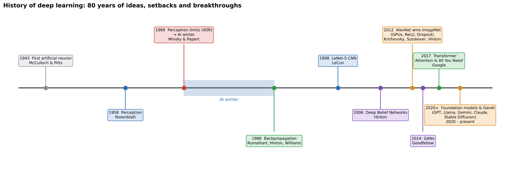
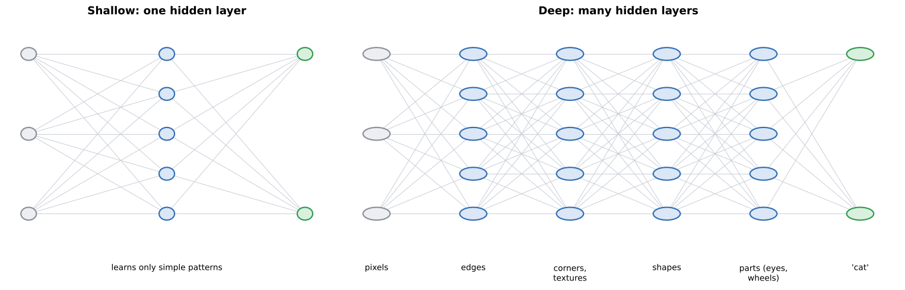

# 01 · History of deep learning (lecture of 04-08-2026)

**Notebook:** `notebooks/02_neurons_1943_to_1986.ipynb` runs the first four milestones (1943 → 1986) as code.

---

## 1. What is deep learning?

> **Deep learning** is a branch of machine learning that uses **artificial neural networks with multiple hidden layers** to learn complex patterns from data.

It became famous only in the last decade or so, but its roots go back to the **1940s**. The field moved through **ideas, setbacks and breakthroughs** before becoming the engine of today's AI.

---

## 2. The ten milestones (learn the year, the people and the one-line contribution)

| Year | Milestone | Who | Why it matters |
|---|---|---|---|
| **1943** | first **artificial neuron** | Warren **McCulloch** & Walter **Pitts** | first mathematical model of a biological neuron; showed that neurons with binary inputs and outputs can do **logic** (AND, OR, NOT); brain functions can be represented **computationally** |
| **1958** | **Perceptron** | Frank **Rosenblatt** | the first **trainable** neural network: it learns its weights from examples. Single layer, supervised, binary classification. **Limitation: only linearly separable problems** |
| **1969** | ***Perceptrons*** (the book) | Marvin **Minsky** & Seymour **Papert** | showed the limits of single-layer networks (e.g. **XOR**) → funding fell, research moved to rule-based **expert systems** → the **AI winter** |
| **1986** | **Backpropagation** popularised | David **Rumelhart**, Geoffrey **Hinton**, Ronald **Williams** | trains **multi-layer** networks by sending the error **backwards**, so deeper networks can learn complex patterns. Still **the** standard training algorithm |
| **1998** | **LeNet-5** (CNN) | Yann **LeCun** | one of the first successful **convolutional** networks: handwritten digits, bank cheques, postcodes. Showed networks can handle **images** |
| **2006** | **Deep Belief Networks** | Geoffrey **Hinton** | **layer-wise pre-training** made deeper networks practical. Marks the **start of modern deep learning** |
| **2012** | **AlexNet** wins **ImageNet** | Alex **Krizhevsky**, Ilya **Sutskever**, Geoffrey **Hinton** | trained on **GPUs**, used **ReLU** and **Dropout**, and crushed traditional computer-vision methods. Sparked wide adoption in academia and industry |
| **2014** | **GANs** | Ian **Goodfellow** | **generator vs discriminator**: image generation, face synthesis, super-resolution, data augmentation. Opened up **generative AI** |
| **2017** | **Transformer** | researchers at **Google** ("**Attention Is All You Need**") | built on the **attention** mechanism, replaced recurrent networks for language: translation, chatbots, summarisation, code generation |
| **2020–now** | **Foundation models & Generative AI** | many organisations | **LLMs**, multimodal AI, **diffusion models**, AI assistants: GPT, Llama, Gemini, Claude, Stable Diffusion |

**Memory trick: three "Hinton" years** (1986 backprop, 2006 DBNs, 2012 AlexNet). He's often called a "godfather of deep learning".

### Two stories worth telling in an exam answer
- **The AI winter (1969 → mid-1980s).** A single perceptron draws one straight line, so it can't learn **XOR** (the 1s are on one diagonal, the 0s on the other). Minsky and Papert's book made this famous, funding for neural networks dried up, and AI research turned to hand-written rules (expert systems). **Backpropagation (1986)** ended it: multi-layer networks *can* learn XOR, and now they could be **trained**. Notebook 02 reproduces the whole story in code.
- **The 2012 turning point.** The ideas (CNNs, backprop) already existed. What changed was **big data** (ImageNet's 1.2 million labelled images), **GPUs** (fast parallel training) and **better tricks** (ReLU, Dropout). AlexNet's win convinced the world.

---

## 3. Why deep learning succeeded (the five enabling factors)

| Factor | Contribution |
|---|---|
| **large datasets** | more data → better training (ImageNet, web text) |
| **GPUs and TPUs** | massively parallel hardware made training deep networks fast enough |
| **improved algorithms** | backpropagation, **ReLU**, **Batch Normalization**, **Dropout**, **attention** (chapters 04–05) |
| **open-source frameworks** | TensorFlow, **PyTorch**, Keras made building networks accessible |
| **cloud computing** | scalable compute to train very large models |

## 4. How the models evolved

**artificial neuron → perceptron → multi-layer perceptron (MLP) → CNN → RNN → LSTM → Transformer → foundation models and GenAI**

- **MLP:** hidden layers (solves XOR).
- **CNN:** images, with local filters.
- **RNN / LSTM:** sequences, with memory (the LSTM remembers longer).
- **Transformer:** attention, parallel training, the basis of LLMs.

---

## 5. Why is it called "deep" learning?

> "Deep" refers to the **number of hidden layers** between input and output: the **depth** of the network. It does **not** mean deep thinking, deep intelligence or deep mathematics.

**Each layer builds on the previous one** (hierarchical feature learning). The lecture's example, recognising a cat or an object:

| Layer | Learns |
|---|---|
| input | raw pixels |
| layer 1 | edges |
| layer 2 | corners and textures |
| layer 3 | shapes |
| layer 4 | object parts (eyes, nose, wheels) |
| layer 5 | the complete object |

The lecture's face-recognition version: pixels → edges and lines → eyes, nose, mouth → face shape → identity.

**The key point:** nobody programs these features. **The network learns them automatically** from data. That's the big difference from classical machine learning, where a human designs the features (chapter 02, and notebook 01 shows it).

**A shallow network** (one hidden layer) learns only simple features. **A deep network** builds increasingly **abstract** representations, which is why deep learning leads in computer vision, speech recognition, natural-language processing and generative AI.

---

## Key takeaways (from the lecture)
- Deep learning started with the **artificial neuron in 1943**.
- The **perceptron (1958)** made networks trainable but was limited to simple (linearly separable) problems.
- **Backpropagation (1986)** made multi-layer networks trainable.
- **CNNs (1998)** transformed computer vision, and **AlexNet (2012)** showed the power of deep networks on GPUs.
- **Transformers (2017)** revolutionised NLP and underpin modern **LLMs**.
- Today deep learning powers generative AI, autonomous systems, healthcare, finance, robotics and science.

---

## Check yourself

1. Who built the first artificial neuron, and when? What could it do?
2. What did Rosenblatt's perceptron add, and what was its limitation?
3. What caused the AI winter, and what ended it?
4. What three ingredients did AlexNet combine in 2012?
5. Which 2017 paper introduced the Transformer, and what mechanism is it built on?
6. What does "deep" in deep learning refer to? What does it NOT mean?
7. Name the five factors that enabled deep learning's success.
8. Put in order: Transformer, LSTM, perceptron, CNN, MLP, artificial neuron, RNN.

Answers

1. McCulloch and Pitts, 1943. A mathematical model of a neuron that performed logical operations with binary inputs and outputs.
2. Learning: it was the first trainable neural network, adjusting its weights from examples. It could only solve linearly separable problems (not XOR).
3. Minsky and Papert's *Perceptrons* (1969) exposed the limits of single-layer networks, and funding moved to rule-based AI. Backpropagation (1986) made multi-layer networks trainable.
4. GPUs, ReLU and Dropout (plus the big ImageNet dataset).
5. "Attention Is All You Need" (Google). The attention mechanism.
6. The number of hidden layers (the depth). Not deep thinking, deep intelligence or deep mathematics.
7. Large datasets, GPUs and TPUs, improved algorithms, open-source frameworks, cloud computing.
8. Artificial neuron → perceptron → MLP → CNN → RNN → LSTM → Transformer.

