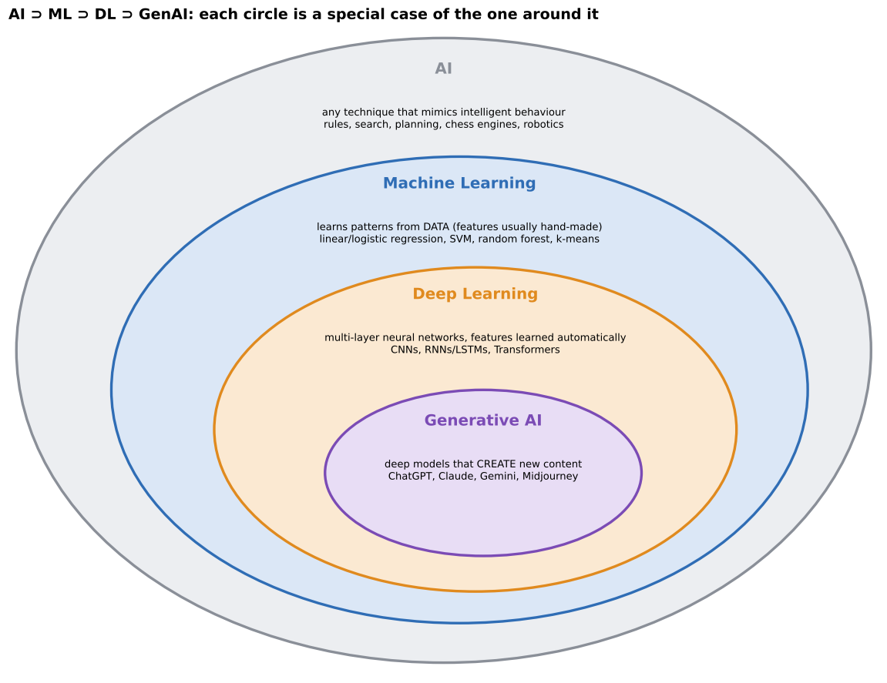
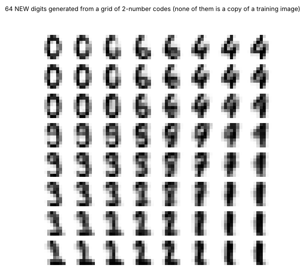

# 02 · AI vs ML vs DL vs GenAI, and the biological neuron analogy (lecture of 05-08-2026)

**Notebooks:**
- `notebooks/01_ai_ml_dl_genai_in_code.ipynb`: one problem solved at all four levels;
- `notebooks/02_neurons_1943_to_1986.ipynb`: the neuron, from biology to code.

---

# Part A · AI vs ML vs DL vs GenAI

## 1. The hierarchy: nested circles

> **ML is a subset of AI, DL is a subset of ML, GenAI is a subset (and an application) of DL.** Each inner circle keeps the properties of the one around it and adds its own defining constraint.

| Level | Defining idea | Examples |
|---|---|---|
| **Artificial Intelligence (AI)** | any technique that lets a machine **mimic intelligent behaviour** | rule-based expert systems, search algorithms, robotics, chess engines |
| **Machine Learning (ML)** | AI that **learns patterns from data** instead of following hand-written rules | random forest, SVM, logistic regression |
| **Deep Learning (DL)** | ML using **multi-layer neural networks** that **learn features automatically** from raw data | CNNs, RNNs, Transformers |
| **Generative AI (GenAI)** | DL models trained to **generate new content** (text, images, audio, code), not just classify or predict | ChatGPT, Claude, Gemini, Midjourney, DALL-E |

## 2. Each level in more detail

### AI: the broadest term
- Any system doing tasks that normally need human intelligence: reasoning, planning, perception, language, decision-making.
- **Not defined by a technique.** It includes 1960s–80s **symbolic, rule-based** systems (if-then medical-diagnosis rules), **search and planning** (pathfinding, early chess programs), all of ML, and **robotics and control**.
- Best seen as a **goal / field of study**: building machines that behave intelligently. ML, DL and GenAI are **strategies** for reaching that goal.

### ML: learning from data
- Instead of a person writing the logic, the algorithm gets **examples** and a learning procedure and **infers** the logic.
- It learns an input → output mapping (or finds structure in unlabelled data), and usually **improves with more data**.
- It **often still needs a human to engineer the features** (which input variables the model sees).
- Three paradigms: **supervised, unsupervised, reinforcement** learning.

| Algorithm | Typical use |
|---|---|
| linear / logistic regression | a number or a yes/no from tabular data |
| decision trees / random forests | classification and regression on business data |
| SVM | classification with a clear margin |
| k-means | grouping unlabelled data (customer segments) |

### DL: deep neural networks
- **Many layers** ("deep"), each turning its input into a **more abstract representation**: edges → shapes and textures → whole objects or faces. This **hierarchical feature extraction** is the mechanical difference from classical ML.
- **Automatic feature extraction** from raw data, with no manual feature engineering.
- Needs **much more data and compute** (GPUs).
- **Excels at unstructured data:** images, audio, video, text.
- Architectures: **CNNs** (images), **RNNs/LSTMs/GRUs** (sequences), **Transformers** (language and beyond).

### GenAI: creating new content
- A classifier says "cat or dog". A generative model **draws a new cat that never existed**.
- Trained, often **self-supervised**, on **massive** data to learn the **distribution** of the data, not just a decision boundary.
- Produces new text, images, audio, video and code.
- Mostly **Transformer**-based (LLMs), plus **diffusion models** for images and video.
- What separates it from older generative methods is mainly **scale**: data, parameters, compute.

| System | Generates |
|---|---|
| ChatGPT, Claude, Gemini | text: conversation, writing, code, analysis |
| Midjourney, DALL-E | images from text |
| Runway | video generation and editing |
| ElevenLabs | synthetic speech, voice cloning |

## 3. The comparison table (exam favourite)

| | AI | ML | DL | GenAI |
|---|---|---|---|---|
| scope | broadest | subset of AI | subset of ML | subset of DL |
| core mechanism | rules, search, learning… | statistical patterns from examples | multi-layer networks, automatic features | large networks that model and reproduce the data distribution |
| feature engineering | n/a / varies | **usually manual** | **automatic** | automatic, at massive scale |
| typical data needs | varies | **moderate** (hundreds to thousands) | **large** (100k+) | **massive** (web-scale, billions of tokens or images) |
| typical output | any intelligent behaviour | prediction / classification | prediction, classification, detection | **newly generated content** |
| example | chess program | spam filter | CNN finding tumours on X-rays | LLM writing an essay |

## 4. The three distinguishing factors

1. **Data.** The amount needed rises sharply from ML → DL → GenAI.
   - Classical ML: often fine with thousands of rows of tabular data.
   - DL: needs large labelled sets (or augmentation) to avoid **overfitting** its many parameters.
   - GenAI: **self-supervised** learning on web-scale, mostly unlabelled data.
2. **Feature engineering.**
   - ML: a human selects and builds features (e.g. "average transaction in the last 30 days" for fraud detection).
   - DL: learned automatically by the layers.
   - GenAI: learned at huge scale, producing rich **embeddings** that transfer to many tasks.
3. **Architecture.**
   - ML: simple, well-understood models (trees, SVMs, linear functions).
   - DL: **artificial neural networks** (MLPs, CNNs, RNNs/LSTMs/GRUs).
   - GenAI: overwhelmingly **Transformers** (self-attention relates all parts of the input at once), plus **diffusion models**.

## 5. Real systems mapped (shows the nesting)

| System | AI | ML | DL | GenAI |
|---|---|---|---|---|
| 1980s chess engine with hand-coded rules | ✓ | ✗ | ✗ | ✗ |
| Naive Bayes spam filter | ✓ | ✓ | ✗ | ✗ |
| CNN photo tagger ("beach", "mountain") | ✓ | ✓ | ✓ | ✗ |
| ChatGPT writing a poem | ✓ | ✓ | ✓ | ✓ |

Every GenAI system is also DL, ML and AI, **but not the other way round**.

## 6. Common misconceptions
- **"AI and ML are the same."** ML is one way to build AI, and many AI systems (rule-based) don't learn at all.
- **"DL is just ML with more layers."** Technically true, but the real shift is **automatic feature learning**, which changes the whole workflow.
- **"GenAI is a different technology from DL."** No: it is deep learning (mostly Transformers) applied and scaled to content generation.
- **"Bigger is always better."** A well-tuned classical model can beat a big deep network on **small, structured** data.

**Why it matters in practice:**
- a few thousand rows of business data → **classical ML**;
- lots of labelled images → **DL (CNNs)**;
- producing new content (a summary, code, an image) → **GenAI**.

Picking the right category is often the most important early decision in an AI project.

### What notebook 01 measured (same digits, four levels)

| Level | Approach | Result |
|---|---|---|
| AI | hand-written if-then rules | 97% on **0 vs 1 only**; rules for all 10 digits are impractical |
| ML | logistic regression on 8 **hand-engineered** features | 74% on all 10 digits; limited by the features chosen |
| ML | the same model on 64 raw pixels | 97% |
| DL | 2-hidden-layer network on raw pixels | 98%, with features it invented itself |
| GenAI | a tiny generative network (VAE) | **draws new digits** that aren't copies of training images |

Honest note: on these tiny, clean 8×8 digits, the deep network only tied with logistic regression on raw pixels at every training-set size. DL's big advantage appears on large, complex data (photos, speech, text).

---

# Part B · The biological neuron analogy

## 7. Why the brain?
Artificial neural networks were **directly inspired by biological neurons**. The **McCulloch–Pitts neuron (1943)** and the **perceptron (1958)** were attempts to model, mathematically, how a neuron receives, processes and passes on information. Modern DL has moved far from biology, but its vocabulary still maps onto it.

## 8. The biological neuron (four parts)
The human brain has about **86 billion neurons**, each connected to thousands of others.

| Part | What it does |
|---|---|
| **dendrites** | branch-like **inputs**: receive signals from other neurons (thousands of them) |
| **soma (cell body)** | **integrates (sums)** the incoming signals. If the total passes a **threshold**, it fires an **action potential**, otherwise nothing: **all-or-nothing** |
| **axon** | long cable carrying the output signal to other neurons (under 1 mm to over 1 m long). **Myelin** insulation speeds it up |
| **synapse** | the junction with the next neuron. The signal crosses a tiny gap (**synaptic cleft**) chemically, via **neurotransmitters**. Its **strength can change** with experience (**synaptic plasticity**), the biological basis of **learning and memory** |

**Signal path:** dendrites receive → soma sums (weighted by synapse strengths) → fires if over the threshold → action potential travels down the axon → converted to chemicals at the synapse → influences the next neuron. Synapse strengths change over time, which is how the network learns.

## 9. The artificial neuron (perceptron)
A **drastic mathematical simplification** that keeps the essential computation:
1. **Inputs** x₁, x₂, x₃… are the feature values (pixels, word embeddings). They play the role of the **dendrites**.
2. **Weights** w₁, w₂, w₃… set the importance of each input, like **synapse strength**. Training adjusts them (backpropagation + gradient descent), the analogue of **plasticity**.
3. **Summation:** z = Σ wᵢxᵢ + **b** (the bias shifts the sum), like the **soma**.
4. **Activation function** f(z): the **threshold** idea, adding non-linearity (step, sigmoid, ReLU, tanh). **Without it, any number of layers collapses into one linear function** (chapter 04 proves this in code).

## 10. The mapping table (learn it)

| Biological | Artificial | Role |
|---|---|---|
| dendrites | inputs x₁, x₂, … | receive signals / feature values |
| synapse (strength) | weights w₁, w₂, … | importance of each signal |
| soma | Σ wᵢxᵢ + b | integrate into one value |
| firing threshold / action potential | activation function | whether, and how strongly, to "fire" |
| axon | output to the next layer | carry the result forward |
| synaptic plasticity | weight updates (backpropagation) | learn from experience / data |

### From one neuron to a network

| Brain | Artificial neural network |
|---|---|
| billions of neurons in regions and circuits (visual cortex, motor cortex) | layers: input, hidden, output |
| signals pass through many layers of neurons | **forward propagation** through the layers |
| learning = strengthening/weakening synapses | learning = **backpropagation** weight updates |
| regions specialise (vision, language) | architectures specialise (CNNs for images, RNNs/Transformers for sequences) |

## 11. Similarities and where the analogy breaks

**Similar:**
- both take **many weighted inputs**, **sum** them, and apply a **threshold / non-linearity**;
- both **adjust connection strengths** with experience;
- both get intelligence only from **many connected units**, never from one.

**Different (don't treat ANNs as brain models):**

| | Biological | Artificial |
|---|---|---|
| signal | electrochemical (ion channels, neurotransmitters) | numbers (floating point) |
| timing | asynchronous, continuous-time spikes | synchronous, discrete steps |
| learning | biochemical plasticity, not fully understood | an exact procedure (backprop + gradient descent) |
| complexity | thousands of synapses, many neuron types, glial support | weighted sum + activation |
| energy | **~20 watts** for the whole brain | training big models uses enormous energy |
| scale | ~86 billion neurons, **~100 trillion synapses** | even the largest models have fewer parameters than the brain has synapses |

The artificial neuron is **inspired by**, but a **drastic simplification** of, the real one, **by design**: the goal is engineering performance, not biological accuracy.

## 12. Why the analogy is still useful
- **Many layers:** the brain processes information hierarchically across regions, and deep networks build abstraction layer by layer.
- **Learned weights:** synapses adapt with experience, and weights are what training adjusts.
- **Activation functions:** neurons fire only past a threshold, and networks need non-linearity.
- **More connections → more complex behaviour**, up to a point.

**Connecting the two halves:** DL (Part A) is *defined* by artificial neural networks, which are built from the neurons in Part B. Networks of millions or billions of simple neurons need a correspondingly huge amount of data to tune every connection, which is why DL and GenAI need so much more data and compute than classical ML.

---

## Check yourself

1. Draw the hierarchy. Where does ChatGPT sit? A rule-based chess program?
2. Name the three factors that distinguish ML, DL and GenAI.
3. Who chooses the features in classical ML? In DL?
4. Give two misconceptions about AI/ML/DL/GenAI and correct them.
5. Map each part: dendrites, synapse, soma, threshold, axon, plasticity.
6. Why must an artificial neuron have an activation function?
7. Give three differences between biological and artificial neurons.
8. Which kind of model would you pick for: a 3,000-row sales table? 1 million labelled X-rays? Writing product descriptions?

Answers

1. AI ⊃ ML ⊃ DL ⊃ GenAI. ChatGPT is in all four. The chess program is AI only (no learning from data).
2. Data requirements, feature engineering (manual vs automatic), architecture.
3. A human (manual feature engineering). The network itself (automatic).
4. "AI = ML" (no: rule-based AI doesn't learn). "GenAI is a different technology" (no: it's scaled deep learning). Also "bigger is always better" (no: classical ML can win on small structured data).
5. Inputs, weights, weighted sum + bias, activation function, output, weight updates (backpropagation).
6. Without non-linearity, stacked layers collapse into one linear function and can't learn complex patterns. It also mirrors the neuron's firing threshold.
7. Any three of: electrochemical vs numerical signals; asynchronous vs synchronous timing; poorly understood biochemical learning vs exact backpropagation; huge vs simple complexity; 20 W vs huge energy use; ~100 trillion synapses vs fewer parameters.
8. Classical ML. DL (a CNN). GenAI (an LLM).

