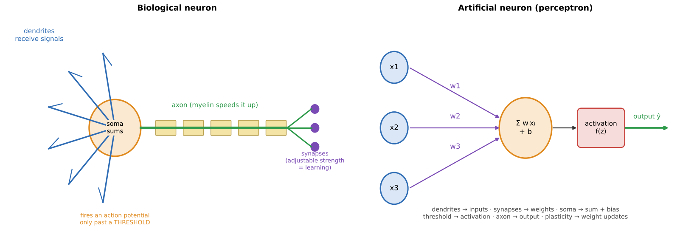
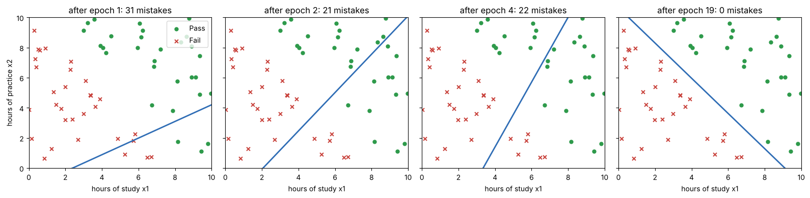
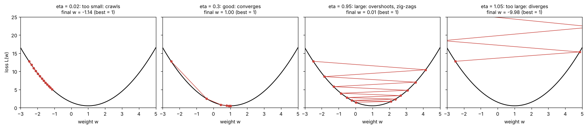
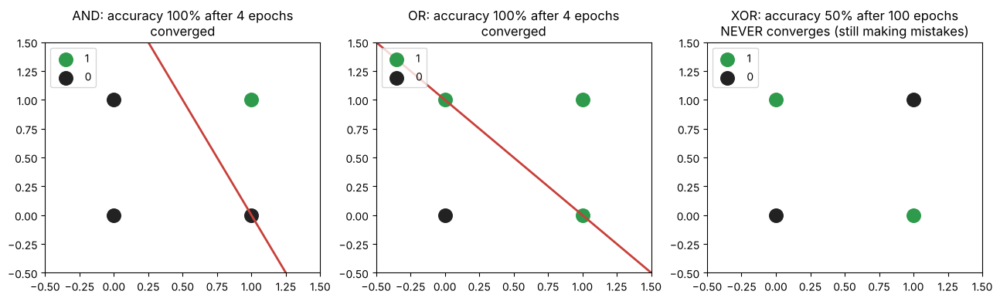
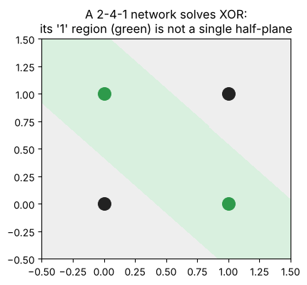

# 03 · The perceptron (lecture of 06-08-2026)

**Notebook:** `notebooks/03_perceptron_from_scratch.ipynb` (both worked examples recomputed, a perceptron built from scratch, learning-rate and XOR experiments)

---

## 1. What is a perceptron?

> The **simplest unit of a neural network**: a single artificial neuron that takes numeric inputs, combines them with a **weighted sum**, applies an **activation function**, and outputs a **binary** (0/1) decision.

**The lecture's running example:** predict whether a student will **Pass (1) or Fail (0)** from **x1 = hours of study** and **x2 = hours of practice**.

| Symbol | Meaning |
|---|---|
| x1, x2 | inputs (study hours, practice hours) |
| w1, w2 | weights: importance of each input |
| b | bias: shifts the threshold |
| z | net input (weighted sum): z = w1·x1 + w2·x2 + b |
| f(z) | activation function (the **step** function) |
| ŷ (y_hat) | predicted output (0 = Fail, 1 = Pass) |
| y | actual (true) answer |
| η (eta) | learning rate: size of each correction |

## 2. Architecture

The lecture draws three conceptual layers: **input** (x1, x2) → the **neuron** (weighted sum, then activation) → **output** (ŷ). Inside the neuron there are two stages: ① compute z, ② apply f(z).

> Careful with words: the lecture labels the neuron's column "hidden layer". In standard terminology a single perceptron has **no** hidden layer: its neuron *is* the output unit. "Hidden layers" are what multi-layer perceptrons add (section 7). Use the lecture's wording in the lecture's exam, and know the standard meaning.

## 3. Forward propagation

> Information flowing **left to right**: inputs → weighted sum → activation → prediction.

**z = Σ wᵢxᵢ + b,  ŷ = f(z)**

### Worked example (lecture 3.2), recomputed in the notebook
Given x1 = 2, x2 = 3, w1 = 0.5, w2 = 0.8, b = −2:
1. Weighted products: x1·w1 = 2 × 0.5 = **1.0** and x2·w2 = 3 × 0.8 = **2.4**.
2. Net input: z = 1.0 + 2.4 − 2.0 = **1.4**.
3. Step activation: f(1.4) = **1**, since 1.4 ≥ 0.
4. **ŷ = 1 → Pass.**

## 4. The activation: Heaviside step function

**f(z) = 1 if z ≥ 0, f(z) = 0 if z < 0**

It turns the continuous z into a crisp yes/no. Note that **z = 0 counts as 1** in the lecture's definition. (Chapter 04: the step function's slope is 0 everywhere, which is why modern networks use smooth activations.)

## 5. Learning: the perceptron update rule

Forward propagation only **predicts**. Learning compares ŷ with the truth y and corrects the weights:

**wᵢ(new) = wᵢ(old) + η·(y − ŷ)·xᵢ    b(new) = b(old) + η·(y − ŷ)**

The error (y − ŷ) can only be:

| y − ŷ | Meaning | Effect |
|---|---|---|
| **0** | correct | no change |
| **+1** | said Fail, was Pass (**under-predicted**) | weights move **up**, in proportion to each input |
| **−1** | said Pass, was Fail (**over-predicted**) | weights move **down** |

### Worked example (lecture 5.2), recomputed in the notebook
Given x1 = 2, x2 = 3, w1 = 0.2, w2 = −0.4, b = −1.0, y = 1, ŷ = 0, η = 0.1:
1. Error = 1 − 0 = **+1** (under-prediction).
2. w1 = 0.2 + 0.1·(1)·(2) = **0.4**.
3. w2 = −0.4 + 0.1·(1)·(3) = **−0.1**.
4. b = −1.0 + 0.1·(1) = **−0.9**.

**Notice** (from the notebook):
- Each weight moved **in proportion to its input** (w2 moved more, because x2 = 3 > x1 = 2).
- After this one update z went from −1.8 to −0.4. That's **closer, but still wrong** (ŷ is still 0). It takes several passes over the data.

*Notebook: the decision line moves as the perceptron learns on 60 students, reaching 0 mistakes after 19 epochs.*

## 6. Gradient descent and the learning rate

Repeating updates over many examples is like **walking downhill on a loss landscape**: each step moves the weights in the direction that reduces the error, until reaching the minimum.

| Learning rate | What happens |
|---|---|
| **too small** (η → 0) | **very slow**: thousands of tiny steps |
| **good** | converges quickly |
| **too large** (η ≫ 0) | **overshoots** the minimum, and the loss **bounces** or **diverges** |
| **local vs global minimum** | a well-tuned η helps reach the true (global) minimum instead of getting stuck in a shallow local one |

> **A surprise the notebook found:** for the classic perceptron starting from **zero weights**, every η (0.001 to 10) took **exactly the same 19 epochs**. The step function only looks at the **sign** of z, and scaling all the weights and the bias by η doesn't change any sign. From non-zero starting weights, η did matter (3 to 19 epochs). The trade-off in the table is really about **gradient descent on a smooth loss**, which all modern networks use, and the notebook's loss-curve plot shows it exactly.

## 7. Linear separability: what one perceptron can and can't learn

A perceptron draws **one straight line** (w1·x1 + w2·x2 + b = 0). So it can only learn **linearly separable** functions:

| x1 | x2 | AND | OR | XOR |
|---|---|---|---|---|
| 0 | 0 | 0 | 0 | 0 |
| 0 | 1 | 0 | 1 | 1 |
| 1 | 0 | 0 | 1 | 1 |
| 1 | 1 | 1 | 1 | 0 |

- **AND and OR:** one line separates the 1s from the 0s, and the perceptron learns them (4 epochs each in the notebook).
- **XOR:** the 1s sit on one diagonal and the 0s on the other, so **no straight line works**. The notebook tried **200,000 random lines**, and none beat **75%** (3 of 4 points). This is **Minsky & Papert's 1969** result, which helped start the AI winter (chapter 01).

> **Zero margin, seen in the notebook:** the learned AND line passes **exactly through the point (1, 0)**. z there is −0.000000000000000028, a floating-point rounding hair. The perceptron stops as soon as it makes no mistakes, however close a point sits to the line. Methods that **maximise the margin** (SVMs) exist to fix this.

### The fix: hidden layers (multi-layer perceptron)
**XOR = (x1 OR x2) AND NOT (x1 AND x2).** Two hidden neurons (OR, NAND) and one output neuron (AND) solve it. The notebook does this with hand-set weights, then **learns** it with a 2-4-1 network trained by backpropagation (outputs 0.003, 0.997, 0.997, 0.003).

Stacking neurons lets the network **bend** its decision boundary into curves and regions, which is why deep networks exist. (Gradient training needs a **smooth** activation such as sigmoid instead of the step, see chapter 04.)

---

## 8. Summary (the lecture's revision box)
1. **Forward propagation:** z = Σ wᵢxᵢ + b, then ŷ = f(z).
2. **Step activation:** 1 if z ≥ 0, else 0.
3. **Error:** (y − ŷ) ∈ {−1, 0, +1}.
4. **Update rule:** wᵢ ← wᵢ + η(y − ŷ)xᵢ and b ← b + η(y − ŷ).
5. **Gradient descent:** repeated updates walk the weights downhill towards the minimum loss.
6. **Core limitation:** a single perceptron only solves **linearly separable** problems (AND, OR), **not XOR**.

---

## Practice problems (with answers)

1. x = (1, 4), w = (0.5, −0.5), b = 1. Compute z and ŷ.
2. A perceptron predicts ŷ = 1 for x = (2, 1) but y = 0, with η = 0.5, w = (0.3, 0.6), b = 0. Give the new w and b.
3. With w = (1, 1), what bias makes the perceptron compute AND? OR?
4. Why does the update rule never change the weights for a correctly classified example?
5. Explain in two sentences why XOR needs a hidden layer.
6. Your training loss bounces up and down and grows. What do you change?
7. Is the perceptron supervised or unsupervised? Why?

Answers

1. z = 0.5·1 + (−0.5)·4 + 1 = 0.5 − 2 + 1 = −0.5 → ŷ = 0.
2. Error = 0 − 1 = −1. w1 = 0.3 + 0.5·(−1)·2 = −0.7. w2 = 0.6 + 0.5·(−1)·1 = 0.1. b = 0 + 0.5·(−1) = −0.5.
3. AND: b between −2 and −1, e.g. b = −1.5 (only 1 + 1 = 2 crosses zero). OR: b between −1 and 0, e.g. b = −0.5.
4. The error (y − ŷ) is 0, so the update η·0·x is 0.
5. A single perceptron draws one straight line, and XOR's classes lie on opposite diagonals, so no line separates them. A hidden layer combines several lines (e.g. OR and NAND) into a non-linear region.
6. Lower the learning rate (the steps are overshooting the minimum).
7. Supervised: every training example comes with the correct label y, which the update rule uses.

