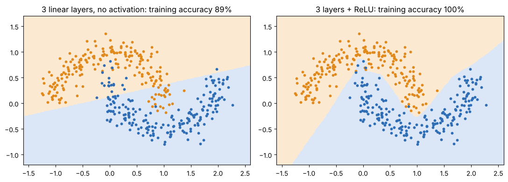
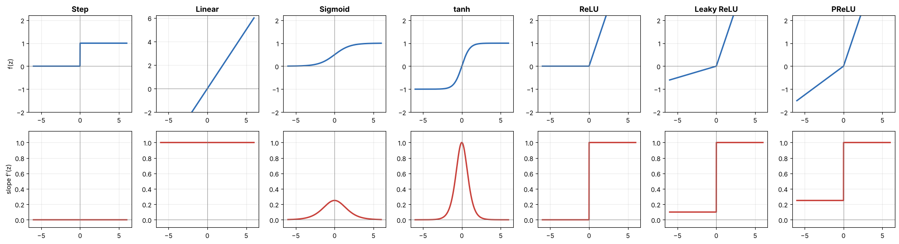
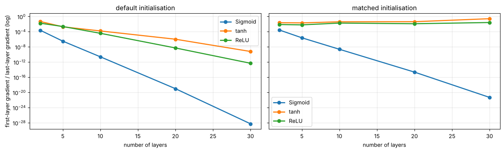

# 04 · Activation functions (lectures of 07-08-2026 and 11-08-2026)

**Part 1 (07-08):** what an activation function is, why we need one, Step, Linear.
**Part 2 (11-08):** Sigmoid, tanh, ReLU, Leaky ReLU, PReLU, vanishing gradients vs dying ReLU, which to use where.

**Notebook:** `notebooks/04_activation_functions.ipynb` (plots of every function and its slope, the linear-collapse proof, vanishing and dying gradients measured, an honest comparison)

---

## 1. What is an activation function?

> A mathematical function applied to a neuron's **weighted sum**, turning it into the output passed to the next layer.

**z = Σ wᵢxᵢ + b → output = f(z)**

**Inputs → weighted sum + bias → activation function → output**

## 2. Why we need one

- **Non-linearity:** real problems are rarely linear, and non-linear activations let networks learn complex relationships.
- **Depth that means something:** stacking non-linear layers builds increasingly complex representations.
- **Useful decision boundaries:** curved, complex classification regions.
- **Controlled output ranges** (e.g. probabilities between 0 and 1).

### Why linear layers alone are not enough
If every layer is linear, the whole network is **still one linear function**:

W₂(W₁x + b₁) + b₂ = (W₂W₁)x + (W₂b₁ + b₂)

so adding more linear layers adds **no** power. The notebook **proves** it: a 4-layer linear network gives identical outputs to one collapsed layer, and a "deep" linear network on the two-moons data could only draw a straight line, while the same network with ReLU separated the moons.

---

## 3. The seven functions

*Top row: the function. Bottom row: its slope (derivative), which is what backpropagation multiplies through the layers.*

### Step (Part 1)
- **f(z) = 1 if z ≥ 0, else 0.** A hard binary threshold (z = 2.5 → 1, z = −1.2 → 0).
- **Pros:** simple, a clear binary decision, historically important (the perceptron).
- **Cons:** **not differentiable at 0**, and its **derivative is 0 almost everywhere**, so it gives **no useful gradient** for backpropagation.
- **Use:** explaining the classic perceptron and hard binary decisions. **Not** used in modern deep networks.

### Linear (Part 1)
- **f(z) = z.** Output proportional to input, unbounded.
- **Pros:** simple, cheap, easy to differentiate (slope 1).
- **Cons:** **no non-linearity**, so a network made only of linear layers stays linear. Unsuitable for hidden layers.
- **Use:** the **output layer for regression** (predicting an unbounded continuous number, e.g. a price).

| | Step | Linear |
|---|---|---|
| output | discrete (0/1) | continuous |
| shape | threshold | straight line |
| differentiable | no (at 0) | yes |
| non-linear | yes | **no** |
| hidden layers | generally not used | generally not used |
| typical use | classical perceptron | regression output |

### Sigmoid (Part 2)
- **σ(z) = 1 / (1 + e⁻ᶻ)**, with derivative **σ(z)·(1 − σ(z))**.
- Range **(0, 1)**, an S-shape. σ(0) = 0.5.
- Smooth, but **not zero-centred**. It **saturates** near 0 and 1, and its **maximum slope is only 0.25**.
- **Pros:** probability-like output, smooth, good for binary decisions and **gates** (LSTMs).
- **Cons:** **vanishing gradients** when saturated; not zero-centred; a poor default for deep hidden layers; the exponential is costlier than piecewise functions.
- **Use:** the **output layer of binary classifiers**.

### tanh (Part 2)
- **tanh(z) = (eᶻ − e⁻ᶻ)/(eᶻ + e⁻ᶻ)**, with derivative **1 − tanh²(z)**.
- Range **(−1, 1)**, **zero-centred** (tanh(0) = 0), the key difference from sigmoid. Largest slope (1) at 0, and it **saturates** near ±1.
- **Pros:** zero-centred outputs, bounded hidden states, historically important in RNNs.
- **Cons:** vanishing gradients when saturated, so large inputs slow learning. Often replaced by ReLU-family activations in deep feed-forward networks.
- **Use:** **RNN hidden states, LSTM/GRU state computations**, anywhere bounded zero-centred values are wanted.

### ReLU, Rectified Linear Unit (Part 2)
- **f(z) = max(0, z).** Range **[0, ∞)**, piecewise linear. Slope **1** for z > 0 and **0** for z < 0.
- Negative inputs give exactly 0, so activations are **sparse**.
- **Pros:** **fast**; the strong default for deep hidden layers; **no saturation on the positive side**; sparsity can help.
- **Cons:** **dying ReLU** (a neuron stuck on the negative side stops learning); zero gradient for negatives; not zero-centred; unbounded positive output.
- **Use:** **hidden layers in CNNs and most feed-forward networks**.

### Leaky ReLU (Part 2)
- **f(z) = z if z > 0, else α·z** (small fixed α, e.g. 0.01). Slope 1 or α.
- **Pros:** gradient still flows for negative inputs, **less prone to dying neurons**, simple and cheap.
- **Cons:** you must **choose α**, which may not suit every dataset; still not zero-centred.
- **Use:** hidden layers when ReLU leaves too many neurons inactive.

### PReLU, Parametric ReLU (Part 2)
- **f(z) = z if z > 0, else a·z**, where **a is learned** during training (one per layer, or one per channel/unit).
- **Pros:** **learns the negative slope from the data**, reduces dying-neuron risk, more flexible than a fixed α.
- **Cons:** **extra trainable parameters**, can increase overfitting on small data, more complex, benefits depend on the architecture and data.
- **Use:** deep CNNs, and experiments where an adaptive slope may help.

| | ReLU | Leaky ReLU | PReLU |
|---|---|---|---|
| negative input → | 0 | α·z | a·z |
| negative-side gradient | 0 | fixed α | learned a |
| dying-neuron risk | higher | lower | lower |
| trainable slope | no | no | **yes** |
| core idea | rectify | leak a little | **learn** the leak |

---

## 4. Vanishing gradient vs dying ReLU (don't mix them up)

| | Vanishing gradient | Dying ReLU |
|---|---|---|
| cause | derivatives are **small** (sigmoid ≤ 0.25, saturated sigmoid/tanh ≈ 0) and get **multiplied** over many layers | the derivative is **exactly 0** for negative inputs |
| who suffers | sigmoid, tanh (in saturation) | ReLU |
| effect | **early layers** learn extremely slowly | a neuron whose input stays negative **never updates again** |
| remedies | ReLU-family activations, good initialisation, BatchNorm | Leaky ReLU, PReLU (non-zero negative slope), sensible learning rates |

### What the notebook measured

- **Vanishing gradient.** In a 30-layer **sigmoid** network the gradient reaching layer 1 was about **10⁻²²** of the last layer's, even with the best initialisation, so those layers can't learn. **tanh and ReLU kept a steady gradient only with matching initialisation**: Xavier for tanh, **He** for ReLU. With PyTorch's default starting weights, they also lost most of the signal. So "ReLU fixes vanishing gradients" really means "ReLU **with He initialisation**".
- **Dying ReLU, one neuron.** With its bias pushed to −2, a ReLU neuron's gradient was **exactly 0** for 2,000 steps (dead forever). The Leaky ReLU neuron recovered and fitted the data.
- **Dying ReLU, a whole network** with 77% of its neurons knocked out (biases −0.35):
  - ReLU stayed at chance (10%).
  - Leaky ReLU with α = 0.01 *and* with α = 0.1 **also** stayed stuck in 60 epochs: the small leak through three layers was too weak for plain SGD.
  - **PReLU learned its slope and recovered to 97.8%.**
  - Leaky ReLU **reduces** the risk; it doesn't remove it.
- **PReLU's learned slopes** ended at 1.79, 1.34 and 2.06, from a start of 0.25. Nothing forces them to stay small.
- **Head-to-head** (6 hidden layers on digits, Adam, 3 seeds):
  - sigmoid **27%**, tanh 95.2%, ReLU 91.0%, Leaky ReLU 93.1%, PReLU 94.6%, all with default initialisation;
  - **ReLU + He initialisation 96.9% (best)**.

---

## 5. Which activation where (the lecture's table)

| Situation | Recommended | Reason |
|---|---|---|
| binary classification **output** | **Sigmoid** | output between 0 and 1 |
| regression **output** | **Linear** | unbounded continuous value |
| typical **hidden layers** | **ReLU** | fast, strong baseline (use He initialisation) |
| dying-ReLU concern | **Leaky ReLU** | non-zero negative gradient |
| adaptive negative slope wanted | **PReLU** | slope is learned |
| bounded, zero-centred hidden state | **tanh** | range −1 to +1 |
| explaining the classic perceptron | **Step** | hard 0/1 threshold |

| Function | Range | Zero-centred | Strength | Limitation | Typical use |
|---|---|---|---|---|---|
| Sigmoid | (0, 1) | no | probability-like output | saturation | binary output |
| tanh | (−1, 1) | **yes** | zero-centred | saturation | RNNs / bounded states |
| ReLU | [0, ∞) | no | fast and sparse | dying neurons | hidden layers |
| Leaky ReLU | (−∞, ∞) | no | negative gradient | fixed α | hidden layers |
| PReLU | (−∞, ∞) | no | learned negative slope | extra parameter | CNNs |

**Summary (lecture):**
- Sigmoid is mainly an **output** activation for binary predictions.
- tanh is zero-centred, good for bounded hidden states, but saturates.
- ReLU is the strong default for hidden layers and gives sparse activations.
- Leaky ReLU keeps a small negative gradient against dying ReLU.
- PReLU learns the negative slope, at the cost of extra parameters.
- **Choose by layer, task and optimisation behaviour, and validate empirically.** The notebook's results show why that last point matters.

---

## Check yourself

1. Compute σ(0), tanh(0), ReLU(−3), LeakyReLU(−3) with α = 0.01.
2. What is the maximum derivative of sigmoid? Of tanh? Where do they occur?
3. Why can't you train a network of step functions with backpropagation?
4. Why is a network of only linear layers no better than one layer?
5. Explain the difference between the vanishing-gradient problem and dying ReLU.
6. Leaky ReLU vs PReLU: what is fixed and what is learned?
7. Choose activations for: hidden layers of a CNN; the output of a spam detector; the output of a temperature predictor; an LSTM's hidden state.
8. Which activation is zero-centred, sigmoid or tanh? Why does that matter?

Answers

1. 0.5, 0, 0, −0.03.
2. Sigmoid: 0.25 at z = 0. tanh: 1 at z = 0.
3. Its derivative is 0 everywhere except the jump, where it's undefined, so there's no gradient signal.
4. A composition of linear functions is linear: W₂(W₁x + b₁) + b₂ = Wx + b.
5. Vanishing: slopes are small but non-zero (saturating sigmoid/tanh) and shrink when multiplied across layers. Dying ReLU: the slope is exactly 0 because the neuron's input is always negative, so it never updates.
6. Leaky ReLU: the slope α is a fixed hyperparameter. PReLU: the slope a is a trainable parameter.
7. ReLU (Leaky ReLU or PReLU if neurons die); sigmoid; linear; tanh.
8. tanh. Zero-centred outputs keep the next layer's inputs balanced around 0, which helps optimisation (sigmoid outputs are always positive).

