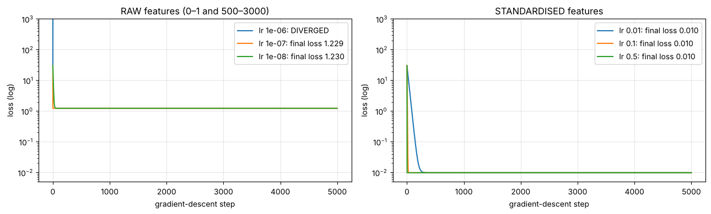
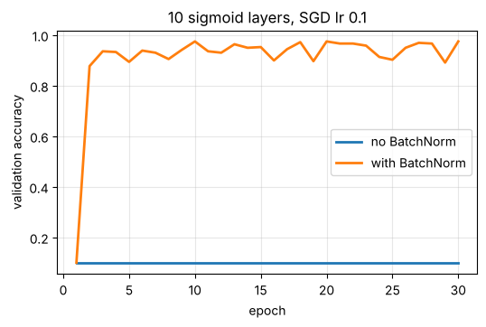
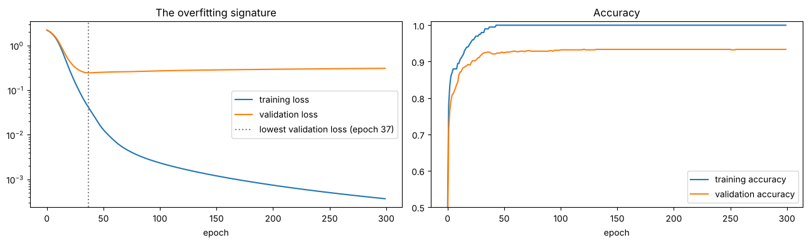

# 05 · Normalization and regularization (lecture of 04-09-2026)

**Notebook:** `notebooks/05_normalization_and_regularization.ipynb` (scaling vs gradient descent, leakage, BatchNorm and LayerNorm by hand, every regulariser tested on an overfitting network)

---

## 1. Two different problems

| Concept | Main purpose | Examples |
|---|---|---|
| **Normalization** | control the **scale/distribution** of data and activations → **stable, efficient optimisation** | min-max scaling, standardisation, BatchNorm, LayerNorm |
| **Regularization** | control **model complexity**, reduce **overfitting** → **better generalisation** to unseen data | L1, L2, dropout, early stopping, augmentation, weight decay |

They solve different problems and are **complementary**: a model can be normalised **and** regularised at the same time.

---

# Part A · Normalization

## 2. Why normalisation is needed
If one feature lies in 0–1 and another in the millions, their gradients are on very different scales, and gradient descent struggles. Scaling makes the problem easy to navigate.

**Notebook result:** predicting a price from a 0–1 rating and a 500–3,000 floor area.
- **Raw features:** learning rate 10⁻⁶ **diverged**; 10⁻⁷ and 10⁻⁸ **stalled** at loss 1.23 after 5,000 steps (the small feature barely learns at such tiny rates).
- **Standardised features:** the same model reached the noise floor (loss 0.0098) in 199, 19, or even 1 step(s) at learning rates 0.01, 0.1, 0.5.

### 2.1 Standardisation (z-score)
**x′ = (x − μ) / σ**, with μ and σ from the **training** data.
- centres the feature at 0, with standard deviation ≈ 1 on the training set;
- a strong default for continuous numerical features.

### 2.2 Min-max scaling
**x′ = (x − min) / (max − min)** → about [0, 1].
- Useful when a bounded range is wanted.
- **Sensitive to outliers**, because the extremes set the range. Notebook: with one 1,000k salary among 99 normal ones, min-max squashed all 99 normal values into **5%** of the range.

### 2.3 Image normalisation
8-bit pixels **0–255 → 0–1** (divide by 255), so the optimiser works with manageable numbers.

### 2.4 Avoid data leakage
> Compute μ, σ (or min/max) from the **training set only**, then apply **those same values** to validation and test data.

Never compute normalisation statistics on the test set and then report test performance as if it were unseen. Information has leaked, and the score is optimistic.

## 3. Normalization layers (inside the network)

| Method | Main idea | Common use |
|---|---|---|
| **Batch Normalization** | mini-batch statistics for each feature/channel | CNNs, many feed-forward networks |
| **Layer Normalization** | normalises the features **within each sample** | Transformers, sequence models |
| **Instance Normalization** | spatial features per sample/channel | style transfer, image generation |
| **Group Normalization** | groups of channels | CNNs with **small batches** |

## 4. Batch Normalization
For each feature, over a mini-batch of size m:
1. **mean** μ_B = (1/m) Σ xᵢ
2. **variance** σ²_B = (1/m) Σ (xᵢ − μ_B)²
3. **normalise** x̂ᵢ = (xᵢ − μ_B) / √(σ²_B + ε)
4. **scale and shift** yᵢ = γ·x̂ᵢ + β, where **γ and β are learned**

Key points:
- **Training:** uses **batch statistics**.
- **Inference:** uses **moving (running) averages** collected during training.
- **ε** prevents division by zero or by a tiny number.
- **γ, β** keep the layer able to learn whatever scale and offset is useful (it can even undo the normalisation).

**Notebook:**
- The hand computation matched `nn.BatchNorm1d` exactly.
- In train mode, a "batch" of identical rows normalised to all zeros (variance 0). In eval mode the running statistics were used instead, which is why `model.eval()` matters.
- A 10-layer **sigmoid** network learned **nothing** in 30 epochs without BatchNorm (10% = chance), but reached **89% after 5 epochs** and **97.5% after 30** with BatchNorm after every layer.

## 5. Layer Normalization
The same formulas, but the mean and variance are computed **across the H features of one sample**, then γ and β are applied.

| BatchNorm | LayerNorm |
|---|---|
| relies on **batch** statistics during training | works **independently for each sample** |
| can be hurt by **very small** batches | handles small or variable batch sizes naturally |
| behaves differently in train and eval | identical in train and eval |
| common in **CNNs** | common in **Transformers** |

---

# Part B · Regularization

## 6. What is regularization?
> Methods that stop a network from **fitting noise or memorising** the training set, so it performs better on **unseen** data.

| Condition | Training | Validation/Test |
|---|---|---|
| **underfitting** | poor | poor |
| **good generalisation** | good | good |
| **overfitting** | **very good** | **worsening / poor** |

## 7. How to detect overfitting
> **Training loss keeps falling while validation loss stops improving or starts rising.**

**Notebook:** a 300,000-weight network on just 200 digit images.
- **Training:** 100% accuracy (memorised).
- **Validation loss:** bottomed out at 0.245 around epoch 37, then rose to 0.309 by epoch 300.
- **Validation accuracy** just plateaued (93.4%), so **compare losses, not just accuracy**. Establish a clear **baseline** before adding regularisation.

## 8. L1 regularization
**Loss = original loss + λ Σ |wᵢ|.** The (sub)gradient adds λ·sign(w), a constant push towards zero.
- Main effect: **sparsity** (many weights become exactly or nearly zero), so it's useful when you want feature selection.
- Too large a λ removes too much capacity → **underfitting**.

## 9. L2 regularization
**Loss = original loss + (λ/2) Σ wᵢ².** The gradient adds **λ·w**, so larger weights shrink more.
- Shrinks weights **smoothly** without forcing many to exactly zero.
- The general-purpose default.

| | L1 | L2 |
|---|---|---|
| penalty | \|w\| | w²/2 |
| main effect | **sparsity** | **weight shrinkage** |
| exactly-zero weights | **more likely** | less likely |
| smooth at zero | no | yes |
| typical purpose | sparse models, feature selection | general weight control |

**Notebook:** L1 (λ = 10⁻⁴) left **88%** of the weights near zero, against 24% for L2 and 2% with no regularisation.

## 10. Elastic Net
**Loss + λ₁ Σ |w| + (λ₂/2) Σ w²**: a compromise between L1's sparsity and L2's smooth shrinkage.

## 11. Dropout
Randomly **disable a fraction p** of activations on each training step.
- The network can't depend on particular neurons, so it learns **distributed** representations.
- **Inverted dropout:** the survivors are scaled by 1/(1 − p) during training, so nothing needs changing at test time.
- **Disabled during inference** (`model.eval()`).
- It is **stochastic** (a different mask each update).
- **Too much dropout → underfitting.**

## 12. Early stopping
Stop training when **validation** performance stops improving, and keep the parameters from the **best validation epoch**.
- **Patience** allows temporary ups and downs before stopping.
- Use the **validation** set to decide, **never** the test set repeatedly.

**Notebook:** with patience 20, training stopped around epochs 56–70 instead of 300 (about 5× cheaper), with a similar test accuracy (93.2% vs 93.5%).

## 13. Data augmentation
Create **realistic variations** of the training examples: small rotations, crops, translations, flips, brightness changes. **The transformation must keep the label correct.**
- More effective diversity, less overfitting, especially useful for small datasets.
- **Wrong transformations create mislabelled or unrealistic examples.** Flipping a "6" can make a "9", for instance. In the notebook, 1-pixel shifts on tiny 8×8 digits (12% of the width, with wrap-around) **hurt** test accuracy (91.8% vs 93.5%): a live example of this warning.

## 14. Weight decay
Shrink the parameters directly at each step.
- **SGD:** w ← w − η(∇L + λw) = (1 − ηλ)·w − η∇L. That is "shrink, then step", which for plain SGD is equivalent to L2.
- **Adam:** adding L2 to the loss is *not* the same as true weight decay, because Adam rescales each gradient. **Decoupled** weight decay applies the shrink directly, and that is the motivation for **AdamW**.

**Notebook:**
- **Adam with `weight_decay = 0.01`** behaved like the L2 penalty: 24% of weights near zero.
- **AdamW with the same 0.01** barely changed anything: each step only shrinks w by lr × wd = 0.001%. **Same number, different mechanism.** AdamW is normally used with larger values (e.g. 0.05–0.1).

### All regularisers on one problem (notebook, 3 seeds, test accuracy)

| Setting | Test accuracy | Weights ≈ 0 |
|---|---|---|
| none | 93.5% | 2% |
| **L2** (λ = 10⁻³) | **94.1%** | 24% |
| L1 (λ = 10⁻⁴) | 93.7% | **88%** |
| **dropout** p = 0.5 | **93.9%** | 2% |
| augmentation (1-px shift) | 91.8% | 2% |
| Adam weight_decay 0.01 | 93.7% | 24% |
| AdamW weight_decay 0.01 | 93.5% | 2% |
| early stopping | 93.2% | — |

**Honest reading:** with only 200 training images, gains are about half a point, the size of the seed noise. Regularisation **helps a little**; it's not magic. **More data** is the strongest cure for overfitting.

---

## 15. Normalization vs regularization

| Question | Normalization | Regularization |
|---|---|---|
| primary objective | stable scale / optimisation | better generalisation |
| examples | standardisation, BatchNorm, LayerNorm | L1, L2, dropout, early stopping, augmentation, weight decay |
| prevents overfitting? | **not necessarily** | **yes, by design** |
| can be combined? | yes | yes |

## 16. Practical selection guide (lecture)

| Problem | Starting point | Reason |
|---|---|---|
| continuous features on very different scales | **standardisation** | comparable feature scales |
| image pixels 0–255 | rescale to 0–1 (or the model's preprocessing) | manageable values |
| CNN with ordinary batch sizes | **BatchNorm** | effective activation normalisation |
| Transformer / sequence model | **LayerNorm** | independent of batch statistics |
| overfitting in a dense network | **L2, dropout, early stopping** | control model complexity |
| need sparse weights | **L1** | many small or zero weights |

---

## Check yourself

1. Normalization vs regularization: one sentence each on what problem it solves.
2. Standardise x = 70 if the training mean is 50 and std is 10. Min-max scale x = 70 if min = 20, max = 120.
3. Why is min-max scaling risky with outliers?
4. What is data leakage in normalisation, and how do you avoid it?
5. Write the four BatchNorm steps. What are γ and β for? What changes at inference?
6. BatchNorm vs LayerNorm: what does each average over, and where is each used?
7. How do you recognise overfitting from training and validation curves?
8. L1 vs L2: penalty, effect on weights, typical use.
9. What does dropout do during training, and during inference?
10. Why does AdamW exist?

Answers

1. Normalization makes optimisation stable and efficient by controlling scale. Regularization reduces overfitting so the model generalises.
2. (70 − 50)/10 = 2.0. (70 − 20)/(120 − 20) = 0.5.
3. The extreme value sets the range, squashing all the normal values into a tiny interval.
4. Using statistics computed with test (or validation) data. Fit the scaler on training data only, then apply it to the others.
5. Batch mean → batch variance → normalise with ε → scale by γ and shift by β (learned, so the layer can choose its own scale and offset). At inference the running averages replace the batch statistics.
6. BatchNorm averages over the batch (per feature/channel) and is used in CNNs. LayerNorm averages over the features (per sample) and is used in Transformers.
7. Training loss keeps falling while validation loss stops improving or rises.
8. L1: λΣ|w|, drives weights to zero (sparsity), used for feature selection. L2: (λ/2)Σw², shrinks weights smoothly, the general default.
9. Training: randomly zeroes a fraction p of activations (scaling the rest by 1/(1 − p)). Inference: off, so all neurons are used.
10. With adaptive optimisers like Adam, L2-in-the-loss is not true weight decay. AdamW decouples the decay and applies it directly to the weights.

