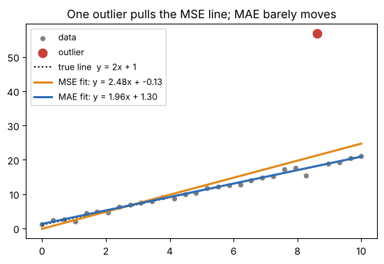

# 06 · Loss functions (lecture of 18-08-2026)

**Notebook:** `notebooks/06_loss_functions.ipynb` (every worked example recomputed, MSE vs MAE with an outlier, why classification uses cross-entropy, sparse vs one-hot labels, PyTorch's versions and the double-softmax trap)

---

## 1. What is a loss function?

> A **loss function** tells a neural network **how wrong** its prediction is compared with the actual target. Training adjusts the weights and biases to make the loss **smaller**, using an optimizer such as SGD or Adam.

**input → network → prediction ŷ → compare with the truth y → loss → optimizer updates the weights → repeat**

**Key idea:** different problems need different losses, because "error" means different things:
- **regression** (predict a number): how far off is the number?
- **binary classification** (yes/no): how well does the probability match the answer?
- **multi-class classification** (one of K classes): how much probability went to the correct class?

---

## 2. MSE: Mean Squared Error (regression)

**MSE = (1/n) · Σ (yᵢ − ŷᵢ)²**

Here n = number of examples, yᵢ = actual value, ŷᵢ = predicted value, and yᵢ − ŷᵢ = the error. **The error is squared.**

Regression examples: house price (₹65,00,000), temperature (28.5 °C), salary, taxi fare, units sold.

### Worked example (recomputed in the notebook)

| Actual | Predicted | Error | Squared |
|---|---|---|---|
| 100 | 90 | 10 | 100 |
| 200 | 220 | −20 | 400 |
| 300 | 270 | 30 | 900 |

**MSE = (100 + 400 + 900) / 3 = 466.67** (PyTorch's `F.mse_loss` agrees).

### Why square the error?
Take errors of 2 and 10. The second is **5×** bigger, but after squaring (4 vs 100) it counts **25×** more. **MSE heavily penalises large errors.**

**Advantages:** punishes big mistakes strongly; smooth and differentiable (easy for gradient descent); simple; a good default for regression, especially when the noise is roughly Gaussian (bell-shaped).

**Main disadvantage: sensitive to outliers.** With errors 2, 3, 4, 2, 3 and one error of 100, the notebook computed **MSE = 1673.7**, and the single 100 is **99.6%** of it. One bad point dominates.

**Use MSE when:** the target is continuous, large errors are especially costly, and there are no severe outliers.

---

## 3. MAE: Mean Absolute Error (regression)

**MAE = (1/n) · Σ |yᵢ − ŷᵢ|**

Same example: absolute errors 10, 20, 30 → **MAE = 60 / 3 = 20**.

| | small error 2 | large error 10 | outlier 100 |
|---|---|---|---|
| MSE contribution | 4 | 100 | 10,000 |
| MAE contribution | 2 | 10 | 100 |

MAE grows **linearly** with the error, so it's **more robust to outliers**. For the errors 2, 3, 4, 2, 3, 100 it gives **MAE = 19.0**.

*Notebook: fitting a line to data with one outlier. The MSE line is pulled towards the outlier; the MAE line stays close to the true line y = 2x + 1.*

**Advantages:** less sensitive to outliers; in the **same units as the target** ("on average the prediction is off by ₹X"); treats all errors proportionally.

**Disadvantages:** |x| has a **sharp corner at 0**, so it isn't differentiable exactly there, and its gradient is always ±1 (it doesn't shrink near the answer). Optimizers cope, but behave differently than on smooth MSE. It also doesn't prioritise very large errors.

| | MSE | MAE |
|---|---|---|
| error calculation | squared | absolute |
| large errors | strongly penalised | penalised proportionally |
| outlier sensitivity | high | lower |
| smoothness | smooth | not differentiable at 0 |
| units | squared target units | same units as the target |
| typical use | standard regression | robust regression |

**Rule:** no big outliers and large errors are costly → **MSE**. Outliers present and you want robustness → **MAE**. *(Beyond the lecture: **Huber loss** is MSE for small errors and MAE for large ones, a popular compromise.)*

---

## 4. Binary cross-entropy, BCE (two classes)

Examples: spam / not spam, fraud / not fraud, disease / no disease, pass / fail. The target is **0 or 1**; the network ends with **one sigmoid** output p = the probability of class 1.

**BCE = −[ y·log(p) + (1 − y)·log(1 − p) ]** (averaged over the n examples)

If y = 1, the second term vanishes and **BCE = −log(p)**. Computed in the notebook:

| Actual | Predicted p | Loss | Lecture's word |
|---|---|---|---|
| 1 | 0.99 | **0.010** | very small |
| 1 | 0.90 | **0.105** | small |
| 1 | 0.60 | **0.511** | moderate |
| 1 | 0.10 | **2.303** | very large |
| 1 | 0.01 | **4.605** | extremely large |

**BCE heavily punishes confident wrong predictions.**

Reading a sigmoid output: 0.02 and 0.25 → probably class 0; 0.51 and 0.95 → probably class 1 (threshold 0.5).

### Why not use MSE for classification? (measured)
The lecture says "classification is about probabilities and likelihood, not numerical distance". The notebook shows the practical consequence. Take y = 1 and a network that is **confidently wrong** (logit z = −5, so p = 0.007), and compare how hard each loss pushes the logit:

| logit z | p | gradient with MSE | gradient with BCE |
|---|---|---|---|
| −5 | 0.007 | **−0.0132** | **−0.9933** |
| −2 | 0.119 | −0.1850 | −0.8808 |
| 0 | 0.500 | −0.2500 | −0.5000 |
| +2 | 0.881 | −0.0250 | −0.1192 |

With MSE, the sigmoid is saturated, so the push almost **vanishes exactly when the model is most wrong**. With BCE the gradient on the logit is simply **p − y**: the more wrong, the harder the push.

---

## 5. Categorical cross-entropy, CCE (K classes, one correct)

Handwritten digits 0–9: K = 10. The network ends with **10 outputs + softmax**, which gives a probability for each class, summing to 1 (chapter 04, section 6). The lecture's example output puts **0.82** on class 7, so the prediction is 7.

**CCE = −Σₖ yₖ · log(pₖ)**

With a **one-hot** label (7 → [0,0,0,0,0,0,0,1,0,0]), every term except the correct class is 0, so **CCE = −log(p_correct)**:
- p(7) = 0.82 → **0.198** (small);
- p(7) = 0.01 → **4.605** (confidently wrong, heavily punished).

**CCE asks: how much probability did I give the correct class?**

---

## 6. Sparse categorical cross-entropy

**Same loss, different label format.** This is where beginners get confused.

| | Categorical CE | Sparse categorical CE |
|---|---|---|
| label for class 2 of 4 | one-hot [0, 0, 1, 0] | the integer **2** |
| output layer | softmax | softmax |
| underlying idea | cross-entropy | cross-entropy |

> **"Sparse" does NOT mean sparse predictions.** It means the **label** is stored as a class index instead of a one-hot vector.

MNIST's `y_train[0] = 7` is an integer, so use `sparse_categorical_crossentropy` (Keras). If you one-hot encode the labels first, use `categorical_crossentropy`. The notebook checks this: integer labels, one-hot labels and the formula by hand all give exactly **2.5375** on the same logits.

### PyTorch equivalents (not in the lecture's Keras examples)

| Keras | PyTorch | output layer |
|---|---|---|
| `mse` / `mae` | `nn.MSELoss` / `nn.L1Loss` | linear |
| `binary_crossentropy` | `nn.BCEWithLogitsLoss` (on raw scores, preferred) or `nn.BCELoss` (on sigmoid outputs) | sigmoid |
| `categorical_crossentropy` / `sparse_categorical_crossentropy` | `nn.CrossEntropyLoss` (accepts integer **or** one-hot/probability targets) | **none: feed the raw logits** |

> ⚠️ **The most common PyTorch bug:** `nn.CrossEntropyLoss` **already applies (log-)softmax**. If your model ends in `nn.Softmax` too, softmax is applied twice. Notebook: for logits (2, 0, −2) with class 0 correct, the correct loss is **0.1429**, while the double-softmax version gives **0.6417** (wrong, with weak gradients). In PyTorch, end classification models with a plain `nn.Linear`.

---

## 7. The complete picture

| Problem | Loss | Output layer | Target format |
|---|---|---|---|
| regression | **MSE** | linear | continuous |
| regression with outliers | **MAE** | linear | continuous |
| binary classification | **binary CE** | sigmoid | 0 / 1 |
| multi-class | **categorical CE** | softmax | one-hot |
| multi-class | **sparse categorical CE** | softmax | integer |
| multi-label (several true) | binary CE per label | one sigmoid per label | 0/1 vector |

**Decision tree:** predicting a number? → MSE (or MAE if outliers). Predicting a class? Two classes → BCE + sigmoid. More than two → softmax + CCE (integer labels → the sparse version).

**What each loss is asking:**
- **MSE:** "How far is my number from the real number?"
- **MAE:** "How much numerical error did I make, without over-weighting large errors?"
- **BCE:** "How well does my probability match the correct yes/no class?"
- **CCE:** "How much probability did I assign to the correct class?"
- **Sparse CCE:** "The same, but my correct class is given as an integer."

---

## Check yourself

1. Actual (10, 20), predicted (12, 14). Compute MSE and MAE.
2. Why is MSE sensitive to outliers? Why is MAE less so?
3. Which loss is in the same units as the target?
4. y = 1 and p = 0.5. What is the BCE?
5. y = 0 and p = 0.9. What is the BCE? Is that good or bad?
6. Why does sigmoid + MSE learn slowly when the model is confidently wrong?
7. A 4-class model outputs (0.1, 0.6, 0.2, 0.1) and the true class is 2 (the 0.2). What is the CCE?
8. Your labels are integers 0–9. Categorical or sparse categorical cross-entropy (Keras)?
9. Your PyTorch model ends with `nn.Softmax(dim=1)` and you train with `nn.CrossEntropyLoss`. What's wrong?
10. Choose loss + output layer for: taxi fare; email spam; handwritten digit; a photo's tags (several allowed).

Answers

1. Errors −2 and 6. MSE = (4 + 36) / 2 = **20**. MAE = (2 + 6) / 2 = **4**.
2. MSE squares errors, so one huge error dominates the sum. MAE grows only linearly with the error.
3. MAE (MSE is in squared units).
4. −ln 0.5 = **0.693**.
5. −ln(1 − 0.9) = −ln 0.1 = **2.303**: bad (confident and wrong).
6. The sigmoid is saturated, so its slope is ≈ 0, and MSE's gradient (which includes that slope) nearly vanishes. BCE's gradient on the logit is p − y, which stays large.
7. −ln 0.2 = **1.609**.
8. Sparse categorical.
9. Softmax is applied twice (CrossEntropyLoss does its own). Remove the Softmax layer and feed raw logits.
10. MSE (or MAE) + linear; BCE + sigmoid; (sparse) CCE + softmax; BCE + one sigmoid per tag.

