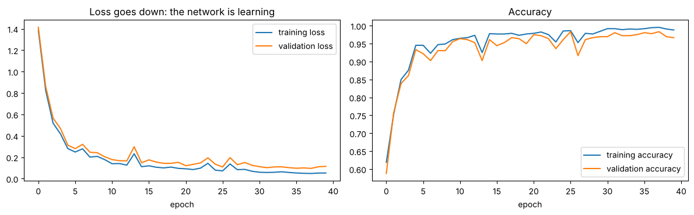
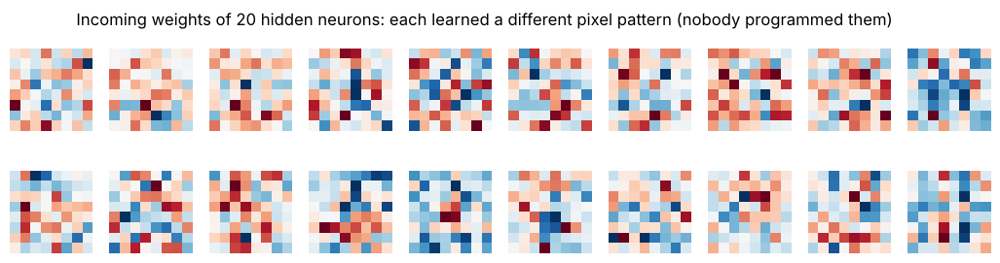

# 07 · How an MLP / ANN works (lecture of 20-08-2026)

**Notebook:** `notebooks/07_mlp_from_scratch.ipynb` (the lecture's small examples, a 2-layer MLP in plain NumPy using the lecture's backpropagation formulas, two independent proofs that the formulas are right, training on digits with steps/batches/epochs, underfitting vs overfitting, what the hidden neurons learn)

---

## 1. The big picture in one line

An MLP learns by repeating:

**input → weighted sum → activation → … → prediction → loss → backpropagation (gradients) → update the weights → repeat**

until the predictions are good enough.

---

## 2. ANN, neuron, MLP

- **ANN (Artificial Neural Network):** a computational model loosely inspired by biological neurons (chapter 02).
- **A neuron:** takes inputs, multiplies each by a weight, adds a bias, applies an activation:
  **z = w₁x₁ + w₂x₂ + … + wₙxₙ + b = w·x + b, then a = f(z)**
- **MLP (Multilayer Perceptron):** an ANN with **one or more hidden layers**. Every neuron in one layer connects to every neuron in the next, so it's also called a **fully connected** (dense) network.

**The three parts:**
1. **Input layer:** receives the features. It does **no learning**; it just passes the values on.
2. **Hidden layers:** learn patterns and representations.
3. **Output layer:** produces the final prediction.

*Example:* predicting whether a customer will leave (churn) from features such as age, income and usage: inputs → hidden layers → one sigmoid output "probability of churn".

### One neuron, worked (recomputed in the notebook)
Inputs x = (2, 3, 1), weights w = (0.5, 0.2, −0.4), bias b = 0.1:

z = 2(0.5) + 3(0.2) + 1(−0.4) + 0.1 = 1.0 + 0.6 − 0.4 + 0.1 = **1.3** → ReLU(1.3) = **1.3**.

### Weights, bias and activations: why each is needed
- **Weights = importance.** A large weight on x₁ and a small one on x₂ means x₁ has much more influence. Weights are **learned**.
- **Bias = shift.** Like y = m·x + c: the weight is the slope (m), the bias the shift (c). Without bias, z is forced to 0 whenever all the inputs are 0.
- **Activations = non-linearity.** Without them, layer after layer collapses into **one** linear layer: W₂(W₁x + b₁) + b₂ = (W₂W₁)x + (W₂b₁ + b₂). The proof is in code in notebook 04. Common choices: **ReLU** in hidden layers, **sigmoid** for a binary output, **softmax** for multi-class (outputs add to 1, e.g. 0.1 / 0.7 / 0.2 = "class 2 at 70%"), tanh for bounded states.

---

## 3. The complete working, step by step

### Steps 1–4: forward propagation
1. **Input:** the feature vector x enters the input layer.
2. **Weighted sum:** the first hidden layer computes **Z⁽¹⁾ = X·W⁽¹⁾ + b⁽¹⁾**, one z per neuron (the **pre-activations**).
3. **Activation:** **A⁽¹⁾ = f(Z⁽¹⁾)**. E.g. ReLU on Z = [−2, 3] gives **[0, 3]**: the first neuron is off, the second passes 3.
4. **Next layer:** A⁽¹⁾ becomes the input of layer 2: Z⁽²⁾ = A⁽¹⁾W⁽²⁾ + b⁽²⁾, A⁽²⁾ = f(Z⁽²⁾), and so on through every hidden layer.

### Step 5: output layer, depending on the problem

| Problem | Output layer | Loss (chapter 06) |
|---|---|---|
| regression (house price) | linear | MSE / MAE |
| binary (churn yes/no) | sigmoid | binary CE |
| multi-class, one-hot labels | softmax | categorical CE |
| multi-class, integer labels | softmax | sparse categorical CE |
| multi-label | one sigmoid per label | binary CE |

For multi-class, the predicted class is the one with the **largest probability**.

### Step 6: loss
Compare the prediction with the target. Lecture example: **Y = [1, 0], Ŷ = [0.7, 0.3]**: "somewhat correct but not perfect".

L = −[1·log(0.7) + 0·log(0.3)] = **0.357** (notebook). Lower loss = closer to the target.

### Step 7: backpropagation
> **Backpropagation = sending the gradient of the loss backwards through the network.** We don't send the raw error back; we send **gradients**.

**Gradient:** how much the loss changes when a parameter changes slightly, **∂L/∂w**.
- ∂L/∂w > 0: increasing w would **increase** the loss.
- ∂L/∂w < 0: increasing w would **decrease** the loss.

**The chain rule is the heart of it.** If L depends on a, a on z, and z on w, then

**∂L/∂w = ∂L/∂a · ∂a/∂z · ∂z/∂w**

and since z = w·x + b, ∂z/∂w = x. Each layer multiplies in its own local derivative.

**For a 2-layer MLP with softmax + cross-entropy** (the notebook implements exactly these):

| Forward | Backward |
|---|---|
| Z⁽¹⁾ = X W⁽¹⁾ + b⁽¹⁾ | δ⁽²⁾ = **Ŷ − Y** (softmax + CE simplifies to this) |
| A⁽¹⁾ = ReLU(Z⁽¹⁾) | ∂L/∂W⁽²⁾ = A⁽¹⁾ᵀ δ⁽²⁾,  ∂L/∂b⁽²⁾ = δ⁽²⁾ |
| Z⁽²⁾ = A⁽¹⁾ W⁽²⁾ + b⁽²⁾ | δ⁽¹⁾ = (δ⁽²⁾ W⁽²⁾ᵀ) ⊙ ReLU′(Z⁽¹⁾) |
| Ŷ = softmax(Z⁽²⁾) | ∂L/∂W⁽¹⁾ = Xᵀ δ⁽¹⁾,  ∂L/∂b⁽¹⁾ = δ⁽¹⁾ |

(⊙ = element-by-element multiplication. For a batch of m examples, average: the gradients get a factor 1/m and the bias gradients are summed over the batch.)

**Are the formulas right? The notebook checked them twice:**
1. **Numerical derivative:** nudge a weight by ±ε and measure (L(w+ε) − L(w−ε)) / 2ε. It agreed with backprop to **1.4 × 10⁻¹¹**.
2. **PyTorch autograd:** the same network's automatic gradients agreed to about **3 × 10⁻¹⁷** (floating-point rounding).

So the lecture's equations are exactly what `loss.backward()` computes.

### Step 8: update the weights
**w ← w − η·∂L/∂w   b ← b − η·∂L/∂b**   (η = learning rate)

Lecture example: w = 2, ∂L/∂w = 0.5, η = 0.1 → w = 2 − 0.1 × 0.5 = **1.95**.

**Why subtract?** The gradient points in the direction where the loss **increases**; we want to go the opposite way, downhill.

**Learning rate:** too small → tiny updates and very slow training; too large → overshooting, oscillating, unstable, may never converge. **0.001** is a common starting point for Adam, but it depends on the problem.

---

## 4. Steps, batches and epochs

| Term | Meaning |
|---|---|
| **batch** | a group of examples processed together (e.g. 128) |
| **training step / iteration** | one batch: forward → loss → backprop → **one weight update** |
| **epoch** | one full pass over the whole training set |

Lecture arithmetic, checked in the notebook:
- 50,000 examples, batch 128 → 50,000 / 128 = 390.6 → **391 batches per epoch** (the last one is smaller). 15 epochs ≈ 15 passes over the data = **5,865 updates**.
- 50,000 examples, batch 100 → 500 steps per epoch; 10 epochs = **5,000 updates**.

> **The weights are updated once per batch, not once per epoch.**

---

## 5. Training, validation and test sets

| Set | Used for |
|---|---|
| **training** | learning the weights (backprop + updates) |
| **validation** | choosing hyperparameters, detecting overfitting, model selection, early stopping |
| **test** | the final, honest estimate on unseen data, **used once, never to update weights** |

**Notebook run** (scikit-learn digits: 64 inputs → 64 ReLU → 10 softmax, written in NumPy): 1,078 training / 359 validation / 360 test images, batch 128 → **9 batches per epoch**, 40 epochs = **360 updates**. Validation accuracy reached **96.7%**; **test accuracy 96.4%**.

---

## 6. Underfitting and overfitting

| | Training | Validation | Diagnosis |
|---|---|---|---|
| tiny network (2 hidden neurons) | 66.3% | 65.5% | **underfitting**: poor everywhere |
| 64 hidden neurons, full data | 99.8% | 98.1% | **good fit** |
| big network, only 60 training images | 100% | 86.4% | **overfitting**: big gap |

*(notebook measurements)*

- **Overfitting** = learned the training data too specifically. Fixes: dropout, L1/L2 regularisation, early stopping, data augmentation, more data, a smaller model (chapter 05).
- **Underfitting** = hasn't learned the relationship. Causes: model too small, too little training, poor features, too much regularisation, poor optimisation.

---

## 7. What does the network actually learn?

It does **not** learn explicit rules like "if Age > 40 and Income > X, predict 1". It learns **numbers**, the weights and biases, that turn hidden neurons into useful **feature detectors**, because those values lower the loss.

*Notebook: each hidden neuron's 64 input weights drawn as an 8×8 image (red pushes the neuron up, blue down). Every neuron learned a different pattern. At this tiny resolution they look noisy rather than like neat strokes, but together they give 96% test accuracy.*

**Training = optimisation:** find the weights and biases that minimise the loss.

**Why several hidden layers?** One hidden layer can in theory approximate many functions given enough neurons, but deep networks learn **hierarchical** representations: in images, edges → shapes → parts → objects. In tabular data the representations are less visual, but the idea is the same.

**Two practical points the lecture recalls:**
- **Initialisation:** don't make all the weights equal (symmetry problem). Use Xavier for sigmoid/tanh and He for ReLU (chapter 08).
- **Normalise the inputs:** features on wildly different scales (age ≈ 40 vs income ≈ 5,00,000) slow training. For images, divide pixels by 255 so 0–255 becomes 0–1.

---

## 8. Backpropagation vs the optimizer (don't mix them up)

- **Backpropagation** **computes** the gradients.
- The **optimizer** decides how to **use** them: plain gradient descent (w ← w − η·grad) or **Adam**, which keeps running averages of the gradients (first moment) and of their squares (second moment) to adapt each weight's step size.

| Forward propagation | Backward propagation |
|---|---|
| input → output | loss → earlier layers |
| computes predictions | computes gradients |
| uses weights, biases, activations | uses the loss gradient and activation **derivatives** |
| ends with the loss | starts from the loss |
| "What did we predict?" | "How should we change?" |

### The eight questions to remember (lecture)
1. **Input:** what information did I receive?
2. **Weighted sum:** what does each neuron compute from the inputs?
3. **Activation:** what non-linear pattern does this neuron represent?
4. **Prediction:** what does the network think?
5. **Loss:** how wrong is it?
6. **Backpropagation:** which parameters caused the error, and by how much?
7. **Optimisation:** how should the parameters change?
8. **Repeat** until the model is good enough.

---

## Check yourself

1. x = (1, −1, 2), w = (0.3, 0.5, 0.1), b = −0.2, ReLU. Compute z and the output.
2. Does the input layer learn anything?
3. Y = [0, 1, 0], Ŷ = [0.2, 0.5, 0.3]. Cross-entropy loss?
4. In softmax + cross-entropy, what is δ at the output layer?
5. Why does δ⁽¹⁾ contain ReLU′(Z⁽¹⁾)? What happens to neurons whose z was negative?
6. w = 0.8, ∂L/∂w = −2, η = 0.05. New w? Did w go up or down, and why?
7. 60,000 examples, batch size 200, 5 epochs. Steps per epoch? Total weight updates?
8. Training 99%, validation 70%. What's happening, and name three fixes.
9. Which dataset do you use to pick the learning rate? Which one only once at the end?
10. What is the difference between backpropagation and the optimizer?

Answers

1. z = 0.3 − 0.5 + 0.2 − 0.2 = **−0.2** → ReLU = **0**.
2. No: it only passes the feature values on.
3. −log(0.5) = **0.693**.
4. **Ŷ − Y**.
5. Chain rule through the activation. ReLU′ = 0 where z < 0, so those neurons pass **no gradient** back (and their incoming weights don't change for that example).
6. w = 0.8 − 0.05 × (−2) = **0.9**: it went **up**, because the negative gradient says increasing w lowers the loss.
7. 60,000 / 200 = **300** steps per epoch; × 5 = **1,500** updates.
8. Overfitting. Fixes: more data or augmentation, dropout, L2, early stopping, a smaller model.
9. Validation; test.
10. Backpropagation computes the gradients; the optimizer turns them into weight updates (e.g. SGD, Adam).

