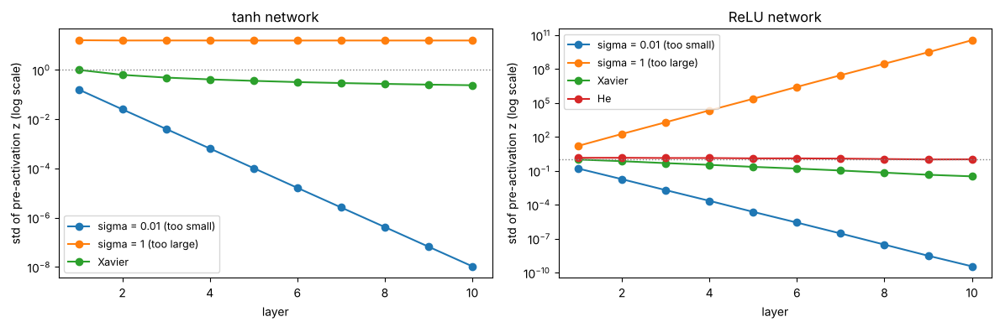
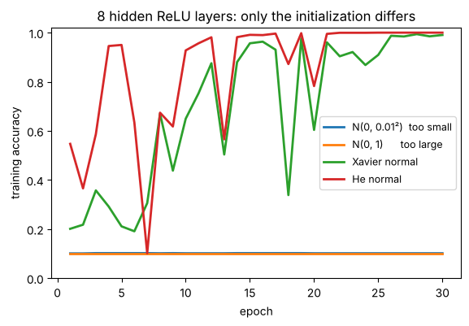

# 08 · Weight initialization: Xavier (Glorot) and He (Kaiming) (lecture of 21-08-2026)

**Notebook:** `notebooks/08_weight_initialization.ipynb` (the lecture's numbers recomputed, the symmetry problem shown, a signal pushed through 10 layers with five different initializations, the same deep network trained four ways, PyTorch's defaults)

---

## 1. What is weight initialization?

> **Assigning the starting values of a network's weights before training begins.**

For a neuron z = w₁x₁ + w₂x₂ + … + wₙxₙ + b, the w's need *some* value before the first forward pass. Training then repeatedly applies **W_new = W_old − η·∂L/∂W**, so **initialization is the starting point of the whole optimisation**.

A good choice affects whether the network learns at all, how fast it converges, **vanishing** and **exploding** gradients, **symmetry** between neurons, and training stability.

---

## 2. Why not start with all zeros? The symmetry problem

If several neurons start with **identical weights**, they get the same inputs, so they compute the same outputs, receive the same gradients, and make the same updates. They stay **identical forever**, learning one feature between them.

**Measured in the notebook** (64 → 8 tanh hidden → 10 on the digits, 300 training steps):

| Start | Training accuracy | Distinct hidden neurons |
|---|---|---|
| all weights 0 | 10.2% | **1 of 8** |
| all weights 0.01 (equal, not zero) | 26.7% | **1 of 8** |
| random (PyTorch default) | **97.8%** | 8 of 8 |

With all zeros it's even worse: tanh(0) = 0, so the gradient reaching the first layer is exactly zero and its weights never move.

- **Weights:** should *not* start equal or at zero (in hidden layers).
- **Biases:** can start at **zero**. Once the weights are random the neurons already differ.

---

## 3. Why not just any random values?

Random values **break the symmetry**, but their **scale** matters:
- **Too small** → each layer shrinks the signal, and repeated multiplication drives activations and gradients towards 0: **vanishing gradients**.
- **Too large** → each layer amplifies it: **exploding gradients** (or saturated sigmoid/tanh, which also kills the gradient).

**The goal of good initialization:** keep the **variance** (spread) of the activations roughly constant going **forward**, and of the gradients going **backward**.

### Seen in the notebook: a signal through 10 layers of width 256 (no training)



| Initialization | Spread at layer 1 | Layer 5 | Layer 10 | Verdict |
|---|---|---|---|---|
| tanh, σ = 0.01 | 0.16 | 0.0001 | 1 × 10⁻⁸ | **vanishes** (~6× smaller per layer) |
| tanh, σ = 1 | 16 | 15.6 | 15.6 | **87% of neurons saturated** at ±1, so slope ≈ 0 |
| tanh, Xavier | 1.0 | 0.36 | 0.24 | slow decline, usable |
| ReLU, σ = 0.01 | 0.16 | 2 × 10⁻⁵ | 4 × 10⁻¹⁰ | **vanishes** (~9× per layer) |
| ReLU, σ = 1 | 16 | 235,000 | 3.6 × 10¹⁰ | **explodes** (~11× per layer) |
| ReLU, Xavier | 1.0 | 0.22 | 0.033 | shrinks ~0.7× per layer |
| ReLU, **He** | 1.42 | 1.27 | 1.04 | **stable** |

*(spread = standard deviation of the pre-activations z)*

**Why does the scale depend on the layer size?** Each z adds up n_in terms, so its spread is about σ·√n_in times the input's. With n = 256, σ = 0.01 gives 0.16 (shrinks) and σ = 1 gives 16 (grows). **Xavier and He choose σ from the layer size to cancel that √n.**

---

## 4. Xavier / Glorot initialization (Glorot & Bengio, 2010)

**Best for sigmoid and tanh.** Uses both **n_in** (inputs to the layer) and **n_out** (its neurons).

- **Xavier normal:** W ~ N(0, σ²) with **σ² = 2 / (n_in + n_out)**, so σ = √(2/(n_in + n_out)).
- **Xavier uniform:** W ~ U(−a, a) with **a = √(6 / (n_in + n_out))**.

**Lecture example** (n_in = 100, n_out = 50), checked in the notebook:
Var = 2 / 150 = **0.0133**, σ ≈ **0.115**. Uniform limit a = √(6/150) = **0.200**.

**Why the 6?** A uniform distribution on (−a, a) has variance a²/3. Setting a²/3 = 2/(n_in + n_out) gives a² = 6/(n_in + n_out). **Both versions have the same variance** (the notebook measured 0.0131 and 0.0133).

**Why it suits sigmoid/tanh:** they **saturate** for large |z| (sigmoid's slope is at most 0.25 and ≈ 0 at the ends). Xavier keeps the initial z in the useful middle range so the signal and gradients don't die quickly.

---

## 5. He / Kaiming initialization (He et al., 2015)

**Best for ReLU, Leaky ReLU, PReLU.** Uses mainly **n_in**.

- **He normal:** W ~ N(0, σ²) with **σ² = 2 / n_in**, so σ = √(2/n_in).
- **He uniform:** W ~ U(−a, a) with **a = √(6 / n_in)**.

**Lecture example** (n_in = 100): Var = 2/100 = **0.02**, σ = √0.02 ≈ **0.141**. Uniform limit a = √0.06 = **0.245**.

**Why does ReLU need its own rule?** ReLU sets every negative input to zero, so about **half** the signal's power is lost at each layer. He's factor **2** (instead of roughly 1) compensates for exactly that. The notebook shows this: Xavier with ReLU loses ~30% per layer, while He stays level.

---

## 6. Xavier vs He at a glance

| | Xavier / Glorot | He / Kaiming |
|---|---|---|
| main purpose | keep activation/gradient variance stable | the same, **compensating for ReLU** |
| best for | sigmoid, tanh | ReLU, Leaky ReLU, PReLU |
| normal variance | 2 / (n_in + n_out) | 2 / n_in |
| uniform range | ±√(6 / (n_in + n_out)) | ±√(6 / n_in) |
| depends on | inputs **and** outputs | mainly inputs |
| typical use | networks with tanh/sigmoid | modern CNNs/MLPs with ReLU |

> **Easy rule: sigmoid / tanh → Xavier. ReLU / Leaky ReLU / PReLU → He.**

---

## 7. Does it really matter? (notebook experiment)

The same 8-hidden-layer ReLU network (width 128), the same data (digits), the same optimiser (SGD, lr 0.05, 30 epochs). Only the initialization changes:

| Initialization | After epoch 1 | After 30 epochs |
|---|---|---|
| N(0, 0.01²), too small | 10.1% | **10.1%**, loss 2.3025 = ln 10: **never learns** |
| N(0, 1), too large | loss `nan` | **`nan`**: numbers overflow, training crashes |
| Xavier normal | 20.1% | 99.1% (loss 0.051) |
| **He normal** | **54.7%** | **100%** (loss 0.0024) |



**Same network, same data: initialization alone decides between "never learns", "crashes" and "works".** (Batch normalization and residual connections reduce this sensitivity in modern networks, but don't remove it.)

---

## 8. In PyTorch

```python
nn.init.xavier_normal_(layer.weight)                         # or xavier_uniform_
nn.init.kaiming_normal_(layer.weight, nonlinearity="relu")   # He; or kaiming_uniform_
nn.init.zeros_(layer.bias)

def init_he(m):
    if isinstance(m, nn.Linear):
        nn.init.kaiming_normal_(m.weight, nonlinearity="relu"); nn.init.zeros_(m.bias)
model.apply(init_he)            # applies to every layer
```

**PyTorch's default** for `nn.Linear` is **U(−1/√n_in, +1/√n_in)**, variance **1/(3·n_in)**. The notebook measured 0.00337 for n_in = 100 (formula: 0.00333). That's **6× smaller** than He's 2/n_in: fine for shallow networks, but set He explicitly for deep plain ReLU stacks. (This explains notebook 04's finding that ReLU did better with He than with the default.)

---

## 9. The complete chain (lecture)

**initialization** sets the scale of the weights → which sets the scale of the **activations** (forward) and **derivatives** (backward) → poor scaling gives **vanishing or exploding gradients** → which decides whether the **weight updates** are useful.

**Summary:**
- Initialization gives the starting values; it happens **once, before** training. It is **not an optimizer**.
- Zero (or equal) hidden weights → **symmetry problem**.
- Arbitrary random values break symmetry but can still have a bad scale.
- **Xavier** (variance 2/(n_in + n_out)) → sigmoid/tanh. **He** (variance 2/n_in) → ReLU family.
- Good initialization keeps activations and gradients at useful scales.

---

## Check yourself

1. A layer has n_in = 200 and n_out = 100. Compute the Xavier normal σ and the Xavier uniform limit.
2. Same layer with ReLU: He normal σ and He uniform limit?
3. Why can't all hidden weights start at 0? What exactly goes wrong?
4. Is it OK for biases to start at 0? Why?
5. Why does He use 2/n_in and not 1/n_in?
6. Your 10-layer ReLU network's loss stays at 2.30 on a 10-class problem from epoch 1. Most likely cause?
7. Your loss becomes `nan` in the first epoch. Name an initialization-related cause.
8. Which initializer for: a tanh RNN layer? a ReLU CNN? a GELU Transformer block (hint: ReLU-like)?
9. Show that U(−a, a) with a = √(6/n_in) has the same variance as N(0, 2/n_in).

<details><summary>Answers</summary>

1. σ = √(2/300) = **0.0816**; a = √(6/300) = **0.141**.
2. σ = √(2/200) = **0.1**; a = √(6/200) = **0.173**.
3. Every hidden neuron computes the same output and gets the same gradient, so they stay identical (the notebook measured 1 distinct neuron out of 8). With exact zeros and tanh, the first layer's gradient is even exactly 0.
4. Yes: once the weights are random the neurons differ, so zero biases create no symmetry.
5. ReLU zeroes about half its inputs, halving the signal's power; the factor 2 restores it.
6. Weights too small: the signal vanishes, so the output is uniform guessing (ln 10 = 2.30).
7. Weights too large: activations explode and overflow.
8. Xavier; He; He-style scaling is the usual choice for ReLU-like activations (in practice Transformers mostly use their own fixed small-std initialisation plus normalisation layers).
9. Var of U(−a, a) = a²/3 = (6/n_in)/3 = 2/n_in. ✓
</details>
