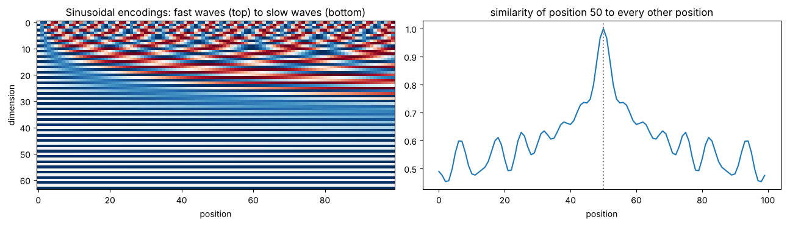

# 09 · Text → Tokens → Vectors: BPE, WordPiece, embeddings, positions (handout)

**Notebook:** `notebooks/09_text_tokens_vectors.ipynb` (a BPE trainer that reproduces the handout's merges, WordPiece scoring and greedy matching, **the real BERT tokenizer** on the handout's practical sentences, embedding lookup = one-hot × E, parameter and memory arithmetic, gradients reaching only the used rows, and why attention needs positions)

---

## 1. The big picture

A language model never sees words or letters. It sees **integer IDs**, turns them into **vectors**, and adds **position** information:

| Stage | What happens | Example |
|---|---|---|
| **1. Tokenization** | text → pieces → IDs | "playing!" → ["play", "##ing", "!"] → [27, 91, 8] |
| **2. Embedding** | each ID picks a row of a trainable table | [27, 91, 8] → rows 27, 91, 8 → X, shape 3 × d |
| **3. Position** | add a position vector to each token vector | token vector + position vector → ordered input |

**Why it matters:** tokenization affects cost, speed, how much fits in the context window, how typos and rare names are handled, code quality and **fairness across languages**. The embedding table can hold millions of parameters. The position design decides how the model sees order and distance.

### Two separate learning processes (don't mix them up)
1. **Tokenizer training** learns a vocabulary and splitting rules from a text corpus, **before** the neural network is trained. Applying a finished tokenizer is deterministic: no gradient descent.
2. **Model training** uses backpropagation to learn the **embedding vectors** and every other weight.

> The tokenizer does **not** learn embeddings.

---

## 2. Why subwords?

| Basic unit | Vocabulary | Sequence length | Advantage | Problem |
|---|---|---|---|---|
| whole words | very large | short | natural units | unknown words, typos, rare forms |
| characters / bytes | very small | long | any string representable | more positions, more computation |
| **subwords** | medium | medium | reusable pieces, few unknowns | quality varies by domain/language |

Common words stay whole (playing, engineer); rare words reuse pieces (unplayable → un + play + able; playbot → play + b + ot).

**The trade-off in two formulas:**
- **Embedding parameters = V × d** (V = vocabulary size, d = vector width).
- **Attention work per layer ∝ n²·d** (n = number of tokens).

A bigger V shortens sequences but enlarges the table. A smaller V saves parameters but lengthens sequences. **If the token count doubles, the n² part of attention grows ~4×** (notebook: 100 → 200 → 400 tokens = 1× → 4× → 16×).

**Quick check 1 (handout answers):** spell-checker → characters/bytes or robust subwords (typos); source code → byte-level or code-trained subwords (new identifiers); a fixed list of 20 commands → whole words/commands are enough (closed domain).

---

## 3. Byte Pair Encoding (BPE)

**Idea:** start from single characters (or bytes) and **repeatedly merge the most frequent adjacent pair** into a new symbol. It's a greedy compression method: frequent patterns get their own token.

**Training:**
1. Split each word into characters, plus an end-of-word marker `</w>`.
2. Count every adjacent pair, **weighted by word frequency**.
3. Merge the most frequent pair everywhere.
4. Repeat until the merge budget or vocabulary size is reached.
5. Store the base symbols and the **ordered** merge rules.

> BPE pieces are **not** guaranteed to be meaningful prefixes or suffixes. They're whatever is frequent.

### Worked example (reproduced exactly by the notebook)
Corpus: low ×5, lower ×2, newest ×6, widest ×3.

Initial counts: (e,s) = (s,t) = (t,</w>) = **9** (newest ×6 + widest ×3); (w,e) = 8; (l,o) = 7. There's a **tie**, so a real implementation needs a deterministic tie-break. The handout picks (e,s), and so does Python's `max` (the first one found).

| Merge | Pair | Count | Result |
|---|---|---|---|
| 1 | e + s | 9 | n e w **es** t </w> |
| 2 | es + t | 9 | n e w **est** </w> |
| 3 | est + </w> | 9 | n e w **est</w>** |
| 4 | l + o | 7 | **lo** w </w> |
| 5 | lo + w | 7 | **low** </w> |
| 6–8 | n+e, ne+w, new+est</w> | 6 | **newest</w>** is one token |
| 9 | low + </w> | 5 | **low</w>** is one token |
| 10 | w + i | 3 | **wi** d est</w> |

**Exercise 2 (answer):** after merges 1–2 the words are `l o w </w>` ×5, `l o w e r </w>` ×2, `n e w est </w>` ×6, `w i d est </w>` ×3. (l,o) still occurs **7** times; merging it gives `lo`, and then (lo,w), also 7, gives `low`.

**Unseen words reuse pieces:** lowest → `low` + `est</w>`; slow → `s` + `low</w>`. The worst case falls back to single characters, so **nothing is ever unknown**.

---

## 4. WordPiece (used by BERT)

### Training intuition: association, not just frequency
Classroom score: **score(a, b) = count(ab) / (count(a) × count(b))**. The denominator penalises pairs made from pieces that are common on their own.

| Pair | count(pair) | count(a) | count(b) | score |
|---|---|---|---|---|
| xy | 10 | 100 | 20 | 10 / 2000 = **0.005** |
| ab | 6 | 10 | 10 | 6 / 100 = **0.06** |

WordPiece prefers **ab**, although xy is more frequent. *(The original method is defined by language-model likelihood gain; this score is a teaching approximation.)*

### Encoding: greedy longest match, `##` = "continues the current word"
From the start of the word, take the **longest** vocabulary piece that matches, then continue with `##` pieces.

Vocabulary {play, ##ing, ##er, un, ##able, able}: playing → play + ##ing; player → play + ##er; unable → un + ##able.

**Exercise 3** (vocabulary {read, ##ing, ##er, un, ##read, ##able}), run in the notebook:
- reader → read + ##er ✓
- reading → read + ##ing ✓
- unreadable → un + ##read + ##able ✓ (**all three succeed**)
- **Without `##read`** → `[UNK]`: after `un`, the rest must be matched by **continuation** pieces, and standalone `read` doesn't count.

> **Handout note:** the question asks which item "may fail", and its answer key says unreadable "may fail" but then shows that it **succeeds** with this exact vocabulary. The answer key contradicts itself. The notebook confirms that all three succeed, and that unreadable fails only if ##read is removed.

| | BPE | WordPiece |
|---|---|---|
| training choice | most frequent adjacent pair | most strongly associated pair / likelihood gain |
| classroom score | count(a,b) | count(a,b) / (count(a)·count(b)) |
| encoding new text | apply the learned merges in order | greedy longest vocabulary match |
| notation | varies (word-boundary markers) | BERT's `##` for continuations |
| purpose | the same: open-ended text with a manageable vocabulary | |

---

## 5. The real BERT tokenizer (handout practical, run in the notebook)

Using the actual `bert-base-uncased` vocabulary (**30,522** tokens). `[CLS]` and `[SEP]` are special start/end tokens that BERT adds; counts include them.

| Input | Tokens | Count | Observation |
|---|---|---|---|
| Tokenization is unbelievably useful. | token ##ization is **un ##bel ##ie ##va ##bly** useful . | 12 | even a normal word can split into 5 pieces |
| Tokenizashun is useful. *(typo)* | token ##iza ##shu ##n is useful . | 9 | **no `[UNK]`**: the typo splits into pieces |
| `vector<vector<int>> values;` | vector < vector < int > > values ; | 11 | each symbol is its own token |
| Thiruvananthapuram costs ₹1,23,456. | th ##ir ##u ##vana ##nt ##ha ##puram costs ₹ ##1 , 23 , 45 ##6 . | 18 | the place name → **7** pieces; the number → **7** tokens |
| playing player unplayable | playing player un ##play ##able | 7 | common words whole, rare ones in pieces |

**Fairness (handout "food for thought"), measured:** "Tokenization is incredibly useful." = **6** tokens (without the specials), while the same sentence in Spanish, "La tokenización es increíblemente útil.", = **13** tokens, more than **twice** as many. The vocabulary was built mostly from English, so Spanish speakers pay more tokens (money, context window, speed) for the same meaning. **Token fertility** = tokens per word; it's high for out-of-domain text.

---

## 6. Embedding layers: a trainable lookup table

Token IDs are just names: ID 27 isn't "bigger" or "more meaningful" than ID 8. An **embedding matrix E** of shape **V × d** holds one trainable row per token:

**token ID t → vector x = E[t] (length d);  IDs [t₁ … tₙ] → X of shape n × d**

- **Lookup view:** IDs [27, 91, 8] → X = [E[27], E[91], E[8]], shape (3, d).
- **One-hot view:** E[t] = one_hot(t) · E. **Mathematically identical** (the notebook checks `torch.allclose` → True), but lookup is far cheaper: the one-hot route builds V numbers per token, almost all zeros, and multiplies by the whole table.

In PyTorch: `nn.Embedding(num_embeddings=V, embedding_dim=d)`; IDs of shape (batch, n) → output (batch, n, d).

### Parameters and memory (checked in the notebook)

| | V × d | Parameters | fp32 (4 bytes) | fp16/bf16 (2 bytes) |
|---|---|---|---|---|
| handout example | 30,000 × 768 | **23,040,000** | **92.16 MB** (≈ 87.9 MiB) | 46.08 MB |
| Exercise 4 | 50,000 × 512 | **25,600,000** | **102.4 MB** | 51.2 MB |
| real bert-base-uncased | 30,522 × 768 | 23,440,896 | 93.76 MB | 46.88 MB |

**Exercise 4:** E has shape **(50,000, 512)**. A batch of IDs of shape (B, n) = (8, 128) becomes **(8, 128, 512)**. Training needs extra memory for gradients, optimizer states and activations, and an untied output projection adds another V × d matrix.

### How embeddings learn
The loss sends gradients back **only into the rows that were used**. For IDs **[4, 9, 4]**: rows 4 and 9 get gradients, and **row 4 accumulates two contributions**, ∂L/∂E[4] = ∂L/∂x₁ + ∂L/∂x₃. The notebook measured a row-4 gradient of 2.0 and a row-9 gradient of 1.0 per element. All other rows: zero. (So rare tokens learn slowly.)

**Static vs contextual:** E has **one** row for "bank". The later Transformer layers produce **different** vectors for "river bank" and "bank loan", because they mix in context.

**Weight tying:** a language model's output layer can reuse E: **logits = h·Eᵀ**. This saves V × d parameters and links the input and output token spaces (the widths must match).

---

## 7. Positions: why attention needs them

"dog bites man" and "man bites dog" contain the same tokens, and **the same token always gets the same lookup vector**. Self-attention (Q = XW_Q, K = XW_K, V = XW_V, softmax(QKᵀ/√d_k)·V) is **permutation equivariant**: shuffle the input rows and the outputs are shuffled the same way, **Attention(ΠX) = Π·Attention(X)**.

**Notebook proof:** without positions, every word's output vector is **identical** in both sentences (True), and any order-free summary is identical too. The model can't tell who bit whom. With position vectors added, the outputs differ (False).

**Input construction:** **input_i = token_embedding[token_i] + position_embedding[i] (+ segment embedding)**. All have width d, so adding them keeps the shape n × d.

### Learned absolute positions (BERT)
A trainable table **P** of shape **L_max × d**; position i uses row P[i]. Simple and flexible, but costs L_max × d parameters, and positions beyond L_max are undefined.

### Sinusoidal encodings (original Transformer)
**PE(pos, 2i) = sin(pos / 10000^(2i/d))   PE(pos, 2i+1) = cos(pos / 10000^(2i/d))**

Each pair of dimensions is a wave of a different frequency (some fast, some slow), giving every position a unique multi-scale "barcode". They're fixed (no parameters), and nearby positions get similar codes.

**Handout example, d = 4, position 1:** [sin 1, cos 1, sin 0.01, cos 0.01] = **[0.8415, 0.5403, 0.0100, 0.99995]** (notebook ✓).

**Modern alternatives:** relative position biases and **RoPE** (rotary embeddings) inject position into the attention scores or rotate queries and keys. The goal is the same: make order and distance visible.

**Exercise 5:** (1) the same token at positions 2 and 10 has the **same token embedding**; only the position part differs. (2) The widths must match because the vectors are **added element by element**. (3) Content-only attention just **permutes its outputs** when the inputs are permuted; it can't infer an order.

---

## 8. Revision: the story in six statements

1. Whole-word vocabularies are brittle; character/byte sequences are long.
2. Subwords balance vocabulary size, sequence length and unknown words.
3. **BPE** greedily merges the most frequent adjacent pair.
4. **WordPiece** prefers strongly associated pairs and encodes by greedy longest match (`##`).
5. An **embedding layer** is a trainable V × d lookup table.
6. **Positions** are needed because content-only attention is permutation equivariant.

**Common misconceptions (all false):** a token is always a whole word · BPE and WordPiece are identical · the tokenizer learns the embeddings · an embedding is a readable definition · a token's identity already includes its position · a bigger vocabulary is always better.

**Glossary:** *token* (unit given to the model) · *vocabulary* (the finite set of token types with IDs) · *merge rule* (a BPE instruction combining two symbols) · *embedding* (a learned vector for an ID) · *d* (values per vector) · *contextual representation* (a later hidden state that depends on the neighbours) · *positional embedding* (learned) vs *encoding* (may be fixed) · *permutation equivariance* · *token fertility* (tokens per word).

---

## Check yourself

1. Why not use one token per possible word?
2. V doubles and d stays fixed. What happens to the embedding parameters?
3. IDs [7, 2, 7]: which rows of E get gradients? Which gets more?
4. What information is missing from content-only self-attention?
5. Corpus: "aa" ×4, "ab" ×1 (characters, ignore `</w>`). What is BPE's first merge?
6. With vocabulary {un, ##happy, happy, ##ness}, segment "unhappiness" and "unhappy". Which fails?
7. V = 32,000, d = 4,096. Embedding parameters and fp16 size?
8. Why are token and position vectors added rather than placed side by side?
9. An 8,000-token context: is that a fixed number of words? Why not?

Answers

1. The set of possible words is open-ended: a huge table, and still unknown words, typos and names.
2. They double (V × d).
3. Rows 7 and 2; row 7 accumulates two contributions.
4. Word order (absolute and relative position).
5. (a, a): count 4 (only "aa" contains it) vs (a, b): 1. So merge a + a → "aa".
6. "unhappy" → un + ##happy ✓. "unhappiness" **fails** → **[UNK]**: after un, the rest ("happiness") must start with a ## piece, but ##happy doesn't match ("happi…" has an i, not a y) and ##ness doesn't start there. The standalone "happy" doesn't count after un.
7. 32,000 × 4,096 = **131,072,000** parameters; × 2 bytes = **262.1 MB** in fp16.
8. Adding keeps the width d (shape n × d), so every later layer is unchanged; both vectors must have the same width. (Concatenation would also work, but it widens the model.)
9. No: the number of words depends on the tokenizer, the language, the domain (code, numbers, names) and the spelling. The notebook showed Spanish needing 2× the tokens of English.

