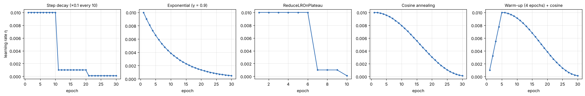
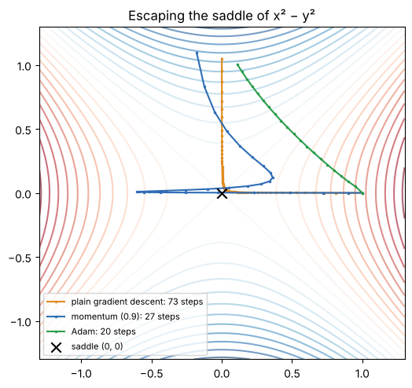
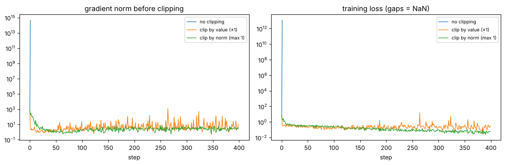

# 10 · Loss landscapes and optimizers (lecture of 27-08-2026)

**Learning-rate schedules · saddle points and local minima · gradient clipping**

**Notebook:** `notebooks/10_loss_landscapes_and_optimizers.ipynb` (η too small/large on a bowl, every schedule computed with PyTorch's schedulers, a fair schedule test, escaping a saddle with GD/momentum/Adam, local vs global minima, the lecture's clipping examples, and an exploding RNN rescued by norm clipping)

---

## 1. The learning rate

**W_new = W_old − η · ∂L/∂W**

Here W is a weight, L the loss, ∂L/∂W the gradient (the slope), and **η (eta) the learning rate**, the **step size**.

**Mountain intuition:** walking down to the lowest point of a valley. Huge steps jump over the valley; tiny steps take forever; a sensible step size gets there efficiently.

| η | What happens |
|---|---|
| **very large** | overshoots the minimum, oscillates, fails to converge, the loss explodes, eventually **NaN** |
| **very small** | stable but tiny updates; training is extremely slow and needs many epochs |
| **suitable** | reaches the bottom efficiently |

**Measured on the bowl L(w) = w²** (one step multiplies w by 1 − 2η), starting at w = 5, 20 steps:

| η | w after 20 steps | Behaviour |
|---|---|---|
| 0.01 | 3.34 | barely moved |
| 0.3 | 0.00000005 | converged in a few steps |
| 0.9 | 0.058 | jumps across the valley every step (oscillates), slowly closing in |
| 1.05 | **33.6** | each jump bigger than the last: **diverges** |

---

## 2. Learning-rate schedules

**Idea:** a fixed η may not suit the whole run. Use a **larger η while far from a good solution** and a **smaller η when close**, e.g. 0.01 → 0.005 → 0.001 → 0.0005.

### Step decay
Cut η at fixed intervals: **η = η₀ · γ^⌊t/k⌋** (η₀ = initial rate, γ = decay factor, k = interval, t = epoch).
Lecture example (η₀ = 0.01, γ = 0.1, k = 10): epochs 1–10 **0.01**, 11–20 **0.001**, 21–30 **0.0001** (PyTorch's `StepLR` reproduces this exactly).
- **+** simple. **−** you must choose the cut points by hand; they may come too early or too late.

### Exponential decay
Shrink smoothly every epoch: **η = η₀ · γᵗ** (0 < γ < 1), or equivalently η₀·e^(−kt).
With η₀ = 0.01, γ = 0.9: 0.01, 0.009, 0.0081, 0.00729, …
- **+** smooth. **−** γ must be chosen carefully (too small kills learning early).

### ReduceLROnPlateau (based on validation performance)
Cut η **when the validation loss stops improving**, instead of on a timetable.
Lecture example: 0.40, 0.32, 0.27, 0.25, 0.25, 0.25, 0.25 … With `patience=2` the scheduler tolerates two epochs without improvement (a repeated 0.25 doesn't count as improvement), and the third one triggers the cut (0.01 → 0.001 after epoch 7 in the notebook).
- **+** adapts to the actual run. **−** needs a validation set; reacts only after the plateau has happened.

### Cosine annealing
η follows half a cosine wave from η_max down to η_min:
**η_t = η_min + ½(η_max − η_min)(1 + cos(π·t/T))**
A smooth slow → fast → slow decrease. Widely used in modern deep learning.

### Warm-up
Start **small** and increase for the first few epochs, then hand over to another schedule (lecture example 0.0001 → 0.0003 → 0.0006 → 0.001). This avoids huge, destabilising updates from random initial weights. **Warm-up + cosine** is the standard recipe for Transformers.

### Do schedules always help? (honest notebook result)
Same small digits network, η₀ = 0.5, 30 epochs, 3 seeds: constant **97.8%**, step decay **97.6%**, cosine **97.8%**, so **no real difference**. On a small, easy problem with a stable η there's nothing to rescue. Schedules pay off in long training runs of large models. **Try them and validate them; don't assume.**

---

## 3. Saddle points and local minima

Optimisation is hard not only because of local minima. In high dimensions, **saddle points and flat regions** are often the bigger problem.

- **Local minimum:** lower than all nearby points; the gradient is (≈) 0 there.
- **Global minimum:** the lowest loss over the **entire** parameter space.
- **Saddle point:** a minimum in one direction and a maximum in another.

### The classic saddle: f(x, y) = x² − y²
- ∂f/∂x = 2x and ∂f/∂y = −2y, both **0 at (0, 0)**.
- Along x: f = x², a **minimum** at x = 0. Along y: f = −y², a **maximum** at y = 0.
- So (0, 0) is a **saddle**, not a minimum (think of a horse's saddle or a mountain pass).

**Why saddles are hard:** near them the gradient is close to 0, so updates are tiny and **training looks stuck**, even though it isn't at a minimum.

**Measured in the notebook** (start at (1, 0.001), η = 0.05, steps until |y| > 1):

| Optimizer | Steps to escape |
|---|---|
| plain gradient descent | **73** |
| momentum (β = 0.9) | **27** |
| Adam | **20** |

### Local vs global minimum: L(w) = w⁴ − 3w² + w
Global minimum at w ≈ −1.30 (L ≈ −3.51); local at w ≈ +1.13 (L ≈ −1.07). Plain gradient descent started on the right side ends in the **local** valley and stays (gradient 0). **Momentum** started at w = +2 built enough speed to roll **over the hump** into the global minimum (from +0.5 it didn't). It can help, but there's no guarantee.

### Momentum and Adam (intuition)
- **Momentum:** v ← β·v − η·∇L, then w ← w + v. It **accumulates past gradients**, so it keeps moving through flat or saddle regions and damps zig-zagging.
- **Adam:** a momentum-like running average of the gradients (**first moment**) plus **adaptive scaling** by the running average of squared gradients (**second moment**). Directions with tiny gradients get relatively larger steps, which is why it escaped the saddle fastest.
- **Mini-batch noise** (stochastic gradients) also helps to knock the optimizer off saddles.

---

## 4. Exploding gradients and gradient clipping

**Exploding gradient:** during backpropagation the gradients become **enormous**, so the updates are enormous.
Lecture example: η = 0.001 and a gradient of 10,000 → update = **10**, far too large for weights typically around 0.1.
**Symptoms:** unstable training, loss oscillation or explosion, numerical overflow, **NaN**, divergence. (Common in RNNs and very deep networks.)

**Gradient clipping** limits the gradient **before** the weight update.

### Clip by value
Each component is clamped to a range [−c, c] independently.
Lecture example with [−2, 2]: [−10, −4, −1, 0.5, 3, 8] → **[−2, −2, −1, 0.5, 2, 2]**.
Because each component is cut separately, the **direction can change** (notebook: cosine between the old and new vector 0.895, not 1).

### Clip by norm
If the whole vector's length ‖g‖ exceeds c, scale it down: **g ← g · c / ‖g‖**.
Lecture example: g = [3, 4], ‖g‖ = √(9 + 16) = **5**, c = 2 → g × 2/5 = **[1.2, 1.6]** (new length 2).
The size shrinks and the **direction is preserved** (cosine 1.000), so it's the natural **first choice** for exploding gradients.

### Seen in the notebook: an RNN that explodes
A simple RNN over 30 time steps, recurrent weights slightly too large, SGD (lr 0.01), 400 steps:

| | Largest gradient norm | Final MSE (predicting the mean = 0.320) |
|---|---|---|
| no clipping | **4.5 × 10¹⁴** | **NaN** (training destroyed) |
| clip by value (±1) | 1,250 | 0.227 (stable, learned little) |
| **clip by norm (1)** | 733 | **0.048** (learned the task) |

### In code
- **Keras/TensorFlow:** `keras.optimizers.Adam(learning_rate=1e-3, clipnorm=1.0)` (overall norm) or `clipvalue=1.0` (each component in [−1, 1]).
- **PyTorch:** `loss.backward()` → `torch.nn.utils.clip_grad_norm_(model.parameters(), 1.0)` (or `clip_grad_value_`) → `optimizer.step()`.

| | clipnorm | clipvalue |
|---|---|---|
| limits | overall gradient magnitude | each component |
| direction | preserved | can be altered |
| typical use | exploding-gradient control | simple component-wise limit |

### What clipping does **not** fix
Clipping only caps large gradients. It does **not** fix vanishing gradients, poor architecture, bad initialization, a wrong learning rate, overfitting, underfitting or unnormalised data.

---

## 5. How the three ideas connect

- Steps too large or too small → adjust **η** or use a **schedule**.
- Stuck in a flat or saddle region → **momentum, stochasticity, adaptive optimizers (Adam), good initialization**.
- Gradients suddenly huge → **gradient clipping**.

**Gradient vs learning rate:** the gradient says **which direction** is downhill and **how steep** it is; the learning rate says **how far** to move. **Clipping modifies the gradient; a schedule modifies η.**

| Concept | Mountain/driving analogy |
|---|---|
| gradient | which way the road slopes |
| learning rate | how aggressively you move |
| LR schedule | go fast at first, slow down near the destination |
| saddle point | terrain going up one way and down another |
| gradient clipping | stops one excessively big step when the slope suddenly becomes huge |

### Summary table (lecture)

| Concept | Main problem | Main idea |
|---|---|---|
| learning rate | step too large/small | controls update size |
| LR schedule | a fixed η may not suit all of training | change η during training |
| step decay | need periodic reduction | cut η at fixed intervals |
| exponential decay | need smooth reduction | multiply η by γ every epoch |
| ReduceLROnPlateau | validation loss stops improving | cut η automatically |
| cosine annealing | need a smooth schedule | cosine-shaped decay |
| warm-up | early instability | start small, then increase |
| local minimum | gradient 0 at a low (not lowest) point | may stop optimization |
| saddle point | gradient ≈ 0 without being a minimum | optimization moves slowly |
| exploding gradient | gradient extremely large | unstable updates |
| clip by value | individual components too large | clamp each component |
| clip by norm | overall gradient too large | rescale the whole vector |

---

## Check yourself

1. On L(w) = w², which learning rates converge, and why?
2. Step decay with η₀ = 0.1, γ = 0.5, interval 5 epochs: what is η in epoch 12?
3. Exponential decay with η₀ = 0.01, γ = 0.9: η after 3 decays?
4. Why use warm-up?
5. Prove that (0, 0) is a saddle point of f(x, y) = x² − y².
6. Why can training appear stuck near a saddle point? Name two remedies.
7. Clip g = [6, 8] by norm with c = 5. Then clip g = [6, 8, −1] by value to ±5. Which one kept the direction?
8. Your RNN's loss is fine for 200 steps, then suddenly becomes NaN. What do you try first?
9. Does gradient clipping fix vanishing gradients? Why not?
10. Gradient vs learning rate: what does each control? Which does clipping change, and which does a schedule change?

Answers

1. 0 < η < 1. Each step multiplies w by (1 − 2η), which shrinks w only if |1 − 2η| < 1.
2. Epochs 1–5: 0.1, 6–10: 0.05, 11–15: **0.025**.
3. 0.01 × 0.9³ = **0.00729**.
4. At the start the weights are random and the gradients can be large and unreliable; small steps first avoid destabilising the model.
5. ∇f = (2x, −2y) = (0, 0) at the origin; along x, f = x² has a minimum; along y, f = −y² has a maximum. So it's neither a minimum nor a maximum.
6. The gradient is near 0, so updates are tiny. Remedies: momentum, Adam, mini-batch noise (also good initialization).
7. Norm: ‖g‖ = 10 → × 0.5 → [3, 4] (direction kept). Value: [5, 5, −1] (direction changed).
8. Gradient clipping by norm (e.g. max 1.0), and/or a lower learning rate.
9. No. Clipping only shrinks gradients that are too **large**; vanishing gradients are too **small**, so it has nothing to do (use better activations, initialization, normalization, residuals).
10. The gradient gives direction and steepness; η gives the step size. Clipping changes the gradient; a schedule changes η.

