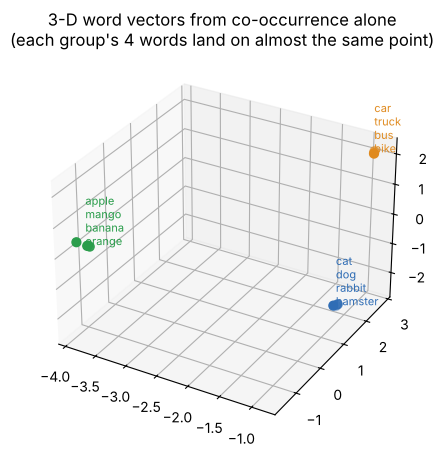

# 11 · From text to MiniGPT: embeddings, attention and the Transformer (GenAI study notes)

**Source:** *Generative AI Study Notes: From Text to MiniGPT* (Polaris, University Edition) · `course-files/GenAI_Study_Notes_From_Text_to_MiniGPT.pdf`

**Notebook:** `notebooks/11_transformer_and_minigpt.ipynb` (word vectors from co-occurrence counts, attention by hand, the √d_k effect measured, causal masks, a shape walkthrough, **the notes' MiniGPT trained from scratch**, the notes' student experiments, and sampling)

> **Core idea:** a language model never receives meaning. It receives **token IDs**, turns them into **vectors**, repeatedly **mixes** (attention) and **transforms** (FFN) those vectors, and finally outputs a **probability distribution over the next token**.

**raw text → tokens → embeddings + positions → L Transformer blocks → logits → softmax → next token**

(Part I, tokenization and BPE, is covered in detail in chapter 09. Only the new points are here.)

---

## Part I: text → token IDs (the new points)

- The tokenizer is **deterministic preprocessing**: the language model doesn't learn the BPE merges; it learns to use the resulting tokens.
- **Token IDs are labels, not numbers with meaning:** token 314 isn't "closer" to 291 than to 52.
- **Special tokens:** **BOS** (start), **EOS** (end), **PAD** (fill unused positions in a batch), **UNK** (unknown; byte-level tokenizers rarely need it).
- **Shapes:** a batch of B sequences of T tokens is an integer tensor **[B, T]**; after embedding with d_model = 512, one 28-token sentence is **[28, 512]**, and a batch is [B, 28, 512].
- **Cost:** attention compares every token with every token, so it does about **T²** work. 500 vs 700 tokens for the same paragraph → (700/500)² = **1.96×** the attention scores.
- **Padding + mask:** [12, 41, 9, PAD, PAD] gets mask [1, 1, 1, 0, 0], so the model ignores padding. **Causal mask:** a decoder token i may only see positions 0…i.

---

## Part II: why embeddings work (a statistical view)

### Discrete IDs carry no similarity
| Representation | cat | dog | What it means |
|---|---|---|---|
| integer ID | 421 | 912 | labels only; distance is meaningless |
| one-hot | [1,0,0,…] | [0,1,0,…] | every pair of tokens equally unrelated (cosine 0) |
| **embedding** | [0.7, 0.2, …] | [0.68, 0.24, …] | coordinates can encode learned similarity |

An embedding is a **row of a trainable matrix E ∈ ℝ^(V × d)**; looking up token i selects row E[i].

### Context is evidence (the distributional idea)
"You know a word by the company it keeps." cat appears near *pet, fur, animal, sleeps*; dog near *pet, fur, animal, barks*; car near *road, engine, drive*. If two words have **similar context distributions**, a model has every reason to give them **similar vectors**.

**Co-occurrence matrix** (notes' example):

| | pet | fur | road | engine |
|---|---|---|---|---|
| cat | 42 | 31 | 0 | 0 |
| dog | 47 | 28 | 1 | 0 |
| car | 0 | 0 | 39 | 44 |

Computed in the notebook: cos(cat, dog) = **0.995**, cos(cat, car) = **0.000**.

### PMI: association beyond raw frequency
**PMI(w, c) = log( P(w, c) / (P(w)·P(c)) )**. Positive = they occur together more than chance; ≈ 0 = chance; negative = less than chance.
Notes' example: P(cat) = 0.01, P(pet) = 0.02, P(cat, pet) = 0.001 → PMI = log(0.001 / 0.0002) = **log 5 ≈ 1.609**, i.e. together **5×** more often than chance.

### Low-dimensional latent factors
The co-occurrence matrix has one column per context word (huge). Factorise it: **X ≈ W·Cᵀ**, and use the rows of W as embeddings. Word2Vec reaches a similar result **by prediction**.

**Notebook experiment:** from 3,000 generated sentences about animals, vehicles and fruit, we built PPMI counts and compressed them with SVD:
- with **3 dimensions**: cos(cat, dog) = **1.000**, cos(car, truck) = **1.000**, cos(cat, car) = **0.056**. The three groups separate **without any labels**.
- with only **2 dimensions**: cat and car are squeezed together (cos **0.969**). Three groups don't fit in 2 numbers, so **embedding size is a capacity choice**.

### Cosine similarity
**cos(a, b) = a·b / (‖a‖‖b‖)**: compares **direction**, not length. Near +1 = similar direction; 0 = unrelated; −1 = opposite. Notes' example: a = [1, 1], b = [0.9, 1.1], dot = 2.0, cosine **0.995**.

> **Don't over-interpret axes.** Real embeddings have 256–4,096+ dimensions; 2-D or 3-D plots are projections for humans.

### Why meaning appears without labels
Nobody tells the model "cat ≈ dog". The loss rewards good **prediction**, and since cat and dog appear in similar contexts, sharing features is efficient. **Semantic-looking geometry emerges as a side effect.**

### Embeddings in a Transformer
- The lookup is **context-free**: "bank" starts from the same row E[bank] in "river bank" and "bank loan".
- **Attention layers** make it contextual: after them, the two "bank"s have different hidden states.
- **Token embeddings are parameters; contextual hidden states are computed activations.** They have the same width d_model but are different objects.
- Training: logits → softmax → **L = −log p_target** → gradients flow back into the embedding rows that were used (chapter 09: only those rows change).

---

## Part III: attention and Transformers

### Why attention?
In an RNN, token 100 can only reach token 3 through ~97 recurrent steps. **Attention gives a direct, content-dependent link**: token 100 can put weight on token 3 directly, and all comparisons are computed **in parallel** as matrix products. *Attention = learned routing:* each token asks what it needs, finds who advertises it, and blends their content.

### Q, K, V
| | Layman meaning | Computed as |
|---|---|---|
| **Query** | what am I looking for? | x·W_Q |
| **Key** | what kind of information do I contain? | x·W_K |
| **Value** | what will I contribute if chosen? | x·W_V |

Q and K decide **where to look**; V decides **what is retrieved**.

### Worked example: "The cat sleeps" (checked in the notebook)
Q_cat = [1, 1]; K_The = [1, 0], K_cat = [1, 1], K_sleeps = [0, 1].
- Raw scores: [1, 2, 1] (cat matches itself best).
- softmax([1, 2, 1]) = **[0.212, 0.576, 0.212]**.
- New cat vector = 0.212·V_The + 0.576·V_cat + 0.212·V_sleeps: **a weighted mixture of the whole visible context**, not "one chosen word".
- *Note:* this is the **unscaled** softmax (the notes say "ignoring scaling for a moment"). With the full formula's ÷√d_k (d_k = 2) the weights are **[0.248, 0.503, 0.248]**.

### Scaled dot-product attention
**Attention(Q, K, V) = softmax( QKᵀ / √d_k ) · V**

**Why ÷√d_k (measured):** random dot products have a spread of about √d_k. Without scaling, the average top attention weight was 0.53 at d_k = 4 but **0.95 at d_k = 512** (softmax almost one-hot, so tiny gradients). With scaling it stayed **≈ 0.36 at every width**.

### Shapes (B = batch, T = length, H = heads, d_head = d_model/H)
| Tensor | Shape | Notebook (B=4, T=64, d=256, H=8, V=10,000) |
|---|---|---|
| token IDs | [B, T] | [4, 64] |
| embeddings / hidden states | [B, T, d_model] | [4, 64, 256] |
| Q, K, V per head | [B, H, T, d_head] | [4, 8, 64, 32] |
| attention scores QKᵀ | [B, H, T, T] | [4, 8, 64, 64] |
| block output | [B, T, d_model] | [4, 64, 256] |
| vocabulary logits | [B, T, V] | [4, 64, 10000] |

d_model = 256 with H = 8 → **d_head = 32**.

### Multi-head attention
Several attention maps in parallel, each in its own learned subspace (short-range syntax, references, positions…). **Caveat:** heads rarely have a clean human-readable role; their specialisation is learned, distributed and often redundant.

### Causal masking
For T = 4, position 0 sees {0}, position 1 sees {0, 1}, and so on: a **lower-triangular** visibility matrix. Implementation: add −∞ (a very negative number) to the forbidden scores **before** softmax, so their weights become exactly 0. *It doesn't delete future tokens from the tensor; it stops each query from attending to them.*

### Self-attention vs cross-attention
| | Q from | K, V from | Use |
|---|---|---|---|
| self-attention | the same sequence | the same sequence | tokens communicate within one sequence |
| cross-attention | the decoder | **another** sequence (encoder output) | translation: the decoder retrieves source information |

A decoder-only GPT uses only (causal) self-attention. (Chapter 12 covers encoder-decoders in detail.)

### Positions
Attention is **permutation-equivariant** ("dog bites man" = "man bites dog" without positions; proven in notebook 09). Options: **learned absolute** embeddings (x_t = token_emb + pos_emb, still [B, T, d]), **sinusoidal**, **RoPE** (rotates Q/K by position so dot products depend on relative distance), **relative position biases**.

### The rest of the block
- **FFN = computation:** FFN(x) = W₂·σ(W₁x + b₁) + b₂, applied **to each position separately** with the same weights; typically expands 4× (768 → 3072) with GELU/SwiGLU. *Attention = communication, FFN = computation.*
- **Non-linearity:** without it, stacked layers collapse into one linear map (chapter 04).
- **Residual connections:** y = x + F(x), a direct highway for information and gradients; each layer learns a **correction**.
- **LayerNorm / RMSNorm:** LN(x) = γ·(x − μ)/√(σ² + ε) + β over each token's features; RMSNorm skips the mean. Keeps scales stable. Modern LLMs use **pre-norm** (normalise before each sublayer).

**A pre-norm decoder block:** a = x + Attention(Norm(x)); y = a + FFN(Norm(a)). Stack L of them.

| Architecture | Attention | Typical tasks |
|---|---|---|
| encoder-only (BERT) | bidirectional | classification, retrieval embeddings, masked-token objectives |
| decoder-only (GPT) | causal | text/code generation |
| encoder-decoder (T5, BART) | encoder bidirectional + decoder causal + cross | translation, conditional generation |

### Output, loss, training vs inference
- **Logits:** logits_t = h_t·W_vocab + b, shape [B, T, d] → **[B, T, V]**; softmax gives next-token probabilities. Targets are the inputs **shifted by one**.
- **Loss:** L = −log P(correct next token), averaged over all positions; backprop updates embeddings, attention, FFN, norms and output weights.
- **Weight tying:** reuse E as the output projection.
- **Training** processes all positions in parallel. **Inference:** *prefill* (process the prompt and fill the K/V cache), then *decode* one token at a time.
- **KV cache:** store the past keys and values instead of recomputing them; memory ∝ layers × length × heads × head_dim × 2 (K and V) × batch × bytes.
- **Sampling:** greedy, temperature, top-k, top-p: these change behaviour **without retraining**.
- **Efficient attention:** FlashAttention (exact, memory-aware), sliding-window, sparse, grouped/multi-query attention (smaller KV cache), linear approximations.

### How big? Why not 1,000 layers?
No formula gives "N layers". Depth, width, heads and context trade off against compute and data. 1,000 layers: slow, memory-hungry, hard to optimise, diminishing returns or overfitting, and a wider or better-trained model often helps more. **For a class project: the smallest model that clearly learns.**

---

## Part IV: MiniGPT, built and trained (notebook)

**The notes' design:** character-level tokenizer, context 64, embedding 64, 4 heads, 2 blocks, ~600 AdamW updates (lr 3e-3, batch 32), on a tiny repetitive corpus ("the cat sits on the mat." …).

**Training pairs:** x = data[i : i+64], y = data[i+1 : i+65]: **the same window shifted by one**, so one window gives **64 training targets**. Logits [B, T, V] are flattened to [B·T, V] for cross-entropy because each position is one classification example.

**Measured:**
- **107,030 parameters** (the notes: "~100K"); trained in **~12 s** on a CPU.
- Loss **3.25 → ~0.1**. The start matches ln 22 = 3.09, uniform guessing over 22 characters. It can't reach 0, because which line comes next is genuinely random.
- Untrained output: `the dtnflslpirhous c..ds yo…`. Trained output: `the dog sits by the door. / the cat sits on the mat. / the cat sleeps by the fire.` (with occasional slips such as "the fird.").

**The notes' student experiments, measured** (validation loss, 600 steps each):

| Variant | Params | Val loss | What we learn |
|---|---|---|---|
| baseline | 107,030 | 0.104 | |
| **no causal mask** | 107,030 | **0.003** | **cheating**: it sees the answer during training; generation is garbage ("dd d d dunnn") |
| no positional embeddings | 107,030 | 0.099 | barely mattered here: a causal model can infer position from how much it sees, and the corpus is very repetitive (unlike real text) |
| 1 layer | 57,046 | 0.093 | half the cost, same quality on this tiny corpus |
| d_model 128 | 410,646 | 0.091 | 3.8× the parameters for a tiny gain |

> **Lesson:** a suspiciously low training loss in a language model usually means **a broken causal mask**.

**Sampling** (same weights): temperature 0.3 gives safe, repetitive output; T = 1 with top-k = 3 gives natural text; T = 2 gives "the cat sits on the yard. / tby. / ts cat": more variety, more errors. In the toy example, the top token's probability goes 0.84 → 0.61 → 0.43 as T goes 0.5 → 1 → 2.

**What backprop learns in MiniGPT:** embeddings (shared features for characters used alike), Q/K (which positions interact), V (what to pass along), FFN (non-linear features), output head (features → next-character logits).

**Debugging checklist (notes):** NaN loss → learning rate, masking, infinities, dtype. Model sees the future → check the triangular mask is applied **before** softmax. Shape errors → d_model % n_heads == 0, transpose/view order. Repeating one symbol → data, LR, temperature. Loss stuck → targets not shifted, optimizer not stepping, detached parameters.

| MiniGPT | production LLM |
|---|---|
| characters | BPE / byte-level subwords |
| d = 64, 2 layers | thousands of dims, dozens of layers |
| context 64 | thousands to millions of tokens |
| tiny corpus | massive curated data |
| plain attention | FlashAttention, GQA/MQA, RoPE, KV cache |

**One-sentence summary:** text → token IDs → embeddings + position → blocks where **attention communicates** and **FFNs compute** (with residuals and normalisation) → vocabulary logits → softmax → cross-entropy in training, sampling at inference, repeat.

---

## Check yourself (the notes' subjective questions, with answers)

1. **BPE:** corpus "low lower lowest". (a) Why subwords over words? (b) Two merge steps? (c) Tokenise lower and lowest with {low, er, est}. (d) 28 tokens, d_model = 512: embedding shape, and why does token count matter?
2. **Self-attention:** "The cat sleeps", Q_cat = [1,1], K = [1,0], [1,1], [0,1]. Raw scores? Largest? What does softmax do, and why weight V?
3. **Architecture:** V = 10,000, T = 50, d_model = 256, 8 heads. (a) Embedding output for one sentence? (b) d_head? (c) Why positions, using "dog bites man"? (d) Roles of self-attention, FFN, residual, LayerNorm? (e) 2 → 12 blocks: what might it buy, and why is 1,000 a poor default?
4. Why does the notebook's "no causal mask" model get a lower loss but generate garbage?
5. Why divide by √d_k?

Answers

1. (a) Words give a huge vocabulary and unknown words; characters give long sequences; subwords balance the two. (b) l + o → lo, then lo + w → low. (c) lower → [low, er]; lowest → [low, est]. (d) **[28, 512]**; dense attention work grows ≈ T².
2. Scores **[1, 2, 1]**; "cat" itself is largest. Softmax turns scores into positive weights summing to 1 (**≈ 0.212, 0.576, 0.212**); weighting V blends information from all visible tokens into a new contextual vector, which is more expressive than processing each token alone.
3. (a) **[50, 256]**. (b) 256/8 = **32**. (c) Both sentences contain the same tokens; without positions attention can't tell their order. (d) Attention moves information between tokens; the FFN transforms each token's features; residuals keep an information and gradient highway; LayerNorm keeps scales stable. (e) More stages of refinement; 1,000 layers bring cost, latency, optimisation difficulty, memory limits and diminishing returns.
4. Without the mask, each position can attend to the very next character (its own target) and copy it. At generation time the future doesn't exist, so the copying trick fails.
5. Dot products grow with dimension (spread ≈ √d_k), making softmax extremely peaked and the gradients tiny; dividing by √d_k keeps the scores around spread 1.

