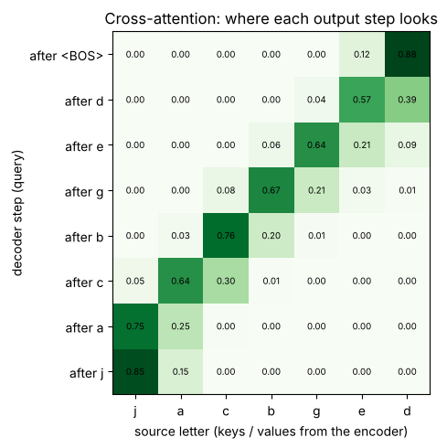

# 12 · Autoregressive and encoder-decoder models (GenAI architecture notes)

**Source:** *Autoregressive & Encoder-Decoder Models: Architecture Study Notes* (Polaris) · `course-files/GenAI_Autoregressive_Encoder_Decoder_Notes.pdf`

**Notebook:** `notebooks/12_autoregressive_encoder_decoder.ipynb` (the probability examples, an encoder-decoder Transformer written out and trained with teacher forcing, step-by-step greedy decoding, **a visible cross-attention map**, exposure bias measured, the same task solved decoder-only, KV-cache arithmetic)

---

## 1. Two axes people mix up

| Word | What it describes |
|---|---|
| **autoregressive** | **how** the output is produced: one token at a time, each conditioned on the earlier ones |
| **encoder / decoder** | **architectural roles**: an encoder reads and represents; a decoder generates |

A GPT (decoder-only) is autoregressive. **The decoder of a translation model is also autoregressive.** The encoder is not.

**Mental model:**
- **Encoder:** read the complete source and build a rich representation of it (**memory M**).
- **Decoder:** decide the next target token from the target prefix seen so far.
- **Cross-attention:** let the decoder look back into the encoded source whenever it needs to.
- **Output head:** turn a decoder hidden state into one logit per vocabulary token.

### The three families
| Architecture | Sees both directions? | Generates token by token? | Typical use |
|---|---|---|---|
| **encoder-only** (BERT) | yes, within the input | not naturally | classification, tagging, embeddings, retrieval |
| **decoder-only** (GPT) | no: causal mask | yes | chat, completion, code, open-ended generation |
| **encoder-decoder** (T5, BART) | encoder yes, decoder causal | yes, in the decoder | translation, summarization, structured text-to-text |

**Decision shortcut:** output = a fixed label/vector → encoder-only. Continue/generate → decoder-only. Transform one sequence into another → encoder-decoder.

---

## 2. What "autoregressive" means

The chain rule of probability:

**p(y₁, …, y_T | x) = ∏ₜ p(yₜ | y₁ … yₜ₋₁, x)** (decoder-only: drop the x)

The model never predicts a whole paragraph at once; it repeatedly answers one simple question, "**what comes next?**"

**Why this factorisation:** generation becomes **multi-class classification at every position**; the same weights are reused at every step; training can score all positions **in parallel**; generation stops naturally at EOS.

**Notes' example** ("I love AI"): p(I|BOS) = 0.6, p(love|BOS, I) = 0.5, p(AI|BOS, I, love) = 0.8 → sequence probability **0.6 × 0.5 × 0.8 = 0.24**.
Training minimises **L = −Σₜ log p(correct token at t)** = −(ln 0.6 + ln 0.5 + ln 0.8) = **1.427** (and e^−1.427 = 0.24).

**Why logs, not products? (measured):** 200 tokens each with p = 0.5 multiply to **exactly 0 in float32** (underflow), while the log-sum is an ordinary −138.6. Sums of logs are also easier to differentiate. Practice question: 0.8 × 0.5 × 0.25 = **0.1** (NLL = 2.303).

---

## 3. Decoder-only (GPT-style) autoregression

- **Causal mask:** the attention matrix is lower-triangular; position t sees positions ≤ t (query 1 sees {1}; query 4 sees {1, 2, 3, 4}).
- **Training arrangement** for [BOS, I, love, AI, EOS]:

| model input | target |
|---|---|
| BOS | I |
| BOS, I | love |
| BOS, I, love | AI |
| BOS, I, love, AI | EOS |

- **Parallel training trick:** feed the whole known sequence at once; the causal mask makes each position behave as if the future didn't exist. (Inference is still sequential.)

---

## 4. Encoder-decoder: the complete data flow

**Source side:** source x (length S) → embeddings + positions → encoder blocks with **bidirectional** self-attention + FFN → **memory M = Encoder(x), shape [B, S, d_model]**, one contextual vector per source position.

**Target side:** the target prefix → decoder blocks → **H = Decoder(y_prefix, M), shape [B, T, d_model]** → output head → logits [B, T, V].

> **Key correction from the notes:** the encoder outputs **neither attention scores nor vocabulary logits**. It outputs a sequence of **contextual vectors**, and those become the **keys and values** for the decoder's cross-attention.

### The encoder's job
A pre-norm encoder block: X₁ = X + SelfAttention(LN(X)); X₂ = X₁ + FFN(LN(X₁)). No causal mask: the whole source is known.

**Why keep one vector per source position** instead of squashing the sentence into one vector (as early RNN seq2seq did)? Different target words need different source details at different moments; per-position vectors keep the alignment; cross-attention can retrieve a different mixture at each step; long sentences don't have to fit through one fixed-size bottleneck.

Rough intuition (not a strict rule): early encoder layers capture local patterns and morphology; middle layers syntax and phrases; later layers task-useful meaning.

### Why the decoder has two attention operations
Each decoder block: **masked self-attention → cross-attention → FFN**, each followed by a residual connection and normalisation.
- **A. Masked self-attention:** "given what I've generated so far, what target-side context matters?"
- **B. Cross-attention:** "given what I'm trying to generate now, which source positions are useful?"
- **C. FFN:** "after communicating, how should I transform the features at this position?"

---

## 5. Cross-attention: Q from the decoder, K and V from the encoder

**Q = H·W_Q [B, T, d_k],  K = M·W_K [B, S, d_k],  V = M·W_V [B, S, d_v]**

**CrossAttention(H, M) = softmax(Q·Kᵀ / √d_k)·V**, with scores of shape **[B, heads, T, S]**: each target position gets a probability distribution over the **source** positions.

**Seen in the notebook** (a toy "translation" where the target is the source word reversed, e.g. jacbged → degbcaj): the cross-attention map is a clean **anti-diagonal**. Writing the 1st output letter, the decoder looks at the **last** source letter (weight 0.88); writing the 2nd, the second-to-last; and so on. The argmax positions were exactly 6, 5, 4, 3, 2, 1, 0.

This is the notes' point that **cross-attention changes at every decoding step**: there is no single fixed source summary. *(Caveat from the notes: in real models a high weight is not a human-readable "alignment rule"; this toy task was chosen so that the alignment is visible.)*

**Self vs cross:** self-attention takes Q, K and V from the **same** sequence; cross-attention takes Q from one sequence (the decoder) and K, V from **another** (the encoder memory).

**Shape check (notes):** S = 100, T = 20 → one cross-attention head gives a **20 × 100** score matrix; decoder self-attention gives **20 × 20**.

---

## 6. The output layer: hidden state → token probabilities

z_t = h_t·W_out + b with **W_out of shape [d_model, V]**, then **p = softmax(z_t)**.

| token | logit | softmax (computed) | notes' table |
|---|---|---|---|
| I | 0.2 | **0.042** | 0.04 |
| love | 1.1 | **0.103** | 0.10 |
| AI | 2.9 | **0.625** | 0.61 |
| EOS | 1.9 | **0.230** | 0.25 |

> **Small erratum:** the notes' probabilities don't quite follow from their own logits (0.625 and 0.230, not 0.61 and 0.25). The greedy choice ("AI") is unchanged.

- **Weight tying:** reuse the embedding matrix for the output projection. That saves parameters, but conceptually lookup (ID → vector) and projection (vector → scores) are different operations.
- **Where the head goes:** for encoder-decoder generation the vocabulary head sits on the **decoder** output, not the encoder memory. Encoder-only classifiers attach a **classification head** instead.

---

## 7. Teacher forcing and shifted targets

Source "I love AI" → target "J'aime l'IA". Training feeds the decoder **BOS + the true target**, and asks it to predict **the true target + EOS** (shifted by one):

| decoder input so far | correct next token |
|---|---|
| BOS | J'aime |
| BOS, J'aime | l' |
| BOS, J'aime, l' | IA |
| BOS, J'aime, l', IA | EOS |

**Loss:** L = −(1/T)·Σₜ log pₜ(yₜ), with **padding positions excluded** (a loss mask; `ignore_index=PAD` in PyTorch).

**Why teacher forcing helps:** all positions train **in parallel**; an untrained model fed its own outputs would produce very noisy trajectories; each prediction gets the correct context.

**The catch: exposure bias.** At inference the true previous token isn't available, so the model conditions on **its own** outputs and one error can derail the rest. **Measured** on a deliberately under-trained model (60 steps):
- teacher-forced token accuracy **90.5%**, but free-running token accuracy only **81.9%**;
- after its first mistake, it got only **53.7%** of the remaining positions right: errors snowball;
- whole-word accuracy was 53.6% both ways, because with greedy decoding a word comes out right exactly when every teacher-forced step is right.

---

## 8. Inference: encode once, then generate

**Encode the source once → start with BOS → run the decoder → choose a token → append it → repeat until EOS.**

The notebook's trained model (238,285 parameters, 1,500 steps, ~36 s) on "jacbged":

| step | prefix | chooses |
|---|---|---|
| 1 | BOS | d |
| 2 | BOS d | e |
| … | … | … |
| 7 | BOS d e g b c a | j |
| 8 | BOS d e g b c a j | EOS |

It scored **100% exact match** on 1,000 unseen words, so it learned the rule.

**What can be cached:** the **encoder memory** (computed once), the **decoder self-attention K/V** of earlier tokens, and the **cross-attention K/V** (projections of the fixed memory).
**KV-cache arithmetic (notebook):** generating T tokens without a cache processes T(T+1)/2 positions (T = 1,000 → **500,500**); with a cache only T (**1,000**). That's a **500× saving**, paid for in memory: e.g. 32 layers × 4,096 tokens × 32 heads × 128 dims × 2 (K, V) × 2 bytes ≈ **2.15 GB per sequence**.

**Choosing tokens:**

| Method | Idea | Good for |
|---|---|---|
| greedy | always the most probable token | a fast, deterministic baseline |
| beam search | keep several best partial sequences | translation, constrained outputs |
| sampling (temperature, top-k, top-p) | draw from controlled probability mass | creative, open-ended text |

### End-to-end: translate "the cat sleeps" → "le chat dort"
- **A. Encoder:** embed + positions → N bidirectional blocks → memory vectors M_the, M_cat, M_sleeps, each now aware of the whole sentence.
- **B. First token:** decoder input BOS → masked self-attention sees only BOS → its query cross-attends to all of M → head picks "le".
- **C. Second token:** prefix [BOS, le] → self-attention uses "le" → cross-attention now weights M_cat more → "chat".
- **D.** Continue → "dort" → EOS. Cross-attention **re-queries the source at every step**.

---

## 9. Decoder-only vs encoder-decoder for the same job

| Aspect | Decoder-only | Encoder-decoder |
|---|---|---|
| input handling | input and output in **one causal stream** | source encoded separately |
| source visibility | later tokens attend to all earlier source tokens | encoder sees the whole source bidirectionally |
| cross-attention | none | explicit decoder → encoder |
| training interface | prompt + completion | source tensor + shifted target tensor |
| inference | grow the single sequence | encode once, then grow the target |
| strength | one universal generative interface | natural fit for sequence transformation |

Summarization, decoder-only: `Article: … Summary:` → continue. Encoder-decoder: encoder input = article, decoder output = summary.

**Measured:** the same reversal task written decoder-only (`source <SEP> target <EOS>`, loss on the target part only, 4 causal layers, 203,406 parameters) also reached **100%** in the same budget. **There is no universal winner**: the difference is how source information flows, not whether the task can be solved. Decoder-only dominates general LLMs (one interface absorbs every task); encoder-decoder stays natural for clean source → target problems.

---

## 10. Choosing an architecture (the thought process)

**Start from: what information must be available when each prediction is made?**

| Question | If yes |
|---|---|
| Only need a fixed label/vector? | encoder-only |
| Open-ended continuation or chat? | decoder-only |
| Distinct source and target sequences? | encoder-decoder |
| Must each output token align closely with source evidence? | encoder-decoder is attractive |
| One universal prompt interface for many tasks? | decoder-only is attractive |

**Then check the system constraints:** latency, memory (longer contexts and caches; cross-attention stores source K/V), data (paired data suits encoder-decoder; raw text suits decoder-only pretraining), flexibility, deployment ecosystem.

| Task | Choice | Reasoning |
|---|---|---|
| sentiment classification | encoder-only | one label; full bidirectional context |
| code autocomplete | decoder-only | continue a prefix |
| chat assistant | decoder-only | conversation + reply in one stream |
| machine translation | encoder-decoder | distinct source/target; query the source while generating |
| summarization | either | both work |
| image captioning | encoder-decoder pattern | image encoder → memory; text decoder cross-attends |
| speech recognition | encoder-decoder pattern | audio encoder → memory; decoder writes text |

The **encoder can be any modality**: cross-attention only needs a set of source vectors to use as keys and values. **RAG** with a decoder-only LLM usually just pastes the retrieved text into the prompt.

**How much to stack?** No formula. Depth buys more refinement stages (more latency); width (d_model) buys richer features (parameters grow fast); heads buy parallel subspaces (each narrower if d_model is fixed); longer context costs attention and cache memory. **Pick a baseline, measure, then scale one dimension at a time.**

### Misconceptions (all false)
- "Autoregressive means decoder-only." (An encoder-decoder's decoder is autoregressive too.)
- "The encoder predicts the output sentence first." (It builds source vectors; the decoder generates.)
- "Cross-attention feeds attention probabilities into the decoder." (The weighted **value** mixture is what's passed on; the probabilities are intermediate.)
- "The decoder can see the whole correct target." (The tensor contains it, but the causal mask blocks the future.)
- "Teacher forcing means the model copies the answer." (It gets the true **previous** tokens but must still predict each next one.)
- "More layers always help."
- "An encoder-decoder has two language models." (Only the decoder defines the output distribution.)

**Fastest diagnostic question:** *at this exact prediction position, what is the model legally allowed to see, and through which attention path can it reach it?*

**One-sentence summary:** an encoder-decoder Transformer first builds a bidirectional source memory; then an autoregressive decoder repeatedly combines its target-prefix state with source information through cross-attention and projects the result to next-token probabilities.

---

## Check yourself (the notes' practice questions)

1. Correct-token probabilities 0.8, 0.5, 0.25: sequence probability? Why train with log probabilities?
2. Translation model with S = 12, T = 7, d_model = 256, 8 heads: shapes of the encoder memory, decoder hidden states, per-head dimension, decoder self-attention scores, cross-attention scores. Where do Q, K, V come from in cross-attention?
3. Choose and justify an architecture for (a) a sentiment classifier, (b) code autocomplete, (c) an English → Hindi translator: what is visible at prediction time, which masks, and where do the logits come from?
4. What is exposure bias, and why does teacher forcing cause it?
5. What can be cached during encoder-decoder generation?

Answers

1. 0.8 × 0.5 × 0.25 = **0.1**. Logs turn the product into a sum (NLL = 2.303): no underflow over long sequences (200 × 0.5 → exactly 0 in float32), numerically stable, and it's exactly the cross-entropy loss.
2. Memory **[B, 12, 256]**; decoder hidden states **[B, 7, 256]**; d_head = 256/8 = **32**; decoder self-attention scores **[B, 8, 7, 7]** (causal); cross-attention scores **[B, 8, 7, 12]**. Q from the decoder hidden states; K and V from the encoder memory.
3. (a) **Encoder-only**: the whole review is visible in both directions; padding mask only; a classification head on the encoder output (e.g. a pooled/CLS vector). (b) **Decoder-only**: only the code prefix is visible; causal mask; logits from the decoder's last position. (c) **Encoder-decoder**: the full English sentence is visible to the encoder (padding mask), the decoder sees only the Hindi prefix (causal mask) plus the encoder memory through cross-attention; logits from the decoder's output head.
4. In training the decoder always gets the true previous tokens, so it never learns to recover from its own mistakes; at inference it conditions on its own outputs, so one error compounds (measured: 90.5% → 81.9% token accuracy).
5. The encoder memory, its cross-attention K/V projections, and the decoder's self-attention K/V for earlier positions.

