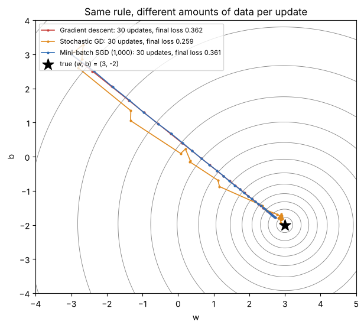
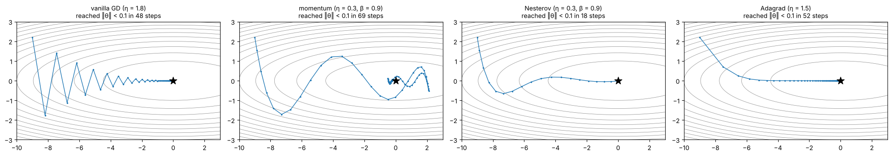
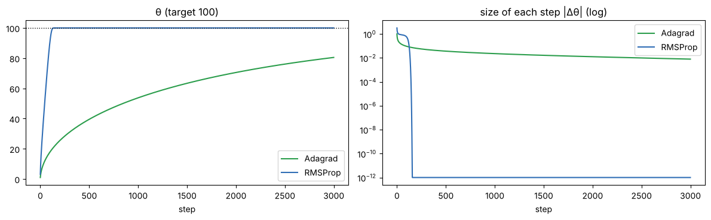

# 13 · Optimizers: GD, SGD, mini-batch, momentum, Nesterov, Adagrad (lectures of 01-09 and 02-09-2026)

**Part 1 (01-09): Optimizers in Neural Networks.** How much data per update: GD vs SGD vs mini-batch SGD.
**Part 2 (02-09): SGD with Momentum, and Adagrad.** What each step is made of.

**Notebook:** `notebooks/13_gd_sgd_momentum_adagrad.ipynb` (iterations per epoch counted, the three paths on a real loss surface, a speed race, momentum/Nesterov/Adagrad built by hand and checked against PyTorch, a fair ravine test of the "2–5×" claim, Adagrad's rare-feature advantage and its stall, a fair race on a real network)

---

## Part 1 (01-09): what an optimizer does

**Training loop:** forward propagation (prediction) → loss → backpropagation (gradients) → **the optimizer updates the weights** → repeat.

> The handout writes "Loss = y − ŷ". Strictly, that is the **error** of one prediction (it can be negative). The **loss** turns errors into one number to minimise, e.g. MSE = mean((y − ŷ)²) (chapter 06).

**Why we need an optimizer:** the gradient only says which way the loss rises fastest. We still need rules for:
- **how big a step** to take (the learning rate);
- **how much data** to look at before each update (all of it, one record, or a batch);
- **how to stay stable** without overshooting or getting stuck.

The choice affects convergence speed, stability, getting stuck in poor minima, and memory/compute per step.

### The one rule everybody shares
**W_new = W_old − η · ∂L/∂W_old**

GD, SGD and mini-batch SGD use **exactly this formula**. They differ only in **how much data is used to compute ∂L/∂W** before each update.

### Gradient Descent (batch GD)
The **whole dataset** goes through one forward and backward pass, then **one** update with the average gradient.
10,000 records → **1 iteration = 1 epoch**. **Iterations per epoch = 1.**
- **+** smooth, stable path; accurate gradient; converges reliably on convex surfaces; easy to debug.
- **−** very slow on big data (a full pass per update); the whole dataset must fit in memory; no online learning; no noise to escape saddles or local minima.

### Stochastic Gradient Descent (SGD)
Update after **every single record**.
10,000 records → **10,000 iterations per epoch**. **Iterations per epoch = N.**
- **+** frequent updates; works for huge data and streaming; very little memory; noise can help escape shallow local minima.
- **−** very noisy path that **oscillates around the minimum** instead of settling; per-record overhead adds up; needs a carefully tuned (often decaying) learning rate; less consistent between runs.

### Mini-batch SGD
Split the data into **batches**, one update per batch.
10,000 records, batch size 1,000 → 10,000 / 1,000 = **10 iterations per epoch**. **Iterations per epoch = N / batch size.**
- **+** balances speed and stability; vectorised, so efficient on GPUs; less variance than SGD but enough noise to escape poor minima; **the standard in practice**.
- **−** batch size is one more hyperparameter; noisier than GD; very large batches lose the helpful noise and get slow, very small ones get unstable; needs memory for one batch.

| Optimizer | Data per update | Iterations per epoch | Path | Memory |
|---|---|---|---|---|
| Gradient Descent | entire dataset | 1 | smooth | high |
| SGD | 1 record | N | very noisy | very low |
| Mini-batch SGD | a batch | N / batch size | moderately noisy | moderate |

### Seen in the notebook (linear regression on 10,000 records)
- Iteration counts: exactly **1 / 10,000 / 10** per epoch.
- On the loss surface, mini-batch (1,000) traces almost the same path as GD; SGD wobbles and keeps jittering near the minimum.

**Race to within 1% of the best loss:**

| | updates | data read | time |
|---|---|---|---|
| GD | 23 | 23 full passes | ~4.5 ms |
| mini-batch 1,000 | 23 | 2.3 passes | ~1.4 ms |
| mini-batch 32 | 150 | 0.48 passes | ~1.5 ms |
| SGD | 1,150 | 0.12 passes | ~10 ms |

SGD reads the least data but is the **slowest in wall-clock time** (50× more updates, each with loop overhead); GD reads the most. **Mini-batches win.**

---

## Part 2 (02-09): momentum, Nesterov and Adagrad

### Why plain gradient descent struggles
**θ_{t+1} = θ_t − η·∇J(θ_t)**. On **ravine-shaped** (ill-conditioned) losses, steep in one direction and shallow in another, it:
- **zig-zags** across the steep direction;
- **crawls** along the shallow direction (small, unrelated steps);
- with mini-batches, follows noisy gradients even near the minimum.

### Momentum: a rolling ball
A ball rolling into a valley keeps some of its speed instead of changing direction instantly. Momentum keeps a **velocity v**, a running (exponentially weighted) sum of past gradients:

**v_t = β·v_{t−1} + η·∇J(θ_t)**,  **θ_{t+1} = θ_t − v_t**,  **v₀ = 0**

- β = momentum coefficient, 0 ≤ β < 1 (commonly **0.9**; typical values **0.9, 0.95, 0.99**).
- **Unrolled:** v_t = η·Σᵢ β^(t−i)·∇J(θᵢ). Recent gradients count most; old ones fade. (Notebook: the recursion and the sum agree to 6 decimals.)
- **EWMA form** (Keras/TensorFlow): v_t = β·v_{t−1} + (1 − β)·g_t. It's the same idea with different bookkeeping (it equals the form above with η rescaled by 1/(1 − β)). PyTorch's `SGD(momentum=0.9)` stores v/η; the notebook shows it gives **identical** weights to the lecture's equations.

**Vector intuition:** the new velocity = (β × old velocity) + (η × new gradient). When gradients keep pointing the same way, they **add up** (speed builds). When they alternate (zig-zag), they **cancel** (oscillation is damped).

**Effective learning rate:** with a constant gradient, v settles at **η / (1 − β)** × g.
**β = 0.9 → 10×, β = 0.99 → 100×** (measured exactly). So a high β needs a smaller η. The build-up takes time: at β = 0.99, about **300 steps** to reach 95% of full speed.

### Nesterov Accelerated Gradient (NAG)
Look ahead before measuring the slope:
**θ̃_t = θ_t − β·v_{t−1}** (where momentum is about to carry you), **v_t = β·v_{t−1} + η·∇J(θ̃_t)**, **θ_{t+1} = θ_t − v_t**.
Classical momentum measures the slope **then** jumps; Nesterov jumps **then** measures and corrects. That means less overshoot.

### Seen in the notebook: the lecture's ravine
J = ½(0.05·θ₁² + 1·θ₂²), start (−9, 2.2):

| Method (hand-picked η) | Steps to the minimum region | What the path looks like |
|---|---|---|
| vanilla GD (η = 1.8) | 48 | **zig-zag** across θ₂, then a crawl along θ₁ |
| momentum (η = 0.3, β = 0.9) | 69 | zig-zag damped, but **overshoots past the minimum** and loops back |
| **Nesterov** (η = 0.3, β = 0.9) | **18** | smooth curve: the look-ahead brakes in time |
| Adagrad (η = 1.5) | 52 | big first step, then straight along θ₁ |

**Fair test: each method at its best η, ravines of increasing steepness ratio:**

| steep : shallow | vanilla | momentum | Nesterov | Adagrad | momentum speed-up |
|---|---|---|---|---|---|
| 5 : 1 | 12 | 10 | 10 | 16 | 1.2× |
| 20 : 1 | 50 | 29 | 15 | 16 | 1.7× |
| 100 : 1 | 231 | 38 | 21 | 16 | 6.1× |
| 1000 : 1 | 2,324 | 100 | 328 | 16 | 23× |

- The lecture's "**often 2–5× fewer iterations**" is a typical middle value; **the worse the ravine, the bigger the gain** (1.2× to 23× here).
- Nesterov usually beats classical momentum, but not always.
- Adagrad's constant 16 steps is a **best case**: here the steep and shallow directions line up with the axes, so per-parameter scaling cancels them perfectly. Real loss surfaces are tilted.

### Momentum summary

| | Vanilla SGD | SGD + momentum |
|---|---|---|
| update | current gradient only | running average (velocity) of gradients |
| in ravines | zig-zags, slow | oscillation damped, faster along the valley |
| noise sensitivity | high | lower (averaging) |
| extra setting | none | β (0.9–0.99) |
| extra memory | none | v (same shape as θ) |
| risk | crawling on plateaus | **overshooting** if β or η is too large |

**+** faster on ravines; smooths mini-batch noise; helps through saddles and shallow minima; just one extra vector. **−** one more hyperparameter; can overshoot; still one global learning rate for all parameters.

---

### Adagrad: a learning rate per parameter
**Problem it solves:** different parameters may need different step sizes. Weights for **rare/sparse** features (rare words, rare items) get a gradient only occasionally and should take **big** steps when they do; frequently-updated weights should take **small, careful** steps.

**g_t = ∇J(θ_t)**
**G_t = G_{t−1} + g_t ⊙ g_t** (G₀ = 0; ⊙ = element by element), i.e. **G_t = Σ gᵢ²**, a running sum of squared gradients per parameter
**θ_{t+1} = θ_t − η / √(G_t + ε) ⊙ g_t**, with ε ≈ 10⁻⁸
**Effective learning rate of parameter i: η_eff,i = η / √(G_t,i + ε)**

Parameters with large or frequent gradients get their rate shrunk hard; rarely-updated ones keep a large rate.

**Seen in the notebook** (logistic regression, 20,000 records, 4 binary features):

| Feature (present in) | G after 20,000 records | effective learning rate |
|---|---|---|
| frequent A (90%) | 4,363 | **0.008** |
| frequent B (70%) | 3,428 | **0.009** |
| rare C (2%) | 48 | **0.072** |
| rare D (1%) | 20 | **0.113** |

The rare features kept **9–14× bigger steps**, the lecture's Fig. 4 pattern.

### Adagrad's big weakness: the learning rate only shrinks
Every term added to G is a square (≥ 0), so **G only grows**, and η/√G **only falls**. On long runs it can approach 0 and **training stalls** before reaching a good minimum.

**Measured:** moving a weight from 0 to a target of 100 (η = 1):
- **Adagrad** after 3,000 steps: θ = **80.5**, and the step size had fallen from 0.31 to **0.008**: stalled short of the target.
- **RMSProp** (a **decaying average** of g² instead of a sum): within 0.01 of **100** after **137 steps**.

That's why **RMSProp, Adadelta and Adam** replaced the ever-growing sum with a moving average that forgets old gradients.

**Adagrad +** no per-parameter tuning; great for **sparse data** (NLP, recommenders, one-hot features); rare parameters catch up; no momentum setting. **−** the decaying learning rate can kill training; can stop early on long deep-learning runs; mostly superseded by RMSProp/Adadelta/Adam.

---

## Three-way summary (lecture)

| | Vanilla SGD | SGD + momentum | Adagrad |
|---|---|---|---|
| core idea | step against the raw gradient | step against a running average (velocity) | step against the gradient, scaled per parameter by squared-gradient history |
| learning rate | fixed, shared | fixed, shared | **adaptive, per parameter, shrinking** |
| extra state | none | velocity v | accumulator G |
| extra setting | none | β | none (only ε) |
| good for | simple, well-conditioned problems | ravines / ill-conditioned losses | sparse data (NLP, text) |
| main weakness | slow in ravines, noise-sensitive | extra tuning; can overshoot | learning rate → 0, stalls |

**Real-network race (notebook):** a digits MLP, each optimizer at its best learning rate. Test accuracy: SGD 96.9%, momentum 97.0%, Nesterov 96.7%, Adagrad 97.3%, Adam 97.0%, all **within noise**. Their best learning rates differed hugely (0.3 / 0.1 / 0.1 / 0.03 / 0.001). **On small problems the learning rate matters more than the optimizer, and you must never reuse one optimizer's η for another.**

**Key takeaways:**
- Momentum = averaging gradients over **time** (damps oscillation, speeds up valleys); β sets how much history; Nesterov adds a look-ahead.
- Adagrad = scaling **per parameter** by gradient history (big steps for rare parameters), but its learning rate decays forever.
- **Both ideas combined, with forgetting, give RMSProp and Adam.**

---

## Check yourself

1. 50,000 records, batch size 500: iterations per epoch for GD, SGD and mini-batch SGD?
2. What is the only thing that differs between GD, SGD and mini-batch SGD?
3. Why can SGD with a fixed learning rate never settle exactly at the minimum?
4. Give two reasons mini-batch SGD is the default.
5. v₀ = 0, β = 0.9, η = 0.1, gradients 1, 1, 1: compute v₁, v₂, v₃. What value does v approach?
6. β = 0.95: what is the step amplification? Why does a large β need a smaller η?
7. What does Nesterov do differently from classical momentum?
8. Adagrad with η = 0.1: a parameter's gradients so far were 3 and 4. What are G and the effective learning rate? Another parameter's only gradient was 0.5: its effective learning rate?
9. Why does Adagrad suit sparse NLP features?
10. Why does Adagrad stall on long runs, and how does RMSProp fix it?

Answers

1. GD **1**; SGD **50,000**; mini-batch 50,000/500 = **100**.
2. How much data is used to compute each gradient (the update formula is identical).
3. Each update follows one record's noisy gradient, so it keeps jittering around the minimum (a decaying learning rate fixes this).
4. Vectorised and fast on GPUs; less noisy than SGD but with enough noise to escape poor minima; far less memory than full GD.
5. v₁ = 0.1; v₂ = 0.9·0.1 + 0.1 = 0.19; v₃ = 0.9·0.19 + 0.1 = **0.271**; it approaches η/(1 − β) = **1.0**.
6. 1/(1 − 0.95) = **20×**. The effective step is η/(1 − β), so a large β multiplies η: keep the product sensible or it overshoots.
7. It computes the gradient at the look-ahead point θ − βv (where momentum is about to take it), then corrects, which reduces overshoot.
8. G = 9 + 16 = **25** → 0.1/5 = **0.02**. Second parameter: G = 0.25 → 0.1/0.5 = **0.2** (10× bigger).
9. Rare words' weights get gradients only occasionally, so their G stays small and they keep large steps when they do appear.
10. G is a sum of squares, so it only grows and η/√G → 0. RMSProp uses an exponentially **decaying average** of g², so old gradients are forgotten and the step size can recover.

