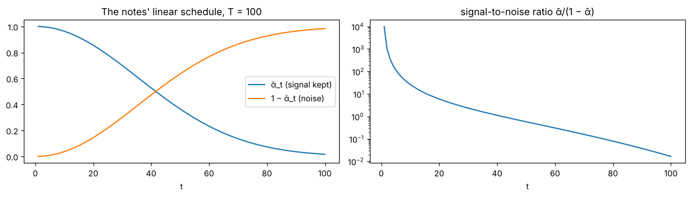
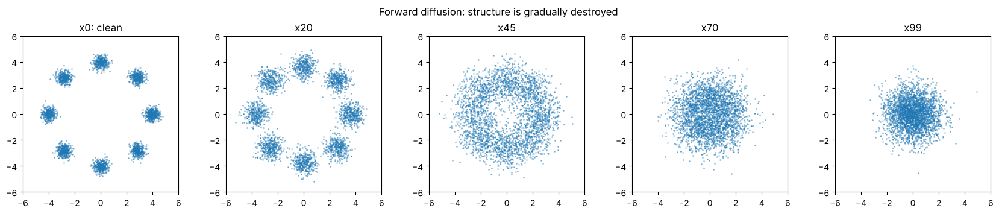
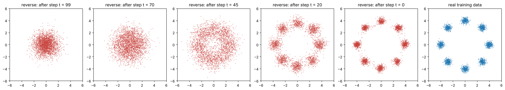
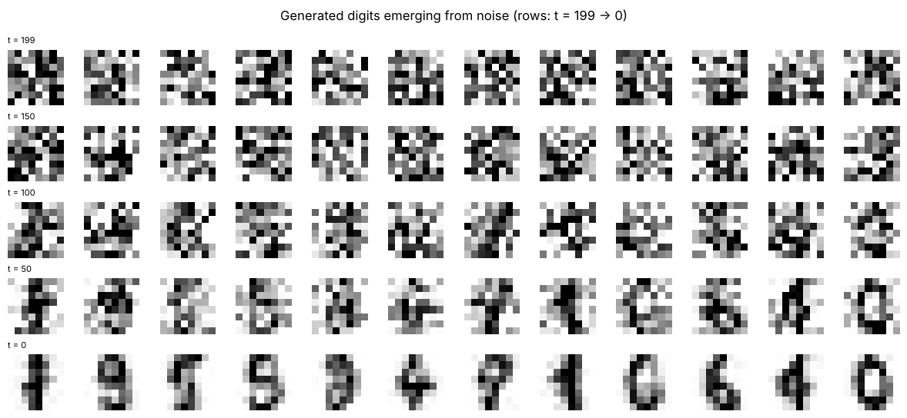
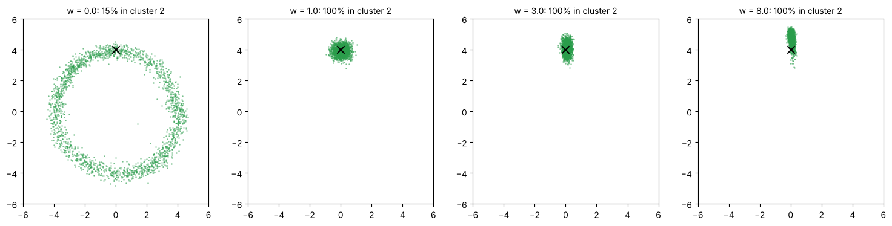

# 15 · Diffusion models: from noise to data (GenAI study notes)

**Source:** *Diffusion Models: From Noise to Data* (Polaris) · `course-files/GenAI_Diffusion_Models_Study_Notes.pdf`

**Notebook:** `notebooks/15_diffusion_models.ipynb` (the notes' numbers checked, closed form vs 100 small steps, the schedule's signal-to-noise ratio, **the notes' exact ring lab** with mode-coverage measurements, error per timestep, 10-step DDIM sampling, class conditioning with classifier-free guidance, and a model that **draws handwritten digits**)

> **Core idea:** a diffusion model learns to **reverse a known corruption process**. In training we deliberately destroy structure with Gaussian noise and teach a network to predict that noise. To generate, we start from pure random noise and **repeatedly denoise**.

**real data x₀ → add noise → nearly Gaussian noise x_T → learned denoising → new sample**

| Question | Short answer |
|---|---|
| What is learned? | a network ε_θ that predicts the noise (or x₀, velocity, score) |
| What is fixed? | the forward noise **schedule**, chosen in advance |
| Why many steps? | each small reverse step is much easier than generating in one jump |
| Where is it used? | images (generation, editing, super-resolution), audio, video, science |

---

## 1. Why destroy data first?

Sampling directly from a complex high-dimensional distribution (faces, speech, molecules) is hard. Diffusion builds a **simple path** between data and Gaussian noise.

| Hard view | Diffusion view |
|---|---|
| map one random vector to a perfect image in one big non-linear jump | learn a sequence of **small corrections**: slightly noisy → slightly cleaner → … → data |

**The thought process:** (1) choose a corruption with easy-to-compute probabilities; (2) train on **many noise levels** so the model learns what structure looks like at each one; (3) at sampling time, approximately invert the corruption.
*Analogy:* it's easier to repeatedly restore a slightly damaged drawing than to draw a masterpiece from a blank page in one go.

---

## 2. The forward process q (fixed, not learned)

One step keeps most of the signal and adds a little fresh noise:

**q(x_t | x_{t−1}) = N(√α_t·x_{t−1}, β_t·I),  i.e. x_t = √α_t·x_{t−1} + √β_t·ε,  ε ~ N(0, I)**

| Symbol | Meaning | Intuition |
|---|---|---|
| β_t | noise **variance** added at step t | small β = gentle corruption |
| α_t | 1 − β_t | how much signal is kept |
| ε | standard Gaussian noise | a random direction of corruption |
| I | identity covariance | independent unit noise per dimension |

**Why square roots?** Variances add through **squared** scale factors: scaling noise by √β gives it variance β. Example: β = 0.04 → x_t = √0.96·x_{t−1} + **0.2**·ε (the noise coefficient is 0.2, not 0.04).

### The closed form: jump straight to any t
**ᾱ_t = α₁·α₂·…·α_t** (the cumulative signal retention), and

**q(x_t | x₀) = N(√ᾱ_t·x₀, (1 − ᾱ_t)·I),  i.e. x_t = √ᾱ_t·x₀ + √(1 − ᾱ_t)·ε**

- Notes' example: ᾱ = 0.64 → **x_t = 0.8·x₀ + 0.6·ε** (0.8² + 0.6² = 1, so unit-variance data keeps variance 1).
- Exam Q1: ᾱ = 0.81 → x_t = **0.9·x₀ + 0.436·ε**. Not 0.81 and 0.19: those are **variances**; the coefficients are their square roots.
- **Checked:** pushing 200,000 copies of a point through 50 individual steps gives exactly the closed-form mean and std (1.813, −1.21; std 0.797). Training never has to run the chain.

---

## 3. Noise schedules

The schedule is β₁ … β_T. Early DDPMs used **linear** schedules; later systems use cosine-like ones.

| Choice | Effect | Reason |
|---|---|---|
| small T | fewer denoising steps | faster, but each reverse step must correct more |
| large T | many gentle steps | easier transitions, more sampling cost |
| noise too fast | signal gone early | middle timesteps carry little information |
| noise too slow | structure remains at the end | x_T is less like the pure noise sampling starts from |

**Signal-to-noise ratio: SNR(t) = ᾱ_t / (1 − ᾱ_t)**, high early, low late. One network must denoise across the whole range.

**The notes' schedule (β linear from 0.0001 to 0.08, T = 100), measured:**

| t | ᾱ_t | signal coef √ᾱ | noise coef | SNR |
|---|---|---|---|---|
| 10 | 0.963 | 0.981 | 0.192 | 26.2 |
| 25 | 0.782 | 0.884 | 0.467 | 3.6 |
| 50 | 0.365 | 0.604 | 0.797 | 0.58 |
| 75 | 0.101 | 0.318 | 0.948 | 0.11 |
| 100 | 0.016 | **0.128** | 0.992 | 0.017 |

At t = 100, **12.8%** of the signal amplitude survives: close to noise but not quite (a mild case of "noise too slow"). It works fine here.



---

## 4. The reverse process (learned)

**p_θ(x_{t−1} | x_t) = N(μ_θ(x_t, t), Σ_t)**: the true reverse step is unknown for real data, so a network approximates it.
- **θ** = all the learnable weights (convolutions, linear layers, attention, norms): what gradient descent changes.
- **One shared network for all t.** The timestep is fed in as an **embedding**, so the same weights behave differently at different noise levels.

### Predict the noise
We sampled ε ourselves, so it's a **known target**: the network learns **ε_θ(x_t, t) ≈ ε**. From the predicted noise the reverse mean can be computed. Generative modelling becomes **ordinary regression**. (Other choices: predict x₀, a velocity v, or the **score**: ∇ₓ log q_t(x) ≈ −ε_θ(x, t)/√(1 − ᾱ_t), which points towards higher probability density.)

### The training objective
**L = E_{x₀, t, ε} [ ‖ε − ε_θ(x_t, t)‖² ]**

One training example: sample clean x₀ → sample t → sample ε → build x_t with the closed form → predict ε_θ → MSE with the true ε → backprop and update θ.
**What changes:** the schedule stays fixed; the random noise changes every batch; the **weights** change. *No manual labels are needed: the corruption creates unlimited training pairs.*

| Noise level | x_t looks like | The network learns |
|---|---|---|
| low t | almost clean | fine details, textures |
| middle t | structure + lots of noise | shapes, parts, consistency |
| high t | mostly noise | coarse global structure |

**Timestep embedding:** sinusoidal features of t (the same idea as Transformer positional encodings, chapter 09).

### Why the loss never reaches 0 (measured, with a twist)
Error of the trained ring model **per timestep**: t = 0 → **1.04**, t = 25 → 0.37, t = 99 → **0.12**.
- With **noise** prediction, the error is **largest at low noise**: the added noise (coefficient 0.01) is tiny next to the data's own spread (0.28), so it can't be separated. Luckily, those errors barely matter, because they're multiplied by that tiny coefficient.
- At high noise, x_t is almost pure noise, so predicting ε is easy. What is **ambiguous** there is the **clean** x₀ (the notes' explanation): several clean points explain the same noisy one.
- Either way, **some error is irreducible**, so the loss settles above 0 (≈ 0.41 in the lab).

---

## 5. Sampling (generation)

```
x = randn(shape)                       # x_T
for t in reversed(range(T)):
    eps = model(x, t)                  # predict noise
    mean = (x - beta_t / sqrt(1 - abar_t) * eps) / sqrt(alpha_t)
    x = mean + sigma_t * randn_like(x) if t > 0 else mean
```

| Training | Sampling |
|---|---|
| a random t per example; very parallel | sequential: x_{t−1} needs x_t |
| known target noise | no target; the model makes its own trajectory |
| weights updated | weights frozen |

The network runs tens to hundreds of times per sample, which is why **faster samplers** and **latent spaces** matter.

### DDPM vs DDIM and faster samplers (measured)
The trained denoiser and the **sampler** are separate. A deterministic DDIM-style sampler jumps between spaced timesteps, with **no retraining**:

| Sampler | Network calls | Within 1.0 of a cluster centre | Empty modes |
|---|---|---|---|
| DDPM | 100 | 97.8% | 0 |
| DDIM | 10 | 93.4% (~15× faster) | 0 |
| DDIM | 3 | 53.8% (smeared) | 0 |

Three different numbers: **training timesteps** (T = 100), **sampling steps** (10), **parameters** (37,762). "More steps always better" is false, and so is "fewer is free".

---

## 6. The notes' lab (run in the notebook)

8 Gaussian clusters on a ring (12,000 points), T = 100, an MLP (2 + 32 → 128 → 128 → 128 → 2, SiLU) with a 32-dimensional sinusoidal timestep embedding, Adam (lr 2e-3), 2,500 steps of batch 256.




**Measured:** 37,762 parameters, trained in **~6 s** (the notes: ~7 s).
- Median distance to the nearest true centre: generated **0.355** vs real 0.327.
- **97.8%** of generated points within 1.0 of a centre (real: 99.9%).
- **All 8 modes covered**, 317–418 points each (ideal 375): no mode collapse (unlike GANs, `computer-vision/week-4-gans`).

It learned the **probability structure**, not individual coordinates. *Classroom question:* why can a 2-D model learn something complicated? Because the complexity lies in the **density**, not in the number of dimensions.

---

## 7. Images, conditioning, guidance, latent diffusion

**From toy to images:** the equations barely change; the **denoiser** does. 2-D points → an MLP; images → a **U-Net** (downsample for global context, upsample back, with **skip connections** carrying fine detail) with attention, or a **Diffusion Transformer (DiT)** on image/latent patches.

**Beyond the notes, measured:** the same training loop on the 1,797 **8×8 digits** (T = 200, a 624K-parameter MLP, under a minute) generates recognisable new 0s, 1s, 4s, 6s and 9s. It isn't copying: generated digits are a median **2.47** from their nearest training digit (real digits are 2.02 from each other), and **0 of 48** were near-copies.



### Conditioning
Unconditional: learn p(x). Conditional: learn **p(x | c)**, with c = text, a class label, an image, a mask… so **ε_θ(x_t, t) → ε_θ(x_t, t, c)**. For **text-to-image**: prompt → text encoder → text vectors; the denoiser's features **cross-attend** to them (Q from the image/latent, K and V from the text: the same mechanism as encoder-decoder models, chapter 12). The question changes from "what makes this look like any likely sample?" to "what makes it likely **and** compatible with the prompt?"

### Classifier-free guidance (CFG)
During training, **drop the condition sometimes**, so one network learns both conditional and unconditional denoising. At sampling time:

**ε_guided = ε_uncond + w·(ε_cond − ε_uncond)**

The difference (ε_cond − ε_uncond) is "the direction of the condition"; w scales it.

**Measured** (ring, asking for cluster 2, condition dropped 15% of the time in training):

| w | lands in the requested cluster | spread inside it (data 0.28) |
|---|---|---|
| 0 | 14.6% (≈ 1/8, condition ignored) | 0.53 |
| 1 | **100%** | 0.286 (natural) |
| 3 | 100% | 0.257 |
| 8 | 100% | **0.234** (tighter than the real data) |

**Higher w → stronger alignment but less diversity** (and, in image models, over-saturated "too perfect" images): the notes' table, measured.



### Latent diffusion
Pixel space is expensive (a 512×512 RGB image has 786,432 numbers). **Image → VAE encoder → small latent z → diffusion in z-space → VAE decoder → image.** The VAE handles compression; the diffusion model learns the distribution **inside** the latent space. The VAE is **not** the diffusion model.

---

## 8. Use cases and design thinking

| Use case | Condition / input | Output |
|---|---|---|
| text-to-image | prompt embeddings | a new image consistent with the text |
| inpainting | image + mask + prompt | a filled-in region consistent with the surroundings |
| super-resolution | low-resolution image | plausible high-resolution version |
| image-to-image | source image + condition | controlled transformation |
| audio/speech | text, spectrogram, audio features | waveform or acoustic features |
| video | text/images/frames | temporally coherent frames |
| science | physical/chemical constraints | molecules, proteins, structures |

Diffusion suits **editing** naturally: it can start from a partially corrupted or constrained input.

**Designing a diffusion model:** (1) representation (pixels, latents, spectrograms, coordinates); (2) corruption (Gaussian for continuous data); (3) target (ε, x₀, v, score); (4) backbone (MLP / U-Net / DiT); (5) conditioning (labels, text, masks); (6) schedule and sampler; (7) evaluation (task metrics + human evaluation, not just "looks good").
*Two-way doors:* the sampler, step count and guidance scale are cheap to change. *One-way doors:* the representation and backbone affect training.

### Misconceptions (all false)
- "The model adds noise during generation." (It predicts a denoising quantity; the **sampler** may add controlled noise.)
- "There's one network per t." (One shared network, conditioned on t.)
- "ᾱ is a trainable weight." (It comes from the fixed schedule.)
- "The model learns to reconstruct each training image." (It learns statistical denoising: the digits test found 0 copies.)
- "Diffusion always works in pixels." (Latent diffusion.)
- "Text is concatenated to pixels." (Encoded, then injected via cross-attention.)
- "More sampling steps always means better." (Measured: 10 DDIM steps ≈ 100 DDPM steps.)

**One-page story:** forward x_t = √ᾱ_t·x₀ + √(1 − ᾱ_t)·ε → train: minimise ‖ε − ε_θ(x_t, t, c)‖² → sample: start from Gaussian noise and apply the reverse update repeatedly → generated sample.

---

## Check yourself (the notes' questions)

1. ᾱ_t = 0.81. Write x_t. What signal/noise intuition does it give? Why 0.9 and 0.436 rather than 0.81 and 0.19?
2. Why is noise-prediction MSE enough to train a generator, though there are no "correct generated image" labels? What is sampled, what is known, what changes?
3. Moving from the 2-D toy to text-conditioned 256×256 images: name four changes (U-Net/DiT, timestep embeddings, text embeddings + cross-attention, latent diffusion).
4. β_t = 0.04: write one forward step.
5. What does the guidance scale w trade off?
6. Training timesteps vs sampling steps vs parameters: give the three numbers from the lab.

<details><summary>Answers</summary>

1. x_t = 0.9·x₀ + 0.436·ε: 81% of the **variance** is still signal and 19% is noise (amplitudes 0.9 and 0.436). The coefficients multiply standard deviations, so they're the square roots of the variances.
2. We choose x₀ (from the data), t and ε ourselves, so the target ε is known exactly; the network sees x_t and t and is trained by MSE to recover ε. Sampled: x₀, t, ε. Known: the schedule and the injected ε. Changing: the network weights θ. Predicting the noise at every level is equivalent to learning the score, i.e. the direction towards likely data, which is all the sampler needs.
3. (a) A U-Net or DiT backbone instead of an MLP, for spatial structure. (b) Timestep embeddings injected into many blocks. (c) A text encoder whose embeddings are used through cross-attention (plus classifier-free guidance). (d) Latent diffusion: a VAE compresses 256×256×3 into a small latent, so diffusion is cheaper. Also image-specific evaluation.
4. x_t = √0.96·x_{t−1} + 0.2·ε.
5. Alignment with the condition vs diversity (and artefacts): w = 1 was natural; w = 8 squeezed samples tighter than the real data.
6. T = 100 training timesteps; 10 (DDIM) or 100 (DDPM) sampling steps; 37,762 parameters.
</details>
